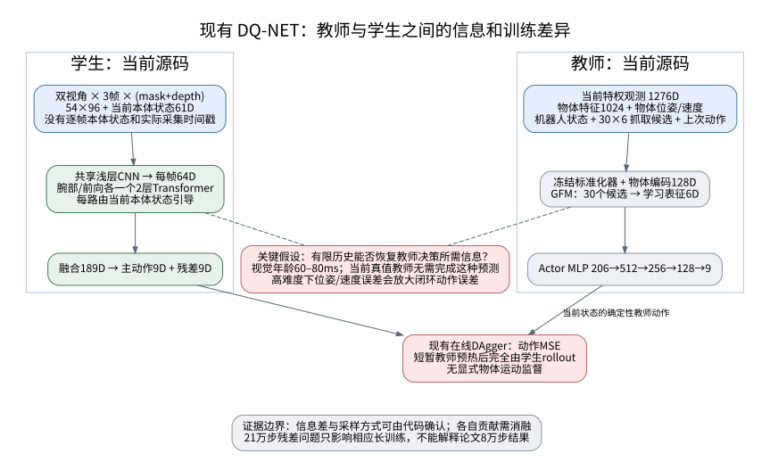
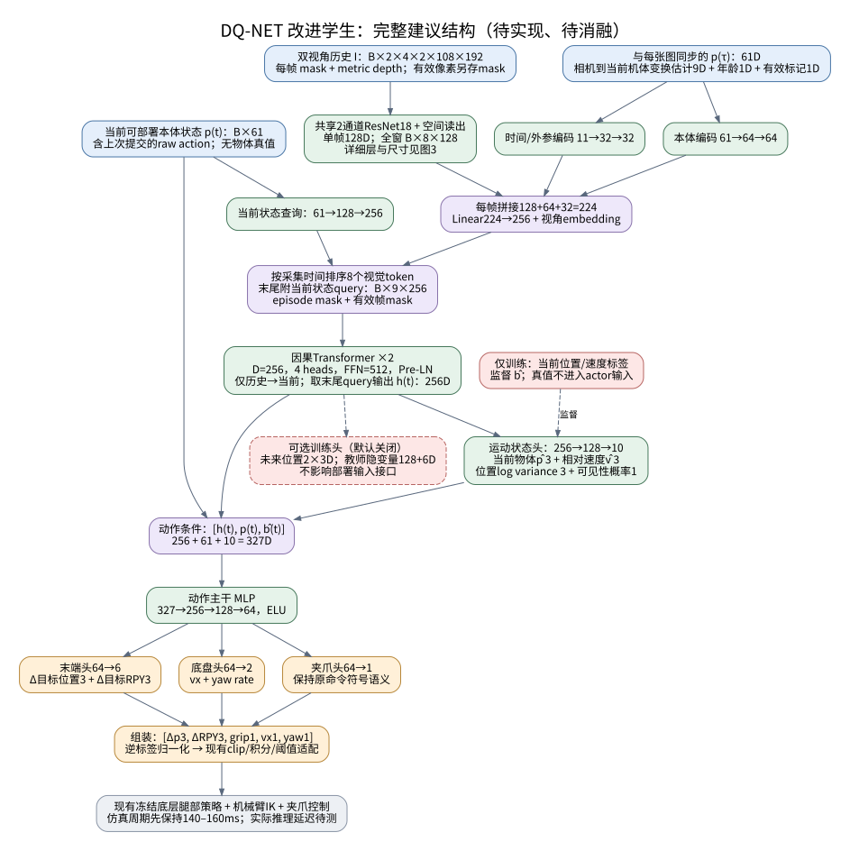
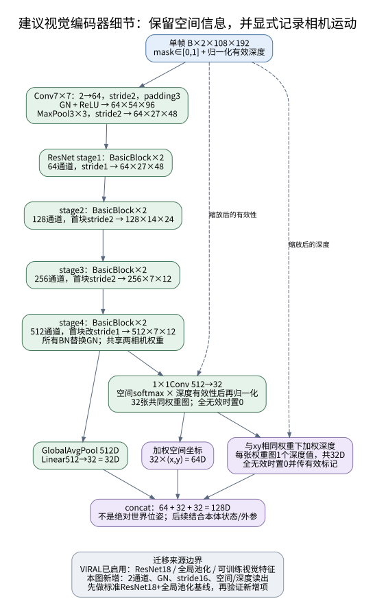
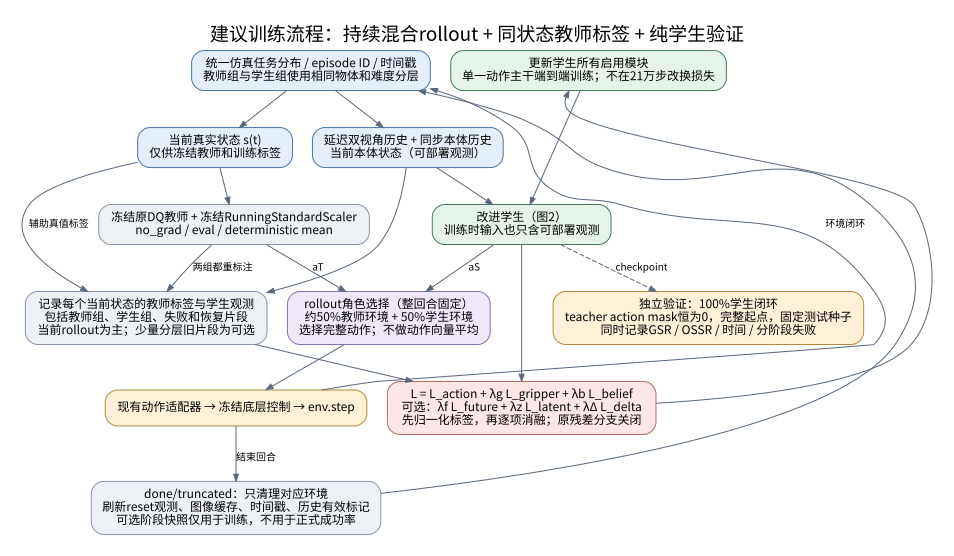
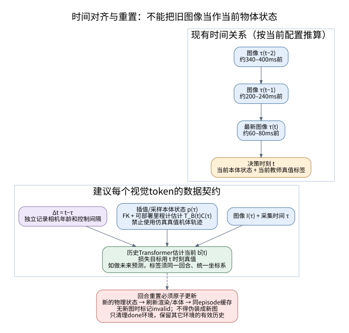

# DQ-NET 教师—学生成功率差距分析与改进方案

> 核查日期：2026-10-13。依据为用户提供的两份 PDF、两套本地源码及其配置/调用链。本文完成的是论文与源码审查、网络和实验方案设计；没有重跑策略训练，也没有把设计目标写成实测收益。

**核心判断：最有证据支持的首要解释是，DQ-NET 学生必须从有限、延迟且随机器人运动的视觉历史中，恢复教师直接获得的目标几何和运动信息；当前训练又主要用最终动作 MSE 监督这种恢复。VIRAL 值得优先借鉴的是持续混合教师轨迹与学生纠错轨迹、较强视觉表征、充分的并行采样以及严格的传感器/控制接口。** 同时，本地 DQ 代码存在需要先排除的重置观测和后期残差训练风险。各因素对成功率的贡献仍需受控实验确定。

不能将两篇论文的总成功率直接作同任务排名：DQ 是移动目标抓取，VIRAL 是人形机器人长程搬放任务；VIRAL 的“接近”也没有 DQ 表 1 那样的严格配对教师/学生数据表。

## 1. 范围、证据和版本

| 对象 | 本次核查版本 | 说明 |
|---|---|---|
| [DQ-NET 论文](DQ-NET.pdf) | arXiv:2508.08328v1 | PDF 物理页码从 1 开始 |
| [VIRAL 论文](/home/hehui/GR00T-VisualSim2Real/doc/VIRAL.pdf) | arXiv:2511.15200v2 | 附录内部重新编号，本文统一用 PDF 物理页码 |
| DQ 源码 | `f463245fc20b79ef8c58309c086fe4e3cee33dad` | 当前配置已包含降低难度、教师/学生环境对齐等本地修改 |
| VIRAL 源码 | `92bf0863d4a9b6ee29849736152b7769bd45c49c` | 按 README 学生实验入口追踪，不能推定等同作者所有论文运行参数 |

已在线核对论文身份和官方项目入口：[DQ arXiv](https://arxiv.org/abs/2508.08328)、[VIRAL arXiv](https://arxiv.org/abs/2511.15200)、[VIRAL 官方项目](https://viral-humanoid.github.io/)。下文详细数值以本地 PDF 为准，实现结论以本地上述提交为准。

本文区分三类结论：**论文证据**是作者实际报告的结果；**源码事实**是生效调用链/配置可确认的行为；**机制推论与设计**需要通过新实验检验。发现潜在实现问题不等于已经证明它导致论文中的某一百分比损失。

## 2. 先核对成功率：差距有多大？

### 2.1 DQ-NET 的差距确实显著

[DQ-NET PDF 第 6 页表 1](DQ-NET.pdf#page=6)的完整方法结果如下。百分比是成功率；差值单位是**百分点**。

| 难度 | 教师 GSR-T | 学生 GSR-S | 教师−学生 | 学生/教师 | 学生 OSSR |
|---|---:|---:|---:|---:|---:|
| Level 1 | 80.8% | 55.8% | 25.0 | 69.1% | 53.2% |
| Level 2 | 80.8% | 55.6% | 25.2 | 68.8% | 53.2% |
| Level 3 | 77.9% | 44.8% | 33.1 | 57.5% | 41.8% |
| Level 4 | 74.3% | 41.0% | 33.3 | 55.2% | 38.5% |

从 L1 到 L4，教师下降 6.5 个百分点，学生下降 14.8 个百分点。这说明复杂运动对学生造成了更大的额外困难，但还不能据此分配每个模块的因果贡献。

论文第 3、5 页给出的重要条件是：L1 固定直线/圆弧、0–15 cm/s；L2 固定轨迹、15–30 cm/s；L3 随机平面运动；L4 加入竖直方向运动。所有方法在 L4 训练，在 L1–L4 测试，每级运行 5,000 **steps**，不是 5,000 个独立回合。教师使用 6,000 个并行环境，学生 200 个，一张 RTX 4090，论文称各训练 80,000 timesteps。

主表未给学生的种子数、独立回合数和误差条，因此不能凭表中数字补出统计显著性。附录第 15 页表 7 另给教师 mean±std，但不能替代学生的统计信息。

### 2.2 VIRAL 是“大致接近”，不是严格证明师生等效

| VIRAL 结果 | 论文位置 | 可以怎样理解 |
|---|---|---|
| 教师约 95% | PDF 第 6 页 §4.1、图 9；第 7 页图 14 | 教师训练/规模实验的近似终点 |
| 学生约 88–89% | PDF 第 8 页图 15 | 从学生曲线读取的近似值，非表格精确统计 |
| 真机 54/59，约 91.5% | PDF 第 5 页 §3.1 | 视觉学生真实部署结果 |
| 人类专家 100% | PDF 第 5 页图 7、第 6 页正文 | 遥操作专家，**不是特权 RL 教师** |

这些图支持“视觉学生保留了较多教师能力”，但教师约 95%与学生约 88–89%来自不同实验图，不能当成严格同场景、同起点、同预算的配对差值。VIRAL 的任务也不是 DQ-Bench 最高约 30 cm/s 的随机三维移动目标抓取。

预算差异尤其大：VIRAL 论文使用 16 张 L40S 训练教师、64 张训练学生；教师约 3.28 万并行环境、学生约 6.55 万。附表 6 写成 `65535 (1024×8×8)`，乘法结果应为 65536，本文采用“约 6.55 万”，不掩盖这一排印差异。源码 README 的单进程 8 环境示例只是调试入口。（VIRAL PDF 第 3、16 页；[V1]、[V2]）

## 3. DQ 学生为什么会掉这么多：论文与源码形成的证据链



[查看 PNG](assets/dq_viral_improvement_20261013/01_evidence_and_gap.png)。蓝色为输入，绿色为可训练模块，灰色为冻结或现有模块，紫色为张量处理，橙色为执行，红色为损失/待排查风险。此图是机制解释，不是已测得的因果分解。

### 3.1 最根本的信息差：教师知道的内容，学生并非都能从图像恢复

README 默认高层路径下，教师观测为 1276 维。物体离线特征为 1024 维，物体位姿为 6 维，机器人局部速度为 3 维，目标相对平面速度为 2 维，抓取候选为 30×6 维。剩余是机器人状态和上一动作。教师特征编码是 `1024→512→128`，GFM 将候选注意力聚合成 6 维表征，控制 MLP 为 `206→512→256→128→9`。[D1]、[D2]、[D3]

学生保留的数值状态只有 61 维：

| 内容 | 维度 |
|---|---:|
| 当前末端位置和 RPY | 6 |
| 关节位置（含夹爪） | 19 |
| 关节速度（不含夹爪，已缩放） | 18 |
| 当前底盘命令 | 3 |
| 当前末端目标位置和 RPY | 6 |
| 上一高层动作 | 9 |
| 合计 | 61 |

学生没有物体位姿、目标速度、物体离线特征、30 个抓取候选，**也没有上述机器人局部速度**。输入为前向/腕部两视角的三帧 mask 和目标 masked depth，再加当前 61 维状态。[D4]、[D5]

因此教师的任务是“根据当前已知几何和运动选动作”，学生则要从目标 mask/depth 恢复几何与位置，同时解决遮挡下跟踪、相机自运动分离、运动预测和动作生成。当前仿真已有目标分割，实机上游分割/跟踪的误差应另行测试。不能把这看成同一输入上的简单模型压缩。

在部分观测下，若相似的学生历史对应不同的真实目标状态，平方损失的理想解近似为：

\[
\pi_S(o_{\le t})=\mathbb E[\pi_T(s_t)\mid o_{\le t}].
\]

这个动作条件均值未必对应有效的抓取方向或闭合时机。加大网络可减少拟合误差，却不能恢复根本不可辨识的信息。这个解释也与 DQ 论文第 14 页作者自述的局限一致：有限视觉难以复现使用精确位姿/速度的教师，快速、不规则运动会扩大差距。

### 3.2 实际是“用旧图像预测当前动作”，还缺少显式时间与自运动信息

当前配置及实际循环给出：[D6]、[D7]

\[
\Delta t_{low}=0.005\times4=0.020\,s,
\qquad\Delta t_{high}=0.020\times(7\sim8)=0.14\sim0.16\,s.
\]

其中 7–8 来自 README 启用的 `--rand_control`。相机在高层周期结束之前采图，`imgDelayFrame=4` 在代码中随机取 3–4 个**低层周期**，故最新图像年龄约为 60–80 ms；不是 4 个高层周期，也不是简单的 4×仿真 dt。

三帧对应的首末决策时刻跨度约 280–320 ms；再考虑每步采图延迟随机变化，实际采集时刻的首末跨度约 260–340 ms。网络只有帧序号位置编码，没有每张图的真实时间戳、捕获时本体状态、对应相机姿态。腕部相机移动和机器人底盘移动都可能表现为目标在图像中移动。

以 0.3 m/s 为例，仅 60–80 ms 感知延迟就对应 1.8–2.4 cm 目标位移；这是量纲示例，并非实测误差。它已与代码每高层步末端位置增量裁剪 ±2 cm 同量级。学生必须学会预测补偿，而教师监督使用当前真值动作。该监督目标本身可以成立，问题是现有输入和训练是否足以学会预测，不能简单将教师标签改成旧时刻动作，否则只是学会跟随过去。[D7]、[D8]

### 3.3 视觉压缩和融合方式可能限制精细运动估计

当前学生共享 CNN 为两层卷积 `2→16→32`，其特征图先展平，经 `32384→128→64` 压缩为每帧一个 64 维 token。腕部与前向各有两层、两头 Transformer，先分别处理三帧和一个当前状态 token，视觉 token 平均后再融合。它并不是对空间 patch 做跨视角注意力，也不是维护长期隐状态的 RNN。[D5]、[D9]

这个结构已经比论文 CNN 基线好：DQ 表 2 中 L4 从 36.14%提高到 41.04%，同时参数由 8.43M 降到 5.37M。它证明当前时序结构有效，也说明“只要参数更多”不是充分解释。进一步保留局部空间信息、让历史视觉与历史本体同步，是有针对性的实验方向。

另一个细节是当前深度只保留目标区域，近于约 0.15 m 的深度置零，远处按 3 m 裁剪/归一化。遮挡和极近距离阶段可能缺失有用深度，必须按阶段统计有效像素比例；不能看到输入有 depth 就认为接触前始终有可靠几何。[D10]

### 3.4 已有 DAgger，但采样方式与 VIRAL 不同

**DQ 并不是纯离线 BC。** 每步都计算教师与学生动作；预热阶段执行教师，之后执行学生，并持续用教师给学生所到状态打标签。默认预热 4000 步，启用 `depth_random` 时为 8000 步。[D11]、[D12]

差别在于 DQ 之后完全切为学生 rollout，VIRAL 默认持续保留约一半教师 rollout。前者能覆盖学生错误，但弱学生可能难以反复到达优质的对准、闭合和抬升状态；后者持续补充这些状态。这个解释需要用各阶段样本比例验证。

DQ 默认缓存为 `24×200=4800` transitions，每轮训练 5 epochs、6 mini-batches，之后环形覆盖，没有跨轮的长期经验库。它是在线 DAgger 风格学习；不应因没有长期 replay 就说“没有 DAgger”。VIRAL 当前主线也每轮清空缓存，所以长期 replay 是可选新增设计，并非直接照搬 VIRAL。[D12]、[D13]、[V3]

论文两者都写 80,000 timesteps，不代表等数据量。按此源码的“每轮对全部环境执行一步”语义，若对应论文同样的计数方式，则学生约 1600 万、教师约 4.8 亿环境 transitions；这是预算量级推算，不能由此证明样本量就是唯一瓶颈，亦不能保证论文实际运行配置完全等同当前代码。

### 3.5 最终动作 MSE 没有直接教学生理解“为什么这样抓”

默认损失只回归 9 维动作，没有物体运动、抓取表征或接触时机的中间监督；记录 reward 不代表学生在做 RL。平移、旋转、夹爪、底盘速度的单位和执行灵敏度不同，统一 raw MSE 可能掩盖关键动作的错误。[D13]

执行端有明显非线性：平移裁 ±0.02、旋转裁 ±0.06、夹爪按索引6（第7个分量）的符号开合、底盘速度和 yaw rate 另行裁剪。两种 raw action 可能执行得几乎一样，而夹爪符号的微小变化却可能决定成功与否。因此应同时记录执行后误差、夹爪符号/时序错率、饱和率与闭环成功率。[D8]

也不建议为了让学生“容易学”直接删除教师速度。DQ 表 1 的 L4 消融是：

| 变体 | 教师 | 学生 | 差距 |
|---|---:|---:|---:|
| 去 GFM | 55.0% | 33.3% | 21.7 pp |
| 去速度 | 70.3% | 34.8% | 35.5 pp |
| 完整 DQ | 74.3% | 41.0% | 33.3 pp |

去速度反而扩大差距；去 GFM 虽缩小差值，却同时降低了学生性能。**正确目标是提高学生绝对成功率并保留教师能力，不能靠降低教师上限制造“小差距”。** GFM 给教师带来 19.3 pp、给学生带来 7.7 pp，提示其收益传递不充分，但不能单凭这个表断言一种中间损失一定能补齐。

## 4. 当前源码需要先处理的工程和评测问题

### 4.1 P0：reset 后学生可能拿到上一回合的观测

调用链为 `DAggerTrainer → wrapper.reset → B1Z1Base.reset → _reset_envs → VecTask.reset/get_state`。[D14]

`_reset_envs` 会重置物理状态、刷新张量、重算教师 `_compute_observations`，但没有同步重建 `states_buf` 或重新采图；`get_state()` 返回已有学生缓存。直到下一次物理 step 的 `make_img_obs/_compute_states_buf` 才更新。因而 reset 后首个学生输入仍可能是上一回合末尾数据，教师标签却来自新回合；初始启动还可能是零缓存。训练与学生评估都经过这一路径。

这是可由源码确认的接口风险；它对最终 GSR 的幅度尚未测量。修复必须做到：新物理状态、末端目标/累计命令、当前本体状态先一致，再构建 reset 观测；图像/历史有明确 episode ID。真实延迟场景若还没有新图，应清空旧回合有效标记并等待/执行预定安全初始命令，不能把旧图伪装成新图。只处理发生 reset 的环境，不能清空全部并行环境历史。

### 4.2 P0：21 万步后的残差训练目标存在不一致

当前学生输出 `a=b+r`。21 万步前冻结残差参数，但残差仍参与前向、且没有零初始化；之后冻结其它参数，只训练残差，目标是：

\[
\mathcal L_{res}=\|r_{new}-(a_T-a_{old})\|^2,
\qquad a_{old}=b+r_{old}.
\]

这会再次减去已有残差。对同一状态、固定主策略和教师的简化稳定点，有 `r=(aT−b)/2`，最终仍留下约一半主策略误差。这是简化代数分析，不是实际网络收敛定理。[D5]、[D13]

更一致的做法是直接最小化 `MSE(b+r,aT)`，或者监督 `r=aT−stopgrad(b)`。本方案首版直接使用单一动作主干、端到端训练，取消硬编码 210000 步切换；如保留残差，末层零初始化，并对主动作/总动作/残差标签分别命名。

**适用边界：当前 README 的 240000 步会触发；论文声称 80000 步，不会触发此后期分支。因此不能将该后期分支用作论文80000步结果差距的解释。** 不建议简单切 `--mlp_stu` 绕过，因为该分支还需核对 `residual_actions` 接口兼容。

### 4.3 师生成功判定已一致，保留现有逻辑；教师复评单独核查

当前教师与学生在 `B1Z1PickMulti` 任务下共用抬升条件和 `RewardVecTask._reward_pick_up()`。两份默认配置均为 `liftedSuccessThreshold=0.2`、`holdSteps=15`，且 `cameraVisibilityReset=False`。在相同模式下，师生的成功判定及计数逻辑一致：训练时满足抬升条件且 `pick_counter < 1` 即增加成功计数，连续保持 15 步后给出抓取成功奖励并结束；eval 时满足抬升条件即计数、奖励并结束。[D15]

训练模式与 eval 模式之间确有保持要求的差异，但这不是教师与学生之间的定义差异。按照本次确认，保留现有成功定义、计数、奖励与保持逻辑，不再把“统一成功定义”或改为 episode 级计数列为 P0 修改项，也不将其作为当前师生性能差距的原因。

教师复评是独立的评估路径核查：学生脚本的 eval 分支跳过教师 checkpoint 加载，虽然评估循环计算教师动作，却不执行。因而不能直接拿这个教师对象输出作“教师在学生环境中的表现”；若进行该项对照，需要显式加载正确的教师及标准化器，独立运行教师控制评估。这不要求修改成功判定。[D12]、[D16]

### 4.4 已经修复的旧问题，不能再次当作当前根因

当前 HEAD 已将教师/学生起始距离、成功阈值、保持时间和相机特有终止规则对齐，默认 `cameraVisibilityReset=False`。它还把两者设置为 Level01、降低了部分场景难度并修改地形行为。初始公开提交两者原本都是 Level04；近期出现过的配置错配不能倒推为论文最初的问题。

当前默认 Level01 的成绩不应与论文“Level04 训练、四级测试”的数字混用。加载旧 checkpoint 时还需检查它对应的历史场景/动作/标准化器版本。本次没有改动这些配置或已有实验。（[D6]；提交 `f463245`）

教师确定性动作、加载标准化器及推理时不更新标准化统计，在当前路径中已经存在；应保留并验证，不能列作“首次引入”的改进。[D12]、[D17]

## 5. VIRAL 的源码中究竟有什么值得借鉴？

### 5.1 实际生效的网络和训练路线

README 指向的实验是 `wsdpt_student_for_teacher_v8q8.002_resnet_rgb_delay`，设置 `use_new_actor_critic=True`，真实实例化 `VisionActorObjPred`。不能把基础配置中保留的旧 CNN 分支画成默认网络。[V1]、[V2]、[V4]

其默认前向路径为：

```text
单帧 RGB 108×192×3
  → 可训练的 ImageNet 预训练 ResNet18
  → 全局平均池化 + Linear512→128
  → 与113维本体状态拼接
  → MLP512→256→128，SiLU
  → 11维高层命令
  → 冻结 HOMIE / 既有机械臂与手控制接口
```

11 维是 3 个移动命令、7 个右臂命令和 1 个右手命令。配置里的机器人 31 维动作包含低层输出，不是视觉策略头的维数；BC 比较的是前 11 维高层动作。[V5]、[V6]

持续混合 rollout 的实际逻辑是：

```python
# 表示源码语义，非逐字复制
aT = frozen_teacher.mean(current_privileged_state)  # 所有环境
aS = student.mean(current_deployable_observation)
a_exec = aS.clone()
a_exec[:int(num_envs * 0.5)] = aT[:int(num_envs * 0.5)]
# 教师组和学生组都以同状态 aT 为标签训练学生
```

这是两组环境的动作选择，不是 `(aT+aS)/2`。学生组所到的偏离状态也会重新查询教师；教师组持续提供完整的优质状态分布。DQ 借鉴时宜按回合、物体、难度分层分配角色，避免固定前半环境恰好只覆盖部分物体。[V6]、[V7]

VIRAL 还在特定阶段修正教师标签以匹配 `zero_vel` 等执行后处理。这提醒我们核对动作标签与实际控制语义，不能把其 `-10×delta_action` 数值直接复制到 DQ。[V6]

### 5.2 最有依据的迁移项

| 借鉴项 | 证据 | 用于 DQ 的具体方式 |
|---|---|---|
| 持续 BC/DAgger 轨迹混合 | 论文 §4.4、图 11；默认 ratio=0.5 | 保留优质接近/抓取轨迹，同时覆盖学生恢复状态；测试 0、0.25、0.5、0.75、1 |
| 更强视觉表征 | 图 10；默认 ResNet18 | 先验证 mask/depth 的轻量 ResNet，再判断空间读出是否必要 |
| 时序信息 | 图 12 历史架构消融 | DQ 更需时间戳、同步本体历史和自运动估计；不能只堆帧数 |
| 训练吞吐和覆盖 | 图 14/15；分布式训练实现 | 同时报告样本数、状态覆盖、更新次数和墙钟，不把 GPU 数当算法 |
| 中间状态初始化 RSI | 图 9；完整演示快照恢复代码 | 可从 DQ 教师成功轨迹生成阶段快照；首先用于补难阶段覆盖 |
| 标定与域随机化 | §2.3、图 13 | DQ 优先深度、分割、遮挡、相机外参和延迟误差；保留低层接口 |

图 11 中 α=0.25、0.5 的柱状成功率均为 1.0，α=1 的纯 BC 为 0，但相关文字没有给出充分的独立样本数和每根柱的完整评估域，因此这里只把它作为混合采样有效的支持，不承诺 DQ 用 0.5 就能达到 100%。

VIRAL 的 RSI 来自仿真遥操作示范，论文说 200 条；主要解决 RL 教师长期任务探索。DQ 可以复用“恢复一致的完整任务状态”这个原则，但不必先采购遥操作数据，亦不能把学生视角历史凭空恢复为真值。DQ 已经有分层控制和末端增量动作，不应再次积分其动作来模仿 VIRAL。

### 5.3 必须防止的误读

| 看起来有的功能 | 当前 README 主线实际情况 | 对本方案的影响 |
|---|---|---|
| 物体位置辅助监督 | `obj_pred_loss_coef: 0.0` | 不能把它列作 VIRAL 当前成功的已启用原因 |
| 预测位置送回 actor | 位置头与动作头并联；动作只用状态和视觉特征 | 本文 belief→action 是针对 DQ 新设计 |
| Spatial Softmax | ResNet 实际是全局平均池化 | 本文空间读出是新增消融项 |
| 默认 DINO | 默认是 ResNet18，DINO 是实现/论文可选项 | 不将 RGB DINO 当必选项，更不能直接套两通道输入 |
| 默认上层长历史 | 没启用 recurrent/temporal attention/state history；缓存虽有多帧，只取一帧 | 论文历史消融和当前默认代码分开陈述 |
| 默认随机相机延迟 | `delay_step=1, random=False`，选缓存最新帧 | 不代表零延迟；观测计算在缓存更新之前，仍有缓存时序滞后 |
| 所有材质随机化都生效 | 部分物体材质事件注册被注释 | 以实际调用为准，不照抄 YAML 字段列表 |
| 长期经验回放 | 主线每轮清空采样存储 | 若给 DQ 加 replay，要单独评估，不称为原样移植 |

证据：[V4]、[V8]、[V9]、[V10]、[V11]。这些区分直接影响改进方向：不能因为一个类名带 `ObjPred`，就推断 VIRAL 通过已经训练好的几何估计消除了师生差距。

### 5.4 VIRAL 批量评估有一个应主动规避的条件性陷阱

`policy_step` 的 `enforce_teacher_rollout` 分支没有 training/eval 守卫，而评估也调用此函数。默认 eval 为单环境，`floor(1×0.5)=0`，恰好没有教师代跑；若改为多个环境并继承训练配置，前 `floor(N×0.5)` 个环境仍可能被教师控制。[V7]、[V12]

因此正式评估必须显式关闭 `algo.config.enforce_teacher_rollout`，记录真实执行动作的来源，采用完整任务起点，区分 RSI 中途恢复评估和全流程评估。**没有作者运行日志和最终 overrides，不能据此断言论文数字有污染。** 这条发现更适合作为 DQ 新评测脚本必须遵守的接口要求。

## 6. 推荐的 DQ-NET 改进路线

目标是缩小“学生可获得的信息与教师所用信息之间的差距”，同时让训练覆盖学生真正会遇到的状态。保留现有可靠教师和底层控制器，先定位瓶颈，再逐项增加复杂度。

| 阶段 | 内容 | 是否来自 VIRAL 的已启用实现 |
|---|---|---|
| P0：可信基线 | 核对任务配置，修 reset/残差问题，显式教师加载与纯学生评估；保留现有成功判定及计数 | 工程核查所得，非 VIRAL 网络创新 |
| P1：优先迁移 | 原学生结构 + 持续混合 rollout；独立测试 ResNet18 全局池化替代浅 CNN | 混合采样/ResNet 是直接可借鉴项 |
| P2：动态感知学生 | 图 2–3 的同步时序、相机运动估计、位置/速度辅助监督与反馈 | 针对 DQ 的新设计；历史动机有 VIRAL 消融支持 |
| P3：选择性补充 | 阶段快照、少量分层 replay、GFM 隐变量监督、未来预测 | RSI 原则可借鉴，其它均需独立验证 |
| P4：仍有瓶颈时 | 视觉 actor + 特权 critic 的小规模 RL 微调 | 可选研究路线；不是 VIRAL 默认学生训练 |

本方案没有把“换成大型 VLA/扩散策略”作为第一步：现有证据更直接指向可观测性、时间对齐和训练分布。P1 的结果将决定是否值得支付 P2 的额外算力。

## 7. 完整改进学生网络：详细架构与数据契约



[查看 PNG](assets/dq_viral_improvement_20261013/02_proposed_student.png)。这是 **P2 的建议结构，不是已完成实现**。两视角、4 帧、108×192、256 维 token 等是起始设计值，必须通过预算匹配消融选择。基线仍保留原三帧、54×96作对照。

### 7.1 输入与时间契约

用 `t` 表示本次高层动作决策时刻，`τ(v,k)` 表示某个视角/历史帧的实际采集时刻。

| 输入 | 建议形状/维度 | 要求 |
|---|---|---|
| 图像历史 | `B×2视角×4帧×2通道×108×192` | mask + 有效深度；分割/深度坐标一致 |
| 同步本体历史 | 每视觉 token 对应 61D | 采集或插值到 τ，不复制当前 p(t)冒充历史 |
| 当前本体状态 | `B×61` | 保留现有字段和单位；最后9维仍为上次提交的 raw action |
| 相机到当前机体的估计变换 | 每 token 9D | 平移3 + 连续旋转表示6；不是“RPY九维” |
| 图像年龄 | 每 token 1D | `t−τ`，秒；不把帧序号当时间 |
| 帧有效标记 | 每 token 1D | 同回合、图像已返回且数据完整；不是“看见物体才有效” |
| 额外非网络元数据 | episode ID、像素深度有效性、采集/到达时间 | 用于缓存、监督和 attention mask，不能跨 reset |

深度裁剪、无效值和缩放采用显式函数；只有网络输入使用归一化值，几何标签与日志保留米/秒等物理单位。若实际传感器提供完整深度，可把“目标 masked depth”与“完整深度+目标 mask”作单独对照，避免静默更换输入模态。不要把填零深度当成物体距离为零。

图2–3的初版假定每个视角内参固定且已标定，缩放图像后同步调整内参。若后续随机化FOV/内参，须先重投影到规范内参，或将内参编码为额外输入并更新维度；单靠9D外参不能消除投影变化。

**相机自运动需要额外的可部署估计链。** 原来的 61D 不含底盘速度/里程计。建议通过关节 FK 得到 `T_B(τ)C(τ)`，再通过 IMU+腿部里程计等真实可用的估计得到 `T_B(t)B(τ)`，组成：

\[
\widehat T_{B(t)C(\tau)}=
\widehat T_{B(t)B(\tau)}\,T_{B(\tau)C(\tau)}.
\]

这 9D 变换是独立元信息，不暗中塞进原 61D。训练中也应走同类估计器或受控噪声模型，不能把仿真真实 root 轨迹直接输入学生。若尚无可靠机体运动估计，只提供局部 FK 并做“无里程计”版本，承认机体运动仍由历史隐式估计；不要宣称已经完成完整自运动补偿。

### 7.2 视觉编码器：先做强骨干基线，再保留空间信息



[查看 PNG](assets/dq_viral_improvement_20261013/03_visual_encoder.png)。VIRAL 默认使用的是 ResNet18＋全局池化；下列空间读出、两通道适配、GN 和 stride 修改均是本文新增项。

| 层 | 参数/处理 | 单帧输出 |
|---|---|---|
| 输入 | mask + depth | `2×108×192` |
| stem | Conv7，stride2，padding3，2→64；GN/ReLU | `64×54×96` |
| pool | MaxPool3，stride2，padding1 | `64×27×48` |
| stage1 | BasicBlock×2，64通道，stride1 | `64×27×48` |
| stage2 | BasicBlock×2，128通道，首块stride2 | `128×14×24` |
| stage3 | BasicBlock×2，256通道，首块stride2 | `256×7×12` |
| stage4 | BasicBlock×2，512通道，首块改stride1 | `512×7×12` |
| 空间分支 | Conv1，512→32；每通道空间权重 | 32个空间分布 |
| 坐标读出 | 每个分布的加权 x/y | 64D |
| 深度读出 | 同一分布的加权有效深度 | 32D |
| 全局分支 | GAP512→Linear32 | 32D |
| 单帧特征 | 拼接 | 128D |

所有残差块的 BN 改为 GN 是为减少小批量、跨域统计依赖；它不是已经证明优于 BN 的结论，应与标准 ResNet18 基线分别比较。2 通道、归一化层和空间分辨率变化使 RGB 预训练权重无法无条件原样使用；初版可从头训练，另测“迁移兼容卷积层、重新初始化 stem/归一化”的版本，不能把预训练收益预先计入。

对空间分布 `w_k`，先与缩放后的有效深度掩码相乘，再共同归一化，用**同一权重**计算 x、y、depth；全无效时这些输出置零。它们是可学习描述子，不保证等于物体中心或无偏三维点。保留全局分支与后续直接视觉通路，避免将控制完全绑定于错误的几何估计。训练时对深度噪声、分割漏检/膨胀/边缘误差和连续遮挡做合适扰动，RGB 色彩增强不能直接搬到深度数值上。

### 7.3 时序与双视角融合

每张图像的128D特征，与同步本体编码 `61→64→64`、元信息编码 `11→32→32` 拼接，共224D；经 `Linear224→256` 加入视角 embedding。4帧×2视角得到8个 token。当前本体经 `61→128→256` 生成当前 query，放到末尾，形成9个256D token。

时序模块采用2层 Pre-LN Transformer、4个注意力头、FFN512。按真实采集时间建因果 mask；同一时间的两视角允许互相访问，当前 query 可访问全部有效过去帧。只取当前 query 的256D输出 `h_t`。

与原网络的差别是：历史帧配自己的本体信息，两视角在 token 层交换信息，最新状态通过当前 query 查询历史，不再只把两个独立视角的时间均值拼起来。reset 后全无效视觉时仍允许当前 query 自注意力；无效历史 query 则应跳过注意力计算、输出有限零值，例如只对有效子序列计算后再 scatter 回来。仅保留当前 query 自连接不足以防止其他全 mask 行出现 NaN，必须检查每层所有 token 有限。但这种初始动作仍须按既定有效观测启动协议处理，不能把无视觉首步悄悄计成正常感知能力。

4帧只是控制开销的起点，同时搜索3/4/8帧。按当前周期，4帧的首末决策时刻跨度为0.42–0.48s；计入采图延迟抖动，实际采集跨度约0.40–0.50s。加大历史可能改善遮挡恢复，也可能引入陈旧状态，所以应按毫秒覆盖范围报告，而非只报帧数。

### 7.4 运动 belief：提供中间监督，但不强迫完整复制教师特权状态

用 `h_t→128→10` 预测：

\[
\hat b_t=[\hat x_t^{B}\,(3),\ \widehat{\dot x}_t^{B}\,(3),\
\log\hat\sigma_x^2\,(3),\ \hat c_{vis}\,(1)].
\]

这里 `B` 定义为机器人基体中心的当前坐标系；物体位置选物体几何中心/包围盒中心等固定物理参考点，避免不同资产原点偏置。`dot x^B` 定义为这个**随基体运动坐标中位置的时间导数**，其标签应包含旋转项：

\[
x^B=R_B^T(x_O^W-x_B^W),\qquad
\dot x^B=R_B^T(v_O^W-v_B^W)-\omega_B^B\times x^B.
\]

如果选机械臂安装点作原点，需要同时改用该点的速度，不能只替换位置。仿真真值只用来生成监督标签；actor 输入中的 `b` 始终使用学生预测，训练时也不能用 ground truth 替换后再声称部署没有信息泄漏。

位置 log variance 用有界输出建模位置预测不确定性；单一可见性标签定义为“当前任一视角的目标有效像素数达到预设阈值”，监督可由仿真渲染/可见像素生成，阈值随分辨率固定并保存。它不等于已经校准的总跟踪置信度。该10D不包含物体完整姿态，也不包含速度不确定性，不应称为完整教师状态恢复。

暂不强制回归完整物体姿态，是考虑对称物体和遮挡下旋转可能不可辨识。抓取朝向仍可由视觉 `h_t` 提供。若实验显示姿态误差是瓶颈，再加对称性适配的旋转/抓取头。

### 7.5 动作头与低层接口

动作输入为 `[h_t(256), p_t(61), b̂_t(10)]`，共327D；MLP为 `327→256→128→64`，分别输出末端6D、底盘2D、夹爪1D，再按原顺序拼成：

```text
action[0:3] = 末端目标位置增量
action[3:6] = 末端目标RPY增量
action[6]   = 夹爪raw命令（当前代码：>=0打开，<0闭合）
action[7]   = 底盘vx命令
action[8]   = 底盘yaw rate命令
```

保留原动作适配器的限幅、目标积分、夹爪阈值和低层控制。底盘速度不是再套一层增量积分，末端增量也不能积分两次。[D8]

首版继续输出 **raw action**，可使用标签统计归一化后再逆变换；不要未经验证就把所有输出强制改成 [-1,1]。教师输入含上一 raw action，改变动作表示也会改变后续教师观测分布。执行后的有效命令另存日志，二者明确区分。

`h_t` 直接连接动作头，使物体状态估计不是唯一通路。初版取消现有随机残差和210k阶段切换；底层腿部策略、IK和夹爪控制先保持不变。140–160ms仅表示沿用的仿真高层周期，**不是新网络已经测得的端到端推理时延**。

## 8. 蒸馏训练：分布、损失与时间对齐



[查看 PNG](assets/dq_viral_improvement_20261013/04_training_loop.png)。只有学生的启用模块参与优化；教师、教师标准化器和底层控制器冻结。

### 8.1 持续混合 rollout，而不是短暂预热后完全切换

P1 首先只改采样，保持原网络，设置教师执行比例 α=0.5。角色在一次回合内固定，reset 时重新分层分配，使两组都有相同的物体、速度和难度组成。与 VIRAL 固定 envID 前半的实现相比，分层角色是针对 DQ 多物体场景的调整。

对于两组环境，教师都根据**当前真实状态**给出确定性标签。不能把某条预录教师轨迹上“相同步数”的动作拿来监督学生偏离后的状态。

```python
# 设计伪代码，尚未接入仓库
for each_high_level_step:
    episode, sensor_history, proprio_now, privileged_now = observe()
    a_teacher = frozen_teacher(privileged_now, frozen_scaler).mean
    a_student, belief = student(sensor_history, proprio_now)

    a_execute = where(teacher_role, a_teacher, a_student)
    # 存储当前观测/标签；复制会被环境覆盖的缓存
    buffer.add(episode, sensor_history, proprio_now,
               teacher_label=a_teacher, auxiliary_gt=gt_at_current_time)
    next_obs, done = env.step(a_execute)
    reset_completed_envs_and_rebuild_observations(done)

    if update_due:
        train_student_on_both_roles(buffer)
```

保留短教师预热可作为单独对照，不把预热和比例改动捆绑归因。验证 α=0、0.25、0.5、0.75、1；模型选择始终由**纯学生**闭环结果决定。α=1 可用于 BC 对照，不作为最终默认。

### 8.2 损失：动作是主目标，运动表征是可检验的辅助目标

推荐 P2 初版：

\[
\mathcal L=\mathcal L_{act}+\lambda_g\mathcal L_{grip}
+\lambda_b\mathcal L_{belief}.
\]

**动作损失。** 使用教师标签训练集的每维尺度 `s_j`（带下限）归一化误差，统计只在训练集计算并冻结；各项按维度/样本取均值：

\[
\mathcal L_{act}=\mathbb E\left[\frac1{9}\sum_{j=0}^{8}
\left(\frac{a^S_j-a^T_j}{s_j}\right)^2\right].
\]

先与原 raw MSE 单独比较；之后才引入接触前/遮挡恢复状态的采样加权或 Huber，避免同时改变过多因素。执行后命令误差用来诊断控制效果，但若没有解决上一 raw action 的观测契约，不直接把所有标签改成裁剪后的命令。

**夹爪损失。** 当前代码正值表示打开，故 `y_open=1[aT_raw[6]>=0]`，使用 `BCEWithLogits(aS_raw[6]/temperature, y_open)`。这里必须是恢复 raw 单位后的预测；标准化后的零点一般不对应开合阈值。夹爪 raw MSE仍保留，避免 BCE 单独使输出幅值不断增大。

**运动表征损失。** 对归一化位置误差采用高斯 NLL，对归一化速度采用 SmoothL1，对可见性采用 BCE：

\[
\mathcal L_{belief}=\frac13\sum_i\frac12
\left[e_{x,i}^2\exp(-\ell_i)+\ell_i\right]
+\operatorname{mean}\,\operatorname{SmoothL1}(e_v)
+\operatorname{BCE}(\hat c_{vis},c_{vis}).
\]

`ell=log variance` 对应**归一化位置坐标**，建议先裁在 [-6,2]，避免无界方差；物理单位下的校准误差另报。遮挡不等于删除所有位置/速度监督：同回合有效历史仍可支持预测；只有时间/episode无效样本必须剔除。对于无法辨识的状态，NLL允许表达位置不确定性，但不保证输出分布能表示所有多峰情形。

所有分支先取均值，初始可设 `λg=0.1, λb=0.1`，再按验证结果和梯度量级调节。这些是起始超参数，未由实验确认。P1只修改 rollout 时，仍保持原损失；P2“无 belief”消融应移除其动作输入或置固定值，不能让随机未训练的10D头混入控制。

### 8.3 可选辅助项：默认不同时打开

| 可选项 | 实现要点 | 启用条件 |
|---|---|---|
| 未来物体位置预测 | `h_t→128→6`，预测之后1/2个高层步的位置，记录真实时间跨度 | 当前速度估计有效，但动态抓取仍明显滞后 |
| 教师隐变量蒸馏 | 小头输出物体编码128D＋GFM输出6D；stop-gradient教师目标 | GFM收益仍不能传给学生，且可观测性检查通过 |
| 动作变化匹配 | 匹配学生与教师连续动作差分；只在同回合使用 | 出现额外抖动，不用简单惩罚一切快速动作 |
| 少量跨轮 replay | 当前数据为主，最多先试25%近期旧片段，分物体/阶段/失败恢复 | 当前混合rollout仍缺少某些状态，且显存允许 |

未来位置标签必须来自同一回合实际后续状态，并统一变换到固定的 `B(t)` 原点/方向；不要让目标坐标系随未来机体旋转，亦不得把未来状态输入网络。未来控制会影响抓取后的物体轨迹，因此首轮只在未接触阶段开启该损失，或显式加入已知控制条件；不能把混合策略执行后的任意接触结果当作纯物体外生运动。

GFM 的6维输出由 `Linear(attention(V))` 得到，且其候选输入经过教师标准化，**不是可以直接用作物理米/弧度的真值抓取位姿**。如果蒸馏它，应称为教师隐变量并单独标准化，不能拿它直接监督 SE(3) 几何误差。128D物体编码也可能携带静态物体身份，遮挡/未知物体下未必能可靠恢复，故不强行蒸馏整个1024D离线特征或依赖物体ID查抓取库。[D1]、[D2]

这些项分别从权重0开始做消融，不能把它们描述成 VIRAL 默认已使用的机制。

### 8.4 时间与 reset 是网络输入的一部分



[查看 PNG](assets/dq_viral_improvement_20261013/05_time_and_reset.png)。图中旧帧年龄是按当前配置推算的范围，真实运行应记录每张图的时间戳。

每条训练样本至少记录：`episode_id, decision_time, capture_times, arrival_times, proprio_at_capture, current_proprio, previous_raw_action, teacher_action, executed_action_source`。如果有动作执行延迟，再单独记录 enqueue/execute 时间；相机延迟和动作延迟不能混成一个参数。

当前教师标签对应决策时刻。可选预测补偿应明确预测至哪个执行时刻、补偿多长时间；首版不建议用隐式“多等一帧”来凑同步。修改控制频率本身也会改变动力学与教师行为，应作为后续独立消融，而不是与换网络同时进行。

### 8.5 RSI 与学生 RL 的使用边界

如果数据统计发现学生几乎到不了接触前阶段，可以从教师成功轨迹保存接近、对准、闭合前、抬升阶段的完整快照，训练时按少量比例恢复。快照须包含机器人/物体/桌子状态、速度、累计末端目标、上一动作、低层历史、接触相关状态和任务计数。物理引擎不能恢复的接触缓存，应通过一致的短暂稳定步骤重新建立。视觉历史只能来自相应真实记录或按有效标记重新采集。

正式 GSR仍从完整初始场景评估。只从“马上就能抓到”的阶段开始，成功率提高并不能证明完成整项任务。

若以上改动后学生仍被教师无法从视觉辨别的动作要求限制，可再使用视觉 actor＋特权 critic 的 PPO 小幅微调，保留教师动作正则和回退 checkpoint，优先采学生访问状态。该阶段允许学生利用任务 reward 找到可实现的替代行为；这是额外算法实验，不是当前残差 MLP 的真实含义，也不是 VIRAL 学生默认在做的事。

## 9. 计算预算与单机实施建议

不要直接照搬 VIRAL 64 GPU 配置。当前机器工具读数显示两张 RTX 4090，报告的总显存分别约48 GiB和24 GiB；这是设备当次读数，不代表两卡都可持续占用或必须启用多卡。原论文单卡200环境应作为保守起点，不在本次任务中启动训练。

网络增加历史和分辨率后，存储也显著增加：

| 200环境、24步 rollout的图像存储 | 估算，不含网络激活/物理/渲染 |
|---|---:|
| 原3帧、双视角、2通道、54×96，float32重复存窗 | 约1.11 GiB |
| 新4帧、双视角、2通道、108×192，float16重复存窗 | 约2.97 GiB |
| 新方案按唯一帧存储，24+3帧/环境，mask uint8 + depth uint16 | 约0.63 GiB |

最后一项只是规则连续 rollout 下的基础数据估算；实际 episode 边界、索引、深度量化尺度、预取和梯度缓存会增加开销。保存每帧一次，用索引组成历史窗口，比重复保存8张历史图更合理。

推理时可缓存不变的历史图像 CNN特征，每次只编码两张新图，并重算含当前参考系变换的 token/时序模块。**训练时骨干仍在更新，不能长期复用旧权重产生的特征并声称等价端到端训练**；应缓存原图、在 minibatch 内重算，或明确进入冻结视觉骨干的独立阶段。

建议先在128–200环境测渲染吞吐、峰值显存、策略推理 P50/P95时延、真实图像年龄和每秒 transitions，再决定512环境或双卡。两张显存不同的卡若采用标准同步数据并行，首先用相同的每进程批量避免梯度权重偏差；若使用不等批量，则需显式按样本数归一化梯度，不能直接平均进程损失。

初版可测试混合精度、按唯一帧存储、minibatch重计算和图像预处理流水线。必须同时报告**等累计环境样本数**与**等墙钟预算**两种比较；增加训练步数/环境数带来的收益不能全算作网络创新。

P1的优化器、rollout24、5 epochs、6 mini-batches和学习率5e-5先沿用基线，以隔离采样改动。P2可从同设置起跑，再单独扫描5e-5/1e-4/2e-4学习率；新视觉骨干显存不足时使用8–16个历史窗口的micro-batch，累积到原有效minibatch后才更新一次，按真实样本数缩放梯度。不要把梯度累积次数误计为额外环境数据或额外优化步数。

## 10. 如何证明原因、验证改进，而不是只堆模块

### 10.1 第一轮：先分清环境、感知还是模仿瓶颈

固定教师 checkpoint、低层模型、动作适配、物体集合和相同测试种子，完成下列配对诊断：

| 实验 | 改什么 | 能回答什么 |
|---|---|---|
| Teacher-native | 教师自己的评测配置 | 该 checkpoint 实际水平 |
| Teacher-on-student-env | 相机开启的学生环境由正确加载的教师执行 | 场景/终止/控制差异是否降低教师上限 |
| Student-original | 当前学生纯闭环，原接口 | 可信基线；记录已知风险 |
| Student-P0 | 只修 reset、残差训练接口，保留成功判定及计数 | 工程问题贡献多少 |
| Retrain-no-camera-delay | 无额外感知延迟重新训练学生；仍测延迟扫描 | 延迟是否为主要瓶颈；单纯测试时关延迟不等同重训练上界 |
| Student-oracle-belief | 同结构，仅诊断时替换真值位置/速度/可见性；log variance保留预测或另设固定值，并分别说明训练/测试替换方式 | 中间状态估计的性能空间；这是特权对照，不是可部署模型，方差没有可直接读取的物理真值 |

若教师进入学生环境后也明显下降，优先排查实际加载的配置、环境和控制差异；当前默认师生成功判定已一致，无需修改。若去延迟改善很大，优先时序补偿。若 oracle belief 很强而预测 belief弱，优先感知和监督。若预测误差已低但闭环仍失败，检查动作时机、夹爪、样本阶段覆盖和低层跟踪。

不要简单把缺失速度置0后运行原教师并把下降称为“速度的重要性”：那属于分布外输入扰动。诊断可报告这种扰动，但要与重新训练的 no-velocity教师消融区分。

### 10.2 第二轮：控制变量的消融顺序

| 编号 | 相对上一步唯一主要变化 | 主要指标 |
|---|---|---|
| A0 | P0后的原结构、原采样 | 全部基线统计 |
| A1 | 持续教师/学生混合，α扫描 | GSR、各阶段覆盖、学生恢复成功 |
| A2 | 同分辨率/历史下换ResNet18+全局池化 | 视觉编码收益与时延 |
| A3 | 只提高分辨率54×96→108×192 | 近距离误差、远距离可见像素、成本 |
| A4 | 时间戳+同步本体+可部署自运动估计 | 速度误差、相机运动条件下GSR |
| A5 | token级双视角时序融合，3/4/8帧 | 遮挡恢复、不同历史时长与时延 |
| A6 | 位置/速度belief监督与动作反馈 | 当前位置/速度误差、校准和GSR |
| A7 | 加空间/深度读出 | 精确对准成功率、推理成本 |
| A8 | 分别添加future / latent / RSI / replay | 各组件净贡献、泛化退化情况 |
| A9 | 有必要才加学生RL | 同预算闭环收益和稳定性 |

为了判断“辅助监督”与“显式反馈”各自作用，A6需比较：无头；有监督但不把belief送入actor；有监督且反馈。不能只比较一个同时改变全部结构的最终模型。

另设 P0残差专项：原始与修正版本都训练超过210k，记录200k/210k/220k/240k的总动作误差和成功率。不能只跑80k就宣称修复了后期分支。

### 10.3 正式评估协议与验收目标

将“论文协议复现”与“当前本地简化场景”分开配置。正式报告至少包括：

1. L1–L4、seen/unseen物体分开，速度、视觉年龄、遮挡程度分桶；固定完整初始状态，关闭教师代跑和训练RSI。
2. 每个条件建议先200回合筛选，最终至少1000独立回合/训练种子、3个训练种子；资源受限可缩减，但必须给出实际分母。最大方差附近1000回合的二项95%区间半宽仍约3.1pp，不能声称可靠识别1pp提升。
3. GSR、OSSR、成功回合TSC，同时报告真实秒数和超时率；TSC仅对成功回合统计需注明，不能让快失败策略看起来更快。
4. 给出每个种子结果、跨种子均值/波动，以及回合级 Wilson区间；评估种子/场景配对时可用配对bootstrap比较改进，不能把同一环境相邻控制步当独立样本。
5. 记录“失去目标→能否重新找到”“接近→对准”“对准→闭合”“闭合→抬升/保持”的条件成功率、夹爪时序错率、位置/速度误差、动作饱和率。
6. 记录参数量、每秒环境样本、累计样本、更新数、训练GPU小时、显存及端到端P95延迟。所有统计保存checkpoint和配置hash。

首轮工程目标可以设为：**相对P0基线，L4学生GSR至少提升5pp，同时L1/L2不显著退化；在更多随机种子上继续验证。** 后续才把“同评测环境下学生/教师≥85%”作为研究目标，例如若教师仍是74.3%，则学生目标约63.2%。这些是验收目标，不是预测或保证；教师实际复评若变化，应重新计算目标。

## 11. 源码落地位置与交付顺序

以下是实施清单，不表示本次已经修改训练代码。建议新增独立配置/模型文件保留可复现基线。

| 现有位置 | 建议变更 |
|---|---|
| `envs/b1z1_base.py` | reset原子更新、采集时间戳、同步本体环形缓存、图像有效性、逐环境episode ID；保留动作语义 |
| `envs/b1z1_pickmulti.py` | 生成明确坐标系的训练标签；部署观测与特权监督分别返回 |
| `envs/reward_vec_task.py` | 保留现有成功判定、计数与奖励逻辑，不纳入本轮修改 |
| `modules/feature_extractor.py`旁新增 `dynamic_student.py` | ResNet基线、空间读出开关、同步时序模块、belief头及单动作主干 |
| `train_multi_bc_deter_DQ_stu.py` | 选择baseline/v2；保存完整配置；教师加载独立于student eval逻辑；动作标签标准化器 |
| `learning/dagger_trainer.py` | 持续混合角色、全部当前状态重标注、角色分层；独立纯学生eval路径 |
| `learning/dagger_rnn.py` | 移除硬编码210k切换；分组损失/辅助标签；保存足够时间元数据 |
| `data/cfg/`新增训练/评估配置 | 论文L4协议与本地Level01分开；随机化、alpha、历史/延迟、损失开关均可审计 |
| 新评估脚本/manifest | 正确加载teacher+scaler；固定种子/回合；统计动作来源、样本数、定义与checkpoint hash |

需要的最小自动检查应围绕真实风险，而不是重复网络实现：

- reset后学生61D与同一新状态的可部署切片一致；新旧episode图像不混用；部分环境reset不污染其他环境。
- 每张图满足 `capture_time≤decision_time`，同步本体和图像episode一致；随机控制周期时年龄计算仍正确。
- teacher/student两种rollout中，标签都由同一条当前真实状态计算；eval执行教师动作计数必须为0。
- 9维动作顺序、夹爪符号、逆归一化与现有adapter一致；残差专项用固定主动作检查能否补偿全部误差。
- 教师、scaler及低层参数/统计在学生训练前后不变；辅助真值只能流向loss，不能流入actor前向。
- 全视觉历史无效时前向无NaN；掩码与未来标签不跨episode；批量与单环境评估在同场景下统计一致。

建议先交付 P0+A1 的小改动和一份配对评测表，再实现 P2。这样可知道改进来自接口修复、数据分布，还是新的感知网络。

## 12. 结论与尚未解决的问题

DQ-NET 的教师确实强于视觉学生，尤其在随机三维运动中。论文局限、输入差异、实际延迟和动作监督方式共同支持“特权信息难以从有限视觉历史恢复”这一首要解释；VIRAL 说明持续混合rollout、表征质量、覆盖和规模化训练能让视觉蒸馏更可靠，但其任务和预算不能直接替代 DQ 上的验证。

最优先的可执行工作是：修复并核对reset/评测/残差契约，建立同环境教师上限与纯学生基线，然后迁移持续混合DAgger。若差距仍主要来自动态感知，再按图2–5实施带时间戳、自运动估计和运动辅助监督的学生。

仍需实验证明：每项问题贡献多少；较强编码器在可用算力上是否满足实时预算；真实分割/深度/里程计误差下belief能否可靠；未知物体上的隐变量蒸馏是否过拟合；所有增强最终能否提高完整回合成功率。本文没有声称这些问题已经被解决。

## 13. 源码证据索引与图文件

以下行号对应第1节的本地提交。路径可直接在当前工作区打开；后续代码变更可能使行号移动。

| ID | 文件/位置 | 支持内容 |
|---|---|---|
| D1 | [教师Policy][D1] | 物体编码、GFM调用、206维actor输入、9维输出 |
| D2 | [PredictAttentionSelector][D2] | 候选注意力与学习得到的6维输出 |
| D3 | [教师观测构建][D3] | 位姿、速度、候选、特征来源 |
| D4 | [学生state切片][D4] | 移除特权信息，仅保留61D数值状态 |
| D5 | [学生Policy][D5] | 三帧双视角、动作和残差头、总动作 |
| D6 | [学生环境配置][D6] | 当前Level01、周期/延迟、对齐参数；同目录教师配置可对照 |
| D7 | [高低层步进与采图][D7] | 7/8低层周期、延迟3/4低层周期 |
| D8 | [动作适配与控制][D8] | 限幅、积分、夹爪符号和底盘命令 |
| D9 | [CNN及GuidedTransformer][D9] | 每帧64维、双分支时序、池化 |
| D10 | [图像预处理][D10] | 分割、近距无效深度、masked depth |
| D11 | [DAgger rollout][D11] | 教师预热后学生闭环、当前状态重标注 |
| D12 | [学生训练器构造][D12] | 缓存、学习超参、teacher deterministic、加载/eval边界 |
| D13 | [DAgger更新与残差阶段][D13] | 210k切换、动作MSE、错误残差目标 |
| D14 | [reset入口与实现][D14] | 新物理状态与旧学生state风险；实现继续见1105行 |
| D15 | [成功与保持判据][D15] | eval抬起即成功、训练保持阶段 |
| D16 | [学生eval循环][D16] | 计算教师但实际执行学生，结束后reset |
| D17 | [PPO.act预处理][D17] | teacher推理预处理，不更新统计 |
| V1 | [VIRAL README][V1] | 学生训练/评估入口、演示规模 |
| V2 | [学生实验配置][V2] | 配置继承、use_new、网络/系数/混合比例 |
| V3 | [TRL采样循环][V3] | 每轮采集/清空存储，真实总循环路径 |
| V4 | [VisionActorObjPred][V4] | 默认视觉/状态前向、并行位置头 |
| V5 | [学生obs配置][V5] | 状态维度、延迟缓存、HOMIE命令键 |
| V6 | [teacher查询与控制组合][V6] | 教师mean标签、阶段动作修正、冻结HOMIE接口 |
| V7 | [教师环境动作替换][V7] | 固定环境分区、缺少eval守卫 |
| V8 | [ResNet封装][V8] | 预训练/可训练视觉骨干，全局平均池化 |
| V9 | [辅助位置损失][V9] | 与0系数相乘，不反馈动作 |
| V10 | [缓存更新时序][V10] | obs计算与history添加顺序 |
| V11 | [随机化事件注册][V11] | 生效事件与注释掉的物体材质 |
| V12 | [默认eval覆盖配置][V12] | 单环境默认、未关闭teacher mixing |
| V13 | [演示状态恢复][V13] | RSI完整状态与累计动作恢复 |

图目录：[assets/dq_viral_improvement_20261013](assets/dq_viral_improvement_20261013)。每张图同时提供SVG、PNG和可编辑DOT，生成脚本为 [render_diagrams.py](assets/dq_viral_improvement_20261013/render_diagrams.py)。重新生成：

```bash
cd /home/hehui/DQ_WBC
python doc/assets/dq_viral_improvement_20261013/render_diagrams.py
```

需要 Graphviz `dot` 和中文字体 `Noto Sans CJK SC`。图中全部 proposed 结构都对应本文设计；训练源码未在本次任务中修改。

交付检查已完成：5张图均生成SVG/PNG并检查可读性；网络关键维度经独立复核；30个源码引用和文内本地文件链接存在；Markdown代码块/公式分隔与SVG语法通过检查。这些是文档与设计检查，不等同于策略训练、推理集成或成功率复现。

[D1]: /home/hehui/DQ_WBC/DQ_high-level/train_multistate_DQ_teacher.py:58
[D2]: /home/hehui/DQ_WBC/DQ_high-level/modules/predictattention.py:6
[D3]: /home/hehui/DQ_WBC/DQ_high-level/envs/b1z1_pickmulti.py:534
[D4]: /home/hehui/DQ_WBC/DQ_high-level/envs/b1z1_base.py:2151
[D5]: /home/hehui/DQ_WBC/DQ_high-level/train_multi_bc_deter_DQ_stu.py:36
[D6]: /home/hehui/DQ_WBC/DQ_high-level/data/cfg/DQ_stu.yaml:1
[D7]: /home/hehui/DQ_WBC/DQ_high-level/envs/b1z1_base.py:1923
[D8]: /home/hehui/DQ_WBC/DQ_high-level/envs/b1z1_base.py:2010
[D9]: /home/hehui/DQ_WBC/DQ_high-level/modules/feature_extractor.py:188
[D10]: /home/hehui/DQ_WBC/DQ_high-level/envs/b1z1_base.py:1366
[D11]: /home/hehui/DQ_WBC/DQ_high-level/learning/dagger_trainer.py:114
[D12]: /home/hehui/DQ_WBC/DQ_high-level/train_multi_bc_deter_DQ_stu.py:325
[D13]: /home/hehui/DQ_WBC/DQ_high-level/learning/dagger_rnn.py:268
[D14]: /home/hehui/DQ_WBC/DQ_high-level/envs/b1z1_base.py:991
[D15]: /home/hehui/DQ_WBC/DQ_high-level/envs/reward_vec_task.py:37
[D16]: /home/hehui/DQ_WBC/DQ_high-level/learning/dagger_trainer.py:199
[D17]: /home/hehui/DQ_WBC/third_party/skrl/skrl/agents/torch/ppo/ppo.py:199
[V1]: /home/hehui/GR00T-VisualSim2Real/README.md:177
[V2]: /home/hehui/GR00T-VisualSim2Real/gr00t/rl/config/exp/loco_manip/wsdpt_student_for_teacher_v8q8.002_resnet_rgb_delay.yaml:164
[V3]: /home/hehui/GR00T-VisualSim2Real/gr00t/rl/trl/trainer/ppo_trainer.py:1395
[V4]: /home/hehui/GR00T-VisualSim2Real/gr00t/rl/trl/modules/vision_actor_critic_modules_obj_pred.py:131
[V5]: /home/hehui/GR00T-VisualSim2Real/gr00t/rl/config/obs/loco_manip/obs_walk_stand_place_grasp_turn_homie_distill_rgb_delay.yaml:48
[V6]: /home/hehui/GR00T-VisualSim2Real/gr00t/rl/trl/trainer/distill_trainer_obj_pred_homie_api.py:340
[V7]: /home/hehui/GR00T-VisualSim2Real/gr00t/rl/trl/trainer/distill_trainer_obj_pred_homie_api.py:473
[V8]: /home/hehui/GR00T-VisualSim2Real/gr00t/rl/agents/modules/modules.py:303
[V9]: /home/hehui/GR00T-VisualSim2Real/gr00t/rl/trl/trainer/distill_trainer_obj_pred.py:337
[V10]: /home/hehui/GR00T-VisualSim2Real/gr00t/rl/envs/loco_manip/walk_stand_place_grasp_turn_homie.py:1324
[V11]: /home/hehui/GR00T-VisualSim2Real/gr00t/rl/simulator/isaacsim/isaacsim.py:538
[V12]: /home/hehui/GR00T-VisualSim2Real/gr00t/rl/config/base.yaml:49
[V13]: /home/hehui/GR00T-VisualSim2Real/gr00t/rl/envs/loco_manip/reset_from_dataset_wsppt.py:137
