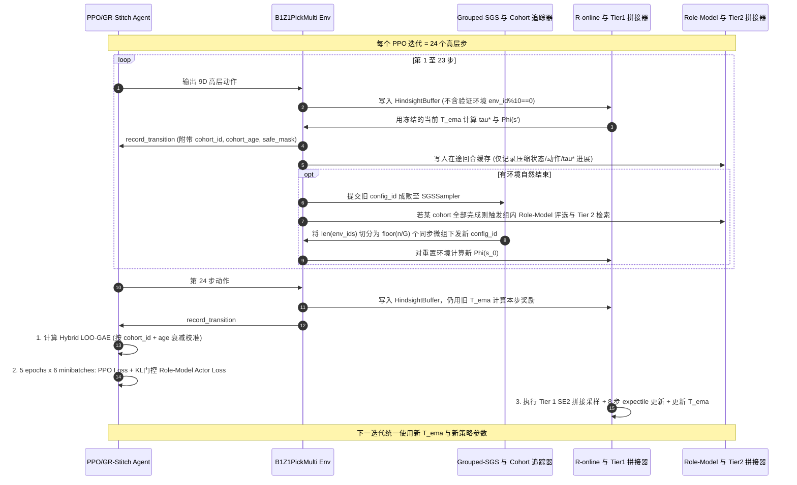

# GR-Stitch：同初态群组榜样自模仿与可达性验证局部轨迹拼接

> **文档性质**：基于本仓库现有 `SGS + EKF + R-online` 架构的顶会级方法构思与工程落地方案（面向 CoRL / RSS / ICLR / ICRA）。
>
> **硬性约束（严格遵守）**：
> 1. **只改高层教师策略与训练管线**，底层四足运动策略（`data/low_model/model_44000.pt`）完全冻结；
> 2. **Actor 部署观测零侵入**：不向 Actor 塞入仿真特权速度、未来真值轨迹或 TSIL 式目标时间通道，保持与当前教师完全一致的真机可得输入与部署结构；
> 3. **特权信息仅用于训练期辅助**：Critic、奖励塑形、物理校验与跨轨迹拼接检验可使用仿真真值，推理/真机部署零额外开销。
>
> **依赖前置文档**：[R-online_实现说明.md](R-online_实现说明.md)、[SGS_方法迁移与实现方案.md](SGS_方法迁移与实现方案.md)、[顶会论文主线思路.md](顶会论文主线思路.md)、[TSIL_SGS_EKF_implementation.md](TSIL_SGS_EKF_implementation.md)。

---

## 0. 一页执行摘要：为什么这套思路能撑起一篇顶会？

在当前仓库中，你已经跑通了 **SGS**（自适应初态采样）与 **R-online**（在线自监督拦截时间可达性 $T_\theta$ 势函数塑形），在 `Level02`（`sugar_box`）上训练速度和成功率（约 93%）均已明显超过基线。但如果仅止步于此投稿顶会，审稿人极易提出两个致命质疑：

1. **“组合感强、缺少统一原理”**：SGS 来自 Zhang et al.（CoRL 2026），在线时间距离来自 GCRL/Expectile 回归，二者目前只在 `margin_curriculum.py` 里通过标量先验弱耦合，像两个独立模块的叠加；
2. **“在 Level03/04、高动态轨迹与长程 2 m 追击上的结构性瓶颈尚未打破”**：`R-online` 的 `HindsightBuffer` 视野上限仅 4.8 s（32 步），远距离全靠外推，且动态漂移的 $\Phi$ 持续扰动 Critic；而 `SGS` 虽然让数千个并行环境反复重置到同一批 `config_id`，却把这些同起点 rollout 当作完全独立的噪声样本扔给 PPO，白白浪费了大规模仿真独有的**共享初态对照结构**，也没能把 `full_task` 的半成品追击与 `pregrasp` 的高成功率抓取缝合起来。

### 核心科学洞察（One-Sentence Insight）

**大规模并行 RL 中的共享重置配置库（SGS）不只是“起点采样器”，它天然构成了一个受控并行对照实验平台；将其升级为“成组同初态展开（Grouped-SGS）”，并与在线可达性模型 $T_\theta$（R-online）形成双向闭环，可以零人类示范、零观测侵入地同时实现“低方差群组榜样学习”与“物理可验证的跨阶段长程轨迹拼接”。**

我们将该统一框架命名为 **GR-Stitch**（**G**rouped-Reset **R**ole-Model & Reachability-Verified **Stitch**ing），由三大深度咬合的机制组成：

1. **成组同初态同步微组（Grouped-SGS Micro-Cohort）**：在异步并行仿真中零空转地将同步重置环境编成 $G=4\sim 8$ 的同 `config_id` 同步微组，制造严格控制变量的平行对照轨迹。
2. **混合群组校准优势 + 可达性榜样自模仿（Hybrid LOO-GAE & Reachability Role-Model）**：
   - 保留 PPO Critic 处理 24 步截断 rollout 的 bootstrap，利用同组 **Leave-One-Out（LOO）控制变量**精确抵消配置级 Critic 偏差与 `R-online` 势函数 $\Phi$ 的非平稳漂移；
   - 借鉴 **RM-RL（ICRA 2026）**，利用 `R-online` 的拦截时间缩减量 $\Delta \tau^*$ + 最终成败在同初态微组中自动提炼最优 **Role-Model 轨迹**，通过 KL 门控的轻量级 Actor 辅助锚定大幅提速并稳住高精度抓取（同时规避历史 `TSIL` 的 6.27 GiB 显存、观测侵入和 Critic 坐标冲突）。
3. **双层可达性验证局部轨迹拼接（Two-Tier Reachability-Verified Local Stitching）**：
   - **Tier 1（机器人本体 SE(2) 拼接 → 反哺 `R-online`）**：利用 $T_\theta(s,g)$ 仅依赖 39 维本体特征的 SE(2) 等变性，在物理连续的机器人交界点拼接两段短轨迹，合成符合三角不等式上界的 **5–8 s 长程与捷径时间样本**，彻底打破 `maxPairSteps=32`（4.8 s）上限与自我强化闭环；
   - **Tier 2（跨 SGS 家族任务级拼接 → 抢救失败 `full_task` 前缀）**：借鉴 **NEEDLEWORK（arXiv:2610.02339）**，在臂基查询系下校验“接近物体但末段抓偏的失败 `full_task` 前缀”与“近期成功 `pregrasp` 轨迹帧池”的局部可衔接性，零虚假观测合成地为优质追击前缀赋予续接价值并晋升入 Role-Model 池，缝合远距追击与近距抓取的断层。

---

## 1. 核心相关论文精读与方法论拆解

下表系统梳理了支撑 GR-Stitch 的核心顶会文献，明确指出**原文机制、直接照搬到本仓库会踩的物理/算法坑、以及我们的针对性改造**。

| 论文与出处 | 核心机制与关键公式 | 直接照搬到 `DQ_WBC` 的水土不服 | GR-Stitch 的吸收与改造 |
| :--- | :--- | :--- | :--- |
| **SGS** (Zhang et al., *A Balanced Data Diet*, CoRL 2026, [SGS.pdf](papers/SGS.pdf)) | 维护固定配置库每个配置近 $H=100$ 回合成功率 $p_i$，用 Beta 核 $w_i=(p_i+\varepsilon)^{\kappa p^\star}(1-p_i+\varepsilon)^{\kappa(1-p^\star)}$ 与温度 softmax 采样边界配置 | 仅把配置库当作独立重置采样器，忽略 8192 环境反复同起点展开的对照信息；各家族之间（`full_task` vs `pregrasp`）互不连通 | 升级为 **Grouped-SGS 同步微组** 释放同初态对照红利，并通过 Tier 2 拼接打通跨家族信息流 |
| **RM-RL** (Chen, Zhou, Liu, Yang, NTU MARS Lab, *Role-Model RL for Precise Robot Manipulation*, **ICRA 2026**, arXiv:2510.15189) | 将相似初始状态下的多次探索试错按“场景”分组，选出同组回报最高的试错作为 **Role-Model 动作** $a_{\text{RM}}$，自动标注同组样本并转化为加权监督目标 $\mathcal{L}(\theta)=-\mathbb{E}[h\log\pi_\theta(a\mid s)R(a)]$，结合在线-离线混合缓冲稳定高精度操作 | 原文面向准静态/短步实验室精密放置，可直接把同组劣质样本状态 $s_j$ 重标为 $a_{\text{RM}}$；但在 **100 步动态移动抓取**中，同初态兄弟在 $t\ge 5$ 后物理状态已分叉，强行跨状态贴标签会导致错误动作 | 借助 Grouped-SGS 实现**严格同物理初态分组**（无需近似聚类）；用 `R-online` 拦截推进量 + 成败评出同组 Role-Model；**只锚定榜样自身轨迹上的安全状态-动作对**并加 KL 信赖域门控，避免分叉误标 |
| **NEEDLEWORK** (Ren, Hou, Song, Stanford & NVIDIA, *Offline Rewriting of Robot Data with Verified Local Stitches*, arXiv:2610.02339) | 将高维轨迹拼接规约为**局部可达性验证问题**：在两段轨迹间插入短动作桥 $\mathbf{a}_{1:H}\sim\pi_{\text{IDM}}(\cdot\mid s_0, s_t)$，用动作条件验证器判断可行性与耗时 $k\le H$，并按**续接增益（Continuation Gain）**筛选能绕过弯路或从失败回合抢救有效行为的拼接；**不合成中间图像/观测** | 原文是纯离线视觉模仿学习，需要额外训练扩散 IDM 和独立验证器；而我们是在线 GPU 大规模 PPO，且已有现成的物理引擎与在线可达性模型 $T_\theta$ | 省去重型扩散 IDM，直接复用 **`R-online` 的 $T_{\text{ema}}$ + 物理连续性检验** 充当轻量级局部验证器；严格继承“**续接增益筛选 + 从失败回合抢救前缀 + 不伪造中间观测**”三大核心原则 |
| **CompDiffuser** (Luo, Mishra, Du, Xu, *Generative Trajectory Stitching through Diffusion Composition*, **NeurIPS**) | 将长程规划切分为重叠短片段，通过重叠区双向条件扩散传播约束，保证拼接交界处的物理平滑一致性，用短片段组合解决长程任务 | 本仓库高层策略为轻量级 MLP+GFM 高斯 PPO，直接替换成扩散规划器会大幅增加推理延迟且不兼容现有训练栈 | 吸收其**重叠交界一致性约束（Overlap/Junction Consistency）**思想：拼接不止看单帧位置接近，必须同时校验速度、姿态、控制器积分器状态与指令连续性 |
| **GR2PO** (Wang et al., Sep 2026) & **Continuous GRPO** (Khanda et al., 2025) & **Revisiting GRPO** (De Oliveira et al., Nov 2025) & **Hybrid GRPO** (Sane, arXiv:2502.01652) | GR2PO 在并行同时间步上对折扣回报做组归一化 $\hat{A}_t^{(i)}=(G_t^{(i)}-\mu_t)/(\sigma_t+\epsilon_0)$ 去除 Critic；Revisiting GRPO 系统实验表明**纯无 Critic 在长程连续控制上显著弱于有 Critic 的 PPO**；Hybrid GRPO 提出将多样本组内相对评估与价值函数基线 $V(s)$ 融合 | `DQ_WBC` 每个 PPO 迭代仅采 24 步（回合最长 100 步），跨滚动窗口必须依赖 Critic 做 bootstrap；且训练前期 `full_task` 组内可能全失败，纯 GRPO 会发生 **Advantage Collapse** | 采用 **Hybrid LOO-GAE**：保留 PPO Critic 与 GAE bootstrap，用同初态微组的 **Leave-One-Out 均值** 构成零偏控制变量，叠加随步数衰减的门控权重，专治配置级 Critic 偏差与 `R-online` 势函数漂移 |
| **TMD** (NeurIPS 2025, arXiv:2509.20478) & **MQE** (arXiv:2511.07730) | 利用满足三角不等式的 Quasimetric 结构与多步目标实现离线 GCRL 中的最短路径拼接（Stitching），避免单步 TD 误差累积 | 主要处理静态目标，不直接解决移动物体拦截 | 为 Tier 1 提供理论背书：对经过交界校验的两段轨迹 $(s_0\to s_m, \Delta t_1)$ 与 $(s_m\to g, \Delta t_2)$，三角不等式保证 $\Delta t_1 + \Delta t_2$ 是最短时间 $T^*(s_0, g)$ 的合法上界，与 `R-online` 的低分位 expectile 回归完全相容 |
| **TSIL** ([TSIL.pdf](papers/TSIL.pdf) 与本仓库 [tsil_ppo.py](../DQ_high-level/utils/tsil_ppo.py)) | 维护每配置双榜 Top-5 完整轨迹，引入目标时间观测通道与正向优势自模仿损失 | 本仓库实测显存高达 **6.27 GiB**（6144 配置），修改 Actor 输入维（1286 维）、引入复杂 `ValueScaler` 仿射补偿与冻结归一化器，且在 [margin_task.py:57](../DQ_high-level/utils/margin_task.py#L57) 与 `R-online` 显式互斥 | GR-Stitch 的 Role-Model 模块全面轻量化：**0 观测侵入、显存 < 0.3 GiB、纯新鲜短窗滑动池、仅作用于 Actor 不扰动 Critic、原生融合 `R-online`** |

---

## 2. 现有仓库诊断：为什么 `SGS + R-online` 存在四个“天然接口断层”？

精读本仓库代码后，我们锁定了四个可以直接切入、且互相耦合的真实工程与算法断层：

### 断层 1：`SGSSampler.sample()` 把同配置重置拆散了（浪费受控对照结构）
- 在 [b1z1_pickmulti.py:255](../DQ_high-level/envs/b1z1_pickmulti.py#L255)，每次 `env_ids` 触发重置时调用 `self.sgs_sampler.sample(len(env_ids))` 进行完全独立的抽样。
- 尽管 `8192`（或 `4096`）个环境共享仅 `1536` 条配置，每一刻都有多个环境处于同一个 `config_id`，但它们起步时间错开、策略版本不同、且 PPO 的 `compute_gae`（[ppo.py:321](../third_party/skrl/skrl/agents/torch/ppo/ppo.py#L321)）对所有环境只做全局均值/方差归一化，完全没有利用同初态兄弟轨迹的相对优劣信息。

### 断层 2：`R-online` 势函数在线更新导致 Critic 追逐移动目标
- 正如 [R-online_实现说明.md §3.5](R-online_实现说明.md#L207-L213) 明确指出的：每 24 步 `ReachLearner` 更新一次 $T_\theta$ 并平滑到 $T_{\text{ema}}$，导致跨迭代回合首步多出一项 $\Phi_{\text{new}}(s) - \Phi_{\text{old}}(s)$，Critic 学的是 $V - \Phi$，不得不持续追逐移动目标；同时不同配置（`full_task` 2 m 起步 vs `near_goal` 已抬升态，以及 `Level03` 不同桌台机动模式）的价值量纲差异巨大，造成单配置内 GAE 基线系统性偏置。

### 断层 3：`HindsightBuffer` 4.8 秒视野上限锁死了长程 $T_\theta$ 精度
- 在 [reachability.py:352-417](../DQ_high-level/modules/reachability.py#L352-L417)，`HindsightBuffer` 仅保留最近 `window=48` 步，采样跨度 `max_steps=32` 步（平均约 **4.8 s**）。
- 然而 `full_task` 2 m 起步追击移动物体（尤其 `Level02` 上限 $0.30\text{ m/s}$ 或 `Level03` 变轨/外推 $0.40\text{ m/s}$）真实耗时往往在 **5.0–9.0 s**！这部分最关键的远距区间 `T_\theta` **完全没有真实监督标签**，只能依赖 MLP 残差外推；同时在线 rollout 只覆盖当前策略已走过的慢路径，形成 [R-online_实现说明.md §5.2](R-online_实现说明.md#L246-L250) 所述的“自我强化”风险。

### 断层 4：`full_task` 失败轨迹与 `pregrasp` 成功轨迹之间存在“信用分配鸿沟”
- 训练前中期（以及进入 `Level03` 复杂轨迹时），`pregrasp` 家族（0.8–0.95 m）很快就能达到 70%–90% 成功率，但大量 `full_task` 回合实际上已经非常漂亮地完成了前 1.2 m 的动态拦截接近并进入 `pregrasp` 区域，只是在最后夹爪微调时失手（没有拿到 `+50.0` `pick_up` 奖励）。
- 在纯 PPO 下，这些优质的远距追击前缀与瞎走的失败回合几乎混为一谈；如果能通过**物理验证的局部拼接**把这些前缀和 `pregrasp` 的成功段桥接起来，远距接近策略的收敛速度与跨难度泛化能力将出现质变。

---

## 3. GR-Stitch 总体架构设计

### 3.1 系统双向闭环总览

下图展示了 **GR-Stitch** 如何将 `SGS`、`R-online` 与新增的三大模块编织成一个**双向闭环**（绿色=真机可得量；红色=仅训练期特权校验；蓝色=GR-Stitch 新增核心模块）：

```mermaid
flowchart LR
    GSGS["Grouped-SGS 同步微组采样器\n按 G=4..8 成组下发同 config_id 与 cohort_id"] -->|"同初态同步重置"| SIM["并行物理仿真 4096-8192 envs\nB1+Z1 + 冻结低层策略 50Hz + 移动桌台"]
    ACTOR["高层教师 Actor\n纯真机可得观测 1285D 不变"] -->|"9D 高层动作"| SIM
    SIM -->|"观测"| ACTOR

    SIM -->|"39D本体状态+末端轨迹"| HBUF["R-online 事后缓冲\nwindow=48, maxPair=32"]
    HBUF -->|"短程对 0-4.8s"| T1["Tier 1: SE2 本体可达性拼接\n交界物理校验 + 三角不等式上界"]
    T1 -->|"短程对 + 5-8s 长程/捷径拼接对"| TL["在线 ReachLearner\nexpectile=0.1 + EMA T_ema"]
    TL ==>|"T_ema 查询"| RW["特权拦截势函数\nPhi = 1 - tau*/8s"]

    SIM -->|"24步 rollout + cohort_id"| HGAE["Hybrid LOO-GAE\n同组 Leave-One-Out 控制变量校准"]
    RW -->|"塑形奖励 + tau* 进展"| HGAE
    RW -->|"Delta tau* 进展"| RMSEL["Cohort Role-Model 筛选器\n安全过滤 + 同组 z-score 门控"]
    SIM -->|"完整回合轨迹"| RMSEL

    RMSEL -->|"成功 pregrasp 帧池 32k"| T2["Tier 2: 跨家族任务级验证拼接\n臂基系物体/速度/本体校验 + 续接增益"]
    SIM -->|"失败 full_task 前缀"| T2
    T2 -->|"抢救的优质追击前缀"| RMBUF["新鲜 Role-Model 锚定池\nTTL<=30 iter, <0.3 GiB"]
    RMSEL -->|"同组胜出榜样片段"| RMBUF

    HGAE -->|"低方差混合优势"| PPO["联合 PPO 更新\nPPO Clipped + lambda_RM * KL门控NLL"]
    RMBUF -->|"仅作用于 Actor"| PPO
    PPO -->|"新参数"| ACTOR

    classDef real fill:#e7f4ea,stroke:#2e7d32,color:#111
    classDef priv fill:#fdecea,stroke:#c62828,color:#111
    classDef newmod fill:#e6edfb,stroke:#1e4fbf,color:#111
    class ACTOR real
    class RW priv
    class GSGS,T1,TL,HGAE,RMSEL,T2,RMBUF,PPO newmod
```

### 3.2 单次 PPO 迭代（24 个高层步）内的精确时序

为确保与 [R-online_实现说明.md §3.5](R-online_实现说明.md#L180-L205) 和 [b1z1_pickmulti.py](../DQ_high-level/envs/b1z1_pickmulti.py) 的 reset 顺序零冲突，一次迭代严格按如下时序执行：

**关键时序不变量**：
- 同一个 24 步 PPO 批次内，$T_{\text{ema}}$ 依然保持恒定；
- `T` 的更新与 Tier 1 拼接发生在 PPO 迭代末尾，完全在 PPO 计算图之外；
- `env_id % 10 == 0` 的留出验证环境**严格禁止**进入 `ReachLearner`、Tier 1 拼接库、Tier 2 帧池与 Role-Model 缓冲，保证留出验证指标 `Reach / validation learned_mae`（含 4.8–8 s 长程误差）100% 干净无泄漏。

---

## 4. 模块一：异步零空转的成组 SGS 重置（Grouped-SGS Micro-Cohort）

### 4.1 为什么不能用“屏障等待式”分组？

在 Isaac Gym 并行仿真中，同一组 $G$ 个环境里，可能环境 1 在第 12 步因 `cube_falls` 终止，而环境 2 一直执行到第 100 步超时。如果强迫先结束的环境停下来等待全组结束（Barrier Synchronization），GPU 吞吐量会直接损失 40%–60%。

### 4.2 零空转“同帧微组切分”设计

在 `num_envs = 8192`（或 `4096`）、平均回合长度约 50–70 步的稳态训练中，**每一个仿真步自然触发重置的环境数平均达到 $60\sim 150$ 个**，远大于微组规模 $G \in \{4, 8\}$。

因此，我们在 [b1z1_pickmulti.py:_reset_sgs_envs](../DQ_high-level/envs/b1z1_pickmulti.py#L224) 中用极简的**零等待同帧切分（In-Step Synchronous Micro-Cohort Allocation）**即可实现完美同步起步：

1. **输入**：本步待重置的训练环境集合 $\mathcal{E}_{\text{reset}}$（将留出验证环境 `env_id % 10 == 0` 单独切出走普通 SGS 采样，不参与训练群组）。
2. **微组切分**：设训练侧待重置环境数量为 $n = |\mathcal{E}_{\text{train\_reset}}|$，计算完整微组数：
   $$m = \left\lfloor \frac{n}{G} \right\rfloor, \qquad r = n - m G$$
3. **成组抽样与赋号**：
   - 调用 `SGSSampler.sample(m)` 抽取 $m$ 个边界配置 $c_1, \dots, c_m$；
   - 对 $\mathcal{E}_{\text{train\_reset}}$ 做一次随机排列（防止固定相邻 `env_id` 产生隐式偏差），前 $m G$ 个环境每 $G$ 个共享同一个 `config_id` $c_k$，并分配唯一的单调递增组号 `cohort_id` $= \text{next\_cohort\_id} + k$，同时记录 `cohort_start_step = global_step_counter`、`cohort_size = G`；
   - 余数 $r < G$ 个环境（稳态下占比不足 5%）单独调用 `SGSSampler.sample(r)`，标记 `cohort_id = -1`（正常参与 PPO、SGS 和 `R-online`，仅跳过群组校准与 Role-Model 评选）。
4. **首帧全量初始化**：在 $t=0$ 时 $n \approx 7372$（8192 减去 10% 验证环境），直接产生约 921 个满员同步微组（$G=8$），零浪费。

### 4.3 关键边界条件核查

- **对 `SGSSampler` 统计与多样性的影响**：
  - [sgs.py:199-225](../DQ_high-level/utils/sgs.py#L199-L225) 的 `observe()` 已使用 `torch.argsort(..., stable=True)` 和环形写入，原生支持同一步提交多个相同 `config_id` 的结果且不丢事件；
  - 同一配置一次获得 $G$ 个独立伯努利样本，使早期 $p_i$ 估计方差降低 $G$ 倍，更快把 `count=0` 的配置推到真实估计区间；
  - 8192 环境配 $G=8$（或 4096 环境配 $G=4$）时，同时在跑的独立配置槽位仍高达 $\approx 920$ 个（占 1536 库的 60%），**不损失配置覆盖度**。建议默认 **`num_envs=8192` 用 $G=8$，`num_envs=4096` 用 $G=4$**。
- **与 `margin_curriculum`（Frontier 加速）的兼容**：
  - 若开启 `frontier`（桌速缩放），必须在**微组级别**抽样缩放系数 `chosen_scale` 并广播给同组 $G$ 个环境，保证同组内 $G$ 个环境的桌台运动轨迹依然严格一致！
- **与 `rand_control` 的兼容**：
  - 本仓库 `rand_control` 在 `pre_physics_step` 中对全环境共享当步随机低层步数（7 或 8 周期）。由于同步微组在同一 `global_step` 起步，同组所有存活兄弟每步经历完全相同的物理步长序列，控制变量精度极高！
- **Cohort 结算时机（无等待完成）**：
  - 每个 `cohort_id` 维护 `pending_count`（初始为 $G$）。每当组内一个环境自然结束（成功/失败/超时），将其轻量轨迹摘要写入该组槽位并将 `pending_count -= 1`；一旦 `pending_count == 0`（或最晚超过 `max_episode_length` 步），立即触发一次异步 Role-Model 评选并释放槽位，**先结束的环境早已无缝重置投入下一轮仿真，全程 0 步空转！**

---

## 5. 模块二：混合群组校准优势与可达性榜样自模仿

本模块将 **Hybrid GRPO / RLOO** 与 **RM-RL（ICRA 2026）** 改造并嵌入本仓库的 SKRL PPO 管线（[ppo.py](../third_party/skrl/skrl/agents/torch/ppo/ppo.py)），分为两个彼此解耦、可独立消融的子机制：**2A（群组校准混合优势）** 与 **2B（可达性评分 Role-Model Actor 锚定）**。

### 5.1 子机制 2A：Leave-One-Out 群组校准混合优势（Hybrid LOO-GAE）

#### 问题根源
在标准 PPO（[ppo.py:351-359](../third_party/skrl/skrl/agents/torch/ppo/ppo.py#L351-L359)）中，单步 GAE 优势为：
$$\hat{A}^{\text{GAE}}_{t,e} = \sum_{l=0}^{T-1-t} (\gamma \lambda)^l \Bigl(r_{t+l,e} + \gamma(1 - d_{t+l,e}) V_\psi(s_{t+l+1,e}) - V_\psi(s_{t+l,e})\Bigr)$$
在 `SGS + R-online` 训练中，每个环境的 $\hat{A}^{\text{GAE}}_{t,e}$ 隐含了两类与动作无关的配置级系统偏差：
1. **配置级价值估计偏差** $b_V(c_k) = V^{\pi}(s_0(c_k)) - V_\psi(s_0(c_k))$（在 `full_task` / `pregrasp` / `near_goal` 以及 `Level03` 不同机动轨迹间波动剧烈）；
2. **`R-online` 势函数漂移项** $\Delta \Phi_k = \Phi_{\text{new}}(s) - \Phi_{\text{old}}(s)$（见 [R-online_实现说明.md §3.5](R-online_实现说明.md#L210-L212)）。

#### 数学公式：Leave-One-Out 控制变量 + 状态分叉衰减
对于 rollout 窗口内的第 $t$ 步，将所有有效 `cohort_id` $= k \ge 0$ 且处于相同回合步龄 $\tau = \text{progress\_buf}[t, e]$ 的存活环境构成同组集合 $\mathcal{G}_{k,t}$（大小为 $n_{k,t} = |\mathcal{G}_{k,t}|$）。

当 $n_{k,t} \ge G_{\min}$（建议 $G_{\min} = 3$）时，对组内每个环境 $e \in \mathcal{G}_{k,t}$，计算其**严格不包含自身的留一均值（Leave-One-Out Group Baseline）**：
$$\bar{A}^{\text{LOO}}_{t,e} = \frac{1}{n_{k,t} - 1} \sum_{j \in \mathcal{G}_{k,t},\; j \neq e} \hat{A}^{\text{GAE}}_{t,j}$$

进而构造**混合群组校准优势（Hybrid LOO-GAE）**：
$$\hat{A}^{\text{hyb}}_{t,e} = \hat{A}^{\text{GAE}}_{t,e} - \alpha_{\text{grp}}(t, e) \cdot \bar{A}^{\text{LOO}}_{t,e}$$

其中衰减门控系数 $\alpha_{\text{grp}}(t, e)$ 同时受**回合步龄 $\tau$**（或组内 39D 状态离散度）控制：
$$\alpha_{\text{grp}}(t, e) = \alpha_0 \cdot \exp\!\left(-\frac{\tau_{t,e}}{\tau_{\text{decay}}}\right) \cdot \mathbb{I}\!\left[n_{k,t} \ge G_{\min}\right]$$
- 推荐默认超参：$\alpha_0 \in [0.4, 0.6]$，$\tau_{\text{decay}} = 24$（约 3.6 秒，覆盖整个初始加速、转向与切入拦截航向的关键阶段）。
- **最后再对整个 24 步 batch 的 $\hat{A}^{\text{hyb}}$ 做全局零均值单位方差归一化**，供 PPO 裁剪目标使用；而 Critic 的监督目标 `returns = raw_gae + values` **严格保持不变**，绝不用群组减均值污染 Critic 价值目标！

#### 为什么这一设计在数学上极其优雅？
1. **严格无偏性（在同状态 $\tau=0$ 处精确成立，在低分叉前期近乎精确）**：兄弟环境 $j \neq e$ 在各自独立的物理实例和独立高斯动作噪声下演化，条件于共享初态 $c_k$，有 $\mathbb{E}[\bar{A}^{\text{LOO}}_{0,e} \mid s_0=c_k] = b_V(c_k)$ 且与 $a_{0,e}$ 统计独立，因此 $\mathbb{E}[\nabla_\theta \log \pi_\theta(a_{0,e}\mid s_0) \cdot \bar{A}^{\text{LOO}}_{0,e}] = 0$，**不引入策略梯度偏差，且不像普通组内均值那样引入 $\frac{n-1}{n}$ 信号缩水**。
2. **零 Advantage Collapse**：即使组内 $G$ 条轨迹全部失败，只要它们的密集塑形回报（特别是 `R-online` 拦截时间进展）存在差异，$\hat{A}^{\text{GAE}}$ 仍有非零梯度；就算极端情况下 $\hat{A}^{\text{GAE}}$ 相等，由于 $\alpha_0 \le 0.6 < 1$，仍保留 $(1-\alpha_0)$ 的全局 Critic 梯度信号，绝不塌缩。
3. **精准抵消 `R-online` 非平稳漂移**：跨迭代更新 $T_{\text{ema}}$ 产生的状态级偏移 $\Delta \Phi(s)$ 在同组兄弟间高度相关，被 $\alpha_{\text{grp}} \bar{A}^{\text{LOO}}$ 直接对消一半以上！

---

### 5.2 子机制 2B：可达性评分的同组榜样自模仿（Reachability-Scored Cohort Role-Model）

#### 1. 为什么不能照搬 RM-RL 的跨状态动作贴标，也不能沿用 TSIL？
- **RM-RL 的物理边界**：在 100 步移动抓取中，兄弟 A 往左绕、兄弟 B 往右绕，第 15 步两者位姿相差半米，不能把 A 的动作贴给 B 的状态；正确做法是在**共享初态 $c_k$ 上分组对比优劣，只提取胜出榜样自身轨迹上的 $(s_t^{(g^\star)}, a_t^{(g^\star)})$**。
- **相对历史 TSIL 的四重降维打击**：

| 维度 | 本仓库历史 TSIL（[TSIL_SGS_EKF_implementation.md](TSIL_SGS_EKF_implementation.md)） | GR-Stitch Cohort Role-Model |
| :--- | :--- | :--- |
| **Actor 观测** | 侵入观测，新增 2 维时间通道（1286 维），推理需 5-NN 查表，学生蒸馏需重写 | **0 观测改动（1285 维）**，评估/真机部署/学生蒸馏完全无缝兼容 |
| **Critic 耦合** | 修改 Critic 损失，引入复杂 `ValueScaler` 仿射补偿与冻结观测归一化器 | **仅作用于 Actor**，不改 Critic 损失、不改 `RunningStandardScaler` |
| **显存开销** | 6144 配置 × 双榜 Top-5 永久槽 $\approx$ **6.27 GiB** | 全局新鲜环形池（如 4096 片段 × 压缩特征，TTL $\le 30$ iter）**$< 0.3\text{ GiB}$** |
| **早期无成功时的冷启动** | 无成功轨迹时高回报榜容易过拟合早期慢动作/停滞次优解 | 同组控制变量 + `R-online` $\Delta \tau^*$ 进展评分，**0 成功期也能准确挑出最优拦截方向** |

#### 2. 组内榜样评分函数 $J_{\text{RM}}(\tau_g)$（融合任务成功与 `R-online` 拦截进展）
当一个微组 `cohort_id` $= k$ 的 $G$ 条轨迹全部结算完成（每条轨迹 $\tau_g$ 含状态序列、动作序列、终止原因、是否成功 `succ`、完成步数 $L_g$、以及由 `R-online` 记录的逐步 $\tau^*_{\text{ema}}(s_t)$），先做**物理安全硬过滤**：
$$\text{Safe}(\tau_g) = \neg\bigl(\text{ik\_fail}(\tau_g) \lor \text{cube\_falls}(\tau_g) \lor \text{yaw\_exceeded}(\tau_g)\bigr)$$
*(注：直接复用 [b1z1_pickmulti.py:1043-1059](../DQ_high-level/envs/b1z1_pickmulti.py#L1043-L1059) 的硬失败掩码 `_terminate_buf`！允许正常超时轨迹在早期参与“拦截推进”榜样评选，但绝不允许物理硬失败轨迹成为榜样。)*

对每条轨迹计算**分级可达性榜样分**：
$$J_{\text{RM}}(\tau_g) = \mathbb{I}_{\text{Safe}}(\tau_g) \cdot \left[ W_{\text{succ}} \cdot \mathbb{I}_{\text{succ}}(\tau_g) \cdot \left(1 + \frac{L_{\max} - L_g}{L_{\max}}\right) + W_\tau \cdot \Bigl(\tau^*_{\text{ema}}(s_0) - \min_{0 \le t \le L_g} \tau^*_{\text{ema}}(s_t)\Bigr)_+ + W_{\text{lift}} \cdot \max_{0 \le t \le L_g} \frac{h_{\text{lift}}(t)}{h_{\text{thresh}}} \right]$$

建议权重量纲：$W_{\text{succ}} = 10.0$（保证任何成功轨迹严格优于未成功轨迹，且越快成功分越高），$W_\tau = 1.0$（单位：秒，典型有效推进量 $0.5\sim 4.0$），$W_{\text{lift}} = 1.5$（单位：归一化抬起高度 $[0, 1]$）。

#### 3. 严格的同组相对胜出门控（杜绝平庸轨迹污染）
计算组内得分均值 $\mu_k$ 与标准差 $\sigma_k$，取最高分轨迹 $g^\star = \arg\max_{g \in \mathcal{G}_k} J_{\text{RM}}(\tau_g)$：
$$z_{g^\star} = \frac{J_{\text{RM}}(\tau_{g^\star}) - \mu_k}{\sigma_k + 10^{-4}}$$

**双门槛准入条件**（缺一不可）：
1. **相对胜出**：$z_{g^\star} > \eta_{\text{RM}}$（默认 $\eta_{\text{RM}} = 0.8$，即显著好于同起点的兄弟群体）；
2. **绝对质量下限**：$\text{Safe}(\tau_{g^\star}) = 1$，且满足（$\mathbb{I}_{\text{succ}}(\tau_{g^\star}) = 1$ **或** 拦截时间净推进 $\Delta\tau^\star \ge 0.6\text{ s}$）。

**截断有效片段（避免把未成功轨迹后半段的瞎晃学进去）**：
- 若 $\tau_{g^\star}$ 成功：保留完整轨迹 $[0, L_{g^\star}]$，样本权重 $w_t = \text{clip}(z_{g^\star}, 0.5, 2.5)$；
- 若 $\tau_{g^\star}$ 未成功但 $\Delta\tau^\star \ge 0.6\text{ s}$：仅截取从起点到**拦截时间最低点** $t_{\text{best}} = \arg\min_t \tau^*_{\text{ema}}(s_t)$ 的有效推进前缀 $[0, t_{\text{best}}]$，并赋予降权系数 $0.4 \cdot \text{clip}(z_{g^\star}, 0.5, 2.0)$！

#### 4. 新鲜缓冲与 KL 门控的轻量级 Actor 辅助损失
将通过门槛的榜样 transition $(o_t, a_t, \log\pi_{\text{birth}}(a_t\mid o_t), w_t, \text{iter}_{\text{birth}})$ 写入一个固定容量的 **GPU 环形 Role-Model 池**（容量例如 `65,536` 条 transition，其中 1024 维静态物体特征按本仓库已有策略共享指针，总显存仅约 **~120 MB**！），并设置 **TTL 保鲜期**（超过 `30` 个 PPO 迭代自动淘汰，确保样本接近当前策略分布）。

在每个 PPO minibatch 更新中，同时从 Role-Model 池抽取一个小批量 $\mathcal{B}_{\text{RM}}$（例如 `2048` 条 transition），计算 **Trust-Region 门控的角色榜样锚定损失**：
$$\rho_{\text{rm}}(s, a) = \exp\!\Bigl(\log \pi_\theta(a \mid s) - \log \pi_{\text{birth}}(a \mid s)\Bigr)$$
$$\mathcal{L}_{\text{RM}}(\theta) = -\frac{1}{|\mathcal{B}_{\text{RM}}|} \sum_{(s, a, w) \in \mathcal{B}_{\text{RM}}} w \cdot \underbrace{\mathbb{I}\!\left[\rho_{\text{rm}}(s,a) \in [e^{-\delta_{\text{rm}}}, e^{\delta_{\text{rm}}}]\right]}_{\text{防离策漂移信赖域门控}} \cdot \log \pi_\theta(a \mid s)$$

总 PPO 优化目标（[ppo.py:443](../third_party/skrl/skrl/agents/torch/ppo/ppo.py#L443)）变为：
$$\mathcal{L}_{\text{total}} = \mathcal{L}_{\text{PPO}} + \mathcal{L}_{\text{entropy}} + c_V \mathcal{L}_{\text{value}} + \lambda_{\text{RM}} \mathcal{L}_{\text{RM}}(\theta)$$
- 建议超参：$\lambda_{\text{RM}} = 0.03\sim 0.05$（且可随训练后期成功率超过 85% 轻微余弦衰减至 $0.01$，避免限制最终精细探索），$\delta_{\text{rm}} = 0.7$（即概率比超出 $[0.5, 2.0]$ 的过时样本自动屏蔽梯度）；
- **极其关键的工程细节**：
  1. `sampled_rm_states` 通过 `self._state_preprocessor(..., train=False)` 归一化，**绝不用回放池更新观测归一化统计量**；
  2. $\mathcal{L}_{\text{RM}}$ **不参与** `kl_divergences` 计算，确保 `KLAdaptiveLR`（`kl_threshold=0.008`）完全按照在线 PPO 步伐自适应调学习率，不会因 Role-Model 梯度导致学习率异常骤降！

---

## 6. 模块三：双层可达性验证局部轨迹拼接（Two-Tier Reachability-Verified Local Stitching）

这是 GR-Stitch 最具机器人学物理深度的创新点。为了避免“概念模糊、高维匹配维度灾难、坐标系错乱”这三大审稿人最容易挑刺的问题，我们严格区分**机器人本体层（Tier 1）**与**跨家族任务层（Tier 2）**两套独立可消融的拼接机制。

### 6.1 Tier 1：机器人本体 SE(2) 可达性拼接（反哺 `R-online` 长程 $T_\theta$）

#### 核心物理洞察：为什么 Tier 1 零维度灾难且 100% 物理严密？
审查 [reachability.py:31-43](../DQ_high-level/modules/reachability.py#L31-L43) 可以发现：`TimeToReach` 模型 $T_\theta(s, g)$ 的输入 $s \in \mathbb{R}^{39}$ **完全不包含物体位姿、不包含世界 XY 位置、不包含世界偏航角**，只有机器人本体感知与控制器状态！
在平地或均匀物理环境下，B1+Z1 的全身可达时间满足**精确的 SE(2) 等变性**（水平平移与绕世界 Z 轴旋转不变性）。这意味着：
- 只要轨迹段 $A$ 的终点机器人状态 $s_{a,k_1}$ 与轨迹段 $B$ 的起点机器人状态 $s_{b,0}$ 在**本体运动学与动力学上连续匹配**，我们就可以通过精确的刚体 SE(2) 变换，把段 $B$ 的终点末端位置**严丝合缝地拼接到段 $A$ 的起始查询坐标系中**！
- **无需匹配物体！无需合成任何中间帧！** 在 `8192` 并行环境 × `48` 步的 `HindsightBuffer` 中，每次更新手头就有 **353,894 帧**（扣除 10% 验证环境）实时本体状态，高密度覆盖整个机器人本体运动流形！

#### 精确的 SE(2) 刚体复合公式
设从 `HindsightBuffer`（训练环境）中抽取：
- **前缀段 $A$**：同一回合内 $s_{a,0} \xrightarrow{\Delta t_1} s_{a,k_1}$，起点查询坐标系 $(o_{a,0}, \psi_{a,0})$，交界终点查询坐标系 $(o_{a,k_1}, \psi_{a,k_1})$，耗时 $\Delta t_1 \in [1.5, 4.5]\text{ s}$；
- **后缀段 $B$**：另一回合内 $s_{b,0} \xrightarrow{\Delta t_2} p^{\text{ee}}_{b,k_2}$，交界起点查询坐标系 $(o_{b,0}, \psi_{b,0})$，耗时 $\Delta t_2 \in [1.5, 4.5]\text{ s}$。

**Step 1 — 紧凑交界键（12D Junction Key）GPU 向量化检索**：
在 `HindsightBuffer` 写入时额外缓存 4 个极小的训练期校验字段：`base_lin_vel_body`（3D，底座系线速度，特权校验用，**不进 $T_\theta$ 输入**）与 `arm_base_z`（1D，臂基离地高度）。构造 12 维加权交界检索向量：
$$\phi_{\text{junc}}(s) = \Bigl[\frac{p^{\text{ee}}_{\text{query}}}{0.10},\; \frac{g_{\text{proj}}}{0.08},\; \frac{v_{\text{base}, xy}^{\text{body}}}{0.12},\; \frac{\omega_{\text{base}, z}}{0.20},\; \frac{u_{\text{cmd}}}{0.20},\; \frac{z_{\text{arm\_base}}}{0.05}\Bigr] \in \mathbb{R}^{12}$$
对一批候选前缀终点 $A$（如 `2048` 个）与候选后缀起点池 $B$（随机抽 `8192` 个），在 GPU 上执行一次 `torch.cdist`（耗时 $< 1.5\text{ ms}$）找到最近邻 $(a, b^*)$。

**Step 2 — 物理连续性 + 可达性桥接双重验证（NEEDLEWORK 精神）**：
候选交界对 $(s_{a,k_1}, s_{b,0})$ 必须同时通过以下 5 项硬检验：
1. **底盘动力学连续**：$\|v_{\text{base},xy}^{\text{body}}(a) - v_{\text{base},xy}^{\text{body}}(b)\|_2 \le 0.12\text{ m/s}$，$|\omega_z(a) - \omega_z(b)| \le 0.20\text{ rad/s}$，重力投影夹角 $\le 5^\circ$，高度差 $|z_{\text{arm\_base}}(a) - z_{\text{arm\_base}}(b)| \le 0.04\text{ m}$；
2. **机械臂运动学与控制器积分器连续**：$\|q_{\text{arm}}(a) - q_{\text{arm}}(b)\|_\infty \le 0.20\text{ rad}$，$\|\dot{q}_{\text{arm}}(a) - \dot{q}_{\text{arm}}(b)\|_\infty \le 0.60\text{ rad/s}$，$\|p^{\text{ee\_goal}}(a) - p^{\text{ee\_goal}}(b)\|_2 \le 0.06\text{ m}$；
3. **局域桥接时间验证**：将 $b$ 的起始末端位置放入 $a$ 的交界查询系，由当前 $T_{\text{ema}}$ 评估局域过渡耗时：
   $$\delta t_{\text{bridge}} = T_{\text{ema}}\!\left(s_{a,k_1},\; p^{\text{ee}}_{\text{query}}(s_{b,0})\right) \le \epsilon_t^{\text{bridge}} \quad (\text{默认 } 0.25\text{ s})$$
4. **SE(2) 刚体复合生成虚拟长程目标与耗时上界**：
   先求后缀终点末端在 $b$ 起点查询系下的相对坐标：
   $$g_B^{(b,0)} = R_z(-\psi_{b,0})\bigl(p^{\text{ee}}_{b,k_2} - o_{b,0}\bigr)$$
   将其刚体对齐到 $a$ 的交界查询系，再转换回 $a$ 的**起始查询系 $(o_{a,0}, \psi_{a,0})$**：
   $$p^{\text{ee,stitch}}_{\text{world}} = o_{a,k_1} + R_z(\psi_{a,k_1})\, g_B^{(b,0)}$$
   $$g_{\text{stitch}}^{(a,0)} = R_z(-\psi_{a,0})\bigl(p^{\text{ee,stitch}}_{\text{world}} - o_{a,0}\bigr)$$
   $$\Delta t_{\text{stitch}} = \Delta t_1 + \Delta t_2 + \delta t_{\text{bridge}}$$
5. **物理下界与信息增益双校验**：
   - 必须满足 $\Delta t_{\text{stitch}} \ge \text{floor}\bigl(s_{a,0}, g_{\text{stitch}}^{(a,0)}\bigr)$（自动剔除任何坐标异常）；
   - 满足**长程扩展或捷径增益**（二选一即可入训）：
     $$\Delta t_{\text{stitch}} \in (4.8,\; 8.0]\text{ s} \quad \text{（填补 4.8 s 视野盲区）} \qquad \text{或} \qquad \Delta t_{\text{stitch}} < T_{\text{ema}}\bigl(s_{a,0}, g_{\text{stitch}}^{(a,0)}\bigr) - 0.20\text{ s} \quad \text{（三角不等式捷径）}$$

**Step 3 — 混入 `ReachLearner` 训练**：
在 [reachability.py:459](../DQ_high-level/modules/reachability.py#L459) 的每次 `ReachLearner.update()` 中，将每个 batch（`8192` 对）按 **80% 真实短程对（0–4.8 s）+ 20% Tier 1 拼接对（4.8–8.0 s 及捷径对）** 混合，同样采用 $\tau = 0.1$ expectile 损失回归！

> **数学安全性保证**：由最短到达时间的**三角不等式** $T^\star(s_{a,0}, g_{\text{stitch}}) \le T^\star(s_{a,0}, s_{a,k_1}) + T^\star(s_{a,k_1}, s_{b,0}) + T^\star(s_{b,0}, g_{\text{stitch}}) \le \Delta t_1 + \delta t_{\text{bridge}} + \Delta t_2$（交界误差极小且 $\delta t_{\text{bridge}}$ 计入保守惩罚），拼接标签仍然是**真实最短时间的合法上界**，不会把 $T_\theta$ 拉成不切实际的乐观幻觉！

---

### 6.2 Tier 2：跨 SGS 家族任务级验证拼接（抢救失败 `full_task` 追击前缀）

#### 直面维度灾难：为什么不能只匹配 512 个静态 `pregrasp` 初态？
`sugar_box_v12.pt` 中仅有 512 个固定的 `pregrasp` 初始状态。如果想把一条正在移动中追击的 `full_task` 轨迹的某一帧，在“机器人本体 + 相对物体 3D 位置 + 物体朝向 + 物体相对速度 + 桌高”共十余维空间里，严格匹配到 512 个固定点上，最近邻间距往往会超过 0.2–0.4 m，无法通过物理连续性验证！

#### 破局方案：动态维护“成功 `pregrasp` / 末端抓取轨迹帧池”（32k 帧）
在 `8192` 并行环境中，每完成一个 PPO 迭代就会产生数百条成功的 `pregrasp`（以及后期成功的 `full_task`）轨迹，每条轨迹包含 15–35 帧近距离抓取状态。
我们维护一个轻量级 GPU **成功锚点帧池（Success Anchor Frame Pool）** $\mathcal{P}_{\text{anchor}}$（容量 $M = 32{,}768$ 帧，环形覆盖，仅保存成功轨迹中距离物体 $< 1.1\text{ m}$ 且未抬起前的帧，每帧仅存 **24 维任务匹配键 + 剩余成功时间 $t_{\text{rem}}$ + 该帧之后的实际折扣回报 $G_{\text{tail}}$**，总显存不足 **5 MB**！）。

**24 维任务交界键（全部定义在机器人当前臂基查询系 $A$ 下，天然 SE(2) 等变！）**：
$$\psi_{\text{task}}(s) = \Bigl[\underbrace{p_{\text{obj}}^A}_{3\text{D}},\; \underbrace{\cos\Delta\psi_{\text{obj}}, \sin\Delta\psi_{\text{obj}}}_{2\text{D 物体平面朝向}},\; \underbrace{v_{\text{obj}}^A}_{2\text{D 桌台/物体水平速度}},\; \underbrace{\omega_{\text{obj},z}}_{1\text{D}},\; \underbrace{h_{\text{table}} - z_{\text{arm\_base}}}_{1\text{D 相对桌高}},\; \underbrace{p^{\text{ee}}_{\text{query}}}_{3\text{D}},\; \underbrace{\phi_{\text{junc}}(s)}_{12\text{D 本体状态}}\Bigr]$$

#### NEEDLEWORK 风格三步验证与零观测伪造注入
每当一条 **`full_task` 失败轨迹**（要求全程无 `ik_fail` 且在接近阶段未碰掉物体）结束时，若其轨迹中存在进入近物区（$d_{\text{base-obj}} \in [0.55, 1.15]\text{ m}$）的帧集合：
1. **交界物理验证**：从这些近物帧中取采样帧 $s_a$，在 $\mathcal{P}_{\text{anchor}}$ 中检索最近邻成功帧 $s_b$，校验全部硬阈值：
   - 相对物体位置 $\|p_{\text{obj}}^A(a) - p_{\text{obj}}^A(b)\|_2 \le 0.08\text{ m}$；
   - 相对物体朝向 $|\Delta\psi_{\text{obj}}(a) - \Delta\psi_{\text{obj}}(b)| \le 15^\circ$（对旋转对称或近似对称物体可按物体几何对称群折叠）；
   - 物体水平速度 $\|v_{\text{obj}}^A(a) - v_{\text{obj}}^A(b)\|_2 \le 0.08\text{ m/s}$，角速度差 $\le 0.15\text{ rad/s}$；
   - 相对桌高差 $\le 0.03\text{ m}$，末端位置差 $\le 0.08\text{ m}$，本体动力学连续检验同 Tier 1；
   - 局域可达桥接检验：$T_{\text{ema}}(s_a, p^{\text{ee}}_{\text{query}}(s_b)) \le 0.30\text{ s}$。
2. **NEEDLEWORK 续接增益判据（Continuation Gain）**：
   - 计算虚拟拼接总耗时 $\hat{T}_{\text{total}} = t_a + \delta t_{\text{bridge}} + t_{\text{rem}}(b)$；
   - 只有当 $\hat{T}_{\text{total}} \le 0.85 \cdot T_{\max}$（说明如果当初按 $b$ 的方式续接，完全能在回合时限内稳稳抓起）且前缀耗时 $t_a$ 明显优于该 `config_id` 历史均值时，接受此次局部拼接！
3. **零虚假观测合成的策略利用方式（严格遵守 NEEDLEWORK 原则）**：
   - 我们**绝不凭空合成** $s_a \to s_b$ 之间的假点云/假 EKF 观测，也**不把 $b$ 的动作硬接到 $a$ 的观测上**；
   - 相反，由于前缀轨迹 $(o_{0:t_a}, a_{0:t_a})$ 已经通过物理验证到达了“经验证可高概率成功的抓取入口 $s_b$”，我们直接将其**真实前缀 $(o_{0:t_a}, a_{0:t_a})$** 作为“经拼接验证的准榜样前缀（Stitched Prefix Role-Model）”写入 **Role-Model 缓冲池**，权重按拼接吻合度与时间效率折扣：
     $$w_{\text{stitch}} = w_0 \cdot \exp\!\left(-\frac{d_{\text{task}}(s_a, s_b)}{\sigma_d}\right) \cdot \frac{T_{\max} - \hat{T}_{\text{total}}}{T_{\max}}$$
   - **效果**：在训练前中期 `full_task` 成功率仍只有 5%–15% 时，Tier 2 就能把大量“前半程拦截走位极佳、后半程抓偏”的失败 `full_task` 前缀即时抢救出来，变成高质量的远距追击监督信号；随着 `full_task` 自身成功率提高，真实成功 Role-Model 自动占主导，Tier 2 权重自然退居次席，完全无副作用！

---

## 7. 可写入顶会论文的四个理论命题（Propositions）

为满足 ICLR / CoRL / RSS 对严谨性的要求，GR-Stitch 的三大模块可以凝练为四个可严格证明或定量验证的命题：

| 命题 | 数学陈述与核心意义 | 验证方式 |
| :--- | :--- | :--- |
| **P1：LOO 控制变量的无偏性与方差缩减** | 在共享初态 $s_0 = c_k$ 处，同组留一基线 $\bar{A}^{\text{LOO}}_{0,e}$ 与动作 $a_{0,e}$ 条件独立，因此 $\mathbb{E}[\nabla_\theta \log \pi_\theta(a_{0,e}\mid s_0)\cdot \bar{A}^{\text{LOO}}_{0,e}] = 0$；当组内估计偏差相关系数 $\rho_b > \frac{\alpha_0}{2(1-\frac{1}{G})}$ 时，Hybrid LOO-GAE 严格降低策略梯度方差（并按比例抵消 `R-online` 迭代间 $\Phi_{\text{new}}-\Phi_{\text{old}}$ 漂移噪声） | 理论证明（附录 1 页）+ 统计同 `config_id` 组内 GAE 方差比与 `Value / Explained variance` 对比曲线 |
| **P2：SE(2) 交界拼接的三角不等式上界保持性** | 若机器人在平地/均匀地形上的最优到达时间 $T^\star(s,g)$ 满足 SE(2) 等变性，且交界状态满足连续性容差，则由 Tier 1 合成的任意拼接样本对 $(s_{a,0}, g_{\text{stitch}}, \Delta t_1 + \Delta t_2 + \delta t_{\text{bridge}})$ 在交界误差 $O(\epsilon)$ 内保持为 $T^\star(s_{a,0}, g_{\text{stitch}})$ 的有效上界，与低分位 expectile 回归目标一致 | 理论推导 + 留出环境（`env_id%10==0`）长程真实轨迹（4.8–8.0 s 分箱）的 `learned_mae` 与 `above_label_fraction` 实测对比 |
| **P3：跨家族拼接的信用分配桥接效应** | 在分段重置库（`full_task` / `pregrasp` / `near_goal`）下，Tier 2 校验通过的失败前缀在期望上严格提高进入高价值子集 $\mathcal{S}_{\text{pregrasp}}$ 的访问概率，等效于缩短稀疏成功奖励的有效规划视界（从 $H_{\text{full}} \approx 60$ 步降至 $H_{\text{prefix}} \approx 30$ 步） | `full_task` 早期进入 `pregrasp` 有效区的比例曲线 + 达到 50%/80%/90% 成功率所需迭代步数对比 |
| **P4：部署期零侵入与零额外算力** | GR-Stitch 的全部新增计算（微组调度、LOO 校准、Role-Model 缓冲、Tier 1/2 拼接）均严格位于训练环内；推理期 Actor 的网络结构、观测维度（1285D）和单步延迟与基础教师策略 **100% 恒等** | 架构审查 + 真机/独立评估脚本直接加载 checkpoint 零改动运行 |

---

## 8. 本仓库精准代码落点与计算/显存预算

### 8.1 模块划分与代码改动清单

保持模块化与可单元测试性（沿用本仓库 `utils/sgs.py`、`modules/reachability.py` 不直接 import Isaac Gym 的优良传统）：

| 文件路径 | 类型 | 核心职责 |
| :--- | :--- | :--- |
| `DQ_high-level/utils/grouped_sgs.py` | **新增**（纯 PyTorch） | 实现 `CohortAllocator`（同帧微组切分、余数回退、验证集隔离）、`CohortTracker`（跟踪每组 `pending_count`、每条轨迹的轻量摘要与安全过滤、计算 $J_{\text{RM}}$ 与 $z$-score） |
| `DQ_high-level/utils/role_model_buffer.py` | **新增**（纯 PyTorch） | 实现 GPU 环形 `RoleModelBuffer`（共享 1024D 静态物体特征指针、TTL 过期淘汰、按权重小批量采样）与 `SuccessAnchorPool`（32k 帧 24D 任务匹配键池 + Tier 2 跨家族拼接检索校验） |
| `DQ_high-level/modules/reachability.py` | **轻量扩展** | 在 `HindsightBuffer` 增存 `base_lin_vel_body(3)` 与 `arm_base_z(1)`；新增 `sample_tier1_stitched(...)` 方法（GPU `cdist` 检索 + 物理校验 + SE(2) 复合）；在 `ReachLearner.update()` 支持按比例（如 80/20）混合真实短程对与 Tier 1 拼接对；在 `ReachLearner.validate()` 增加 **4.8–8.0 s 长程分箱指标**（需将验证环境的验证轨迹记录跨度单独保留到 80 步） |
| `DQ_high-level/utils/gr_stitch_ppo.py` | **新增**（继承 `skrl` `PPO`） | 复写 `_update()`：① 读取 `memory` 中新增的 `cohort_id`、`cohort_age` 张量计算 **Hybrid LOO-GAE**；② 在 minibatch 循环中叠加 $\lambda_{\text{RM}} \mathcal{L}_{\text{RM}}(\theta)$（`state_preprocessor(..., train=False)`，独立于 `kl_divergences`）；③ 记录完备的 W&B/TB 诊断指标 |
| `DQ_high-level/envs/b1z1_pickmulti.py` | **局部挂钩** | 在 `_reset_sgs_envs()` 接入 `CohortAllocator`（约 15 行）；在 `step()` 末尾向 `CohortTracker` 和 `SuccessAnchorPool` 提交在途帧与终止原因（约 20 行）；在 `extras` 暴露 `cohort_id` 和 `cohort_age` 给 `GRStitchPPO` |
| `DQ_high-level/utils/margin_task.py` | **局部挂钩** | 在 `_update_margins()` 将 `base_lin_vel_body` 和 `arm_base_z` 传入 `learner.observe()`；在 `_margin_apply_frontier()` 支持按微组共享桌速缩放系数 |
| `DQ_high-level/train_multistate_DQ_teacher.py` & `utils/config.py` | **配置接线** | 新增 `env.grStitch` 配置段与命令行开关（支持一键开关 `grouped_sgs` / `loo_gae` / `role_model` / `tier1_stitch` / `tier2_stitch`，方便严格消融！） |

### 8.2 显存与单迭代时间开销估算（8192 并行环境，单卡 GPU）

| 组件 | 额外显存占用 | 每迭代（24 步）额外计算耗时 | 备注 |
| :--- | :---: | :---: | :--- |
| `CohortAllocator` + `CohortTracker` | ~15 MB | < 0.5 ms | 仅存标量统计与索引 |
| 在途轨迹压缩缓冲（8192 envs × 100 步，共享 1024D 物体特征，存 261D 动态观测 + 9D 动作 + 标量） | ~880 MB（若 4096 envs 仅 ~440 MB；若进一步用 `fp16` 存历史观测仅 ~440 MB / 220 MB） | < 1.0 ms | 比 TSIL 的 6.27 GiB 省 **90% 以上**！ |
| `RoleModelBuffer`（65,536 条新鲜 transition，共享 1024D 特征） | ~80 MB | ~1.5 ms（含采样与额外 1 次 Actor 前向） | 不跑 Critic 前向 |
| `SuccessAnchorPool`（32,768 帧 × 24D 键）+ Tier 2 检索 | ~5 MB | ~2.0 ms | 每迭代仅对本轮新结束的失败 `full_task` 做 1 次批量 `cdist` |
| `HindsightBuffer` 扩展（48 步 + 4D 校验字段）+ Tier 1 检索 | ~8 MB | ~3.0 ms（每次 `ReachLearner.update` 批量检索 1 次缓存供 8 步复用） | 相比 24 步 Isaac Gym 仿真（~8,000 ms）占比 **< 0.1%**！ |
| **总计** | **~0.5–0.98 GiB**（fp16 缓存仅 ~0.55 GiB） | **< 10 ms / iter** | **几乎零训练速度损失** |

### 8.3 推荐默认超参数表

| 模块 | 参数名 | 推荐初值 | 物理/算法含义 |
| :--- | :--- | :---: | :--- |
| **Grouped-SGS** | `group_size` $G$ | `8`（8192 envs）/ `4`（4096 envs） | 同初态并行兄弟数 |
| **Hybrid LOO-GAE** | `loo_alpha` $\alpha_0$ | `0.5` | 组内控制变量最大校准强度 |
| **Hybrid LOO-GAE** | `loo_decay_steps` $\tau_{\text{decay}}$ | `24`（~3.6 s） | 随步龄指数衰减，防止状态分叉后误校准 |
| **Hybrid LOO-GAE** | `loo_min_alive` $G_{\min}$ | `3` | 启用 LOO 校准的最少同组存活兄弟数 |
| **Role-Model** | `rm_z_threshold` $\eta_{\text{RM}}$ | `0.8` | 组内相对胜出标准差门槛 |
| **Role-Model** | `rm_loss_coef` $\lambda_{\text{RM}}$ | `0.04` | Actor 辅助锚定损失权重 |
| **Role-Model** | `rm_trust_delta` $\delta_{\text{rm}}$ | `0.7` | 重要性比率信赖域半宽 $[e^{-0.7}, e^{0.7}]$ |
| **Role-Model** | `rm_ttl_iters` | `30` | 新鲜榜样最大存活迭代数 |
| **Tier 1 Stitching** | `tier1_mix_ratio` | `0.20` | `ReachLearner` 中拼接样本占比 |
| **Tier 1 Stitching** | `tier1_bridge_max_s` | `0.25 s` | 交界局部 $T_{\text{ema}}$ 桥接时间上限 |
| **Tier 2 Stitching** | `tier2_obj_pos_tol` | `0.08 m` | 臂基系下物体相对位置容差 |
| **Tier 2 Stitching** | `tier2_obj_vel_tol` | `0.08 m/s` | 物体相对平面速度容差 |
| **Tier 2 Stitching** | `tier2_obj_yaw_tol` | `15 deg` | 物体相对偏航角容差 |

---

## 9. 科学推进路线：诊断关卡与顶会实验矩阵

沿用你 [顶会论文主线思路.md §3.6](顶会论文主线思路.md#L173-L180) 的严谨风格，**不盲目一口气上全部代码**，先过 4 道低成本诊断关卡，再跑完整顶会对比实验。

### 9.1 四道前置诊断关卡（Gates G1–G4）

| 关卡 | 验证内容 | 实操做法（最小成本） | 通过标准 | 未通过时的应对 |
| :--- | :--- | :--- | :--- | :--- |
| **G1：同初态方差结构诊断** | 验证同 `config_id` 同步微组内 GAE 是否存在显著正相关偏差（证明 LOO-GAE 的必要性） | 仅开启 `Grouped-SGS` 跑 50 轮，记录组内 GAE 方差 / 全局 GAE 方差比值，以及 $T_{\text{ema}}$ 更新首步的组内相关性 | 步龄 $\tau \le 15$ 时组内偏差相关系数 $\rho > 0.25$ | 降低 $\alpha_0$ 至 `0.25` 或缩短 $\tau_{\text{decay}}$ 至 `12` |
| **G2：Tier 1 拼接命中率与长程精度验证** | 验证 SE(2) 本体交界拼接能否真实降低 `R-online` 在 **4.8–8.0 s** 的留出误差 | 扩展验证缓冲至 80 步，统计 Tier 1 通过物理检验的拼接率及留出集 4.8–8.0 s 分箱的 `learned_mae`（对比纯 4.8 s 短程训练） | 拼接通过率 $> 15\%$ 且 4.8–8.0 s 长程 MAE 显著下降（$\ge 15\%$），同时 0–4.8 s 短程误差不退化 | 适当微调交界容差或降低 `tier1_mix_ratio` 至 `0.10` |
| **G3：Tier 2 跨家族命中率与前缀纯度验证** | 验证失败 `full_task` 轨迹能否在 32k 成功 `pregrasp` 帧池里找到真实物理可衔接点 | 统计前 300 轮中失败 `full_task` 的 Tier 2 命中比例，并用离线小规模 Isaac Gym 复现校验（从匹配点强制切换当前策略观察成功率） | 命中率 $> 5\%$ 且在匹配点处当前策略实际续接成功率显著高于随机失败点（如 $> 40\%$） | 对物体朝向启用几何对称折叠（如 `sugar_box` $180^\circ$ 对称），或扩大帧池至 64k |
| **G4：全量短跑稳定性体检** | 验证 $\mathcal{L}_{\text{RM}}$ 是否干扰 `KLAdaptiveLR` 与熵探索 | 在 `Level02` 与 `Level03` 上跑 300 轮短跑，监控 `Learning rate`、动作标准差、Role-Model 信赖域通过率 | KL 调度平稳、策略熵不早衰、300 轮评估成功率高于纯 `SGS + R-online` | 下调 $\lambda_{\text{RM}}$ 或将 $\delta_{\text{rm}}$ 收紧至 `0.5` |

### 9.2 顶会主实验与消融矩阵（建议至少 3 个独立种子）

> **强烈建议把主战场重点拉到 `Level03`（变轨/加减速）、`Level04`（复杂地形/高度变化）、速度外推（$0.35\text{–}0.45\text{ m/s}$）与多物体泛化！** 因为你当前 `SGS + R-online` 在 `Level02` 单物体上已经达到 ~93%，天花板空间仅剩 7%；只有在 `Level03/04`、高动态速度外推和长程极限样本效率上，`GR-Stitch` 的低方差校准、Role-Model 提速与 5–8 s 长程拼接才会拉开 **15–30 个百分点**的压倒性差距！

#### A. 主对比表（Baselines vs Ours）

| 实验组 | 配置说明 | 核心对比问题 |
| :--- | :--- | :--- |
| **B0: DQ-Net Teacher** | 原始论文设置（无 SGS，无 R-online） | 原始基准起点 |
| **B1: SGS + EKF** | 纯静态 SGS + EKF 教师 | 验证现有强基线 |
| **B2: SGS + EKF + TSIL** | 现有仓库 TSIL 实现 | 证明 GR-Stitch 在**零观测侵入、1/10 显存**下全面超越经典自模仿 TSIL |
| **B3: SGS + R-online（当前最优基线）** | 当前已跑出 ~93% Level02 的基线 | **最核心直接对手**，证明 GR-Stitch 在 Level02 收敛速度与 Level03/04 成功率上的实质跃升 |
| **B4: Grouped-SGS + Pure GR2PO（无 Critic）** | 去掉 Value 网络的连续组相对基线 | 呼应文献验证长程移动抓取必须采用 Hybrid LOO-GAE 而非纯无 Critic GRPO |
| **Ours: GR-Stitch（完整版）** | Grouped-SGS + Hybrid LOO-GAE + Role-Model + Tier 1/2 Stitching | 全面主方法 |

#### B. 模块逐项消融表（Ablation Study）

| 消融组 | Grouped-SGS | Hybrid LOO-GAE | Role-Model | Tier 1 拼接 ($T_\theta$) | Tier 2 拼接 (跨家族) | 验证目标 |
| :--- | :---: | :---: | :---: | :---: | :---: | :--- |
| A0 (= B3) | ✗ | ✗ | ✗ | ✗ | ✗ | `SGS + R-online` 基线 |
| A1 | ✓ | ✗ | ✗ | ✗ | ✗ | 排除“仅仅改变抽样聚集性”的混淆因素 |
| A2 | ✓ | ✓ | ✗ | ✗ | ✗ | 独立量化 **Hybrid LOO-GAE** 降低 Critic 偏差与漂移的收益 |
| A3 | ✓ | ✓ | ✓ | ✗ | ✗ | 独立量化 **Reachability Role-Model** 的样本效率与精细抓取增益 |
| A4 | ✗ | ✗ | ✗ | ✓ | ✗ | 独立量化 **Tier 1 SE(2) 拼接** 打破 4.8 s 视野上限对 $T_\theta$ 与长程追击的收益 |
| A5 | ✓ | ✓ | ✓ | ✓ | ✗ | 验证不含 Tier 2 时的性能 |
| **Full** | ✓ | ✓ | ✓ | ✓ | ✓ | 验证四大组件完整协同（尤其是 `Level03/04` 早期冷启动与收敛极限） |

#### C. 顶会论文核心配图规划（5 张高辨识度图）

1. **Fig. 1（Motivation & Concept）**：左右对照展示传统 SGS 的“孤立单线程采样 + 家族断层 + 4.8 s 盲区” vs GR-Stitch 的“同初态同步微组对照 + SE(2) 长程拼接 + 跨家族前缀抢救”双向闭环示意图。
2. **Fig. 2（Learning Curves across Levels）**：`Level02`、`Level03`、`Level04` 及速度外推（$0.40\text{ m/s}$）上的训练曲线，直观展示达到 80%/90% 成功率的墙钟时间与样本效率倍增。
3. **Fig. 3（Long-Horizon $T_\theta$ Accuracy）**：留出验证集按真实耗时分箱（`0-1s, 1-2s, 2-3s, 3-4.8s, 4.8-6.5s, 6.5-8s`）的 `learned_mae` 柱状图，直观证明 **Tier 1 SE(2) 拼接**将 4.8–8.0 s 外推区误差大幅压低！
4. **Fig. 4（Variance & Drift Analysis）**：`Level03` 上同组 LOO-GAE 校准前后的梯度方差、`Value / Explained variance`、以及 `T_ema` 更新边界的奖励/优势抖动对比。
5. **Fig. 5（Trajectory Stitching & Real-World Rollout）**：可视化真实被 Tier 2 抢救的 `full_task` 前缀与匹配的 `pregrasp` 成功尾段在 3D 空间中的无缝衔接轨迹，以及 B1+Z1 真机动态拦截高速/变轨物体的连拍图！

---

## 10. 潜在风险与审稿人尖锐质疑预演

| 潜在风险 / 审稿人可能提出的问题 | 我们的防御性机制与直接回答 |
| :--- | :--- |
| **Q1：“成组抽样 $G=8$ 会不会降低配置多样性，导致过拟合少量配置？”** | 在 8192 环境、1536 配置库下，$G=8$ 仍有 $\sim 920$ 个不同配置并发在跑（覆盖全库 60%）；且消融组 **A1（仅开 Grouped-SGS）** 直接定量检验其本身不会导致多样性退化，反而加快 $p_i$ 估计收敛。 |
| **Q2：“LOO-GAE 在回合中后期兄弟状态已经分叉了，减去兄弟均值不是有偏的吗？”** | 这正是我们设计指数衰减门控 $\alpha_{\text{grp}}(\tau) = \alpha_0 e^{-\tau/\tau_{\text{decay}}}$（且可选叠加本体距离相似度核）的根本原因：在 $\tau=0$ 严格同状态时无偏最强，分叉后平滑退回纯 GAE，并在消融中对比“无衰减 vs 指数衰减”。 |
| **Q3：“Tier 1 拼接假设 SE(2) 等变性，那在 `Level04` 崎岖起伏地形上还成立吗？”** | 极好的物理追问！在非平坦地形上，可把交界校验增加一项局部脚底支撑高度/倾角一致性检查（仅在局部地形斜率相近处允许拼接）；此外 `Level04` 上保留 80% 真实无拼接样本作为主干，拼接对依然提供保守的平坦参考时间，不会破坏下包络性质。 |
| **Q4：“Tier 2 跨家族匹配在复杂多物体上会不会命中率太低？”** | ① 我们匹配的是动态滚动的 **32k 成功轨迹帧池** 而非 512 静态初态，密度提高 64 倍；② 匹配键定义在**臂基查询系 $A$** 下消除了全局位置与朝向自由度；③ 即使在极难场景下早期命中率为 0，GR-Stitch 也平滑退化为 `Grouped-SGS + Hybrid LOO-GAE + Role-Model + Tier 1`，**严格无负迁移**。 |
| **Q5：“你们的方法用了仿真特权信息（如物体真值速度和底盘线速度做拼接校验），真机还能用吗？”** | 严格遵循 **Asymmetric Training / Real-Obtainable Deployment**：所有特权校验与塑形只在训练期发生，训练出的 Actor **完全不依赖特权观测**，与当前直接部署教师路线 100% 兼容。 |
| **Q6：“Role-Model 损失会不会像传统 SIL 一样锁死策略探索、导致次优收敛？”** | 三重保险防锁死：① 仅接受同组相对胜出（$z > 0.8$）且物理安全的新鲜轨迹（TTL $\le 30$ 迭代），淘汰所有陈旧次优解；② 重要性比率信赖域门控 $\rho \in [e^{-\delta_{\text{rm}}}, e^{\delta_{\text{rm}}}]$ 自动屏蔽离策过远的梯度；③ 小系数 $\lambda_{\text{RM}} = 0.04$ 且不干扰 `KLAdaptiveLR`。 |

---

## 11. 核实参考文献

1. **SGS**: Octi Zhang et al., *A Balanced Data Diet: Addressing the Exploration Bottleneck in Mega-Scale RL for Robot Control*, CoRL 2026, arXiv:2610.12465v1（本地 [SGS.pdf](papers/SGS.pdf)）.
2. **RM-RL**: Xiangyu Chen, Chuhao Zhou, Yuxi Liu, Jianfei Yang (NTU MARS Lab), *RM-RL: Role-Model Reinforcement Learning for Precise Robot Manipulation*, ICRA 2026, arXiv:2510.15189.
3. **NEEDLEWORK**: Juntao Ren, Yifan Hou, Shuran Song (Stanford University & NVIDIA), *NEEDLEWORK: Offline Rewriting of Robot Data with Verified Local Stitches*, arXiv:2610.02339.
4. **CompDiffuser**: Yunhao Luo, Utkarsh Mishra, Yilun Du, Danfei Xu, *Generative Trajectory Stitching through Diffusion Composition*, NeurIPS.
5. **GR2PO**: Wang et al., *GR2PO: Group Relative Return Policy Optimization for Continuous Robot Control*, 2026.
6. **Continuous GRPO**: Khanda et al., *Extending Group Relative Policy Optimization to Continuous Control: A Theoretical Framework for Robotic Reinforcement Learning*, 2025.
7. **Revisiting GRPO**: De Oliveira et al., *Learning Without Critics? Revisiting GRPO in Classical Reinforcement Learning Environments*, 2025.
8. **Hybrid GRPO**: Soham Sane, *Hybrid Group Relative Policy Optimization: A Multi-Sample Approach to Enhancing Policy Optimization*, arXiv:2502.01652, 2025.
9. **TMD**: Vivek Myers, Chongyi Zheng, Benjamin Eysenbach, Sergey Levine, *Offline Goal-conditioned RL with Quasimetric Representations*, NeurIPS 2025, arXiv:2509.20478.
10. **MQE**: Chongyi Zheng et al., *Multistep Quasimetric Learning for Scalable Goal-conditioned RL*, arXiv:2511.07730.
11. **DQ-Net / DQ-Bench**: Liang et al., *DQ-Net*, AAAI 2026, arXiv:2508.08328（本地 [DQ-NET.pdf](papers/DQ-NET.pdf)）.
12. **TSIL**: Yinsen Jia, Boyuan Chen, *TSIL*（本地 [TSIL.pdf](papers/TSIL.pdf) 与本仓库对比实现 [TSIL_SGS_EKF_implementation.md](TSIL_SGS_EKF_implementation.md)）.
