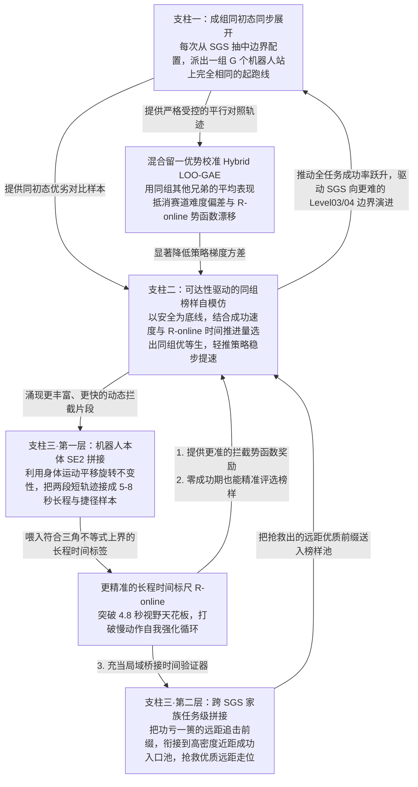
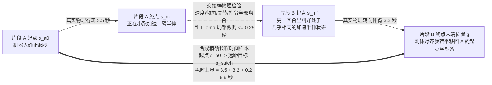
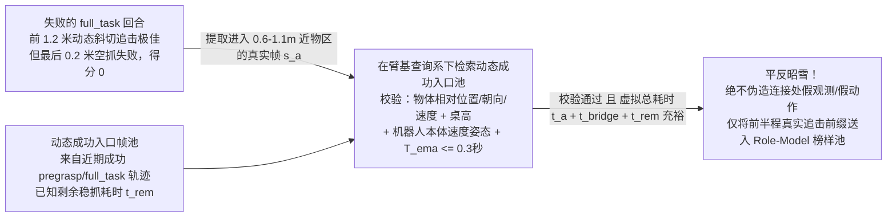

# GR-Stitch 完整研究构思：同初态群组榜样自模仿与可达性验证局部轨迹拼接

> **文档定位**：本文专注于**完整、清晰地阐述核心研究思路、物理与算法动机、相关顶会论文的精读与改造逻辑、以及顶会论文的叙事与验证框架**，暂不涉及具体代码实现细节。
>
> **研究边界（自始至终严格坚守）**：
> 1. **只改进高层策略及其训练范式**：底层四足行走控制器保持冻结，不改动底层动力学控制；
> 2. **保持真机可直接部署的信息边界**：高层策略（Actor）在决策时只看真机可获取的观测，不引入任何仿真特权信息，也不改变部署时的网络结构与推理开销；
> 3. **特权信息仅作用于训练期辅助**：仿真中的物体真值轨迹、底盘真实速度、物理状态校验仅用于训练阶段的奖励塑形、榜样筛选与轨迹拼接验证。

---

## 第一章：问题起点——为什么现有的 `SGS + R-online` 离顶会还差临门一脚？

目前你的系统已经具备两个非常扎实的模块：
- **SGS（Success-Guided Sampling）**：预先准备覆盖不同任务阶段的重置配置库（远距完整起步 `full_task`、近距预抓 `pregrasp`、已近目标 `near_goal`），根据每个配置近期的真实成功率，动态把训练算力集中在成功率 50% 左右的能力边界上；
- **R-online**：不依赖预训练教师，一边训练策略、一边从策略自己的交互轨迹里用“事后重标（Hindsight）”学习机器人的**自身时间可达性函数 $T_\theta(s, g)$**（从当前身体状态 $s$ 把末端送到空间位置 $g$ 最少需要多久），进而算出与移动物体的最早拦截时间 $\tau^*$，用势函数塑形引导机器人去“提前拦截”而不是“盲目追尾”。

这套组合在 `Level02`（匀速直线/圆周运动）上已经比原版基线训得更快、成功率也更高（约 93%）。但如果我们站在 CoRL / RSS / ICLR / ICRA 审稿人的角度审视，这套工作还面临一个致命的学术短板：

> **审稿人的第一反应会是：“SGS 是别人的重置方法，R-online 是把目标条件时间距离做成在线奖励塑形，两者合在一起工程效果不错，但它们各自为战，并没有融合成一个新的核心原理。”**

更重要的是，一旦你把任务推向 **`Level03`（运动模式随机切换、变速、急转弯）、`Level04`（复杂地形与高度变化）、更快的物体速度，或者多物体泛化**，现有 `SGS + R-online` 隐藏的 **四个深层结构浪费** 就会彻底暴露出来。

我们可以通过一个真实训练场景，把这四个问题一眼看穿：

### 场景还原：四足机械臂从 2 米外追击一个移动桌台上的物体

1. **浪费一：“同起跑线赛跑，却不互相比较”**
   在大规模并行仿真中，几千个并行环境反复从同一批固定的 SGS 配置起步——同一时刻往往有很多个机器人站在**完全相同的起跑线、面对完全相同的移动桌台**。
   但现在我们把它们当成彼此毫不相干的样本扔给 PPO。假如某个 `Level03` 配置特别刁钻，价值网络（Critic）暂时低估了它的难度，或者 `R-online` 在迭代更新时势函数 $\Phi$ 整体往上/往下漂移了一点，那么这批同起点的轨迹就会一起被错误地“集体夸奖”或“集体挨批”，策略根本分不清究竟是**赛道本身太难/势函数变了**，还是**自己这一步的动作选得好不好**。

2. **浪费二：“偶发的高明拦截动作，很快就被噪声淹没了”**
   在高速移动或急转弯场景下，从“追着物体尾巴跑”进化到“提前斜切拦截”，需要前 10–15 步底盘转向、加速与机械臂预伸的精确协同。在探索过程中，偶尔会有 1 个机器人靠探索噪声走出极其漂亮的斜切路线甚至抓起物体，但另外 7 个同起点的机器人全都追丢了。在普通 PPO 的高方差批量更新里，这条珍贵的“优等生解法”只占极小权重，微弱的梯度瞬间被大量平庸/失败样本稀释，策略反复遗忘、收敛缓慢。

3. **瓶颈三：`R-online` 手里的“时间尺子”只有 4.8 秒长，量不了 8 秒的长程追击**
   `R-online` 目前只在单条轨迹最近的一小段滑动窗口里取起点和终点，跨度最长只有约 **4.8 秒**。这意味着：它从未见过真实耗时 5–8 秒的样本！而机器人从 2 米外斜切拦截高速移动物体，真实耗时恰恰经常落在 **5–8 秒**。超过 4.8 秒以后，`R-online` 只能靠神经网络盲目外推；同时，它只从当前策略走过的路线采样，策略没走过的快速斜切路线在 $T_\theta$ 眼里可能显得很慢，容易陷入**“策略没走过 → $T_\theta$ 估得慢 → 奖励不鼓励 → 策略更不走”**的自我强化死循环。

4. **断层四：`full_task` 和 `pregrasp` 像两座孤岛，大量“功亏一篑”的优质追击被判 0 分**
   训练前中期（尤其在 `Level03` 上），`pregrasp`（0.8 米起步）往往很快就能达到 70%–90% 的成功率，而 `full_task`（2 米起步）成功率可能只有 10%。但如果你回看失败的 `full_task` 录像，会发现其中**一大半其实前半程走得极其出色**：机器人稳稳地预判了桌台轨迹、顺利斜切到了物体旁边 0.85 米处，只因最后夹爪微调差了一两厘米没合拢，整条轨迹就因为没拿到最终成功奖励而被判失败——前面几十步完美的远距追击努力几乎付诸东流。

---

### 本文的核心科学洞察

把上面四个痛点放在一起看，你会惊奇地发现：**它们其实是同一个硬币的两面，而且恰好能用你手里的 `SGS` 和 `R-online` 互相解套！**

> **核心命题**：大规模并行 RL 中的共享重置库（SGS）绝不仅仅是一个“挑起点的采样器”，它天然蕴含着**同初态受控对照结构**与**分阶段轨迹碎片**；而在线时间可达性模型 $T_\theta$（R-online）也不只是一个“奖励塑形器”，它天然提供了一个**物理具身的时间标尺与局部衔接验证器**。
>
> 如果我们把 **SGS 升级为成组同初态展开（Grouped-SGS）**，并与 **$T_\theta$ 构成双向闭环**——向前，用同起跑线对照做低方差优势校准与优等生榜样学习；向后，用 $T_\theta$ 验证并拼接真实物理轨迹碎片，既把时间尺子从 4.8 秒拉长到 8 秒、又把“功亏一篑的远距追击”和“近距稳抓入口”无缝缝合——**两块独立的积木就会严丝合缝地咬合成一套逻辑自洽、物理严密的新范式（GR-Stitch）。**

---

## 第二章：核心相关论文精读——站在谁的肩膀上，又为什么不能照搬？

为了确保思路既站在 2025–2026 顶会前沿，又不犯“生搬硬套水土不服”的错误，下面逐一拆解支撑本构思的几类核心顶会工作。

### 1. SGS（CoRL 2026，《A Balanced Data Diet》）
- **原文解决了什么**：在超大规模并行机器人 RL 中，如果永远从最难的完整任务起步，策略长期见不到成功；如果均匀重置到各种中间态，又会把大量算力浪费在已经 100% 掌握的简单状态和 0% 的极难状态上。SGS 追踪每个具体初始配置的近期成功率 $p_i$，用平滑的钟形权重（峰值在目标成功率 $p^\star=0.5$）优先采样“时成时败”的能力边界配置。
- **原文没触及的空白**：SGS 把配置库当成单向的“抽签箱”——抽完就各跑各的，回合结束只回收一个 0/1 标签。它完全没有利用**同一配置在并行仿真中被成组反复执行所产生的横向对照信息**，也没有在**不同难度家族（远距/近距/临近目标）的轨迹之间建立主动连接**。

### 2. GRPO / GR2PO / Hybrid GRPO 与 Revisiting GRPO（2025–2026）
- **原文解决了什么**：
  - **GRPO**（从大模型推理火到控制领域）的核心思想极其朴素：从同一个起点并行生成一组 $G$ 条轨迹，用这组轨迹回报的**均值和标准差**直接做相对归一化，算谁比同组兄弟更好，从而省去价值网络（Critic）。
  - **GR2PO**（2026）将其推广到连续机器人控制，在每个时间步上对并行轨迹的折扣回报做组内归一化，解决只看即时奖励无法做长程信用分配的问题。
  - **关键警示——《Learning Without Critics? Revisiting GRPO》（2025）与《Hybrid GRPO》（2025）**：系统性评测一针见血地指出，**在长程、无明确早期终止、高维连续机器人操作中，完全去掉 Critic 会显著弱于 PPO！** 原因有二：① 回合很长时（例如我们的 100 步移动抓取），训练中段大量轨迹尚未结束，没有 Critic 就无法做截断未来估计（bootstrap）；② 当一组 $G$ 条轨迹全失败（前期常见）或全成功（后期常见）时，组内方差归零，产生**优势塌缩（Advantage Collapse）**，策略直接丧失梯度。因此 *Hybrid GRPO* 提出将“同组多样本相对评估”与“价值函数基线 $V(s)$”融合。
- **对我们的决定性启发**：**绝不能扔掉 PPO 的 Critic**，而是利用 Grouped-SGS 的同步同起跑线结构，设计**“保留 Critic + 同组留一控制变量（Leave-One-Out）校准”的混合优势**，既享受同起跑线消除偏差与势函数漂移的红利，又完全避免优势塌缩与长程退化。

### 3. RM-RL（ICRA 2026，《Role-Model Reinforcement Learning for Precise Robot Manipulation》，NTU MARS Lab）
- **原文解决了什么**：面向毫米级高精度机器人操作（如实验器皿精准放置），传统在线 RL 试错太不稳定、离策经验回放又面临严重的分布偏移，而采集人类示范成本太高。RM-RL 提出**“角色榜样（Role-Model）”策略**：把从**相似初始状态（同一场景）**出发的多次探索试错归为一组，自动选出组内回报最高的动作作为“榜样动作”，将同组探索数据转化为有监督的榜样回归目标，并配合在线-离线混合缓冲稳定学习，完全无需人类示范。
- **直接照搬到动态移动抓取会踩什么坑**：
  - RM-RL 面向的是准静态、短步长的精密对准任务，同一场景里多次试错的物理状态高度重合，因此原文可以直接把“失败样本的当前状态”拿去配对“榜样的动作”做监督标签；
  - 但在我们的 **100 步四足移动抓取**中，即使两个机器人从完全相同的 $s_0$ 出发，只要第 3 步一个往左偏、一个往右偏，到了第 15 步两者的底盘位置、机械臂姿态和物体相对方位已经差了半米！此时**绝对不能把机器人 A 的动作强行贴给机器人 B 的状态**，否则学到的是完全错误的物理控制。
- **我们的精准改造**：
  1. 用 Grouped-SGS 替代原文的“近似初态聚类”，天然获得**物理完全一致的同初态分组**；
  2. 引入 `R-online` 的拦截时间推进量 $\Delta\tau^*$ 升级评分标准，解决稀疏成功任务早期“全组没抓起、选不出榜样”的冷启动难题；
  3. **只学习榜样自己真实走过的状态-动作片段**（杜绝跨分叉状态错配），并用“新鲜短窗口 + 信赖域门控”取代长期离线大缓冲，彻底规避分布偏移与传统自模仿（SIL/TSIL）的早熟过拟合。

### 4. NEEDLEWORK（arXiv:2610.02339，Stanford & NVIDIA）与 CompDiffuser（NeurIPS）& TMD/MQE（NeurIPS 2025）
这三篇顶会工作共同回答了机器人学习里一个经典难题：**怎样把多段“短小、零散、甚至包含失败”的轨迹，安全可靠地拼接成长程高质量经验？**

- **NEEDLEWORK** 的三大核心洞察：
  1. **把全局规划难题降维成“局部可达性验证”**：不要妄想一口气生成完美长程轨迹，只要验证两段轨迹之间存在一个很短、物理上确实能走通的“局部连接桥”，就能把它们接起来；
  2. **按“续接增益（Continuation Gain）”抢救失败轨迹**：失败回合里往往藏着极高质量的前半程！只要校验出某条失败轨迹在中途到达了一个“已知后续能顺利成功的状态”，就证明它的前半程有极高价值，可以从失败数据里把好行为抢救出来；
  3. **绝不凭空伪造中间高维观测**：拼接只利用真实记录过的观测与动作，避免生成模型产生虚假状态把策略带偏。
- **CompDiffuser** 的核心洞察：拼接两段轨迹绝不能只看“某一个点坐标离得近”，必须保证交界处具有**重叠一致性（物理姿态、速度、趋势连续）**，否则拼出来的是违背牛顿力学的“瞬移轨迹”。
- **TMD / MQE（拟度量时间距离）** 的理论洞察：在目标条件 RL 中，最优到达时间满足**三角不等式** $T^\star(A \to C) \le T^\star(A \to B) + T^\star(B \to C)$。这意味着，哪怕你从未走过从 $A$ 到 $C$ 的直达路线，只要你走过 $A \to B$ 和 $B \to C$，把两段耗时相加得到的总时间，在数学上就是 $A \to C$ 最短到达时间的**严格有效上界**——通过组合短轨迹，时间模型可以自然学会远超单条轨迹视距的长程时间几何！
- **对我们的决定性启发**：NEEDLEWORK 是离线视觉模仿，不得不额外训一个重型扩散逆动力学模型和独立验证器；而我们手里**现成就有一个在线学习的物理时间标尺 $T_\theta$（R-online）以及仿真期的真实物理状态**！因此我们无需额外训练重型生成模型，直接把拼接解耦为**“机器人本体层 SE(2) 拼接（反哺 $T_\theta$）”**与**“跨家族任务层拼接（抢救失败 `full_task` 前缀）”**两层，既极致轻量，又 100% 物理严密！

### 5. 顺带厘清：为什么比历史自模仿路线（SIL / TSIL）更干净？
此前你已经在仓库里实践过 TSIL（带时间条件化的自模仿学习），也亲身体验过经典全局自模仿的三大负担：
1. **侵入观测**：不得不往 Actor 输入里塞时间目标通道，破坏了真机部署和学生蒸馏的简洁性；
2. **污染 Critic**：为了把老旧高回报轨迹和在线 PPO 混在一起训，必须同时改写 Critic 损失并做复杂的价值归一化坐标补偿；
3. **全局陈年档案易过拟合**：按全局历史保存早期的“笨拙慢成功”轨迹，容易在后期把策略拉回局部次优解。

而 GR-Stitch 的榜样机制是**“同起跑线横向选优 + 只吃新鲜菜 + 只轻推 Actor + 零观测改动”**，与 `R-online` 原生融合而非互斥，从根源上甩掉了上述所有包袱。

---

## 第三章：总体构思——GR-Stitch 的统一架构与“双向飞轮”

**GR-Stitch**（**G**rouped-Reset **R**ole-Model & Reachability-Verified **Stitch**ing）不是三个互相独立的技巧，而是围绕**“共享重置对照结构 × 在线时间可达性 $T_\theta$”**形成的一个紧密闭环：

请留意这个飞轮里的**双向因果**：
- **正向赋能（SGS 群组 → 策略优化）**：Grouped-SGS 制造的同起跑线对照，直接赋能 LOO 低方差优势校准与优等生榜样学习，让策略更快发现“提前斜切拦截”而不是“追尾”；
- **反向赋能（局部拼接 → R-online 与跨家族打通）**：策略产出的真实轨迹碎片经物理校验拼接后，一方面把 `R-online` 的时间标尺从 4.8 秒扩展到 8 秒并打破自我强化，另一方面把 `full_task` 与 `pregrasp` 之间的鸿沟缝合起来，反过来让榜样学习和拦截奖励越来越准！

下面三章，我们把每一个支柱的**直觉、原理、具体例子和防坑逻辑**彻底讲透。

---

## 第四章：支柱一——成组同初态展开与混合留一优势校准

### 4.1 直观类比：为什么必须“同起跑线赛跑”？

想象教练在训练一支短跑队：
- **普通 SGS 的做法**：随机抽签，让 1 号选手跑 50 米平路（`near_goal`），2 号选手跑 200 米弯道（`full_task` 直线），3 号选手跑 200 米泥泞急转弯（`Level03` 变轨）。跑完以后把所有人的成绩混在一起算全队平均分，再拿每个人的成绩减全队平均分来发奖金。结果 1 号永远被夸、3 号永远被骂，哪怕 3 号在急转弯赛道上跑出了惊人的个人最佳水平！
- **Grouped-SGS 的做法**：教练每次抽中一条有训练价值的边界赛道（某个 SGS 配置），就同时派出 **$G$ 名选手（例如 4 到 8 个并行机器人）站在完全一模一样的起跑线上、面对完全相同的移动桌台**同时开跑！

### 4.2 关键设计：如何做到“同起跑线出发，却绝不互相干等”？

在并行仿真里，同组的 8 个机器人结束时间一定是不一样的（比如 1 号在第 15 步碰掉物体提前结束了，2 号一直坚持到第 90 步才抓起）。**绝对不能让先结束的机器人原地空等其他兄弟**，否则 GPU 算力会白白浪费一半。

我们的解法非常自然、零空转：
- **出发时“就地拼团”**：在几千个并行环境中，每一帧自然结束并等待重置的机器人本来就有几十到上百个。我们直接把同一帧触发重置的机器人随机打散，每 $G$ 个编成一个**同步微组（Micro-Cohort）**，从 SGS 抽 1 个配置同时分给这 $G$ 个机器人（剩下的不到 $G$ 个零头走普通单发重置即可）。
- **过程中“严格同步”**：因为同一微组的 $G$ 个机器人是在同一时刻从同一物理状态出发的，只要它们都还存活，每一步所处的回合步数、使用的策略版本、经历的桌台运动规律以及当前的 `R-online` 势函数版本全部严格一致！
- **结束后“先走先算”**：先结束的机器人把自己的轨迹摘要留给小组记账本，**立刻无缝去参加下一轮重置，一帧也不等**；等小组里最后一名成员也跑完，记账本再统一结算这一组的“优等生榜样”。

### 4.3 混合留一优势校准（Hybrid LOO-GAE）：精准切除赛道偏差与势函数漂移

在同起跑线微组的基础上，怎么改进 PPO 的优势估计？

#### 1. 为什么不能像纯 GRPO 那样删掉 Critic？
在我们的动态抓取里，一个完整回合长达 100 步（约 15 秒），但 PPO 每 24 步（约 3.6 秒）就会更新一次。每次更新时，大部分回合都才跑了一半，必须靠 Critic 去估计“24 步之后还能拿多少分”；而且训练初期，极难配置下的 8 个机器人可能全都失败，如果只靠组内二值成败比高低，8 个人得分一样就会集体失去梯度（优势塌缩）。所以 **Critic 必须保留**。

#### 2. 留一控制变量（Leave-One-Out Baseline）是怎么工作的？
先按标准 PPO 用 Critic 算出每个机器人在第 $t$ 步的常规优势 $\hat{A}^{\text{GAE}}_{t, e}$。这个常规优势里其实混杂了两个东西：
$$\hat{A}^{\text{GAE}}_{t, e} = \underbrace{\text{我这个动作真正的相对好坏}}_{\text{我们想要的信号}} + \underbrace{\text{Critic 对这条赛道的估值误差} + \text{R-online 势函数更新带来的整体偏移}}_{\text{同起跑线 8 个人共有的系统噪音}}$$

现在看一个极其巧妙的减法：对微组里的第 $e$ 个机器人，计算**同组中除自己之外、当前仍存活的另外 $n-1$ 个兄弟的平均优势** $\bar{A}^{\text{LOO}}_{t, e}$，然后把它按比例从自己的优势里减掉：
$$\hat{A}^{\text{hyb}}_{t, e} = \hat{A}^{\text{GAE}}_{t, e} - \alpha(\tau) \cdot \bar{A}^{\text{LOO}}_{t, e}$$

#### 3. 这条公式背后有三个精妙的防坑设计：
- **为什么用“除我之外的均值（Leave-One-Out）”而不是“全组均值”？**
  因为其他兄弟是在各自独立的仿真环境里靠独立探索噪声跑出来的，他们的表现与“我自己此刻选了什么动作”在数学上完全独立！减去一个与自己当前动作独立的量，**在策略梯度期望上严格无偏**（不会歪曲最优策略），而且不会像减去全组均值那样把自己本身的信号也缩小一截。
- **为什么衰减系数 $\alpha(\tau)$ 要随回合步数 $\tau$ 指数衰减（例如前期 0.5，3.6 秒后逐渐降向 0）？**
  想一想物理过程：在刚起步的第 1 步（$\tau=0$），8 个机器人处于**完全相同的物理状态**，用兄弟均值减偏差是 100% 精确无偏的；随着步数增加，大家向左向右各走各的路，到了第 40 步，1 号已经快抓到物体了，2 号还卡在原地转圈，两者状态早已不同，此时再拿 1 号的均值去减 2 号就会引入偏差！因此让 $\alpha(\tau)$ 在决定“大方向切入拦截航向”的前 20–30 步发挥最大校准威力，随后平滑退回纯 Critic GAE，既无偏又稳健！
- **Critic 的训练目标绝不被污染**：上述校准只用于指导 Actor 更新动作（优势项），Critic 学价值函数依然严格拟合原始未减均值的真实回报，保证 Critic 自身估计长期准确。

### 4.4 一个具体例子看懂它的威力
假设遇到一个极难的 `Level03` 急转弯配置，Critic 暂时高估了它的价值（以为平均能拿 20 分，实际当前策略只能拿 5 分），所以 8 个兄弟算出来的普通 GAE 分别是：
- 兄弟 1（走出了绝妙斜切路线，实际拿 16 分）：普通 GAE $= -4$；
- 兄弟 2–8（全被急转弯甩开，实际拿 3 分）：普通 GAE $= -17$。

在普通 PPO 里，**连走得最好的兄弟 1 优势都是负的（$-4$），PPO 反而会惩罚它刚才的好动作！**
而在 Hybrid LOO-GAE（设 $\alpha = 0.5$）下：
- 兄弟 1 的留一兄弟均值是 $-17$，校准后优势 $= -4 - 0.5 \times (-17) = +4.5$（**立刻转为明确的正向鼓励！**）；
- 兄弟 2–8 的留一均值约 $-15.1$，校准后优势 $= -17 - 0.5 \times (-15.1) = -9.4$（**依然受到清晰惩罚！**）。

无需改奖励、无需删 Critic，瞬间把“好动作被误杀”的问题彻底纠偏！

---

## 第五章：支柱二——可达性驱动的同组“优等生榜样”自模仿

如果说支柱一是在每一步的 PPO 梯度里“去噪”，那么支柱二就是把同起跑线竞赛中脱颖而出的**“完整好思路”明确提炼出来，防止策略刚学到一点门道就在随机探索里忘掉**。

### 5.1 为什么普通奖励选不出好的“榜样”？

在 RM-RL 原文里，选榜样很简单：谁回合总回报最高就选谁。但在我们的动态移动抓取中，如果直接按总回报选榜样，会掉进两个坑：
1. **刷分但不安全**：某条轨迹一路靠近物体刷了不少接近奖励，结果最后动作太猛把物体直接撞下桌子，总分反而比小心翼翼的轨迹高；
2. **早期全失败时盲人摸象**：训练前期在 `full_task` 或 `Level03` 上，同组 8 个机器人可能全部没能抓起物体，只看成功与否全是 0，根本分不出谁是优等生。

### 5.2 用 `R-online` 打造“物理安全 + 全周期分级”的榜样评选机制

当一个微组的 $G$ 个机器人全部跑完后，我们用三道漏斗极其严格地选出本组榜样：

#### 第一道漏斗：物理安全一票否决
任何因**物理硬失败**结束的轨迹（例如机械臂 IK 追踪失效、把物体碰掉下台面、底盘偏航角越界翻车）直接取消榜样资格！只允许“顺利抓起保持成功”或“全程安全但超时未抓起”的轨迹参选。

#### 第二道漏斗：融合 `R-online` 拦截推进量的分级打分
对所有通过安全检查的同组轨迹，按清晰的物理优先级综合打分 $J_{\text{RM}}$：
1. **最高优先级——完整成功与拦截速度**：只要成功抓起并保持，基础分就严格高于一切未成功轨迹；在同样成功的兄弟里，**耗时越短（越早拦截、越干脆利落）得分越高**；
2. **第二优先级（未成功时的核心尺子）——`R-online` 拦截时间净缩减量 $\Delta\tau^*$**：
   即便全组都没能把物体举起来，我们回头看 `R-online` 给每一步算出的“最早可拦截时间 $\tau^*(s_t)$”：从起步时的 $\tau^*(s_0)$ 到全程达到的最小值 $\min_t \tau^*(s_t)$，**谁把物理可达拦截时间压缩得最多、同时抬升进展最好，谁就真正走对了动态拦截方向！**

#### 第三道漏斗：相对显著胜出 + 有效片段截断
- **绝不凑数**：只有当组内第一名的得分**显著甩开同组平均水平**（例如高于均值至少 $0.8$ 个组内标准差），且达到最低质量底线（要么成功，要么拦截时间净缩减至少 0.6 秒），才授予它“角色榜样”称号。如果 8 个机器人半斤八两，本组直接不产出榜样。
- **去粗取精（防学废动作）**：
  - 如果榜样是成功轨迹，保留它从起步到抓起的完整动作序列；
  - 如果榜样是未成功但拦截推进极佳的轨迹，**只截取它从起步到“拦截时间最短那一刻”之前的前半程**——后半程它在物体旁边瞎晃没抓上的垃圾动作全部丢掉，绝不污染策略！

### 5.3 怎样向“优等生”学习，才不会像传统自模仿那样锁死探索？

这是把 RM-RL 思想落地到大规模 PPO 最关键的四条“防走火入魔”铁律：

1. **只学榜样自己走过的状态，绝不跨状态乱贴标签**：
   由于同组兄弟出发几步后状态就分叉了，我们只让策略在**榜样轨迹自身经历过的真实观测**上，轻轻提高它当时选出的那个好动作的概率（辅助加权对数似然损失），完全尊重多步动力学因果。
2. **只吃新鲜菜，不囤陈年老账（短保鲜期滑动池）**：
   策略每几十轮就在脱胎换骨，第 100 轮选出的“优等生”到了第 300 轮看其实非常笨拙。因此我们只保留极轻量的近期新鲜榜样池，任何榜样存活超过几十个迭代就自动过期淘汰，保证策略永远只向“比现在的自己更聪明的同代优等生”看齐。
3. **信赖域门控 + 小权重轻推**：
   对每一条榜样样本检查当前策略与榜样诞生时的策略偏离程度（概率比）。如果某个榜样动作已经离当前策略分布太远，自动屏蔽它的梯度，防止粗暴拉扯破坏 PPO 信赖域；同时给榜样损失配一个温和的小权重，让它充当“稳定锚与加速器”而非霸占主导权，保持 PPO 自身的探索活力。
4. **零观测侵入、不碰 Critic**：
   榜样学习只对 Actor 施加辅助牵引，完全不改 Actor 观测维度，也完全不干扰 Critic 的价值估计和在线学习率调度——训练结束后直接拿出普通 Actor 即可真机部署！

---

## 第六章：支柱三——双层可达性验证局部轨迹拼接

如果说前两章充分利用了“同初态横向对照”，那么本章就是整个框架最富机器人学物理巧思、也是最能打动顶会审稿人的核心突破：**把零散的真实物理短轨迹，经过严格验证拼接起来，一口气解决 `R-online` 的长程视野瓶颈和 SGS 的跨家族断层！**

在具体构思时，我们敏锐地发现一个极其关键的物理区分：**训练“时间尺子 $T_\theta$”所需的拼接条件**，与**训练“抓取策略 $\pi_\theta$”所需的拼接条件**，在物理自由度上有着天壤之别！把它们混为一谈必然失败；把它们精准拆成 **Tier 1（本体层）** 和 **Tier 2（任务层）** 两层，则每一层都无懈可击！

---

### 6.1 第一层拼接（Tier 1）：机器人本体 SE(2) 刚体拼接——把 4.8 秒短尺接成 8 秒长尺

#### 为什么这一层完全没有高维匹配难题？
回头看 `R-online` 学的东西：$T_\theta(s, g)$ 回答的是“**机器人从当前身体姿态 $s$ 出发，把机械臂末端送到自身坐标系下的位置 $g$，最少要花几秒？**”。
注意这个函数的输入里**根本没有物体，也没有机器人在世界地图上的绝对位置和朝向**！

在平坦或均匀地面上，四足+机械臂的物理运动能力满足严格的 **SE(2) 刚体等变性**——无论机器人在实验室的东边还是西边、面朝南还是面朝北，只要它的**自身身体状态（速度、倾角、关节位置与速度、末端目标与指令）**是一样的，它后续把末端送到相对某方向某距离处所需的时间就完全一样！

#### 像“接力赛交接棒”一样拼接长程轨迹
看下面这张几何示意图，瞬间就能明白两段不到 4 秒的短轨迹是如何严谨地拼出一条 7 秒长程轨迹的：

#### 四道物理保险，杜绝“瞬移假样本”
为了让拼接出来的 6.9 秒样本 100% 尊重牛顿力学（吸收 CompDiffuser 的重叠一致性与 NEEDLEWORK 的局域验证思想），交接点 $(s_m, s_m')$ 必须同时通过四道硬检验：
1. **底盘动力学连续（惯性不能突变）**：两个机器人在交接瞬间的机身前向/侧向线速度、偏航角速度、机身俯仰/横滚倾角、以及臂基离地高度必须全部高度吻合——绝不把“高速狂奔”的片段 A 接到“原地静止”的片段 B 上；
2. **机械臂运动学与控制器状态连续**：六轴机械臂的关节角、关节速度、以及高层末端目标积分器状态必须连续吻合；
3. **局域可达时间验证**：把 $s_m'$ 的末端位置投影到 $s_m$ 的坐标系下，用当前 `R-online` 自己算一遍从 $s_m$ 过渡到 $s_m'$ 的局域耗时 $\delta t_{\text{bridge}}$，必须极短（例如 $\le 0.25$ 秒，相当于 1–2 个高层步）；
4. **严格物理下界与信息价值筛选**：合成的总耗时 $\Delta t_1 + \Delta t_2 + \delta t_{\text{bridge}}$ 必须合理大于物理极限下界，且满足以下两个价值条件之一才入选：
   - **长程填补**：总耗时落在 **4.8–8.0 秒**，精准填补 `R-online` 滑动窗口看不见的远距盲区！
   - **跨路线捷径**：哪怕在 4.8 秒以内，如果“A 走前半程 + B 走后半程”拼出的时间明显比当前 $T_\theta$ 预估的时间更短，说明发现了更快的组合动作路线，直接打破“自我强化死循环”！

#### 为什么数学上绝对安全？
由于任何两段真实可行路径经过交接点相连的总耗时，按照最短时间度量的**三角不等式**，必然是“从起点直达拼接终点”理论最短时间的**合法上界**（最多因交接微差保守多算了 $\delta t_{\text{bridge}}$）。而 `R-online` 本身采用的就是拟合上界下包络的低分位 expectile 回归！因此，把真实短程样本与 Tier 1 拼接长程样本按比例混合训练，**不仅完全符合原模型的数学假设，而且能直接把 4.8–8.0 秒远距离预测误差压下来！**

---

### 6.2 第二层拼接（Tier 2）：跨 SGS 家族任务级验证拼接——抢救“功亏一篑”的远距追击

#### 痛点重温
在 `full_task`（2 米起步）中，机器人前期有 80%–90% 的回合都会失败；但很多失败并不是输在远距离追击，而是输在最后 0.8 米以内的精细对准和夹爪闭合。而与此同时，`pregrasp`（0.8 米起步）家族里每天都在源源不断地跑出成千上万条**顺利抓稳并抬起的成功轨迹**！

#### 破局核心：为什么不能去匹配 512 个静态起点，而要建“动态成功入口帧池”？
如果只拿 `full_task` 失败轨迹去匹配配置库里那 512 个固定的静态 `pregrasp` 起点，由于涉及“机器人姿态 + 物体相对位置 + 物体朝向 + 物体相对速度 + 桌台高度”十几个连续维度，512 个点实在太稀疏了，根本很难严丝合缝地撞上。

但换个思路就豁然开朗了：**每一轮训练都会产生数百条成功的 `pregrasp`（以及后期成功的 `full_task`）完整轨迹，每条轨迹在靠近物体到抓起之前会经过 20–30 帧真实动态画面！** 把这些近期成功轨迹中“距离物体 1.1 米以内、尚未抓起”的所有中间帧汇总起来，瞬间就形成了一个包含数万帧、高密度覆盖动态接近流形的**“成功入口帧池”**（并且每一帧都天然知道：从这一帧往下走，真实策略还要花多久就能稳稳抓起！）。

#### NEEDLEWORK 风格的三步验证拼接（严密、轻量、零造假）

每当一条无物理硬失败（未翻车、未提前撞掉物体）的 `full_task` 失败轨迹结束时：
1. **在机器人自身视角下做全物理要素验证**：
   抽出它走到物体附近（例如 0.6–1.1 米）的帧 $s_a$，去“成功入口帧池”里找最近邻的成功入口帧 $s_b$。不仅要求两者的机器人本体状态连续，更严格要求在机器人当前臂基视角下：
   - **物体的相对 3D 位置**极其接近（如误差 $\le 8\text{ cm}$）；
   - **物体的相对朝向**一致（如误差 $\le 15^\circ$，对称物体按几何对称性折叠）；
   - **物体的相对运动速度与角速度**一致（如误差 $\le 0.08\text{ m/s}$，确保移动台面的运动趋势完全吻合）；
   - **桌台相对高度**一致（如误差 $\le 3\text{ cm}$）；
   - **`R-online` 局域桥接时间**极短（$\le 0.3\text{ s}$）。
2. **续接增益判据（直接继承 NEEDLEWORK 核心准则）**：
   算一下如果从 $s_a$ 衔接 $s_b$ 往下走，虚拟完整耗时 $\hat{T}_{\text{total}} = t_a + \delta t_{\text{bridge}} + t_{\text{rem}}(b)$ 是多少。只有当这个虚拟总耗时显著充裕（例如远小于最大回合时限），说明前半程追击既准又快，才批准这次拼接！
3. **零观测伪造的前缀晋升机制**：
   我们**绝不凭空捏造** $s_a$ 到 $s_b$ 之间不存在的画面或动作，也绝不把 $s_b$ 后面的动作硬拼到 $s_a$ 的观测上。我们做的事情非常纯粹且完全忠于真实物理：既然已经严格验证前半程真实走出来的 $(o_{0:t_a}, a_{0:t_a})$ 成功把机器人带进了“经证实稳抓必胜的动态入口”，就直接把这段**真实的优质远距追击前缀**按拼接吻合度加权，送进支柱二的 **Role-Model 榜样池**！
   - **直观效果**：相当于在远距追击和近距抓取之间架起了一座经过物理检验的“信用桥梁”——策略再也不用等到 100 步全套动作纯靠运气同时做对才获得正反馈，而是先通过跨家族拼接极速掌握“2 米 → 0.8 米精准动态切入”，再与已经熟练的“0.8 米 → 抓起”无缝合龙！
   - **天然零副作用**：随着训练推进、`full_task` 自己真正一气呵成的成功率越来越高，真实成功榜样自然占据主导，Tier 2 拼接前缀的占比平滑退让，不会拖累最终上限。

---

## 第七章：如何将这套构思讲成一篇高命中率的顶会论文？

### 7.1 论文标题方向与核心故事线

- **参考英文定位**：*GR-Stitch: Exploiting Shared-Reset Structure for Role-Model Learning and Reachability-Verified Stitching in Dynamic Mobile Manipulation*
- **一句话故事线（给审稿人的清晰印象）**：
  - 现有机器人大规模并行 RL 把配置重置库（SGS）仅仅当作“单向起点采样器”，把在线可达性模型（R-online）仅仅当作“局域奖励塑形器”；
  - 我们发现二者存在深层互补：将共享重置库升级为**同初态同步微组**，并让**在线具身时间度量 $T_\theta$** 同时承担“优等生评分尺”和“局部轨迹拼接验证器”，在**不改低层控制、不增人类示范、不改部署观测**的前提下，实现了低方差优势校准、新鲜榜样加速、长程可达性外推突破以及跨阶段失败前缀抢救的完整闭环。

### 7.2 面向不同顶会的侧重建议

- **冲 CoRL / RSS（最推荐）**：强调**具身物理洞察与极端动态泛化**——重点展示从 `Level02` 到 `Level03`（随机变速变轨）、`Level04`（复杂地形）、以及高速外推（$0.35\text{–}0.45\text{ m/s}$）上的巨大优势，配合 B1+Z1 真机拦截移动物体的部署验证（突出“训练期用特权校验与拼接，部署期 100% 真机可得零开销”）。
- **冲 ICLR / ICRA**：强调**通用大规模并行 RL 算法范式**——突出四个严谨的理论/方法性质：
  1. **P1（无偏控制变量与漂移抵消）**：Hybrid LOO-GAE 在共享初态处的无偏性，以及对配置级 Critic 偏差与非平稳势函数漂移的方差缩减；
  2. **P2（SE(2) 拼接的上界保持性）**：Tier 1 拼接标签满足三角不等式上界，与 expectile 下包络回归天然相容；
  3. **P3（跨家族有效规划视界缩短）**：Tier 2 通过抢救进入高价值近物入口的失败前缀，大幅缩短长程稀疏任务的信用分配链条；
  4. **P4（部署零侵入性）**：推理期网络结构与观测维度完全不变。

### 7.3 论文必须回答的四个核心研究问题（RQ）与实验布局

> **战略提醒**：你在 `Level02` 单物体上用 `SGS + R-online` 已经达到 ~93%，往上只剩 7% 的空间。顶会实验**千万不要只停留在 Level02 上卷最后两三个点**，必须把主战场拉到更能体现 GR-Stitch 降维打击威力的场景：**`Level03` 变轨变速、`Level04` 复杂地形、速度外推（0.35–0.45 m/s）、多物体泛化，以及达到同等高成功率的训练样本效率（收敛提速倍数）！**

1. **RQ1（总体优势）**：GR-Stitch 相比原版 DQ-Net、纯 SGS+EKF、历史自模仿 TSIL、当前最强的 `SGS + R-online`、以及纯无 Critic 的 `GR2PO`，在样本效率、最终成功率与 `Level03/04` 困难动态泛化上究竟能提升多少？
   - *对比 TSIL*：直接证明在**零观测侵入、无复杂价值坐标改动**的前提下，效果全面超越经典全局自模仿；
   - *对比纯无 Critic GR2PO*：直接呼应 2025–2026 社区争论，用实验证明长程动态操作必须用 **Hybrid LOO-GAE** 而非扔掉 Critic。
2. **RQ2（各支柱是否真正不可或缺——逐项消融）**：
   - 单独加 `Grouped-SGS`（不开校准和榜样）→ 排除“只是采样分布变了”的混淆因素；
   - 叠加 `Hybrid LOO-GAE` → 独立证明同组留一校准在 `Level03` 高方差与势函数漂移下的增益；
   - 叠加 `Reachability Role-Model` → 独立证明同组优等生牵引带来的收敛提速与精细抓取稳健性；
   - 单独开启 `Tier 1 拼接` → 独立证明打破 4.8 秒视野盲区对 $T_\theta$ 长程误差和远距拦截的直接贡献；
   - 最终叠加 `Tier 2 跨家族拼接` → 独立证明从失败 `full_task` 抢救前缀在早期冷启动与极难场景下的关键推力。
3. **RQ3（机制内部是不是真的按我们说的在工作——白盒诊断证据）**：
   - **长程时间标尺对比图**：把留出验证集按真实耗时分箱（`0–1s, 1–2s, 2–3s, 3–4.8s, 4.8–6.5s, 6.5–8s`），直接画出开启 Tier 1 拼接前后 **4.8–8.0 秒区间预测误差断崖式下降**的柱状图——审稿人看一眼就会信服！
   - **同组偏差与方差诊断图**：展示 `Level03` 上开启 Hybrid LOO-GAE 前后的梯度方差与 Critic 解释方差变化；
   - **跨家族拼接可视化**：直观画出几条被 Tier 2 抢救出来的 `full_task` 前半程轨迹与它匹配上的 `pregrasp` 成功尾段在三维空间里的无缝接力！
4. **RQ4（对核心设计的敏感度与鲁棒性）**：
   - 检验微组规模（如 $G=4$ vs $8$）、LOO 是否加步龄衰减（证明不衰减会在状态分叉后退化）、Role-Model 是否加新鲜度过期淘汰（证明不淘汰陈旧轨迹会导致早熟锁死）。

### 7.4 动手前的四项低成本“思想体检”（先验证假设，再全力投入）

在全面铺开训练之前，建议用最小代价依次确认四个关键科学问题：
1. **体检一（确认 LOO 的用武之地）**：在同起跑线微组里，前 15 步兄弟之间的 GAE 误差是不是真的高度正相关？如果是，Hybrid LOO-GAE 必有扎实收益；
2. **体检二（确认 Tier 1 真能把长尺子拉准）**：对比纯 4.8 秒短程训练与加入 SE(2) 拼接训练，在留出验证集 4.8–8.0 秒真实长程轨迹上，$T_\theta$ 的预测误差是不是显著下降？
3. **体检三（确认 Tier 2 的命中质量）**：在训练前中期，失败的 `full_task` 轨迹到底有多少比例能在动态成功入口池里找到物理吻合点？把机器人放到这些匹配点上用当前策略继续跑，真实成功率是不是远高于随机失败点？
4. **体检四（确认 Role-Model 不破坏探索）**：开启轻量级榜样锚定后，策略熵与探索幅度是否保持健康，没有出现过早收敛到单一僵硬动作的现象？

### 7.5 预先回应审稿人最可能提出的五个概念质疑

- **质疑 1：“成组抽样会不会降低每个 batch 看到的场景多样性？”**
  在大规模并行环境下（如数千个环境共享一千余个配置），每组 $G=4\sim 8$ 仍然保证每一时刻有近千个不同配置在并发演进，覆盖全库大半壁江山；同时消融实验会直接证明单纯成组不会损及多样性，反而让单个配置成功率估计更稳。
- **质疑 2：“同组兄弟走几步状态就分叉了，后面还拿兄弟减均值不是有偏的吗？”**
  这正是我们引入**步龄指数衰减门控**的原因：在刚出发、状态完全一致且决定全局拦截航向的前期强力校准，随着轨迹自然分叉平滑退回纯 Critic GAE，兼顾无偏性与低方差。
- **质疑 3：“第一层拼接依赖平地平移旋转不变性，换到 `Level04` 起伏地形还成立吗？”**
  在复杂地形上，只需在交界检验里加入局部支撑面倾角/脚底高度一致性约束（只在局部地形坡度相近的交接点允许拼接），且训练中始终以真实无拼接数据为主干、拼接数据作补充，安全可控。
- **质疑 4：“跨家族任务拼接在多物体、高维度下如果匹配不到怎么办？”**
  我们匹配的不是稀疏的几百个静态起点，而是数万帧高密度的动态成功过程帧，并在机器人自身视角下消除了全局位置与朝向自由度；即使在极端困难的冷启动初期暂时零命中，系统也会平滑退化为“群组校准 + 榜样 + 第一层拼接”，绝对不会产生负迁移。
- **质疑 5：“训练期用了特权校验和拼接，会不会导致真机用不了？”**
  完全不会。所有特权物理校验、势函数与拼接都只发生在训练阶段；训练产出的高层 Actor 输入和结构与纯真机可部署教师一模一样，测试和真机部署零额外模块、零延迟增加。

---

## 第八章：参考文献

1. **SGS**：Octi Zhang et al., *A Balanced Data Diet: Addressing the Exploration Bottleneck in Mega-Scale RL for Robot Control*, CoRL 2026, arXiv:2610.12465v1（本地 [SGS.pdf](papers/SGS.pdf)）.
2. **RM-RL**：Xiangyu Chen, Chuhao Zhou, Yuxi Liu, Jianfei Yang (NTU MARS Lab), *RM-RL: Role-Model Reinforcement Learning for Precise Robot Manipulation*, ICRA 2026, arXiv:2510.15189.
3. **NEEDLEWORK**：Juntao Ren, Yifan Hou, Shuran Song (Stanford University & NVIDIA), *NEEDLEWORK: Offline Rewriting of Robot Data with Verified Local Stitches*, arXiv:2610.02339.
4. **CompDiffuser**：Yunhao Luo, Utkarsh Mishra, Yilun Du, Danfei Xu, *Generative Trajectory Stitching through Diffusion Composition*, NeurIPS.
5. **GR2PO**：Wang et al., *GR2PO: Group Relative Return Policy Optimization for Continuous Robot Control*, 2026.
6. **Continuous GRPO**：Khanda et al., *Extending Group Relative Policy Optimization to Continuous Control: A Theoretical Framework for Robotic Reinforcement Learning*, 2025.
7. **Revisiting GRPO**：De Oliveira et al., *Learning Without Critics? Revisiting GRPO in Classical Reinforcement Learning Environments*, 2025.
8. **Hybrid GRPO**：Soham Sane, *Hybrid Group Relative Policy Optimization: A Multi-Sample Approach to Enhancing Policy Optimization*, arXiv:2502.01652, 2025.
9. **TMD**：Vivek Myers, Chongyi Zheng, Benjamin Eysenbach, Sergey Levine, *Offline Goal-conditioned RL with Quasimetric Representations*, NeurIPS 2025, arXiv:2509.20478.
10. **MQE**：Chongyi Zheng et al., *Multistep Quasimetric Learning for Scalable Goal-conditioned RL*, arXiv:2511.07730.
11. **DQ-Net / DQ-Bench**：Liang et al., *DQ-Net*, AAAI 2026, arXiv:2508.08328（本地 [DQ-NET.pdf](papers/DQ-NET.pdf)）.
12. **TSIL**：Yinsen Jia, Boyuan Chen, *TSIL*（本地 [TSIL.pdf](papers/TSIL.pdf)）.
