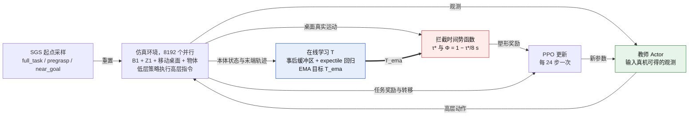
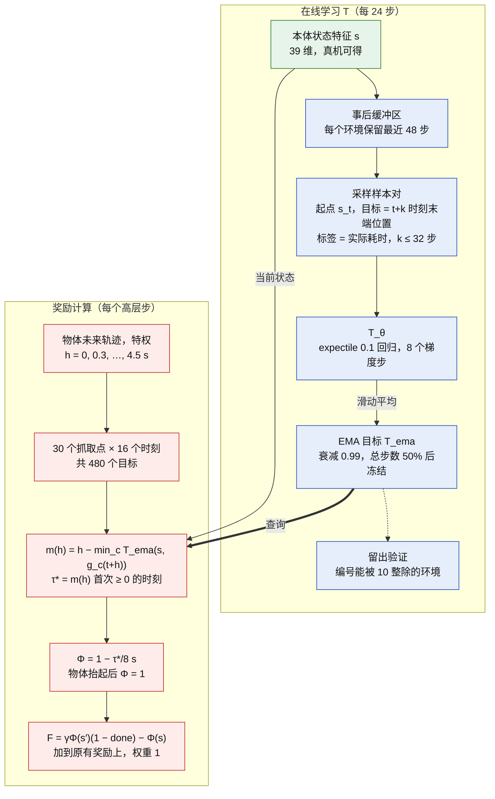
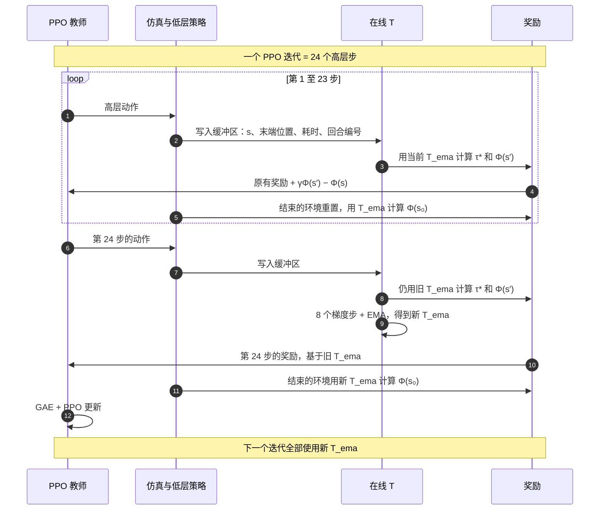

# R-online：一边训练教师，一边学习时间可达性 T

> 2026-11-26。代码已随主线 A 实现，尚未训练验证（`DQ_teacher/` 下还没有 R-online 的 run）。
> 相关文档：[主线A_实现说明.md](主线A_实现说明.md)（R 的定义与离线 T）、[顶会论文主线思路.md](顶会论文主线思路.md)。

## 0. 一句话

R-online 和现有的 R 用**同一个奖励**：拦截时间势函数 Φ = 1 − τ\*/8 s。区别只在 T 的来源：

- **离线 R**：先用训练好的 T1 教师跑 rollout，训练出 T，冻结后再训练新教师；
- **R-online**：不需要任何预训练策略。T 从零开始，用**正在训练的教师自己的 rollout** 在线学习，和 PPO 交替更新。

它要回答两个问题：

1. 方法是否依赖一个预训练教师（"先有鸡还是先有蛋"），以及与 B1 比较时是否公平；
2. 学出来的 T 本身是否必要（与解析 T 对比）。

---

## 1. 与离线 R 的对比

| | 离线 R（`r_intercept_s44`） | R-online |
|---|---|---|
| T 的数据 | T1 教师在普通 2 m 任务上跑 3000 步（随机采样动作） | 正在训练的教师在 SGS 起点上的 rollout |
| 何时训练 T | 教师训练之前，一次性完成 | 与 PPO 交替：每个 rollout（24 步）更新一次 |
| T 的初值 | 训练好的模型，留出误差 0.31 s | 物理下界 + 0.13 s（明显偏乐观），之后由数据修正 |
| 训练中 T 是否变化 | 不变，势函数塑形严格成立 | 一直在变，到总步数 50% 时冻结 |
| 前置依赖 | 先训练 T1（约 17 小时） | 无 |
| 参数 | `--reach_model data/reach/sugar_box_mlp/reach_model.pt --margin_reward` | `--reach_model new:mlp --reach_online --margin_reward` |
| 产物 | run 目录下的 `reach_model_initial.pt`（T 的副本） | checkpoint 中的 `reach_learner`；正常结束时另存 `reach_model_final.pt` |

奖励的其余部分完全相同：权重 1，保留 `approaching`，Φ(终止) = 0。

---

## 2. 系统架构

颜色说明：绿色是真机可得的量；红色是特权信息，只在训练中使用；蓝色是 R-online 新增的在线学习部分。

### 2.1 总览



图中有一个**闭环**：策略 → 数据 → T → 奖励 → 策略。离线 R 没有这个环，因为它的 T 来自另一个固定的策略。R-online 的好处和风险（§5）都来自这个闭环。

### 2.2 在线学习 T 与奖励计算



两条流水线并行运行：
- 一条每 24 步更新一次 T；
- 另一条每步用 T 计算奖励。

它们只通过"查询"这一条边相连：奖励只读取 EMA 目标 T_ema，从不读取正在训练的 T_θ。

---

## 3. 组件详解

### 3.1 T 的输入、结构和初值

**输入 s（39 维，全部真机可得）：**

| 特征 | 维数 | 真机来源 |
|---|---|---|
| 末端位置、末端姿态（6D 旋转），均在查询坐标系下 | 3 + 6 | 关节编码器 + 正运动学 |
| 重力方向、底座角速度（底座坐标系） | 3 + 3 | IMU |
| 机械臂关节位置、0.1 × 关节速度 | 6 + 6 | 关节编码器 |
| 夹爪位置 | 1 | 夹爪编码器 |
| 末端目标（积分器状态）、其 RPY 的 sin 和 cos | 3 + 3 + 3 | 控制器内部状态 |
| 发给低层的底座指令 vx、wz | 2 | 控制器内部状态 |

**目标 g**：一个三维位置，表达在**查询坐标系**中。这个坐标系的原点在机械臂基座，x 轴沿底座朝向，z 轴竖直向上，并在查询时刻冻结。

**结构**（[reachability.py:199](../DQ_high-level/modules/reachability.py#L199)）：

```text
T(s, g) = floor(s, g) + softplus(残差网络(s, g))，上限 8 s
  残差网络：状态编码器 39 → 256 → 256 → 64（每个环境只算一次）
            + 目标特征 11 维 → 线性投影到 64 → 两层头部 → 1
  floor：物理下界（底座和手臂都以速度上限直奔目标所需的时间）
```

**初值**：头部最后一层的权重为 0，偏置为 −2，所以训练开始时对任何输入都有 T = floor + softplus(−2) ≈ floor + 0.13 s。

- 这意味着 R-online 在第 0 轮相当于一个"物理下界势函数"，对远处目标明显偏乐观。例如目标在 2 m 外时，下界约 1.75 s，解析估计约 3–5 s。
- 状态归一化的统计量在前 200 次梯度更新中拟合。

### 3.2 数据：事后缓冲区

**写入**（[margin_task.py:196](../DQ_high-level/utils/margin_task.py#L196)）：

- 每个高层步，在物理仿真之后、计算奖励之前，把**所有环境**的 (s, 末端世界坐标, 查询坐标系的原点和朝向, 回合内时间, 回合编号) 写入环形缓冲区；
- 每个环境只保留最近 48 步，相当于最近两个 rollout；
- 时间是实际耗时：`rand_control` 下每个高层步执行 7 或 8 个低层周期，平均约 0.15 s；
- 重置后的初始状态 s₀ 不写入，所以每个回合的第一段 s₀ → s₁ 不进入 T 的训练数据。

**采样**（[reachability.py:341](../DQ_high-level/modules/reachability.py#L341)）：

1. 随机选一个**训练环境**（编号不能被 10 整除的环境），随机选一个起点，再随机选间隔 k ∈ [0, 32] 步；
2. 起点和终点必须属于同一个回合，否则丢弃这一对；
3. 目标 = 终点时刻的末端位置，变换到起点时刻的查询坐标系；
4. 标签 = 两个时刻之间的实际耗时，最长约 4.8 s。

**含义**：标签是"从 s_t 到达 g 最少需要多久"的**上界**，因为策略当时并不是专门去 g 的。比 4.8 s 更远的目标没有标签，只能靠网络外推。

### 3.3 学习：expectile 回归 + EMA 目标网络

更新逻辑在 [margin_task.py:300](../DQ_high-level/utils/margin_task.py#L300) 和 [reachability.py:448](../DQ_high-level/modules/reachability.py#L448)：

| 项 | 取值 | 作用 |
|---|---|---|
| 损失 | expectile，τ = 0.1：预测高于标签时权重 0.9，低于标签时权重 0.1 | 拟合标签的**下包络**，即"数据中同类情况最快的那一次" |
| 优化器 | Adam，学习率 3e-4，梯度裁剪 1.0 | |
| 频率 | 全局步数能被 24 整除时更新，每次 8 个梯度步，每步 8192 对 | 每个 PPO 迭代更新一次 T |
| EMA 目标网络 | 每个梯度步衰减 0.99；每个迭代向 T_θ 靠近约 7.7%，时间常数约 12 个迭代 | 奖励、token 和课程**只查询 T_ema**，以平滑 T 的变化 |
| 留出验证 | 每 80 次在线更新（即 80 个迭代）在留出环境上验证一次 | 输出 `Reach / validation learned_mae`，以及解析估计和下界的同口径误差 |
| 冻结 | 全局步数 ≥ 0.5 × `timesteps` 后停止更新 | 默认 120000 步，即第 60000 步（第 2500 轮）冻结。**500 轮的实验永远到不了冻结点** |

### 3.4 奖励：拦截时间势函数（与离线 R 完全相同）

每步每个环境的计算（[margin_task.py:196](../DQ_high-level/utils/margin_task.py#L196)、[reachability.py:545](../DQ_high-level/modules/reachability.py#L545)、[reachability.py:568](../DQ_high-level/modules/reachability.py#L568)）：

1. 由桌面的真实运动参数（特权）外推物体在 h = 0, 0.3, …, 4.5 s 的位姿（[`planar_carrier_future`](../DQ_high-level/modules/reachability.py#L594)）；
2. 每个时刻取 30 个抓取点，共 480 个目标，用 **T_ema** 批量求时间；
3. 每个时刻取最快的抓取点：m(h) = h − min_c T_ema(s, g_c(t+h))；
4. τ\* = m(h) 第一次 ≥ 0 的时刻，在相邻时刻之间线性插值；4.5 s 内都赶不上时，τ\* = T_ema(s, 物体在 4.5 s 时的位置)；结果限制在 [0, 8] s；
5. Φ = 1 − τ\*/8 s；物体被抬起后 Φ = 1；
6. 塑形奖励 F = γΦ(s′)·(1 − done) − Φ(s)，γ = 0.99（必须与 PPO 的折扣一致），权重 1，加在原有奖励之上。

### 3.5 一个 PPO 迭代内的时序



**时序对齐的效果：**

- T 的更新恰好发生在每个 rollout 的最后一步，所以**同一个 PPO 批次内 Φ 是固定的**。
- 唯一的例外是跨越更新的回合：在下一个迭代的第一步，奖励中会多出一项 Φ_new(s) − Φ_old(s)。
  - 这一项只取决于转移起点的状态，与动作无关，所以不会让策略梯度产生系统偏差，只会给 Critic 增加噪声。
- 代价在迭代之间：Critic 学的是 V − Φ，而 Φ 每个迭代都在变，Critic 要追一个移动的目标。

### 3.6 检查点和产物

- 每个 agent checkpoint 都带上 `reach_learner`，内容包括 T_θ、T_ema、优化器状态和更新次数（[train_multistate_DQ_teacher.py:527](../DQ_high-level/train_multistate_DQ_teacher.py#L527)）。缓冲区不保存，恢复训练时从空缓冲区开始。
- 训练正常结束时，把 T_ema 另存为 `reach_model_final.pt`（[train_multistate_DQ_teacher.py:623](../DQ_high-level/train_multistate_DQ_teacher.py#L623)）。之后可以用 `--reach_model` 复用，例如作为下一轮实验的离线 T。

---

## 4. 信息边界（直接部署）

| 量 | 是否真机可得 | 在 R-online 中的用途 |
|---|---|---|
| T 的输入 s 和 g | 是：本体感知、控制器状态、目标位置 | 只用于奖励 |
| T 的训练标签 | 是：末端自身轨迹的耗时，真机上可由正运动学得到 | 训练 T |
| 物体未来轨迹（桌面真实运动） | 否，特权信息 | 只用于奖励 |
| Actor 的输入 | 是，与 B1 完全相同 | 部署 |

R-online 只把 T 用在奖励里，所以对部署**没有任何影响**：部署的仍然是同一个结构的 Actor。只有同时打开 `--margin_tokens` 时 T 才会进入 Actor 的输入链路，那时评估必须使用 checkpoint 中保存的 T。

---

## 5. 预期的训练动态与风险

### 5.1 三个阶段

| 阶段 | 策略 | T_ema | 塑形信号 |
|---|---|---|---|
| 开始（约前几十轮） | 接近随机 | 从乐观的下界出发，被慢动作数据推高 | 起初类似"距离 / 最大速度"势函数，随后可能变平、变悲观 |
| 学会接近和抓取 | 越来越快、越来越直接 | 下包络随策略加快而下降 | 逐渐反映真实的到达时间 |
| 冻结之后（50% 步数） | 继续优化 | 固定 | 严格的势函数塑形 |

### 5.2 风险

1. **早期 T 先变差。** 早期数据全是慢动作，残差被拉大，T 从乐观变成悲观。而 R 起作用的正好是 full_task 起步阶段（第 200–350 轮）。
2. **自我强化。** T 只反映"当前策略有多快"。策略没走过的路线（比如真正的拦截路线）在 T 看来很慢，Φ 不会鼓励它们。T 越接近策略自身的价值，塑形带来的新信息越少。
3. **势函数非平稳。** 不变性只对固定的 Φ 成立。500 轮的实验里 T 一直在变，Critic 一直在追移动的目标。
4. **远距离靠外推。** 样本对最长约 4.8 s。full_task 的 2 m 起点到达时间常常更长，那一段 T 没有直接的标签。
5. **数据只覆盖近期。** 缓冲区只保留最近 48 步，T 很快忘记较早的行为，估计会有一些抖动。

### 5.3 可选改进（都还没有实现）

| 改进 | 针对的风险 |
|---|---|
| 推迟在线更新的开始时间，之前先用解析 T 或下界 | 1 |
| 先用脚本控制器采集的数据预训练 T，再在线微调 | 1、2 |
| 短实验提前冻结，例如 `onlineFreezeFraction` 设为 0.05，即第 6000 步 | 3 |
| 扩大缓冲区或增大 `maxPairSteps` | 4、5 |
| `--reach_model new:quasimetric`：带三角不等式结构的变体（目前没有 QRL 的对偶目标） | 4 |

---

## 6. 怎么跑、看什么

在 `DQ_high-level` 下运行：

```bash
SEED=44 RUN_NAME=r_online_s44 bash train_teacher_sgs_ekf.sh --action_scaling normalized --reach_model new:mlp --reach_online --margin_reward --stop_after 12000
```

和它一起比较的组（都是 seed 44，500 轮）：

| 组 | 参数 | 作用 |
|---|---|---|
| `b1_s44` | 无 | 同种子基线（还没跑） |
| `r_intercept_s44` | 离线 T | 已有 |
| `r_analytic_s44` | `--reach_model analytic --margin_reward` | 判断学 T 是否必要 |
| `r_online_s44` | 见上 | 判断是否需要预训练教师 |

**要看的曲线：**

- `Reach / loss`、`Reach / label_mean`、`Reach / prediction_mean`：T 是否在稳定学习；
- `Reach / validation learned_mae` 对比 `analytic_mae`，以及 `learned_above_label_fraction`：T 的质量。注意它每 80 轮才记录一次；
- `Margin / privileged intercept time mean (s)`：在线模式下，它的变化**同时来自策略进步和 T 的变化**，不能单独作为策略进步的证据；
- `Value / Explained variance`：Critic 是否被非平稳的 Φ 拖垮；
- 各族成功率，以及 agent_10000 的严格评估（`eval_sgs_teacher.py`，`--seed 1001`）。

**按结果判断：**

| 结果 | 结论 |
|---|---|
| analytic ≈ 离线 R | 学 T 没有必要，贡献应落在拦截时间势函数本身 |
| analytic 不如离线 R，online ≈ 离线 R | 最理想：学 T 有用且不需要预训练教师，主方法改用在线版 |
| analytic 和 online 都不如离线 R | 再实现脚本控制器采数据，得到不依赖教师的 T |

---

## 7. 代码位置

| 内容 | 位置 |
|---|---|
| 在线学习器的创建、冻结点 | [margin_task.py:92](../DQ_high-level/utils/margin_task.py#L92) |
| 写入缓冲区，计算 τ\* | [margin_task.py:196](../DQ_high-level/utils/margin_task.py#L196) |
| 重置时计算 Φ(s₀) | [margin_task.py:259](../DQ_high-level/utils/margin_task.py#L259) |
| 每步的在线更新和验证 | [margin_task.py:300](../DQ_high-level/utils/margin_task.py#L300) |
| Φ 和塑形奖励 | [margin_task.py:319](../DQ_high-level/utils/margin_task.py#L319)、[margin_task.py:337](../DQ_high-level/utils/margin_task.py#L337) |
| T 的网络结构和物理下界 | [reachability.py:199](../DQ_high-level/modules/reachability.py#L199)、[reachability.py:147](../DQ_high-level/modules/reachability.py#L147) |
| 事后缓冲区、学习器、expectile 损失 | [reachability.py:341](../DQ_high-level/modules/reachability.py#L341)、[reachability.py:408](../DQ_high-level/modules/reachability.py#L408)、[reachability.py:334](../DQ_high-level/modules/reachability.py#L334) |
| 裕度、τ\*、物体未来轨迹 | [reachability.py:545](../DQ_high-level/modules/reachability.py#L545)、[reachability.py:568](../DQ_high-level/modules/reachability.py#L568)、[reachability.py:594](../DQ_high-level/modules/reachability.py#L594) |
| 在线相关的默认参数 | [config.py:279](../DQ_high-level/utils/config.py#L279)（`reachModel`）至 [config.py:306](../DQ_high-level/utils/config.py#L306) |
| checkpoint 和 `reach_model_final.pt` | [train_multistate_DQ_teacher.py:527](../DQ_high-level/train_multistate_DQ_teacher.py#L527)、[train_multistate_DQ_teacher.py:623](../DQ_high-level/train_multistate_DQ_teacher.py#L623) |
| SGS 重置后接入 | [b1z1_pickmulti.py:331](../DQ_high-level/envs/b1z1_pickmulti.py#L331) |
