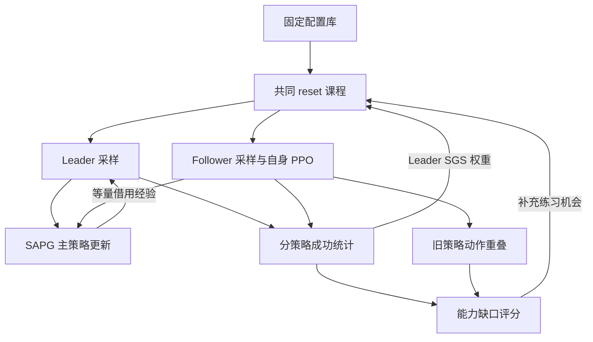

# SGS＋SAPG 思路方案：面向主策略能力缺口的协同课程

/home/hehui/DQ_WBC/doc/papers/SGS.pdf
/home/hehui/DQ_WBC-1888ce7/doc/papers/SAPG.pdf
仔细阅读上面两篇文章。其中我已经引入了SGS。我现在想把SAPG的思路与SGS结合起来，形成一个能够支撑顶会论文的思路，请你帮我仔细构思思路，结果保存为md文件。

> 日期：2026-11-23。本文是研究设计，尚未实现或验证。依据用户提供的 SAPG、SGS 论文，并结合本仓库的教师训练、SGS bank 与 PPO 数据流。
>
> **核心想法：既练主策略正在掌握的配置，也练“探索策略已经会、主策略还不会，而且动作分布有一定重叠”的配置；通过 SAPG 把探索经验汇总到最终部署的主策略。**

## 1. 方案定位：从简单组合走向协同课程

SGS 回答“哪些初始配置值得多练”，SAPG 回答“如何通过多个策略发现不同的行为，并汇总经验”。两者可以先形成一个基础组合，再增加一项明确的新机制。

| 版本 | 课程如何选择配置 | 策略如何学习 | 用途 |
|---|---|---|---|
| 当前方法 | 单策略成功率驱动 SGS | 单策略 PPO | 本项目已有起点 |
| 基础组合 | leader 成功率驱动共同 SGS | SAPG 主策略／探索策略 | 验证两篇论文的互补性 |
| **本方案研究版** | **leader 的 SGS 课程＋能力差距与动作重叠驱动的课程** | **保持相同 SAPG 更新** | **验证策略之间的能力信息能否改善课程** |

第一版研究只改变共同 reset 分布，不同时改变 follower 数据筛选规则。这样可以回答一个清楚的问题：**知道其他策略会什么，能否帮助 SGS 找到主策略值得练习的新配置？**

预期贡献是课程与多策略探索之间的反馈机制，不是“第一次发现 SGS 和 SAPG 可以组合”。SGS 原文 §2、§3.3 已将 SAPG 所属的并行探索方向视为互补，并在参考文献 [38] 引用 SAPG；但所读论文没有给出这两个方法的组合实验。[1][2]

## 2. 为什么仅把两个算法接起来还不够

### 2.1 单策略 SGS 可能遗漏另一类学习机会

SGS 倾向于增加成功率中等的配置权重。如果 leader 在某配置上几乎一直失败，其权重通常较低。

但是，另一个策略可能已经在这个配置上找到了可行的接近路径或闭合时机。这时“leader 几乎不会”不一定意味着“当前无法学习”，也可能意味着“已经存在值得利用的探索经验”。

本方案希望把这种机会补进课程。它不假设 follower 的成功一定能转化为 leader 的成功，因而还要观察动作分布是否有重叠，并通过实验验证经验是否有用。

### 2.2 混合成功率会掩盖策略之间的差异

假设同一配置上，leader 成功率为 0，follower 成功率为 1。合并后可能得到 0.5，但这不是任一策略的真实能力边界。

因此，应维护“策略 × 配置”的统计矩阵，而不是把所有 episode 继续放进原来的单套成功历史。最终部署的是 leader，课程目标也应围绕 leader 定义。

### 2.3 follower 会做，不等于 leader 能利用其经验

如果两者动作分布几乎没有重叠，follower 的成功轨迹可能在 leader 下极不可能发生，跨策略更新容易变得低效或不稳定。

本方案用一个有明确含义的动作重叠指标筛查这类情况。它只是经验可利用性的代理，不能替代真实的学习收益测量。

## 3. 整体结构

起步使用 2 个策略，总环境数仍为 8192：leader 和 follower 各 4096 个。二者在相同任务、奖励、观测和配置库上训练，最终只使用 leader。

图中省略了共享网络的参数交互：actor 在不同策略间共享骨干，critic 也在不同策略间共享自己的骨干；通过可学习的策略条件编码区分分支。follower 自身更新也会通过共享骨干影响 leader。

| 组成部分 | 具体职责 | 来源 |
|---|---|---|
| 固定配置库 | 提供可恢复的任务初态 | 沿用本项目 SGS bank |
| 多策略与条件编码 | 增加行为探索的差异 | SAPG |
| leader 的中等成功率课程 | 保留主策略自身的学习前沿 | SGS |
| 分策略能力差距 | 找到其他策略已掌握而 leader 未掌握的配置 | 本方案提出 |
| 动作重叠评分 | 降低动作分布相距过远的配置优先级 | 本方案提出 |
| 非对称经验聚合 | leader 借用经验，follower 保持各自 on-policy 更新 | SAPG |

所有策略始终使用同一个 reset 分布。第一版不把某个 follower 固定绑定为“只练 near-goal”或“只练 pregrasp”，也不要求它们执行人为指定的抓取方式。

## 4. 核心机制：两类课程的混合

### 4.1 第一类：主策略自己的学习前沿

记配置编号为 $k$，主策略为 $L$，其近期成功率为 $p_{L,k}$。沿用 SGS 的 Beta 形权重与温度采样：

$$
w_k=(p_{L,k}+\epsilon)^{\kappa t}
     (1-p_{L,k}+\epsilon)^{\kappa(1-t)},
\qquad q_S(k)\propto(w_k+\epsilon)^{1/T}.
$$

实际实现复用当前 `SGSSampler.probabilities()` 的数值保护，不另写一个略有差异的 SGS。起步沿用当前操作任务设置：目标成功率 $t=0.5$、$\kappa=1$、$T=2$、$\epsilon=10^{-4}$。

**这里的成功历史只来自 leader。** 未观测配置继续按现有初始化约定处理；未观测不等于已确认失败。

### 4.2 第二类的条件一：存在可信的能力差距

为每个策略和配置维护自然结束 episode 的成功记录：

$$
p_{j,k}=\frac{\text{近期成功回合数}}{\text{近期有效回合数}}.
$$

最直观的差距是 $[p_{j,k}-p_{L,k}]_+$，但少量偶然成功容易把差距放大。研究版使用保守筛选：

$$
G_{j,k}=\max(0,\ell_{j,k}-u_{L,k}),
$$

其中 $\ell$、$u$ 是近期成功率的 Wilson 下界和上界。直觉是：只有 follower 的保守表现仍高于 leader 的乐观表现，才启用额外课程。

建议起步规则：每个策略—配置最多保留最近 100 个自然结束回合；计算差距时仅使用最近 128 次 PPO 更新内的记录，且双方各至少有 20 个有效回合。否则令 $G_{j,k}=0$，继续由原 SGS 分布提供覆盖。

这些阈值是待检验的工程初值，不是两篇论文的既定参数。策略持续变化、回合之间可能相关，因此 Wilson 区间在这里是保守筛选工具，不能宣称它对当前策略提供严格的 95% 覆盖保证。附录 A 给出计算式。

需要额外检查：不同策略组的摩擦、质量等随机化分布应一致。固定环境分组时，应随机或分层分配策略编号，避免把环境参数差异误认为策略能力差距。

### 4.3 第二类的条件二：动作分布有一定重叠

对 follower 当前 rollout 中的原始采样动作，计算：

$$
\mu_t=\frac{\pi_L^{old}(a_t\mid o_t)}{\pi_j^b(a_t\mid o_t)},
\qquad
O_{j,k}=\frac{1}{|\mathcal D_{j,k}|}
\sum_{t\in\mathcal D_{j,k}}\min(1,\mu_t).
$$

$\pi_j^b$ 是采样时的 follower；$\pi_L^{old}$ 是同一 rollout 的旧 leader；$\mathcal D_{j,k}$ 是由配置 $k$ 开始的 episode 在本轮留下的样本，包括成功与失败过程。

数值上计算 `exp(min(0, log_mu))` 即可得到每个样本的有界贡献。**该有界处理仅用于课程评分；不要据此把 SAPG loss 中的 importance ratio 也改成同一截断。**

在固定观测下，它有如下含义：

$$
\mathbb E_{a\sim\pi_j^b}
\left[\min\left(1,\frac{\pi_L^{old}(a\mid o)}{\pi_j^b(a\mid o)}\right)\right]
=\int\min(\pi_j^b(a\mid o),\pi_L^{old}(a\mid o))\,da.
$$

因此 $O\in[0,1]$ 可作为 follower 所访问观测上的条件动作分布重叠代理。它不是成功迁移概率，也不能修正不同策略的状态访问分布。

建议仅用最新完整 rollout 估计重叠；配置至少有 32 个 transition，且来自至少 4 个不同的 episode ID。episode ID 使用跨环境唯一键，例如 `(env_id, episode_counter)`，避免并行环境的回合编号重名。数据不足时暂不启用该配置的额外课程。相关 transition 不能被当作独立成功试验。

不要只用成功轨迹或正 advantage 样本来计算 $O$，否则改变了指标的采样含义。也不要用 ESS 单独替代它：若样本中的 $\mu_t$ 全为 $10^{-8}$，ESS 仍等于样本数，但这些样本的重叠评分接近零。ESS 应作为权重集中程度的独立诊断。

### 4.4 合并成配置优先级

对每个配置，取最有希望帮助 leader 的 follower：

$$
U_k=\max_{j\ne L}G_{j,k}O_{j,k},
\qquad q_C(k)=\frac{U_k}{\sum_vU_v}.
$$

第一版只有一个 follower，暂时没有多 follower 最大值选择带来的额外复杂性。$U_k$ 的含义是“值得补充练习的候选机会”，而不是已知的学习收益。

不能把归一化后的 $q_C$ 永久赋予固定预算：当所有 $U_k$ 都接近零时，归一化仍会把微弱信号放大为完整分布。因此使用有界的整体强度：

$$
\alpha=\alpha_{\max}\max_k U_k,
\qquad
q(k)=(1-\alpha)q_S(k)+\alpha q_C(k).
$$

建议从 $\alpha_{\max}=0.2$ 开始。因为 $U_k\in[0,1]$，至少 80% 的混合权重保留给 leader 的原 SGS 课程；整体证据弱时，新增课程实际占比更小。这里说的是**分布混合权重**，不是完整任务回合或成功样本的保证比例。

若所有 $U_k=0$，直接令 $q=q_S$，不计算 $q_C$。因为 $q_S$ 保留全配置的非零概率，第一版不再额外增加均匀采样项。如果后续发现覆盖不足，应将覆盖改动同时加入相应基线后再比较。

### 4.5 更新节奏与统计失效

每次自然 episode 结束记录分策略结果；共同课程每 10 次 PPO 更新刷新一次，并在两次刷新之间冻结。刷新时重新计算全部候选，缺少新鲜重叠数据或有效成功统计的配置，其 $U_k$ 置零，不能沿用旧的高分。

课程只作用于后续 reset，不打断正在执行的 episode。根据第 $v$ 轮旧策略数据形成的分布用于后续训练，存在短暂滞后，这是该近似算法的一部分。

基础组合与研究版必须采用相同课程刷新周期，避免把“降低课程更新频率”的收益误算为新评分的贡献。

## 5. 训练闭环：怎样与 SAPG 配合

### 5.1 一轮训练做什么

1. **固定当前策略快照与归一化快照。** 各环境按自己的策略编号采样，本轮旧策略用于计算行为概率和 leader 目标。
2. **采集 rollout。** 保存每个 transition 的策略编号、起始配置编号、episode ID、原始动作、行为 log-prob、奖励、终止信息与真实下一观测。
3. **记账。** 自然结束 episode 记录终局 hold；人工取消或重置不作为失败。一个 rollout 内可能经历 reset，配置编号必须逐步保存，不能事后用环境最后的配置回填整段数据。
4. **计算本轮旧 leader 的概率与价值。** 对 follower 样本使用同一旧网络和归一化坐标，形成 SAPG 更新所需的量及重叠统计。
5. **执行 SAPG 更新。** follower 用各自 on-policy 数据；leader 用自身数据和等量 follower 数据。多 follower 时，从其合集随机抽取；第一版不按 $U_k$ 再筛选训练样本。
6. **按周期刷新课程。** 使用已提交的分策略统计和本轮重叠数据计算新的共同 $q$，应用于后续 reset。
7. **保存状态与日志。** 包括所有分支参数、优化器、归一化、课程历史和统计版本，便于复核实验配置。

保持策略编号在一个 episode 内不变；网络参数仍可像普通 PPO 一样在 rollout 边界更新，不要求把整回合锁定为同一参数快照。

### 5.2 保留 SAPG 的关键约束

- actor、critic 分别采用共享骨干加策略条件编码；可先用 16 维编码作为项目初值。每组使用独立的可学习动作标准差，以支持不同探索尺度。
- leader 的 on-policy 与借用数据量保持 1:1；follower 不直接使用其他分支的数据更新。
- 先比较不加额外熵的版本。SAPG 在 Regrasping、Throw 等任务中，额外熵并非越大越好。[1]
- 主任务奖励、hold 成功定义和观测保持一致。课程不同于阶段奖励，不引入“这个 follower 只需要接近物体就算成功”的替代判据。
- 部署时固定 leader 条件，不做多个策略的动作投票。训练阶段的策略数量不要求真机增加触觉传感器。

### 5.3 跨策略更新必须明确的近似

记当前 leader 相对旧 leader 的概率比为 $\rho=\pi_L/\pi_L^{old}$，旧 leader 相对 follower 的比值为 $\mu=\pi_L^{old}/\pi_j^b$。推荐使用考虑 advantage 正负号的形式最大化：

$$
L_{off}=\mathbb E\left[\mu\min\left(\rho\widehat A_L,
\operatorname{clip}(\rho,1-\varepsilon,1+\varepsilon)\widehat A_L\right)\right].
$$

它对应 SAPG 对 $r=\mu\rho$ 使用 $[\mu(1-\varepsilon),\mu(1+\varepsilon)]$ 的裁剪思想。$\mu$ 固定，不参与梯度。原文 Eq. 2/3 的 advantage 排在 `min` 外，对负 advantage 存在表达歧义；这里明确采用标准 PPO 的符号处理，未声称逐字复现官方代码。[1]

leader 的 off-policy value target 必须由旧 leader 计算，不能直接使用 follower GAE。为减少本仓库改动，可以保留现有 on-policy GAE，off-policy 使用旧 leader 的单步 TD residual：

$$
\widehat A_L=r_t+\gamma m_tV_L^{old}(o_{t+1})-V_L^{old}(o_t).
$$

$m_t$ 使用各对照组一致的终止／截断语义，不跨 reset bootstrap。该选择是 **SAPG 思路的工程移植**：原论文 on-policy critic 使用 3-step target，且没有完整规定 off-policy advantage 估计实现。[1]

共用 reset 分布减少了一层差异，但不能消除状态访问分布偏差，也不构成无偏策略梯度或单调性能提升保证。若未来为每个策略单独定义 $q_j(k)$，需要另行研究配置分布偏移，不能直接沿用本方案的解释。

## 6. 用移动抓取任务理解方案

下面的成功率是示意，不是实验数据；真正是否启用补充课程还取决于统计样本量与保守差距。

| 配置情况 | leader | follower | 动作重叠 | 分配倾向 |
|---|---:|---:|---|---|
| 接近物体后偶尔抓空 | 50% | 55% | 较高 | 主要由原 SGS 的中等成功率权重支持 |
| 某种接近方向下 leader 经常错过闭合时机 | 10% | 85% | 较高 | 作为补充练习候选，让两个策略更多经历该配置 |
| follower 使用与 leader 相距很远的动作模式 | 10% | 90% | 接近零 | 降低补充权重，避免只根据能力差距盲目投入 |
| 两者都无法稳定抓住 | 0% | 0% | 任意 | 没有能力差距证据，保留原 SGS 覆盖 |
| 两者都已稳定完成 | 95% | 98% | 较高 | 逐渐降低练习比例，保留回访概率 |

希望出现的闭环是：follower 发现局部解法，课程增加相关配置，leader 通过自身练习和聚合经验改善，能力差距随之缩小，新增课程权重自动回落。

但“follower 先成功、leader 后成功”本身不能证明跨策略迁移：共同课程、共享骨干和 leader 自身探索也可能造成这一现象，需要消融区分。

## 7. 如何落到当前仓库

当前入口实际使用 `sugar_box_v12.pt`、8192 个环境、24 步 rollout、`success_mode=hold`、EKF 未来位姿与归一化动作。第一轮固定这些设置，仅增加多策略和课程管理。

| 模块 | 现有文件 | 拟改动 |
|---|---|---|
| 教师模型与训练配置 | [train_multistate_DQ_teacher.py](/home/hehui/DQ_WBC-1888ce7/DQ_high-level/train_multistate_DQ_teacher.py) | 策略条件 actor/critic、分组标准差、独立 SAPG 更新入口 |
| 成功率与课程 | [sgs.py](/home/hehui/DQ_WBC-1888ce7/DQ_high-level/utils/sgs.py) | 保留原 SGS 内核；增加策略—配置统计、时间戳、共同分布管理 |
| 回合归属与 reset | [b1z1_pickmulti.py](/home/hehui/DQ_WBC-1888ce7/DQ_high-level/envs/b1z1_pickmulti.py) | 旧配置与策略对应记账；从当前共同课程采样 |
| rollout 与更新 | [ppo.py](/home/hehui/DQ_WBC-1888ce7/third_party/skrl/skrl/agents/torch/ppo/ppo.py) | 参考现有接口新增 SAPG 分支，显式保存跨策略更新需要的字段 |
| 训练入口 | [train_teacher_sgs_ekf.sh](/home/hehui/DQ_WBC-1888ce7/DQ_high-level/train_teacher_sgs_ekf.sh) | 新建实验入口或配置，记录版本与参数，避免改变已有基线含义 |
| 严格评估 | [eval_sgs_teacher.py](/home/hehui/DQ_WBC-1888ce7/DQ_high-level/eval_sgs_teacher.py) | 固定 leader 条件，沿用完整任务评估口径 |

需要提前处理的四个接口问题：

1. **策略编号独立传递。** 当前观测按固定位置切片，并有历史帧结构，不能把 `policy_id` 随意拼在原始观测末尾或送进状态归一化器。
2. **显式保存下一状态。** 本地 PPO 虽向 memory 传了 `next_states`，但没有注册对应历史 tensor；要补存，或预存采样时旧 leader 的相关 value。
3. **冻结旧策略语义。** 旧 log-prob、旧 value 与归一化快照一致；概率使用原始采样动作，不能换成环境裁剪后的动作。
4. **KL 与课程指标分开。** 学习率调度衡量各策略自己的 old→new 变化，不能把 leader 与 follower 的差异当成一次 PPO 更新过大。

当前 SGS 入口不支持训练 resume；若实现上述状态保存并进一步支持续训，需要单独完成恢复逻辑并验证，不能仅保存模型权重就声称可以无缝续训。实施前还应确认实际导入的 `skrl` 对应本地审查版本。

## 8. 实验设计：证明的是哪一项贡献

### 8.1 先做五组核心对照

| 组别 | 训练器 | reset 分布 | 目的 |
|---|---|---|---|
| A | PPO | 同一 bank 上 Uniform | 配置库基础表现 |
| B | PPO | SGS | 当前方法 |
| C | SAPG | 同一 bank 上 Uniform | SAPG 单独贡献 |
| D | SAPG | leader SGS | 两篇论文的基础组合 |
| E | 与 D 相同 | 本方案的共同混合课程 | 新机制是否优于简单组合 |

**E 与 D 是最重要的比较。** 两者共享策略数、网络、优化器、熵设置、off:on 比例、课程刷新周期、训练预算和成功定义，只改变 reset 概率计算。D 可同样记录能力矩阵与重叠但不使用评分，以测量统计开销。

Uniform 组仍使用同一 bank，不能退回单一原始 reset，否则混入状态库本身的贡献。

### 8.2 三个可证伪假设

| 假设 | 支持它所需的结果 | 不足以支持的现象 |
|---|---|---|
| H1：补充课程能扩展 leader 的有效训练范围 | E 在完整任务成功率或学习曲线面积上稳定优于 D | 训练混合成功率变高 |
| H2：动作重叠能改善候选选择 | 完整版优于仅使用能力差距的版本 | 只看到 importance weight 更平滑 |
| H3：follower 经验确有帮助 | 控制更新预算后，跨策略经验对照影响 leader 表现 | 只观察到两者成功率差距缩小 |

优先消融：

- **去掉重叠因子。** 使用 $U_k=\max_jG_{j,k}$。这会同时改变课程选择与实际混合强度；应同时报告 $\alpha$、分布熵和配置覆盖。若要单独检验“选得更好”，再做控制平均额外课程预算的比较，不将两种效应混为一谈。
- **打乱配置对应关系。** 在数据有效的配置间打乱 $U_k$，保持分数集合、混合强度和统计有效性，破坏“哪个配置值得练”的信息；检查完整混合分布的集中程度是否仍相近。
- **关闭 leader 的跨策略 loss。** 衡量聚合的重要性；承认共享骨干仍可传递信息。另做相同更新预算下用额外 leader 样本更新的对照，避免把计算量差异当成经验来源差异。

需要更强机制证据时，可从同一 checkpoint 克隆短诊断分支，固定 leader 数据、优化步数与 follower 样本数，暂不执行 follower 自身梯度，比较不同经验来源对后续 leader 评估的影响。这个局部诊断不进入第一版主算法。

### 8.3 公平预算和评估

起步配置 $M=2$、rollout 为 24：每轮新环境样本为 $8192\times24=196608$；leader 自身数据为 98304，再使用等量 follower 数据。因此每个 epoch 总样本参与 loss 约 294912 次，是单策略 PPO 的 **1.5 倍**。$M=4$ 均分时才是约 1.25 倍。

同时报告“成功率—真实 transition”和“成功率—GPU 小时”曲线、吞吐与显存。新评分需要的额外前向也计入耗时；如果增加探测回合，其数据同样计入预算。

主评估只运行 leader，从固定的完整任务初态开始，关闭自适应课程并冻结归一化。训练成功统计与最终评估数据隔离。训练时的随机策略成功率与部署时确定性 leader 成功率分别记录，不混成一个指标。

先用 3 个训练种子筛查，正式比较建议至少 5 个；置信区间以训练种子为主要独立单位，不能把大量评估 episode 当成大量独立训练。预先固定 checkpoint 评估时点，报告完整曲线，不只展示最优时刻。

主指标为完整任务 hold 成功率与学习曲线面积；辅助记录成功耗时、失败惩罚耗时、配置覆盖率、有效差距配置比例、统计年龄、实际 $\alpha$、动作重叠、ESS 和各策略自身 KL。

## 9. 推进顺序与适用边界

| 阶段 | 工作 | 进入下一阶段的依据 |
|---|---|---|
| 1：基础组合 | 完成双策略 SAPG＋leader SGS，验证概率、价值目标和回合归属 | 数据流正确、训练稳定；能够解释分支行为与计算开销 |
| 2：仅记录新评分 | 记录 $G$、$O$、$U$，不影响课程 | 确实存在持续的能力差距，而非少量噪声或环境分组偏差 |
| 3：启用混合课程 | 与 D 做匹配预算比较及关键消融 | leader 完整任务收益稳定，收益不只来自额外计算或采样集中 |
| 4：扩展验证 | 4 个策略、更多物体／任务、未见配置 | 方法在更广设置下仍有效 |

如果两个策略几乎始终相同，或保守筛选后长期没有有效差距，算法应退回基础 SGS＋SAPG。这可能说明当前任务没有足够的策略互补性，也可能说明统计过于稀疏；应分别检查，而不是不断增加模块掩盖问题。

如果 E 只提高 bank 内成功率，完整任务没有改善，应先检查 reset 课程与评估目标的偏移。如果去掉重叠仍同样有效，就不把重叠模块作为必要贡献。若差距打乱后效果不变，则需重新审视分数是否真的识别了有用配置。

**动态接触过渡生成作为后续扩展。** 多个 follower 可以提供不同的接触建立、闭合、抬升和恢复轨迹，再将经过物理验证的过渡状态加入候选库。它解决的是状态来源，本方案解决的是训练分配和经验利用。第一轮固定 bank，避免同时改变三类因素。

本方案最值得验证的主张是：**课程不仅应依据主策略当前会多少，还应利用其他策略已经发现、且主策略可能利用的行为，决定下一阶段值得练什么。** 这是一项研究假设；简单拼接、评分公式或单任务提升都不足以直接证明学术新颖性，投稿前仍需系统查重与多任务验证。

## 附录 A：保守差距的计算

对近期 $n>0$ 个有效 episode，成功比例为 $\hat p$，取 $z=1.96$：

$$
c=\frac{\hat p+z^2/(2n)}{1+z^2/n},
\qquad
h=\frac{z\sqrt{\hat p(1-\hat p)/n+z^2/(4n^2)}}{1+z^2/n}.
$$

取 $\ell=\max(0,c-h)$、$u=\min(1,c+h)$，再计算 $G_{j,k}=[\ell_{j,k}-u_{L,k}]_+$。如果计数或时效不满足 §4.2 的要求，直接令差距无效，不用人工失败补齐样本。

例如双方各完成 20 回合，follower 全成功而 leader 全失败，则保守差距约为 0.678。如果动作重叠为 0.7，$U\approx0.475$；在它是当前最大分数时，$\alpha_{\max}=0.2$ 对应实际混合比例约 9.5%。该算例仅说明评分逻辑，不代表预期实验效果。

## 附录 B：起步参数与来源

| 参数 | 起步值 | 性质 |
|---|---:|---|
| 总环境数 | 8192 | 沿用项目 |
| 策略数 | 2，后比较 4 | 项目设计 |
| rollout 长度 | 24 | 沿用项目 |
| leader on:off 数据量 | 1:1 | SAPG 关键设计 |
| 额外熵系数 | 先用 0 | 需任务消融，非保证最优 |
| SGS $t,\kappa,T,\epsilon$ | $0.5,1,2,10^{-4}$ | 沿用操作任务设置和现有内核 |
| 每策略—配置成功历史 | 最多 100 回合 | SGS 风格统计 |
| 差距有效样本量 | 双方各至少 20 回合 | 新方案保守初值 |
| 差距记录时效 | 最近 128 次 PPO 更新 | 新方案初值 |
| 重叠最小数据量 | 最新 rollout 至少 32 步、4 个 episode ID | 新方案初值 |
| 课程刷新周期 | 10 次 PPO 更新 | D、E 同时采用 |
| $\alpha_{\max}$ | 0.2，可小范围比较 0.1／0.4 | 新方案主要强度参数 |

## 参考资料

1. Singla, Agarwal, Pathak. **SAPG: Split and Aggregate Policy Gradients**, ICML 2024。重点参考 §4、§6.3、附录 B。[本地 PDF](/home/hehui/DQ_WBC-1888ce7/doc/papers/SAPG.pdf) · [PMLR](https://proceedings.mlr.press/v235/singla24a.html) · [官方项目](https://sapg-rl.github.io/)。
2. Zhang et al. **A Balanced Data Diet: Addressing the Exploration Bottleneck in Mega-Scale RL for Robot Control**, 用户提供的 SGS 论文。重点参考 §2、§3.2–3.3 和参考文献 [38]。[本地 PDF](/home/hehui/DQ_WBC-1888ce7/doc/papers/SGS.pdf) · [官方项目](https://sgs-rl.github.io/)。
3. 前序方法与代码分析：[SGS_SAPG_combination_analysis.md](/home/hehui/DQ_WBC-1888ce7/doc/SGS_SAPG_combination_analysis.md)。本文件在此基础上给出一个可检验的协同课程设计，不覆盖原分析文档。

本文未修改训练代码、未启动训练，所有新增机制与超参数均待实验验证。
