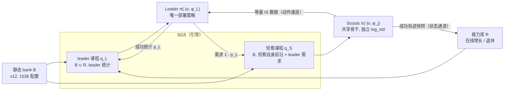

# 侦察—接力：用仿真重置在策略群体之间传递探索成果（SGS × SAPG 新思路）

> 日期：2026-11-23。研究设计稿，尚未实现或验证。依据 SGS 论文（CoRL 2026，arXiv 2610.12465）、SAPG 论文（ICML 2024），以及本仓库教师训练代码（`sugar_box_v12.pt`、8192 环境、hold 成功判据、EKF 未来位姿、归一化动作）。
>
> 本文是重新构思的第二版，不替代 [SGS_SAPG_combination_analysis.md](SGS_SAPG_combination_analysis.md)（基础组合与实现细节）和 [SGS_SAPG_collaborative_curriculum_design.md](SGS_SAPG_collaborative_curriculum_design.md)（能力差距 × 动作重叠课程）。SAPG 聚合项的实现陷阱沿用前者 §5.2、§6，这里不重复。

/home/hehui/DQ_WBC-1888ce7/doc/SGS_SAPG_scout_relay_design.md
你就按照这个思路为我完成代码实现吧。修改后写一个代码修改记录，简要记录改了啥，md格式。
---

## 0. 一句话主张

**SAPG 靠动作重要性采样把 follower 的经验汇给 leader。但 follower 最有价值的发现，恰恰是 leader 还不会、动作分布离 leader 最远的那部分，这部分 IS 通道几乎传不过去。仿真器却可以把 follower 到过的状态直接设为 leader 的重置起点。这条“状态通道”与行为策略无关，不需要 IS，也不会因策略更新而过期；决定其中哪些状态值得 leader 练，正是 SGS 擅长的事。**

由此得到方法 **侦察—接力（Scout & Relay，暂名）**：

- **侦察（Scout）**：follower 按 leader 的 SGS 统计，专门去探索 leader 失败的配置。这是 SGS → SAPG 的方向。
- **接力（Relay）**：follower 成功轨迹上的中间状态被写入一个动态起点库，leader 用自己的 SGS 统计从中选点练习。这是 SAPG → SGS 的方向。
- **聚合（Aggregate）**：保留 SAPG 原有的 IS 聚合，负责动作接近时的局部精修。

两条通道互补：

| 通道 | 适用情形 |
|---|---|
| 动作通道（IS） | 行为接近，用于精修 |
| 状态通道（重置接力） | 行为相距远，用于发现 |

### 与上一版方案的区别

| | 上一版：协同课程 | 本版：侦察—接力 |
|---|---|---|
| follower 的知识怎样到达 leader | 只经 IS 聚合，外加课程调频 | IS 聚合 **＋ 状态重置接力** |
| 对“动作重叠低”的配置 | 降权（$U=G\times O$），即放弃 | **正是接力通道的主要用武之地** |
| SGS 的作用 | 在固定 bank 上调采样概率 | 同时在 **在线增长的配置集合** 上调概率，并指挥 follower 去哪探索 |
| 理论支点 | 无，阈值较多 | IS 有效样本量的解析式；重置分布的分布失配系数（policy gradient 理论） |
| 回应 SGS 原文局限 | 未涉及 | 直接回应 SGS §5 的局限 2：“SGS 只采样、不构造分布” |

---

## 1. 两篇论文到底解决了什么，各自留下了什么

### 1.1 共同的大问题

两篇都在回答同一个问题：**大规模并行 on-policy RL 中，一个 batch 里有多少样本真正带来学习信号？** 它们各自指出了一种冗余。

| | SGS | SAPG |
|---|---|---|
| 冗余所在 | **状态轴**：大量环境从结果已确定的配置开始（必成或必败） | **行为轴**：同一 Gaussian 策略在大量环境里执行几乎相同的动作 |
| 修正办法 | 按成功率 Beta 核 $w=(p+\epsilon)^{\kappa t}(1-p+\epsilon)^{\kappa(1-t)}$ 加温度 softmax 重采样配置 | 拆成 $M$ 个条件策略（共享骨干＋$\phi_j$），leader 用 IS 吸收 follower 数据（on:off = 1:1） |
| 自述的互补关系 | §2、§3.3 把 SAPG（参考文献 [38]）列为解决“单 Gaussian 数据冗余”的互补方向 | 未讨论 reset 分布 |
| 自述局限 | ①离散固定配置集；②**只采样、不构造分布**（“closing the loop … remains an open problem”）；③sim-to-real 差距 | 对称聚合会使策略趋同、多样性消失；全量 off-policy 数据噪声大，需下采样 |

SGS 原文明确写了 “We do not claim a fundamentally new curriculum principle”。**所以只在 SGS 上叠一个新的打分公式，很难构成顶会贡献；贡献必须来自 SGS 与 SAPG 之间新的耦合机制。**

### 1.2 SGS 的附录已经暗示了“谁来构造起点库”是关键

SGS 附录 B.3 的 reset 消融：

| 训练 bank | 结果 |
|---|---|
| 去掉 Near-Goal 族 | 三族成功率全部为 0 |
| 去掉 Stable Grasp 族 | 均值明显下降，一个种子崩溃 |
| 去掉 Reaching 族 | 基本不变 |

也就是说，**SGS 的效果高度依赖起点库里有没有“靠近成功”的状态**，而这些状态目前靠人工设计（OmniReset 三族；本项目 v12 的 full_task / pregrasp / near_goal 三族）。

动态抓取让人工设计更难：桌子在走弧线、底盘在动、物体有速度。v12 的 pregrasp 和 near_goal 已经做了大量物理校验（`ConfigurationBank._validate_near_goal`），但这类“通用”中间状态未必落在困难配置的**真实可行路径**上。

### 1.3 SAPG 隐藏的两难：多样性越有价值，越难被 IS 传递

SAPG 需要 follower 与 leader **不同**，否则数据冗余没有改善；对称聚合消融已说明趋同会抵消收益。可 IS 聚合要求 follower 与 leader **相近**，否则重要性权重退化。这就是本文要正面处理的 **“多样性—可传递性两难”**（§3.1 给出定量形式）。

### 1.4 两种冗余在本项目里会相互放大

本项目 bank 只有 1536 个配置，环境却有 8192 个，**同一配置天然被多个环境同时运行**：均匀采样时平均约 5.3 个并发副本。

SGS 把概率集中到前沿配置后，并发副本数近似为

$$
\text{副本数}\approx \frac{8192}{\exp(H(q))},
$$

其中 $\exp(H(q))$ 是采样分布的有效配置数。若训练中期有效配置数降到 300，每个前沿配置约 27 个并发副本。这些副本从同一起点出发，运行同一个 Gaussian 策略，只有域随机化和动作噪声不同。

**SGS 越集中，行为冗余越严重，SAPG 式的行为拆分越有价值。** 这是可测量的现象（§7 P0），可作为论文第一张动机图。

---

## 2. 研究问题与可证伪假设

**核心研究问题：在 SGS 管理起点、SAPG 管理行为多样性的框架里，follower 的探索成果应该通过什么通道交给最终部署的 leader？**

| 假设 | 内容 | 支持它的证据 | 推翻它的证据 |
|---|---|---|---|
| H1 两难存在 | follower 显著优于 leader 的配置上，follower 样本在 leader 下的 IS 有效样本量显著更低 | “能力差距—ESS” 负相关 | 无相关，或能力差距配置上 ESS 并不低 |
| H2 状态通道有效 | 接力使 leader 在严格完整任务评估上优于基础 SGS＋SAPG | 匹配预算下多种子稳定领先 | 只提高 bank 内成功率，2 m 起步不变 |
| H3 两通道互补 | 接力收益集中在低重叠配置，IS 收益集中在高重叠配置 | 按重叠分层后收益分布呈交叉 | 两种收益在各层没有差别 |
| H4 群体有必要 | 侦察接力优于“leader 自接力”（只用 leader 自己偶然成功的轨迹） | 匹配接力预算下领先 | 自接力与侦察接力持平 |
| H5 SGS 是合适的接力控制器 | SGS 选择接力点优于均匀选择或固定时刻 | leader 选中的接力点随训练向轨迹前端移动（自动反向课程） | 均匀选择同样好 |

**H4 是最大风险。** 若自接力已经足够，论文就退化成“在线状态库＋SGS”，与 ConTrack（2026，见 [SGS_top_conference_assessment.md](SGS_top_conference_assessment.md) §3）等近作非常接近。因此 P0/P1 必须尽早回答 H1 和 H4。

---

## 3. 理论支点

### 3.1 IS 通道的有效样本量：解析式

固定观测 $o$，follower 动作 $a\sim\pi_j(\cdot\mid o)$，权重 $\mu(a)=\pi_L(a\mid o)/\pi_j(a\mid o)$。由于 $\mathbb E_j[\mu]=1$，Kish 有效样本比例为

$$
\frac{\mathrm{ESS}}{n}=\frac{(\mathbb E_j\mu)^2}{\mathbb E_j[\mu^2]}
=\frac{1}{\int \pi_L^2/\pi_j\,da}
=\exp\!\big(-D_2(\pi_L\Vert\pi_j)\big),
$$

其中 $D_2$ 是 2 阶 Rényi 散度。对标准差相同的对角 Gaussian 策略（均值差 $\Delta$，标准差 $\sigma$）：

$$
D_2=\Big\Vert \frac{\Delta}{\sigma}\Big\Vert_2^2
\quad\Longrightarrow\quad
\frac{\mathrm{ESS}}{n}=\exp\!\Big(-\Big\Vert\frac{\Delta}{\sigma}\Big\Vert_2^2\Big).
$$

| 均值差 $\Vert\Delta/\sigma\Vert^2$ | 0.25 | 1 | 4 | 9 |
|---|---|---|---|---|
| 单步有效样本比例 | 0.78 | 0.37 | 0.018 | $1.2\times10^{-4}$ |

**举例（数值仅示意）：** 9 维归一化动作，训练后期 $\sigma\approx0.2$。若 follower 在底盘前进速度和偏航角速度两维上各比 leader 偏 0.4（从另一侧绕行截获），则 $\Vert\Delta/\sigma\Vert^2=8$，有效样本比例约 $3\times10^{-4}$。

follower 一旦形成**不同的行为模式**，它在这些状态上的样本对 leader 几乎没有贡献。SAPG 的 $\mu$ 缩放裁剪窗口 $[\mu(1-\varepsilon),\mu(1+\varepsilon)]$ 不改变这一点：$\mu$ 很小时梯度贡献可忽略；偶发的大 $\mu$ 则带来方差。

若两者标准差不同，follower 更窄时情况更糟（$\sigma_j^2\le\sigma_L^2/2$ 时 $D_2$ 发散）。此外，SAPG 只用单步比值，忽略状态分布差异，其偏差也随策略分歧增大。

**结论：IS 通道擅长传递“小偏离”，即精修；不擅长传递“新模式”，即发现。** 这是 H1 的理论来源，P0 用实测 ESS 检验。

### 3.2 状态通道：重置分布与分布失配系数

经典 policy gradient 理论（Kakade & Langford 2002 的 restart distribution 与 CPI；Agarwal 等 JMLR 2021 的梯度支配引理，引用前核对编号）中，用重置分布 $\nu$ 训练、在原任务分布 $\rho$ 上评估时，次优性受**分布失配系数**控制：

$$
V^{\pi^*}(\rho)-V^{\pi}(\rho)\;\le\;\frac{1}{1-\gamma}\,
\Big\Vert\frac{d^{\pi^*}_{\rho}}{\nu}\Big\Vert_\infty\;
\max_{\bar\pi}\,(\bar\pi-\pi)^{\top}\nabla_\pi V^{\pi}(\nu).
$$

直观含义：**重置分布 $\nu$ 应覆盖好策略在原任务中会经过的状态。**

- 人工 bank（pregrasp / near_goal）是对 $d^{\pi^*}_\rho$ 的手工猜测。
- leader 自身访问的状态只覆盖它已经会走的路。
- **follower 在 leader 失败的配置上成功，其轨迹就是“更好策略在原任务中的访问状态”的样本。** 把它们加入 $\nu$，可以降低 leader 当前覆盖不到的那部分失配。

这一论证有三条边界，需要在论文中写明：

1. 该界针对的是 $\nu$ 上的近似驻点，不保证 PPO 能收敛到该驻点。
2. follower 成功轨迹只是 $d^{\pi^*}$ 的代理，不是它本身。
3. SGS 本身已经让训练用的 $\nu\ne\rho$。接力不引入新类型的偏差，只是**改进 $\nu$ 的构造**，回应 SGS 原文局限 2。

状态还有一个 IS 数据没有的性质：**它是物理状态，与策略无关，不会随策略更新而过期。** 会变化的只是它对 leader 的练习价值，而这正由 SGS 的成功率统计追踪。

### 3.3 SGS 沿接力链产生自动反向课程

对 follower 的一条成功轨迹 $s_0,\dots,s_T$，leader 从 $s_t$ 起步的成功率 $p_L(s_t)$ 通常随 $t$ 增大（越接近成功越容易）。SGS 的 Beta 核把概率集中在 $p_L\approx0.5$ 的位置。随着 leader 掌握后段状态，这个位置会沿轨迹**向前端移动**。

这正是反向课程（Florensa 2017、Backplay、RFCL）的效果，但有三点不同：

- 示范来自**同时训练的 follower**，无需人工示范；
- 不需要手工设定前移速度；
- 停在哪里由 leader 自己的成功率决定。

单调前移是经验假设（H5），不是定理，需要画出“leader 所选接力点在轨迹中的相对位置”随训练变化的曲线来验证。

---

## 4. 方法：侦察—接力

### 4.1 总体结构



### 4.2 群体与角色（沿用 SAPG）

- **结构**：actor 和 critic 各自共享骨干，用可学习条件向量 $\phi_j$ 区分分支（先用 16 维），每个分支有独立的可学习 `log_std`。
- **起步配置**：$M=2$，leader 4096 环境，scout 4096 环境，总数仍为 8192。
- **扩展配置**：$M=3$，leader 4096，两个 scout 各 2048，以保证 leader 自身样本量。这偏离了 SAPG 的均分做法，需要作为消融。
- **更新规则**：scout 只做自身 on-policy PPO。leader 用自身 on-policy 数据（**包含从接力状态起步的回合，它们完全是 on-policy 的**），再加等量的 scout 数据，用 SAPG 的 IS 修正项更新。
- **部署**：只部署 leader，条件向量固定为 $\phi_L$。actor 观测与现有 214 维完全一致。scout、接力库和课程都是训练期的仿真特权，符合“教师直接部署”的约束。

### 4.3 侦察课程：SGS 指挥 scout 去哪探索（SGS → SAPG）

scout 在静态 bank 上采样，权重同时考虑自己的学习前沿和 leader 的需求：

$$
q_S(k)\;\propto\;\Big[\,(w(p_{S,k})+\epsilon)\cdot(1-\tilde p_{L,k}+\epsilon)^{\beta}\,\Big]^{1/T}.
$$

- $w(\cdot)$ 是原 SGS 的 Beta 核（$t=0.5,\ \kappa=1,\ \epsilon=10^{-4}$），直接复用 `SGSSampler` 的数值保护。$T=2$。
- $p_{S,k}$ 是 scout 自己的成功率，$\tilde p_{L,k}$ 是 leader 的成功率（沿用 `p_init=0`，未访问即视为“需要”）。
- $\beta=1$ 为默认值，$\beta=0$ 退化为“各分支各自 SGS”，作为消融。

训练早期 leader 处处失败，需求项接近 1，侦察课程退化为普通 SGS。leader 掌握某配置后，scout 自动转去别处。

### 4.4 接力：scout 的成功变成 leader 的起点（SAPG → SGS）

**① 快照缓冲**

每个 scout 环境维护一个**当前回合**的快照环形缓冲，每 $m=5$ 个高层步（约 0.75 s）写入一次。字段与 `ConfigurationBank.REQUIRED_TENSORS` 完全一致：

- 根状态：`robot_root`、`object_root`、`table_root`、`rigid_body_state`；
- 关节：`dof_pos`、`dof_vel`；
- 末端与夹爪：`ee_goal_cart`、`ee_goal_orn_rpy`、`gripper_target`、`ee_jacobian`；
- 桌子：`table_vy`、`rotation_enabled`、`table_yaw_rate`、`table_height`，外加 `table_change_interval` 与当前模式计时。

这样恢复时可以**原样复用 `_reset_sgs_envs` 的恢复路径**。按一个快照约 500 个浮点估算，4096 个 scout 环境各存 20 帧约 160 MB 显存。

**② 触发条件**

以下三条同时满足时，写入接力链：

1. scout 从配置 $k$ 起步的回合以 hold 成功自然结束；
2. leader 在 $k$ 上很弱：$\tilde p_{L,k}\le\tau_{\text{need}}=0.3$；
3. $k$ 的活跃接力链数少于 $r_{\max}=2$。

**③ 选取接力状态**

记 hold 开始的步数为 $T_s$。在 $f\in\{0.2,0.4,0.6,0.8\}$ 处，各取最接近 $f\cdot T_s$ 的快照，组成 4 个接力项。每项记录来源配置、链编号和 $f$。

只取 hold 开始**之前**的状态，避免把持稳计数中途切断。若来源回合本身起步于 pregrasp 或 near_goal，链同样有效。

**④ leader 怎样从中采样**

leader 在 $B\cup R$ 上运行一个统一的 SGS：

- 接力项的成功率用 Laplace 估计 $(s+1)/(n+2)$，未访问时为 0.5。理由是 scout 已经在这条轨迹上成功过，给出乐观初值是合理的。
- 接力项的总概率质量上限为 $\alpha_{\max}=0.3$，超出时按比例缩放，以保证 full_task 等原始配置的练习量。
- 消融 $\alpha_{\max}\in\{0.15,0.3,0.5,1.0\}$，其中 1.0 即不设上限。

**⑤ 起步语义**

与现有 bank 族一致：回合计时归零（critic 的时间观测从 0 开始，拥有完整的 100 步预算），hold 计数归零，EKF 窗口重置后压入当前位姿，低层控制器历史清零。

**⑥ 质量控制**

| 情况 | 判定方式 | 处理 |
|---|---|---|
| 隔离（无效状态） | leader 从该项起步后 3 步内因翻倒、底座过低或 IK 失败而终止 | 判为恢复失真，立即移除。超时或掉落不在此列，属于“难”而非“无效” |
| 掌握 | $p\ge0.9$ 且 $n\ge20$ | 退休 |
| 无用 | $n\ge40$ 且从未成功 | 退休 |
| 容量满 | 总容量 4096 项（约 1024 条链） | 淘汰当前 SGS 权重最低的项 |

另外记录“链前端已掌握”事件：链的 $f=0.2$ 项被掌握，通常意味着来源配置 $k$ 本身进入了 leader 的前沿。

### 4.5 一轮训练

```text
for iteration:
  # 1) 采样（每个环境按自身分支）
  leader 环境结束 → 从 q_L（B ∪ R，leader 统计，R 质量 ≤ α_max）抽起点
  scout 环境结束  → 从 q_S（B，scout 前沿 × leader 需求）抽起点
  rollout 24 步；scout 环境每 5 步写入快照环形缓冲
  # 2) 记账（只用自然结束的回合）
  leader 结果 → 更新 leader 在 B 或 R 项上的历史
  scout  结果 → 更新 scout 在 B 上的历史；满足触发条件则写入接力链
  执行隔离、退休、容量淘汰
  # 3) 更新（SAPG）
  scout  ← 各自 PPO（on-policy）
  leader ← on-policy PPO（含接力起步）+ 等量 scout 数据的 IS 修正项
```

课程每次 PPO 更新后刷新即可。现有 `SGSSampler` 每个回合结束时都会更新，计算量很小。

### 4.6 设计取舍说明

- **为什么只接力“成功”轨迹？** 让接力链的语义更干净：已知存在从该状态出发的成功路径。“接力失败轨迹的状态”作为对照（§6.3），用来区分“成功条件化”与“只是多了状态多样性”。
- **为什么不让 scout 也从接力库起步？** 第一版保持 scout 的探索对象就是原始配置，避免链套链导致状态分布漂移。可作为后续扩展。
- **为什么保留 IS 通道？** 理论上两通道互补（H3），而且 IS 通道为 leader 提供 scout 在困难配置上的 critic 训练数据。消融里会单独关闭它。
- **为什么不需要 Wilson 区间、重叠阈值等？** 本版的过滤只有一个触发阈值 $\tau_{\text{need}}$。接力项的取舍完全交给 leader 的 SGS 统计，超参数比上一版少。

---

## 5. 为什么这是“组合”而不是“拼接”

| 耦合方向 | 机制 | 去掉后会怎样 |
|---|---|---|
| SGS → SAPG | leader 的成功统计决定 scout 去哪探索 | scout 的多样性花在 leader 已会或无关的配置上 |
| SAPG → SGS | scout 的成功轨迹在线构造 SGS 的配置集合 | SGS 只能在人工 bank 上调频，碰不到 leader 不会的路径 |
| SGS 作为接力控制器 | 前沿权重沿接力链自动前移 | 需要人工反向课程进度表 |
| 两条聚合通道 | IS 负责精修，重置负责发现 | 只有 IS 时，新模式传不过去（§3.1） |

每一行都能对应一个消融（§6.3）。**论文的核心卖点是“状态通道＋IS 通道”的互补，以及 SGS 在其中的双重角色；单独的 SGS、SAPG 或接力都不是新贡献。**

---

## 6. 实验设计

### 6.1 公共设定

- **固定条件**：v12 bank、奖励（以当前采用的基线为准，T1，或 T1 加主线 A 的 R 势函数，所有组一致）、观测、8192 总环境、24 步 rollout、PPO 超参。
- **公平性**：比较时以实际环境 transition 数为横轴，同时报告 GPU 小时和墙钟时间。$M=2$ 时 leader 每轮参与 loss 的样本约为单策略 PPO 的 1.5 倍（见上一版文档 §8.3）。
- **主指标**：`eval_sgs_teacher.py` 的严格评估。只评估确定性 leader，从 2 m 完整任务原始分布起步，关闭 SGS，冻结归一化，报告 hold 成功率。
- **辅助指标**：学习曲线面积、达到 0.5 / 0.8 成功率所需的 transition 数、成功耗时。
- **种子**：筛查用 3 个种子，正式结论用 5 个。基线与新方法使用相同种子集合；记忆中已有种子效应显著的先例。

### 6.2 主比较

| 组别 | 训练器 | leader 起点分布 | scout 课程 | 接力来源 | 回答的问题 |
|---|---|---|---|---|---|
| A | PPO | bank 上均匀 | — | — | bank 本身 |
| B | PPO | SGS | — | — | 当前方法 |
| C | SAPG | leader SGS | 普通 SGS | — | 两篇论文的基础组合 |
| D | SAPG | leader SGS（B∪R） | 普通 SGS | **leader 自己**的偶然成功 | 自接力（ConTrack 式在线库的公平迁移） |
| E | SAPG | leader SGS（B∪R） | 普通 SGS | scout 成功 | 接力通道的贡献 |
| **F** | SAPG | leader SGS（B∪R） | **需求加权** | scout 成功 | 完整方法 |
| G | PPO | SGS（B∪R） | — | leader 自己 | 单策略能否靠自接力达到同样效果 |

关键比较：

- **F 对 C**：完整方法的收益（H2）。
- **E、F 对 D、G**：群体是否必要（H4）。
- **F 对 E**：侦察课程是否必要。

D、E、F 的接力容量、$\alpha_{\max}$、触发阈值完全相同。

### 6.3 机制消融

| 消融 | 改变 | 检验 |
|---|---|---|
| 接力不用 SGS | 接力项内均匀采样 | H5：SGS 作为接力控制器的作用 |
| 固定接力点 | 只用 $f=0.8$ 或只用 $f=0.2$ | 自动反向课程是否优于固定位置 |
| 失败轨迹接力 | 同等数量状态，取自 scout 失败回合 | 成功条件化是否重要 |
| 关闭 IS 通道 | leader 不吸收 scout 数据，只保留接力 | 分离两条通道的贡献 |
| 关闭接力通道 | 即 C 组，但侦察课程开启 | 侦察课程本身对 IS 通道是否有帮助 |
| 群体规模 | $M\in\{2,3,4\}$，以及 leader 占比 50% 对均分 | 规模与预算分配 |
| scout 多样性来源 | 仅 $\phi$／加分支熵／scout 使用不同 SGS 目标 $t_j$ | 多样性从哪来最有效 |
| 快照完整度 | 控制器历史清零（默认）对比同时保存步态相位与低层历史 | 恢复失真的影响 |

### 6.4 最有说服力的两张机制图

1. **两难散点图（H1）**：在 C 组训练中，对每个配置画出能力差距 $p_{S,k}-p_{L,k}$ 与 scout 样本在 leader 下的中位 ESS 比例。预期两者负相关。这张图在 P0 阶段就能得到，不需要实现接力。
2. **按重叠分层的收益图（H3）**：把配置按 scout–leader 的平均 ESS 分成高、中、低三层，比较 E 对 C（接力收益）和 C 对“仅侦察课程、关闭 IS”（IS 收益）在各层上 leader 成功率的提升。预期接力收益集中在低重叠层、IS 收益集中在高重叠层，两条曲线交叉。

再加一张 **接力点前移曲线（H5）**：leader 采样到的接力项平均 $f$ 随训练迭代的变化。

### 6.5 规模实验

两篇原文的核心叙事都是“随并行规模扩展”。建议在可承受范围内做 4K / 8K / 16K（条件允许则 32K）总环境的扩展曲线，保持 minibatch 数不变，比较 B、C、F。

如果单卡上不去 16K，可以考虑多卡，或者把论文叙事改为“固定预算下的能力与效率”，不要强行声称 mega-scale。

### 6.6 泛化性（顶会通常要求不止一个任务）

1. **本域内**：
   - 桌子速度分档，从静止到 1.6 倍；
   - 直线与弧线运动分开统计；
   - 多个物体，每个物体一个 bank。

   预测：运动越动态，人工中间状态越难设计，接力的收益应越大。这是与移动抓取应用最契合的论点。
2. **公共基准**：SAPG 最难的 AllegroKuka Regrasping 和 Reorientation。它们同样基于 Isaac Gym，SAPG 有官方代码，快照重置在该框架内可行。这能说明方法不依赖本任务。
3. **可选**：SGS 原文的 assembly 任务，取决于其代码是否开源。

### 6.7 真机

只部署 leader，观测不变，无需新增传感器。比较 B（当前最优）与 F：在多档桌速、直线和弧线上各做 N 次试验，报告成功率、首次尝试成功率和成功耗时。

真机提升不是本方法的直接主张，但顶会机器人类审稿通常会要求真机结果。

---

## 7. 推进路线与决策点

| 阶段 | 内容 | 继续推进的条件 |
|---|---|---|
| **P0 诊断**（不实现接力） | ① 现有 B 组日志：记录 $\exp(H(q))$、并发副本数、同配置副本间的轨迹离散度；② 实现 C 组（SAPG＋leader SGS，$M=2$），记录每配置的 scout–leader 成功差和 ESS；③ 快照“恢复—回放”一致性测试：恢复 scout 快照并开环回放原动作，统计成功一致率 | ≥10% 的配置持续（≥50 次迭代）满足 scout 比 leader 高 0.3 以上，且这些配置的中位 ESS < 0.2；恢复—回放一致率足够高（例如 ≥80%） |
| **P1 最小方法** | D、E 两组加 C 对照，3 个种子 | E 显著优于 C，且 E 优于 D |
| **P2 完整方法** | F 组、§6.3 消融、§6.4 机制图 | F ≥ E；H3 的交叉形态出现 |
| **P3 论文证据** | 规模实验、泛化任务、5 个种子、真机 | — |

**P0 不通过时的退路：**

| 现象 | 处理 |
|---|---|
| scout 与 leader 一直几乎相同，没有能力差距 | 先加大多样性（分支熵、不同 $t_j$）再测；仍不行则说明本任务缺少行为互补，回到基础组合 |
| 有能力差距但 ESS 不低 | IS 通道已经够用，接力的理论动机变弱；论文重心改为侦察课程 |
| 恢复—回放一致率低 | 先扩展快照字段，加入步态相位、低层观测历史和动作历史；这是正确性问题，不是方法问题 |
| P1 中 D ≈ E | 群体没有额外价值，论文退化为“SGS＋在线自接力”，新颖性显著下降，需重新评估是否继续 |

---

## 8. 与相关工作的边界（投稿前需系统查重）

| 方向 | 代表工作 | 区别 |
|---|---|---|
| 群体策略聚合 | SAPG（IS 聚合）、DexPBT（权重替换＋超参变异）、P3S（off-policy 群体共享回放，需核对） | 它们只通过动作数据或权重传递；本方法增加**状态重置通道** |
| 从状态或示范重启 | Go-Explore、Backplay、Salimans & Chen 2018、反向课程（Florensa 2017）、RFCL、DemoStart | 多为单智能体存档或人工示范；本方法的“示范者”是**同时训练的群体成员**，接力点由 leader 的 SGS 选择 |
| 在线状态库 | ConTrack（2026，单策略，示范跟踪，失败附近重置） | 最近的近邻，D、G 两组就是它的公平迁移 |
| 构造 reset 分布 | OmniReset、CSRL、采样式探索（RSS 2023） | 离线、几何或约束驱动；本方法在线、由群体成功驱动 |
| UED 与课程 | PLR、SFL、ACCEL（编辑关卡）、SGS | ACCEL 通过编辑生成新关卡；本方法通过群体成功生成新起点 |
| LLM RL 中的类比 | DAPO 的动态采样（过滤全对或全错的 prompt，与 SGS 同一原理）；用部分解答作为前缀或提示帮助难题（如 QuestA、BREAD，需核对） | 类比：仿真状态相当于“前缀”，scout 相当于同时训练的“更强模型”，无需外部专家 |

**可主张的贡献（需查重确认）：**

1. **分析**：提出 IS 聚合的“多样性—可传递性两难”，给出 Gaussian 策略的 ESS 解析式，并在动态移动抓取中实测验证。同时指出 SGS 的集中采样会放大行为冗余。
2. **方法**：侦察—接力。由 SGS 统计驱动的侦察课程，加上由 leader SGS 分配的群体状态接力，两条通道并存；最终只部署单一 leader。
3. **实验**：在动态移动抓取（多速度、多物体）和公共灵巧操作基准上验证，包括规模曲线、机制消融和真机直接部署。

**不能主张的：**

- 首次结合 SGS 与 SAPG（SGS 原文已指出两者互补）；
- 首次从访问状态重启；
- 无偏或单调改进保证；
- 真机提升必然来自本方法。

---

## 9. 落到本仓库的改动点

| 模块 | 文件 | 改动 |
|---|---|---|
| 多分支模型 | `DQ_high-level/train_multistate_DQ_teacher.py` | actor 和 critic 加入条件向量 $\phi_j$（经独立元数据通道传入，不拼进原始观测或归一化器）；每个分支独立 `log_std` |
| SAPG 更新 | `third_party/skrl/skrl/agents/torch/ppo/ppo.py`（建议新建 SAPG agent，不改原 PPO） | 分支内 PPO；leader 的 IS 修正项。实现陷阱见 [上一版分析](SGS_SAPG_combination_analysis.md) §5.2、§6 |
| 接力库与课程 | `DQ_high-level/utils/sgs.py` | 新增 `RelayBank`（字段同 `REQUIRED_TENSORS`，外加来源配置、链编号、$f$、状态标记）；leader 的 $B\cup R$ 联合采样与 $\alpha_{\max}$ 上限；scout 的需求加权采样；分支维度的成功统计 |
| 快照与恢复 | `DQ_high-level/envs/b1z1_pickmulti.py` | scout 环境的快照环形缓冲；把 `_reset_sgs_envs` 的状态来源泛化为“bank 或接力库”；记账时同时记录 `policy_id` 和起点来源；隔离判定 |
| 入口 | `DQ_high-level/train_teacher_sgs_ekf.sh` | 新建独立入口或配置项（例如 `--sapg_branches`、`--relay`），保持现有基线含义不变 |
| 评估 | `DQ_high-level/eval_sgs_teacher.py` | 固定 $\phi_L$；其余口径不变 |
| 诊断日志 | 训练日志 | $\exp(H(q))$、每配置 ESS、能力差距、接力库规模与新增、退休、隔离计数、leader 采样接力的平均 $f$、接力起步占比、分支间 KL |

**实现前要确认的两点：**

1. 快照恢复时低层控制器历史被清零。现有 near_goal 族已经接受了这一近似，但接力状态多为底盘行进中的状态，可能更敏感。P0 的恢复—回放测试要先做。
2. 当前 SGS 入口不支持 resume，接力库加群体的训练状态更多。若需要续训，必须单独实现并验证。

---

## 10. 论文结构草案

**标题备选：**

- *When Importance Sampling Fails, Reset: Relaying Population Exploration for Massively Parallel On-Policy RL*
- *Scout and Relay: Coupling Success-Guided Sampling with Split-and-Aggregate Policy Gradients*

**摘要骨架：** 大规模并行 on-policy RL 存在状态冗余和行为冗余，分别由 SGS 与 SAPG 缓解。我们发现两者结合时存在“多样性—可传递性两难”：follower 越有新发现，IS 越难把它传给 leader。我们提出用仿真重置作为第二条聚合通道，由 SGS 决定在哪探索、练哪些接力状态。在动态移动抓取和灵巧操作上，方法优于基础组合与在线自接力，并在真机直接部署。

**图表计划：**

| 图 | 内容 |
|---|---|
| 图 1 | 两条通道的概念图 |
| 图 2 | 两难散点图与 ESS 解析曲线 |
| 图 3 | 主结果学习曲线 |
| 图 4 | 规模曲线 |
| 图 5 | 按重叠分层的收益交叉 |
| 图 6 | 接力点前移曲线 |
| 图 7 | 真机结果 |
| 表 | 消融汇总 |

**投稿定位：**

- 有真机加两类任务时，CoRL / RSS 最合适。
- 若公共基准结果足够强、理论部分扎实，可考虑 ICLR / NeurIPS，但需要更多非机器人基准。

---

## 11. 风险清单

| 风险 | 后果 | 缓解 |
|---|---|---|
| 自接力已经足够（H4 不成立） | 群体部分失去意义，新颖性大幅下降 | P1 尽早比较 D 与 E；若成立，及时转向 |
| scout 与 leader 趋同 | 没有可接力的发现 | 共享骨干可能导致趋同；监测分支间 KL，用分支熵或不同 $t_j$ 维持差异 |
| 接力状态带偏 full_task | bank 内成功率上升而完整任务评估不变 | $\alpha_{\max}$ 上限；只以严格评估为主指标 |
| 快照恢复失真 | 接力状态物理上不可信 | 恢复—回放测试；扩展快照字段；隔离机制 |
| 计算开销 | 被质疑收益来自算力 | 以 transition 和 GPU 小时双横轴报告；C 组与 F 组开销接近，可作为主要对照 |
| 规模受限 | 无法支撑 mega-scale 叙事 | 改用固定预算叙事，或多卡 |
| 与主线 A 混淆 | 归因不清 | 两条线分开立项；所有组共用同一奖励底座，不同时改动 |

---

## 参考

1. Zhang, Guaman Castro, Yin 等. *A Balanced Data Diet: Addressing the Exploration Bottleneck in Mega-Scale RL for Robot Control*（SGS），CoRL 2026。重点：§2、§3.2–3.3、§5（局限）、附录 B.2–B.3。本地 PDF：`/home/hehui/DQ_WBC/doc/papers/SGS.pdf`。
2. Singla, Agarwal, Pathak. *SAPG: Split and Aggregate Policy Gradients*，ICML 2024。重点：§4.1–4.6（Eq. 3–9）、§6.3 消融、§6.4 多样性分析、附录 B。本地 PDF：`/home/hehui/DQ_WBC-1888ce7/doc/papers/SAPG.pdf`。
3. Kakade & Langford. *Approximately Optimal Approximate Reinforcement Learning*，ICML 2002（restart distribution 与 CPI；SAPG 参考文献 [13]）。
4. Agarwal, Kakade, Lee, Mahajan. *On the Theory of Policy Gradient Methods: Optimality, Approximation, and Distribution Shift*，JMLR 2021（梯度支配与分布失配系数，引用前核对引理编号）。
5. 反向课程与重启：Florensa 等 2017；Salimans & Chen 2018；Ecoffet 等 *Go-Explore*，Nature 2021；Tao 等 RFCL 2024；Bauzá 等 DemoStart，ICRA 2025（均为 SGS 参考文献）。
6. 本仓库已有分析：[SGS_SAPG_combination_analysis.md](SGS_SAPG_combination_analysis.md)（SAPG 实现细节）、[SGS_top_conference_assessment.md](SGS_top_conference_assessment.md)（近邻工作查重，含 ConTrack、OmniReset、CSRL）、[Dynamic_contact_transition_curriculum_design.md](Dynamic_contact_transition_curriculum_design.md)。接力链天然包含接触前驱状态，可视为该方向的一种低成本生成器。

本文未修改训练代码，也未启动实验。所有机制、阈值和预期均待 P0 诊断与后续实验验证。
