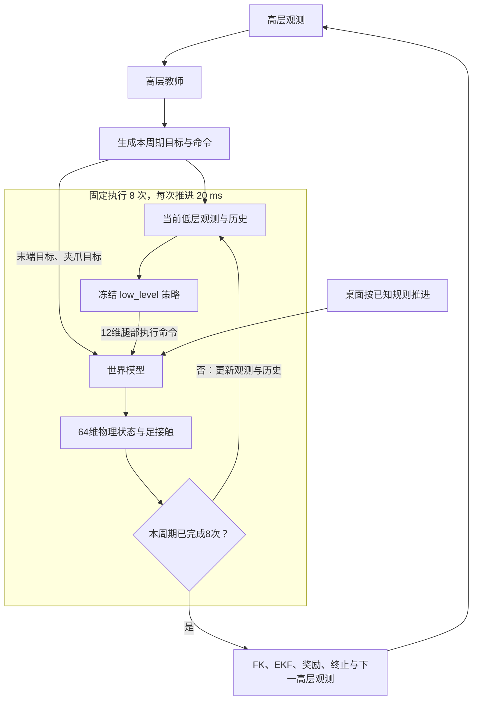

**SGS＋EKF 教师的分层想象训练方案：固定 8 个低层周期，桌面按规则推进**

日期：2026-11-05。本文汇总当前讨论确定的方案，取代此前草案中随机 7／8 个低层周期、学习桌面残差的设计。现已按本文实现固定 8 次低层闭环；代码、运行方式和验证范围见[固定 8 次实现说明](SuperMimic_fixed8_implementation.md)。

**已经确定的整体结构**

高层教师每次产生一个动作，随后固定执行 8 次低层闭环。每次低层闭环包含：构造当前低层观测、运行冻结 low_level 神经策略、更新控制记忆、用世界模型推进 20 ms。经过 8 次后，构造新的高层观测，再由同一个教师重新决策。

世界模型学习机器人与物体的实际运动；桌面按已知运动规则计算，不设置桌面状态预测头、桌面残差或桌面监督损失。末端通过可微 FK 从基座与关节状态计算，低层历史通过观测队列更新。

这是针对当前分层控制系统选择的建模方式。SuperMimic 的核心是当前策略持续读取预测观测、重新生成动作，并对整段想象收益进行 BPTT；原文没有要求所有任务都必须采用这种低层分解。

**时间尺度与“32 步”的含义**

| 层级 | 本方案周期 | 作用 |
|---|---:|---|
| 真实物理与执行器内环 | 5 ms | 真实环境刷新 PD、机械臂 IK／位置目标和桌面控制，再推进物理 |
| 低层闭环与世界模型 | 20 ms | 冻结 low_level 策略决策一次，模型预测一个低层周期的结果 |
| 高层教师 | 固定 160 ms | 生成一次高层动作，内部完成固定 8 个低层周期 |

真实数据采集、PPO 交互和想象均采用固定 8 次，确保控制时序一致。开启世界模型时，任务配置强制固定 8 次并关闭随机周期；原 SGS 启动脚本中的 `--rand_control` 不会覆盖这一约束。未开启世界模型的基线保持原有时序。

高层想象长度单独记为 K，不与每个高层周期内部的 8 次混淆。建议初始验证用 K=4；这一项是起始实验建议，不是用户指定的固定超参数。

| 高层决策数 K | 20 ms 世界模型调用数 | 想象时长 |
|---:|---:|---:|
| 4 | 32 | 0.64 s |
| 8 | 64 | 1.28 s |
| 16 | 128 | 2.56 s |
| 32 | 256 | 5.12 s |

K=4 时应表述为“4 个高层决策、32 个模型子步”。SuperMimic 原配置的 32 步则是 32 次被训练 Actor 的决策，两者只有此处的物理时长相同。

**动力学网络学习的状态：64 维**

| 连续物理状态 | 维度 | 用途 |
|---|---:|---|
| 基座位置、四元数、线速度、角速度 | 13 | 表达移动、倾斜、稳定性和操作反作用 |
| 12 个腿部关节位置与速度 | 24 | 表达支撑运动，生成低层观测 |
| 6 个机械臂关节位置与速度 | 12 | 表达末端控制的实际响应与接触影响 |
| 夹爪实际关节位置与速度 | 2 | 表达实际闭合程度、阻挡与运动滞后 |
| 物体位置、四元数、线速度、角速度 | 13 | 表达抓取、抬升、旋转、滑移与脱落 |
| **总计** | **64** | 机器人 51＋物体 13 |

定义：

\[
x=(p_B,Q_B,v_B,\omega_B,q_j,\dot q_j,p_O,Q_O,v_O,\omega_O).
\]

沿用速度增量加位姿修正的形式时，两个四元数分别用三维旋转增量，对应 62 维物理残差；积分和归一化后得到下一份 64 维状态。状态维度与网络输入维度不同，控制命令、桌面条件和物理参数仍要进入网络。

另设置 4 个足接触辅助输出，服务下一次 low_level 决策。它们用真实传感器接触标签监督，不作为连续残差积分。当前低层接口使用 0／1 信号，第一版保持相同前向语义；阈值路径没有连续梯度。若改为概率输入或使用梯度近似，需要单独验证。

本方案不学习独立末端状态、低层历史、步态计数或桌面实际位姿／速度。末端、历史等仍参与计算；64 维也不是完整闭环系统所需保存的全部信息。

**桌面：已知规则驱动的时变条件**

记桌面外生状态为 e_j，包括名义位姿、速度、运动命令以及必要的控制时钟。更新为：

\[
e_{j+1}=T_{\mathrm{table}}(e_j,u_j^{table}),
\]

T_table 没有待训练参数。每段训练或想象窗口从起点真实桌面状态初始化，随后执行已知控制规则得到名义轨迹。

具体约定：

- 桌面不进入动力学网络的学习输出，也不设置桌面残差或桌面预测损失。
- 桌面的名义位姿、运动、尺寸和摩擦仍用于描述物体的支撑条件，必要部分作为模型输入，并用于任务关系计算。
- 桌面随着时间运动，不固定在想象起点。当前 Level02 包含局部方向速度和转向，应按桌面朝向转换到世界系；名义推进应遵循四次 5 ms 控制更新的顺序。
- 多步模型训练与策略想象采用相同的桌面推进规则。训练窗口后续不能逐步读取真实未来桌面位姿来替换名义状态。
- 独立于机器人动作的桌面命令计划可以记录或预采样。接触之后的实际桌面未来状态不属于预先已知命令。

当前真实桌面仍是受控制的动态刚体。本方案将想象中的桌面视为按已知规则运动的支撑面，省略接触导致的桌面响应；名义轨迹与 PhysX 实际读回可能存在差异。这是明确的建模近似，并不包含把真实资产改成固定或运动学刚体的决定。验证时单独检查该差异对物体预测和动作效果的影响。

**显式计算与维护的量**

| 量 | 获取方式 |
|---|---|
| 基座 roll／pitch、机体系角速度 | 从预测基座姿态和角速度变换 |
| 关节位置偏差、缩放后的关节速度 | 从预测关节状态和参考常量计算 |
| 末端位姿与速度、需要的连杆几何 | 基座与关节状态经过可微 FK／速度运动学计算 |
| 高层动作与执行命令 | 当前教师输出，再应用真实动作映射 |
| 累计局部目标、持有的世界系目标 | 按高层目标更新规则计算与保存 |
| 低层腿部动作 | 冻结 low_level 策略读取当前观测及历史后计算 |
| 710 维低层观测历史 | 每个低层周期生成当前观测并移动、追加队列 |
| 20 维低层历史编码 | 运行冻结历史编码器 |
| 上一低层动作、步态相位与等待状态 | 保存实际计算结果，按现有控制状态机更新 |
| EKF、上一高层动作、奖励历史、保持计数和进度 | 每个高层边界按规则更新 |
| 桌面名义运动 | T_table 按已知控制规则更新 |

质量、惯性、几何、摩擦、驱动增益、默认关节位置、动作尺度等是当前环境的已知条件，在一次想象展开中保持其原有设定。它们可以因环境或 reset 随机化而不同，不能把“展开内固定”理解为所有环境数值相同。

**一次高层转移的完整递推**

用 k 表示高层决策，用 j=0,…,7 表示周期内部步骤。除物理状态 x 外，还保存低层控制记忆 m^L、高层目标与任务记忆 m^H、桌面外生状态 e、物理参数 ξ。

高层周期开始时：

\[
a_k^H=\operatorname{ActionMap}(\mu_\theta(o_k^H)),
\qquad
(u_k,m_k^{H,+})=G(x_{k,0},m_k^H,a_k^H).
\]

u_k 包含底盘命令、缓存局部目标、持有的世界系末端目标 T_k^{ee,*} 和夹爪关节目标 q_k^{grip,*}。夹爪继续使用：

\[
q_k^{grip,*}=q_{closed}+opening_k(q_{open}-q_{closed}).
\]

末端世界目标在高层开始时利用当时完整基座姿态生成，整个 160 ms 内保持；低层观测读取的局部目标缓存也保持真实代码中的语义。不能每个模型子步随预测基座重新生成一个世界目标，也不能在 8 个子步里重复累加同一个高层增量。

每个低层周期执行：

\[
o_{k,j}^L=O_L(x_{k,j},c_{k,j}^{foot},m_{k,j}^L,u_k),
\qquad
a_{k,j}^{leg}=\pi_L(o_{k,j}^L,H_{k,j}^L)_{leg},
\]

\[
(\hat x_{k,j+1},\hat c_{k,j+1}^{foot})
=F_\omega^{20ms}(\hat x_{k,j},a_{k,j}^{leg},T_k^{ee,*},q_k^{grip,*},e_{k,j},\xi).
\]

同时执行桌面规则更新与低层缓存更新。低层顺序遵循当前代码：更新步态，构造当前观测，使用当前观测与旧历史计算动作，再追加当前观测。`progress<1` 时的初始历史填充也应一致。

真实 low_level 网络输出 18 维，其中当前物理执行使用的腿部输出为 12 维。机械臂的 6 维网络输出不作为执行命令；其真实控制来自高层末端目标与 IK／位置驱动。

这里显式执行的是冻结神经策略与控制记忆。每个 20 ms 内部四次 5 ms 的腿部 PD、机械臂 IK／位置控制和物理接触，由 F 的转移整体学习。不能把起点计算一次 IK 或力矩并保持 20 ms，当作真实内环的等价展开。

第 8 次结束后：

\[
x_{k+1,0}=x_{k,8}.
\]

随后通过 FK、因果 EKF 和任务规则得到下一高层观测、奖励、成功保持及终止；同一个高层教师再计算 a_{k+1}^H。高层奖励、折扣、EKF、保持计数和 timeout 都每 160 ms 更新一次。

**补充：想象阶段如何构造高层与低层观测**

这里沿用当前启动入口的观测接口：`roboinfo`、`observe_gait_commands`、`no_velocity_obs`、两个 EKF 预测时距 0.60／0.90 s、5 帧 EKF 历史；不启用视觉学生或 TSIL。下述维度针对这些配置。

核心分工是：动力学网络递推物理状态，观测构造函数从当前预测状态、控制记忆与固定资产信息生成策略输入。高层每 160 ms 读取一次新观测，低层每 20 ms 读取一次新观测。**两层观测都必须随着想象轨迹更新；不能将起点观测一直重复使用，也不需要新增网络来回归整条观测向量。**

记物体原始特征与局部抓取模板等固定信息为 A，则：

\[
o_k^H=O_H(\hat x_{k,0},m_k^H,A),
\qquad
o_{k,j}^L=O_L(\hat x_{k,j},\hat c_{k,j}^{foot},m_{k,j}^L,u_k).
\]

动力学物理状态 64 维、高层原始观测 1284 维、低层单帧观测 71 维，分别回答“系统如何运动”“教师根据什么决策”“冻结控制器根据什么响应”，不能混为一个维度。

**想象起点：恢复一份时间对齐的闭环快照**

每段想象从真实高层决策边界开始，复制当前机器人与物体状态、足接触、最近 10 帧低层历史、上一低层动作、步态状态、当前高层命令与累计目标、上一高层动作，以及 EKF 的位姿／时间／有效计数。桌面外生起点、物体身份和物理参数也一并恢复。起点如果来自 SGS，也需要这些控制记忆与物理状态相互对应，不能只恢复关节角度。

起点之前的历史作为给定数据；起点之后的状态、观测和历史全部由本次想象产生。保存的是“下一次构造观测之前”的缓存语义，避免起点多推进一次步态、多追加一次低层观测，或把已记录的当前物体再次压入 EKF。

**高层观测：每完成 8 次低层响应后重建 1284 维**

下表严格按当前高层原始观测的拼接顺序列出；区间为 Python 半开区间。

| 区间 | 字段 | 维度 | 想象中的来源 |
|---|---|---:|---|
| `[0:1024]` | 物体特征 | 1024 | 当前物体资产的预计算特征，展开内固定 |
| `[1024:1030]` | 当前物体位置与姿态 | 6 | 预测物体位姿与当前预测基座坐标变换 |
| `[1030:1036]` | 当前末端位置与姿态 | 6 | 预测基座、关节经过 FK，再做局部坐标变换 |
| `[1036:1055]` | 关节位置 | 19 | 预测关节位置，含夹爪，使用现有重排顺序 |
| `[1055:1073]` | 关节速度 | 18 | 预测腿与机械臂关节速度乘 0.05，排除夹爪 |
| `[1073:1076]` | 底盘命令 | 3 | 高层动作接口维护的当前命令 |
| `[1076:1079]` | 累计末端位置目标 | 3 | 高层动作接口维护的局部目标缓存 |
| `[1079:1082]` | 累计末端姿态目标 | 3 | 高层动作接口维护的姿态目标缓存 |
| `[1082:1095]` | EKF 未来物体位姿及有效标记 | 13 | 两个时距各 6 维，加 1 维 valid，由因果历史计算 |
| `[1095:1185]` | 30 个抓取候选位置 | 90 | 物体局部模板，经当前预测物体与基座变换 |
| `[1185:1275]` | 30 个抓取候选姿态 | 90 | 同上，保留当前姿态约定 |
| `[1275:1284]` | 上一高层动作 | 9 | 高层执行接口保存的动作缓存 |
| **合计** | | **1284** | |

`no_velocity_obs` 删除的是基座线速度 3 维和物体相对 XY 速度 2 维，不会删除上述 18 维关节速度。基座及物体速度仍须包含在动力学状态中，用于后续运动预测。当前高层观测没有直接的桌面位姿／速度字段；桌面名义运动仍服务动力学与任务计算。

这一布局来自当前 [机器人观测拼接](/home/hehui/DQ_WBC/DQ_high-level/envs/b1z1_pickmulti.py:1090)、[速度字段裁剪](/home/hehui/DQ_WBC/DQ_high-level/envs/b1z1_pickmulti.py:870)和[最终高层拼接](/home/hehui/DQ_WBC/DQ_high-level/envs/b1z1_pickmulti.py:779)。其中有几个必须保持一致的细节。

第一，坐标系沿用当前策略已经使用的定义。令机器人基座位姿为 `(p_B,Q_B)`，完整旋转为 R_B，仅偏航旋转为 R_yaw，机械臂参考原点为：

\[
p_{arm}=p_B+R_B[0.3,0,0.09]^\top.
\]

当前物体 6 维观测是：

\[
o^{obj}=\left[
\big(R_{yaw}^{-1}(p_O-p_{arm})\big)_{xy},
(p_O)_z^{world},
\operatorname{RPY}(Q_{yaw}^{-1}Q_O)
\right].
\]

也就是 XY 使用以 arm base 为原点的 heading 坐标，Z 保留物体世界高度。末端观测则使用完整基座旋转：

\[
o^{ee}=\left[
R_B^{-1}(p_{EE}-p_{arm}),
\operatorname{RPY}(Q_B^{-1}Q_{EE})
\right],
\quad (p_{EE},Q_{EE})=FK(\hat x).
\]

不能将两者一律改成相同的局部坐标系，否则会改变教师输入的含义。[物体位姿编码](/home/hehui/DQ_WBC/DQ_high-level/utils/object_pose.py:9)已明确这个约定。

第二，固定的是物体原始特征和物体局部抓取模板。每次高层决策，都要用当前预测物体位姿重新计算 30 个世界抓取候选：

\[
\hat T_{world,grasp,i}
=\hat T_{world,obj}\,T_{obj,grasp,i}.
\]

再以当前预测 arm base 为原点、完整基座姿态为方向变换到局部；保留现有姿态修正、候选局部 Z 的 `[-0.6,0.6]` 限幅。候选姿态字段是当前实现的 `[yaw,pitch,roll]`，物体和末端姿态字段则是 `[roll,pitch,yaw]`。这些候选使用当前物体位姿，不使用 EKF 未来位姿。具体依据是[候选世界变换](/home/hehui/DQ_WBC/DQ_high-level/PredictPiontTransform/predictpoint_mul.py:167)和[候选局部变换](/home/hehui/DQ_WBC/DQ_high-level/envs/b1z1_pickmulti.py:793)。

1024 维原始特征虽然固定，Actor 中的特征编码器和抓取注意力模块仍属于待训练教师。不能把 128 维编码结果或 6 维选中候选提前冻结成常量。Actor 内部将特征 `1024→128`、候选 `180→6`，再与其余字段拼接，最终 MLP 输入为 **214 维**。Critic 读取同一份 1284 维观测，使用自己的编码器和注意力模块，不直接把 64 维物理状态当作价值网络输入。见 [Actor／Critic](/home/hehui/DQ_WBC/DQ_high-level/train_multistate_DQ_teacher.py:143)。

第三，EKF 仍保持因果预测语义。每完成一个 160 ms 高层周期：

1. 把此时世界模型已经产生的当前物体世界位姿和当前时间追加到 EKF 历史，保留最近 5 条；历史中可能同时含有起点之前的真实样本和起点之后的想象样本。
2. 只使用截至此时的历史，外推未来 0.60 s、0.90 s 的物体位姿。
3. 两个预测位姿都按照上述物体编码规则，转换到当前预测机器人对应的参考系；不使用未来机器人坐标系。
4. 拼接两份 6 维观测与有效标记。历史不足 5 条或结果无效时，用两份当前物体观测替代，`valid=0`，与真实接口一致。

这里不需要先将世界模型额外向未来展开 0.60／0.90 s，更不能提前读取后续想象帧作为当前 EKF 输入。EKF 提供的是根据已有历史估计的运动趋势，不是包含未来接触与未来动作后果的真值预告。真实 EKF 的 `push/predict` 接口含 `no_grad/detach`，想象阶段需要保留相同前向数学的可微函数式计算，不能直接照搬其梯度截断。依据：[EKF 观测编码](/home/hehui/DQ_WBC/DQ_high-level/envs/b1z1_pickmulti.py:754)、[历史与预测规则](/home/hehui/DQ_WBC/DQ_high-level/modules/pose_prediction.py:152)。

最后，上一高层动作保存的是与真实 `action_history_buf` 一致的 9 维执行接口动作，其中夹爪字段是 opening；它不是 12 维腿部动作，也不是当前尚未产生的新高层动作。原始观测拼接后，继续使用真实 PPO 相同的观测限幅与归一化。想象阶段冻结归一化统计，但保留输入导数；当前 [想象预处理](/home/hehui/DQ_WBC/DQ_high-level/utils/world_model/imagination.py:153)中的这个原则可以沿用。

**低层观测：每 20 ms 重建 71 维，再拼接 10 帧历史**

| 顺序 | 当前单帧字段 | 维度 | 想象中的来源 |
|---:|---|---:|---|
| 1 | 基座 roll、pitch | 2 | 预测基座四元数转换 |
| 2 | 机体系角速度 | 3 | 预测世界角速度经完整基座旋转变换 |
| 3 | 腿与臂关节位置偏差 | 18 | 预测关节位置减 `_initial_dof_pos`，重排并排除夹爪 |
| 4 | 腿与臂关节速度 | 18 | 预测关节速度乘 0.05，重排并排除夹爪 |
| 5 | 上一次低层腿部动作 | 12 | 上一个低层周期计算所得动作缓存 |
| 6 | 四足接触信号 | 4 | 起点真实接触；后续来自模型接触辅助输出，按真实接口重排 |
| 7 | 底盘命令 | 3 | 本高层周期持有的命令，保留原有命令缩放 |
| 8 | 局部末端位置目标 | 3 | 本高层周期的 `curr_ee_goal_cart` 缓存 |
| 9 | 零占位量 | 3 | 与真实低层观测一致的常零字段 |
| 10 | 步态相位及四路时钟 | 5 | 按现有步态更新规则计算，1＋4 |
| **合计** | | **71** | |

高层使用关节实际位置 19 维，低层使用相对参考位置 18 维；不能混用。低层没有物体特征、抓取候选、EKF、实际末端位姿或桌面状态这些直接字段。机械臂实际运动通过 6 个臂关节的位置与速度进入低层，局部位置目标用于协调底盘响应；机械臂本身仍由高层目标对应的 IK／位置控制执行，其 20 ms 效果由世界模型学习。

在一个高层周期的 8 次低层调用中，局部末端目标缓存与底盘命令保持不变；机器人状态、足接触、上一腿部动作、步态和历史持续改变。因此冻结低层策略仍会每 20 ms 生成不同的反馈动作。不能把第一步腿部动作重复 8 次，也不能为了改变局部目标而每步重新随基座生成世界系末端目标。

令低层历史为 `H^L∈R^(10×71)`。正常运行时，一个子步的顺序是：

1. 按真实规则推进步态相位与时钟。
2. 从当前预测状态和缓存构造单帧 `o^L`。
3. 将当前单帧与旧历史拼接为 `71+710=781` 维，送入冻结低层网络。
4. 网络内的冻结历史编码器将 710 维历史映射为 20 维，与当前 71 维组成 91 维骨干输入；输出中的 12 维腿部动作参与本次转移。
5. 历史队列移除最旧一帧、追加本次 `o^L`，保存本次腿部动作，供下一子步使用；世界模型推进物理状态与接触信号。

\[
H^L_{j+1}=\operatorname{concat}(H^L_j[1:],o^L_j),
\qquad
a^{leg}_{prev,j+1}=a^{leg}_j.
\]

初始 `progress<1` 的特殊分支继续按真实代码用当前观测填充 10 帧，再形成网络输入；该条件由高层进度决定，不应自行改成“每个高层周期填充一次”。正常历史跨越高层边界连续移动，完成 8 次后不清空。想象起点之前的历史无需梯度，但后续追加的观测需要保留计算图，BPTT 才能穿过低层历史编码与反馈。实现依据：[低层观测与历史](/home/hehui/DQ_WBC/DQ_high-level/envs/b1z1_base.py:1169)、[冻结网络的历史输入](/home/hehui/DQ_WBC/DQ_high-level/utils/low_level_model.py:206)。

**把两套观测放在同一条时间线上**

\[
\underbrace{o_k^H\rightarrow a_k^H\rightarrow u_k}_{\text{高层决策及目标更新一次}}
\rightarrow
\underbrace{\left(o_{k,j}^L,H_{k,j}^L\right)
\rightarrow a_{k,j}^{leg}\rightarrow \hat x_{k,j+1}}_{j=0,\ldots,7\text{，每次从新状态重建低层观测}}
\rightarrow
\underbrace{\text{FK、EKF、任务记忆}\rightarrow o_{k+1}^H}_{\text{160 ms 边界重建高层观测}}.
\]

`o_k^H` 中的目标、命令与上一动作描述决策前已有的缓存；教师产生 `a_k^H` 后更新一次目标，8 次低层观测使用更新后的 `u_k`。到 `o_{k+1}^H` 时，上一高层动作成为 `a_k^H`，目标缓存则是这次动作更新后的值。这个顺序避免把当前动作放进产生它自身的观测，也避免观测落后一个高层周期。

想象中所有新观测都由本次预测状态计算，不读取 Isaac Gym 的未来状态，也不修改真实环境缓存。FK、坐标变换、历史编码、EKF 和两层网络都按批量 GPU 张量计算。冻结低层权重不等于对低层调用使用 `no_grad`；必须允许梯度沿“高层动作→物理状态→低层观测与历史→低层反馈→后续状态→高层观测／收益”传播。接触阈值、有效标记和硬限幅仍按各自实际可微性处理，不宣称所有路径都有平滑导数。

后续实现首先应做观测一致性检查：给定同一份真实状态和缓存，用上述构造得到的高层 1284 维、低层 781 维输入，应逐字段匹配真实环境；随后再把状态来源换成模型预测，并验证多步更新和梯度。这样能区分动力学误差与观测构造错误。

**训练数据与世界模型损失**

真实轨迹由 SGS 初始化和当前教师交互得到。固定每个高层周期 8 次，记录真实 20 ms 转移、实际腿部执行命令、持有的末端／夹爪目标、足接触标签、物理条件及高层边界标记。

模型拟合采用真实起点和记录动作进行多步自回归，后续物理状态由模型自己推进。可以用 8 个低层步作为初始训练窗口，覆盖一个完整高层周期；窗口长度是训练超参数，不能与高层想象长度混淆。桌面只在窗口起点读取真实状态，之后按同一外生规则推进。

建议模型损失为：

\[
L_{WM}=L_{physical}+\lambda_{rel}L_{relation}
+\lambda_cL_{foot\ contact}+\lambda_fL_{failure}.
\]

- L_physical：基座、腿、臂、夹爪和物体的归一化多步误差，旋转使用相对旋转误差。
- L_relation：从 FK 与预测物体计算手物相对位姿、相对运动，以及需要的支撑面关系。若加入相对桌面的监督，应明确桌面参考定义，避免把名义桌面误差强行归咎于物体运动；真实桌面轨迹可用于离线诊断，不作为未来条件输入。
- L_foot contact：真实足部传感器判据对应的分类监督。
- L_failure：仅在采用独立软失败头时使用，标签与高层检查边界对齐。

不设置桌面状态 loss、低层历史 loss、步态计数 loss 或独立末端自由回归 loss。FK 输出可以接受实际末端监督，其梯度通过 FK 返回预测关节与基座。

**策略想象、BPTT 与尾值**

每段想象从真实快照初始化物理状态、低层历史、桌面起点和任务记忆。之后所有高层动作来自当前教师，所有低层腿部动作来自冻结低层策略对预测观测的重新响应；不读取真实未来物理状态或未来低层动作。

高层展开 K 次，对高层任务回报求梯度：

\[
J(\theta)=\mathbb E\left[
\sum_{k=0}^{K-1}\gamma_H^k C_kR_{k+1}
+\gamma_H^KC_KV_H(o_K^H)
\right].
\]

其中 C_k 表示所采用终止处理下的继续权重。成功、失败和超时需要保持各自任务语义：成功终止保留本次成功回报，后续同一任务收益与尾值清零；失败风险可以另用经过校准的软头提供信号；timeout 由任务时钟处理。不能把成功与失败一起用作单纯压低未来价值的混合概率。硬阈值和保持计数没有平滑路径梯度；若新增可微成功目标，应作为独立方法变化验证。

对整个 K×8 次展开统一反向传播。冻结 low_level、世界模型和 Critic 的参数，但保留它们对输入的导数；新产生的状态、动作和历史不能逐步 detach。这样高层动作既能通过腿部控制反馈影响收益，也能通过机械臂和夹爪目标直接影响物体运动，并进一步改变后续高层决策。

真实 PPO 继续随机采样；BPTT 使用均值经过执行映射后的确定性动作；标准差仅由 PPO 更新。尾值先沿用当前高层 PPO Critic，并检查其在预测状态上的估值质量。这是已选择的混合路线；原 SuperMimic 的 Critic 用想象轨迹的 GAE／λ-return 训练，两者不能混称为同一实现。

SGS 提供不同任务阶段的起点与数据覆盖；EKF 每 160 ms 根据预测出的当前物体观测更新一次。保持计数若仍为 10 次，则对应 10 个高层检查周期，即 1.6 s，而非 10 个模型子步。

**实施与验证边界**

当前启动入口仍是 [train_teacher_sgs_ekf_world_model.sh](/home/hehui/DQ_WBC/DQ_high-level/train_teacher_sgs_ekf_world_model.sh)。已同步真实采集和想象时序，并采用 64 维物理预测、显式低层闭环与独立微步回放。

验证顺序为：固定 8 次时序与控制缓存一致性；FK 与真实末端一致性；20 ms、160 ms 和 K×160 ms 的物理与闭环误差；名义桌面近似对物体接触的影响；9 维高层动作扰动与真实后果是否一致；最后比较真实成功率、失败率和训练成本。

所有物理模型、FK、冻结低层网络、历史与 EKF 的想象计算按批量 GPU 张量组织。已在 GPU 上验证小批量真实采样、模型拟合和 BPTT，结果见[GPU 诊断报告](SuperMimic_fixed8_gpu_validation.json)。该诊断不代表完整训练规模的速度／显存测试，也不代表动作梯度已通过生产验证或抓取成功率得到提升。

方法依据：SuperMimic [论文](/home/hehui/SuperMimic-Reproduced/docs/supermimic.pdf)第 5 页与算法 A.1；复现的 [逐步闭环](/home/hehui/SuperMimic-Reproduced/src/supermimic/imagination/rollout.py:98)、[Actor BPTT](/home/hehui/SuperMimic-Reproduced/src/supermimic/imagination/policy_trainer.py:65)。当前执行语义依据 [低层观测与历史](/home/hehui/DQ_WBC/DQ_high-level/envs/b1z1_base.py:1169)、[真实控制循环](/home/hehui/DQ_WBC/DQ_high-level/envs/b1z1_base.py:2007)、[桌面控制](/home/hehui/DQ_WBC/DQ_high-level/envs/b1z1_base.py:1917)。
