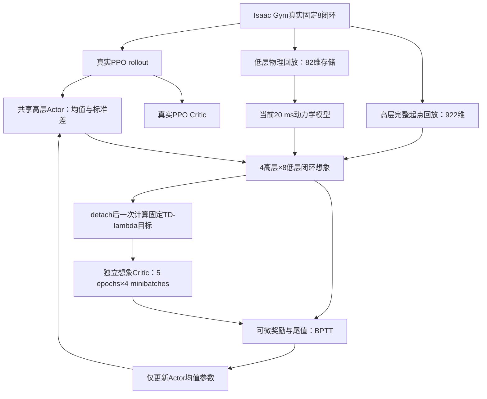

# SuperMimic 可对齐部分：本轮代码实现

更新日期：2026-11-05。对应用户授权“可以改成一致逻辑或配置的部分先改，45不用改”。入口仍为 [train_teacher_sgs_ekf_world_model.sh](../DQ_high-level/train_teacher_sgs_ekf_world_model.sh)。

默认路径现在是 **真实随机 PPO＋单个当前世界模型＋均值动作 BPTT＋独立想象 Critic**。第45项没有实施：没有加入 torch.compile、DDP 或多GPU训练。

本轮恢复了模型分支的 Actor–Critic 关系，并采用复现中的主要网络／优化配置；整个算法仍然是保留 PPO 的抓取混合方法。实际抓取收益需要正式训练和消融确认。

## 1. 对应审阅编号的修改

| 编号 | 本轮结果 |
|---|---|
| 09 | 高层 Actor／真实 PPO Critic 的输入改为固定物理尺度；取消在线均值方差更新。真实和想象 Critic 的价值均使用原任务奖励单位。 |
| 14 | 动力学输入中的基座、物体、名义桌面和 EE 目标姿态采用 rot6d；四元数仍用于物理存储和积分。 |
| 16 | 默认动力学 MLP 从三层512改为三层2048。 |
| 19（可确定部分） | 旋转误差改为最短 rotation vector；原五组损失权重及手物关系损失保持。 |
| 24–25 | 新增独立想象 Critic：读取物理状态、context、控制／任务记忆和进度；在想象轨迹上用固定 TD(λ) 目标训练。BPTT 的尾值改由它提供。 |
| 29 | BPTT Adam β=(0.9,0.95)，先裁剪总范数至1，再逐元素裁剪至±0.1。默认有效学习率采用2e-4，辅助强度1。 |
| 30 | 默认每轮10个2048窗口的动力学 minibatch、4096个想象起点；以20 ms真实向量步为单位累计0.4轮更新额度。采用微批次累积控制显存。 |
| 31 | 世界模型、BPTT Actor、想象 Critic 的学习率按真实低层步做余弦衰减，250000低层步到0.03倍。 |
| 32–33 | 默认采集4096环境槽，低层回放1000步／槽。低层物理拟合只保存82维必要字段；高层想象起点仍保存完整922维。 |
| 34 | 训练集内对合法窗口和起点均匀采样；取消 family 平衡和近期混合重加权，SGS真实采样规则保持。 |
| 36–39 | 默认使用一个持续训练模型，BPTT期间暂时冻结参数；取消快照启用门、留出误差门、起点误差过滤和置信度权重。可选探针只诊断。 |
| 40 | 取消 KL 超限回滚；仍记录 KL，保留非有限损失／梯度／参数检查。 |
| 41 | warmup配置为5高层步＝40低层步；实际更新等到完整PPO rollout结束，避免采集期间改Actor。 |
| 44 | 无噪声物理标签＋真实和想象一致的高层观测噪声；冻结低层控制器的输入分布保持。 |

没有改动不确定或不适用的部分：真实PPO仍随机采样并独占更新σ；连续夹爪映射、SGS、固定8闭环、FK、名义桌面推进、脚接触二值输入、成功／失败／超时、原奖励和高层γ=0.99继续使用。没有引入实际桌面状态预测。

## 2. 训练数据流及两个 Critic

一次高层动作仍展开8次“低层观测→冻结低层策略→20 ms模型转移”。拟合窗口是8个低层步，想象窗口是4次高层决策＝32个低层步＝0.64 s。



每轮先拟合世界模型，再固定模型／低层控制器／Critic权重展开想象。Actor从奖励及尾值获得输入梯度。想象Critic的监督目标在本轮Critic优化前一次性计算并detach；随后Actor更新一次，Critic进行5×4次拟合。

真实PPO Critic只接收真实PPO目标。想象Critic不读取或更新它，也不共享其优化器。想象数据不加入PPO memory或SGS统计。

想象Critic默认隐藏层为256、128。当前 sugar_box 配置输入为 **1006维**，包括规范化物理量、物理context、低层历史和动作、持有目标、因果EKF历史、任务保持进度与剩余时域相关信息。它不读取重复的末端测量缓存，也不把环境槽号作为预测特征。该输入用于价值估计，不是要求动力学预测1006维。

## 3. 状态、存储和旋转表示

| 用途 | 当前默认维度 |
|---|---:|
| 连续物理状态 | 64 |
| 动力学残差输出 | 62 |
| 足接触辅助输出 | 4 |
| 完整高层展开状态 | 922 |
| 物理模型状态特征（含名义桌面） | 81 |
| 实际低层执行动作记录 | 20 |
| 动力学动作特征（目标姿态rot6d） | 22 |
| context特征（当前任务） | 60 |
| 动力学MLP输入：81＋22＋60＋dt | 164 |
| 低层回放存储状态 | 82 |

82维包含机器人根13、物体13、q19、qd19、桌面初态13、桌高1、足接触4。桌面从窗口初态按名义规则推进，不读取后续真实桌面轨迹。动力学拟合不使用710维低层历史、EKF记忆或高层任务计数，因此无需为每条20 ms记录重复保存这些字段。采样时恢复完整布局供现有物理适配器使用，省略字段填零；**这种解码状态只可用于物理拟合，不能作为想象策略起点**。高层回放继续完整存储历史。

默认4096槽下，低层回放约3.35 GiB，高层256步回放约7.38 GiB，合计约10.73 GiB。这只是常驻回放预算，尚不包含Isaac Gym场景、策略、优化器、采样临时张量和计算图。

新模型schema为 `dq-sgs-ekf-fixed8-physical64-rot6d-v5`，旧姿态输入／网络宽度的世界模型权重不可直接加载。固定归一化模块也明确拒绝旧RunningStandardScaler统计；本轮配置应重新训练，不做隐式权重迁移。完整教师检查点保存独立想象Critic及其优化器；普通评估应加载agent检查点，误用candidate模型探针包会明确报错，避免静默评估随机策略。

## 4. 更新预算和物理时钟

| 设置 | 默认值／单位 |
|---|---|
| 拟合 | 每轮10个 minibatch，每批2048个8步窗口 |
| 拟合微批次 | 256；累积完整2048样本梯度后进行一次Adam更新 |
| 想象 | 每轮4096起点，每个起点32低层模型步 |
| 想象分块 | 128；32块累积后仅做一次Actor更新 |
| 想象Critic | Adam 2e-4，λ=.95，5 epochs×4 minibatches，范数裁剪1 |
| 模型／BPTT Actor初始LR | 均为2e-4 |
| 更新／数据比 | 每采集一个20 ms向量步累计0.4轮 |
| warmup | 5高层步＝40低层步 |
| 余弦日程 | 真实低层步250000时衰减至0.03倍 |
| 默认运行长度 | 40000高层步＝320000低层步，可用TIMESTEPS覆盖 |

真实PPO仍每24高层步更新一次。为了不在同一PPO rollout中间改变策略，世界模型／BPTT更新也集中在这个边界执行：第一次有192个低层步，扣除40步warmup，累计60.8轮，执行60轮、留下0.8；后续每个完整rollout新增76.8轮额度。

因此，正式默认训练比之前“每次PPO只做2×128拟合”的计算量大得多。该安排按低层真实数据量对齐更新预算，**并不等同于复现每收集少量数据立即更新的交错顺序**。Actor仍叠加PPO更新，2e-4也只是采用原配方的实验起点，不是已经证明最适合抓取任务的数值。

γ仍为每高层步0.99，没有孤立改成0.99^8。余弦日程仅作用于模型分支三个优化器；真实PPO的KL自适应学习率保持。

## 5. 固定尺度与观测噪声

高层角度／关节位置除以π；位置、控制指令、视觉特征等保持既有单位；原观测中已乘0.05的关节速度继续沿用。没有在线中心化和统计更新。两个Critic均输出原始任务奖励单位。

噪声在真实采集时及每次想象构造策略观测后注入，随后再做固定缩放。PPO优化重新使用存好的带噪观测，不再次采样噪声。默认独立均匀噪声半宽：

- 物体／末端位置：0.005 m；对应RPY：0.01 rad。
- 关节位置：0.005 rad；已缩放关节速度：0.005，相当于原速度0.1 rad/s。
- 可选速度观测：0.01 m/s。

这些数值是本任务的可配置起值，不是SuperMimic人形传感器表的直接复制。视觉特征、EKF预测、抓取模板、控制目标、mask和上次动作不加这组噪声；冻结低层不加额外噪声。物理监督标签和想象Critic的特权输入保持无噪声。评估入口关闭这组高层噪声。

## 6. 运行与验证

沿用原启动命令即可进入新默认配方：

```bash
conda activate dqwbc
export LD_LIBRARY_PATH="$CONDA_PREFIX/lib:${LD_LIBRARY_PATH:-}"
RL_DEVICE=cuda:1 SIM_DEVICE=cuda:1 \
bash DQ_high-level/train_teacher_sgs_ekf_world_model.sh --no-wandb
```

`--world_model fit`只拟合模型；`--wm_recipe gated`保留旧门控逻辑用于对照。新默认配方下 `--wm_probe_interval 0`表示不运行可选探针，不阻止BPTT。YAML可覆盖配方参数，主要预算也有 `--wm_*` 参数。配置最终值会写入实验配置。

真实GPU验证脚本：

```bash
python DQ_high-level/tests/smoke_supermimic_aligned_gpu.py --device cuda:1 --full-batch
```

本轮已在RTX4090的cuda:1上执行该脚本，报告见 [SuperMimic_aligned_gpu_validation.json](SuperMimic_aligned_gpu_validation.json)：

- 12个真实Isaac Gym环境、48个高层步／384个低层步；真实入口完成3轮模型／BPTT／想象Critic更新。诊断仅缩减采集环境数和更新预算，动力学仍为2048×3。
- 额外完成一个2048窗口拟合minibatch、一个4096起点／32模型步的BPTT更新及20次想象Critic拟合；分块Actor梯度有限、更新成功。
- 已检查BPTT期间真实PPO Critic、世界模型、冻结低层和σ不变；想象Actor与想象Critic发生更新；真实PPO仍更新自己的Critic和σ。
- 观测重建最大误差约1.18e-5；策略／两个Critic／动力学／低层／FK／噪声／缩放／两套回放均在CUDA。
- 该诊断峰值Torch分配约605 MiB。它使用12环境的小回放，**不代表4096环境完整训练的总显存**；完整4096物理环境和最终成功率尚未验证。

回归测试使用dqwbc环境、先导入Isaac Gym再导入Torch，已运行全仓测试：652项，650项通过、2项按环境条件跳过。另有固定目标、更新归属、分块等价、存档恢复、噪声与干净标签、20 ms更新额度等CPU／CUDA专项测试。

## 7. 主要代码

| 文件 | 职责 |
|---|---|
| [recipe.py](../DQ_high-level/utils/world_model/recipe.py) | 默认配方、物理时钟余弦日程 |
| [wm_ppo.py](../DQ_high-level/utils/wm_ppo.py) | 单模型、两个Critic衔接、更新额度、门控兼容路径 |
| [imagined_critic.py](../DQ_high-level/utils/world_model/imagined_critic.py) | 特权价值网络、固定TD(λ)目标及独立训练 |
| [imagination.py](../DQ_high-level/utils/world_model/imagination.py) | 均值动作梯度、分块累积、优化器和检查点 |
| [wm_fixed8.py](../DQ_high-level/utils/wm_fixed8.py) | rot6d特征、旋转误差、Critic输入和观测重建 |
| [policy_inputs.py](../DQ_high-level/utils/world_model/policy_inputs.py) | 固定尺度及真实／想象一致的高层噪声 |
| [replay.py](../DQ_high-level/utils/world_model/replay.py) | 低层必要字段存储、完整高层起点、合法窗口采样 |
| [trainer.py](../DQ_high-level/utils/world_model/trainer.py) | 自回归拟合、均匀采样及拟合微批次累积 |

参考代码来自本地独立复现，并保留MIT署名；没有将其误标为论文官方代码。
