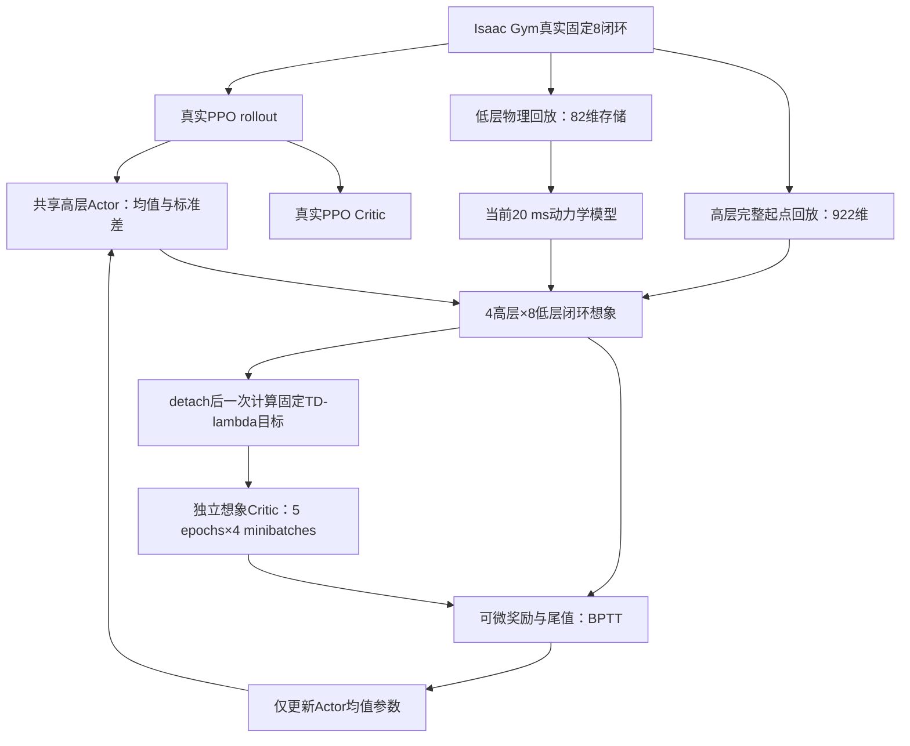

# SuperMimic 可对齐部分：本轮代码实现

更新日期：2026-11-06。包含本轮按 SuperMimic 源码重新核对各节点后的结构修正。入口仍为 [train_teacher_sgs_ekf_world_model.sh](../DQ_high-level/train_teacher_sgs_ekf_world_model.sh)。

最新执行优化和生产规模验证见 [SuperMimic_speed_optimization.md](SuperMimic_speed_optimization.md)。默认使用 cuda:0，模型微批为2048，想象分块为4096。

数值保护也记录在上述文档中：世界模型入口采用本地 `FinitePPO`，保存真实 Gaussian 采样 latent 计算 PPO 概率比，避免反演已饱和的夹爪 opening；同时检查优化步骤和 PhysX 上传输入。它们不能代替下文的模型、动作坐标及价值网络修正。

默认路径现在是 **真实随机 PPO＋单个当前世界模型＋均值动作 BPTT＋独立想象 Critic**。第45项没有实施：没有加入 torch.compile、DDP 或多GPU训练。

本轮恢复了模型分支的 Actor–Critic 关系，并采用复现中的主要网络／优化配置；整个算法仍然是保留 PPO 的抓取混合方法。实际抓取收益需要正式训练和消融确认。

## 0. 重新按源码逐节点核对后的修正

依据本地复现提交 `ba6105349069bf040f1fdad60873d13138d505a2`、[训练流程图](/home/hehui/SuperMimic-Reproduced/docs/supermimic_training_flow.html) 和论文第 3.2–3.3 节、附录 D。复现是独立实现，以下明确区分源码直接采用的计算与抓取任务适配。

### 0.1 本次修正的结构问题

1. **物理损失定义不一致。** 旧实现对根、物体、腿、臂、夹爪五组做等权平均，并默认叠加 FK 关系损失。现在默认采用源码的 `mean_batch,time(sum_dims(error²))`，使用未加组权重的 62 维物理误差；`auxiliary_weight=0` 时完全不执行额外 FK 损失。足接触 BCE 保留为本任务的独立监督项，权重仍为 0.1。NSE 日志仍报告逐维均值，不能把新旧 `state_loss` 数值直接比较。
2. **末端价值存在直接的动作记忆通路。** 旧 Critic 将原始上一动作、低层历史和 EKF 历史直接作为输入；即使物理命令已饱和，这些数仍能影响尾值。现在采用物理状态、执行目标、环境条件及必要任务阶段构造紧凑 Critic，不再直接读取这些原始历史。完整历史仍留在想象状态中，供高低层策略闭环使用。与复现的“有历史 Actor、无完整历史 Critic”一样，这是一种压缩价值近似，不是严格完整 Markov 状态的价值函数。
3. **随机动作与物理命令的单位不匹配。** 旧 `σ=1` 直接对应米／弧度增量，而执行范围只有 ±0.02 m／±0.06 rad。现在其他八维动作先采用归一化命令坐标，再映射到物理量；真实执行与想象调用同一函数。新 Actor 末层复制源码的正交 `gain=0.01`、零 bias；Gaussian 初始 `σ=0.1`，随后仍只由真实 PPO 更新。BPTT 仍只使用均值。
4. **缺少全维平方动作变化成本。** 原任务只惩罚底盘两维的 L2 变化。新的 SuperMimic 配方在真实与想象奖励中同步采用 `−0.002 × Σ₉(a_t−a_prev)²`。这是明确的奖励修改；系数参考复现的 `−0.1 × 0.02`，在本任务每个高层奖励结算时使用，不声称其时间尺度与原版完全相同。夹爪在该成本中使用 opening，而非 sigmoid 前的 latent。

没有将额外 `clipActions=1` 设为默认。源 Actor 的动作输出本来就不是 tanh 有界输出；归一化命令仍允许超过 ±1，物理执行层沿用原有范围限制。原始动作参与历史和平方变化成本；超出物理范围的动作不应通过直接输入 Critic 获得虚假价值收益。

| 输出坐标 | 物理执行映射，随后沿用任务原有限幅／死区 |
|---|---|
| 0–2 | 平移增量 `0.02 × a[:3]`，范围 ±0.02 m |
| 3–5 | 姿态增量 `0.06 × a[3:6]`，范围 ±0.06 rad |
| 6 | `opening=sigmoid(mu_6)` 或对应 Gaussian 样本的 sigmoid；关节目标仍为 `q_closed+opening(q_open−q_closed)` |
| 7 | 前进速度 `forward_limit × a_7`，当前训练上限 0.45 m/s |
| 8 | 转向速度 `0.6 × a_8`，范围 ±0.6 rad/s |

原小指令置零、关闭夹爪时停车等任务规则继续生效。新坐标、奖励模式及 Critic 输入约定已写入配置／模型元数据；旧权重不能当作新坐标策略直接继续训练。没有这些字段的旧评估配置仍采用原物理动作坐标。

### 0.2 流程图中的节点如何对应到当前代码

源路径下表简写为 `SM/src/supermimic/`，其中 `SM=/home/hehui/SuperMimic-Reproduced`；本仓库路径相对 `DQ_high-level/`。

| 源节点与核心作用 | 源码 | 当前实现与对齐结果 |
|---|---|---|
| 记录真实执行转移，不跨 reset 拼窗 | `data/recorder.py`, `data/replay_buffer.py` | `utils/wm_ppo.py`, `world_model/replay.py`；高层起点与 20 ms 执行动作分开保存，终末状态在 reset 前捕获 |
| 固定真实起点，8 步自回归拟合 | `world_model/world_model.py::window_loss` | `world_model/trainer.py::loss_on`；只使用初始真实状态和记录动作，中间不 teacher-force、不 detach |
| 规范化、SiLU MLP、零输出层 | `world_model/state_spec.py`, `dynamics.py` | `wm_fixed8.py::low_features`, `world_model/hierarchical.py`；2048×3、零末层、单位固定尺度；状态扩展为机器人＋物体 |
| 速度增量与位姿修正的显式积分 | `world_model/state_spec.py::integrate` | `wm_fixed8.py::integrate_low`；20 ms 积分，62 残差恢复 64 物理量；末端由 FK 计算 |
| 状态误差平方和与独立监督头 | `world_model/world_model.py::window_loss` | 默认逐维平方和已对齐；不再默认添加手物 FK 损失。保留足接触 BCE；不将成功／失败混为原版终止标签 |
| 解析观测、重建历史并重算策略 | `world_model/heads.py`, `imagination/rollout.py` | `wm_env.py::observation`, `wm_fixed8.py::low_observation`；由预测状态产生观测、因果 EKF、FK 和滑动历史，无真实未来状态注入 |
| 冻结模型参数，保留动作／状态 Jacobian | `imagination/policy_trainer.py::update` | `world_model/gradients.py`, `imagination.py`；模型、低层、Critic 不更新，输入计算图保持连接 |
| 32 个连续模型步 | `imagination/rollout.py::imagine` | `imagination.py` 外层4次高层决策，`hierarchical.py::forward` 每次8个低层闭环，共32个20 ms预测；中间不 detach |
| 奖励累计＋末端价值 | `imagination/objective.py::policy_objective` | `imagination_objective` 沿用相同公式；本任务在高层边界结算4次奖励／尾值，γ仍为每高层步0.99 |
| 一次 Actor BPTT 更新 | `imagination/policy_trainer.py` | `−J/H`、Adam `(0.9,0.95)`、范数1后逐元素0.1；mean-only，PPO 独占 σ |
| detach 后构造一次 TD(λ) 标签 | `imagination/objective.py::gae_targets` | `world_model/imagined_critic.py::lambda_returns/prepare`；同一轨迹、固定标签、λ=.95，有限任务超时另行处理 |
| 独立 Critic 拟合 | `imagination/policy_trainer.py` | MLP256→128→1，Adam、MSE、5×4；无 EMA、无额外目标网络、不更新真实 PPO Critic |
| 采集→模型→Actor→Critic | `training/loop.py` | 保留此相对顺序；为维持 PPO rollout 内策略固定，模型分支更新集中在每24个高层步之后，并非原版每几步交错更新 |

### 0.3 不能声称与原版相同的节点

- 原版每20 ms调用可训练 Actor，共32次；本任务每160 ms调用高层 Actor，共4次，其间冻结低层重算32次。总物理时长同为0.64 s，策略决策数、奖励频率和尾值折扣不同：`0.99^4≈0.961`，原版 `0.99^32≈0.725`。
- 原版有学习的 soft termination 与可微 survival。本任务继续使用成功／失败／超时硬判据，接触信号也阈值化；这些分支不提供边界概率梯度。这是仍保留的差异，不是已经复制好的节点。
- 原版目标来自运动参考，当前来自抓取任务、SGS起点和物体观测。真实 PPO 与独立 BPTT Adam 共同更新同一个高层 Actor，也是额外的混合训练选择。
- 源没有实际物体抓取验证。这里的物体动力学、冻结低层和名义桌面都是本任务适配；没有预测桌面真实受力后的位姿／速度。
- 原底盘小指令置零规则仍保留。归一化初始σ=.1对应前进速度σ=.045 m/s、转向σ=.06 rad/s；零均值时约99.914%的底盘样本落在原死区内，均值BPTT在死区内的底盘命令物理导数也为0。PPO仍可能通过少数越界样本及共享网络更新使均值走出死区；不能由单元映射一致就推断探索已经足够。这是保留原任务门槛的代价，后续应单独消融，而非静默改变门槛。

### 0.4 验证方法

`tests/test_supermimic_source_parity.py` 和 `tests/test_world_model_fitting_loss.py` 直接从本地源码提取纯函数／类执行，不依赖 MuJoCo 导入。对比目标、输入梯度、TD(λ)、MLP及自回归模型损失；另外检查“物理状态相同、原始动作历史不同”不会直接改变紧凑 Critic，以及冻结低层仍保留输入梯度。动作测试检查真实与想象映射／奖励一致。

`test_world_model_hierarchical.py` 进一步在真实 `HierarchicalDynamics` 的4×8闭环中，用中心有限差分验证末端物理损失对共享策略参数和首次高层动作的导数，检查32次低层响应和冻结参数归属。它检验完整时间链，不能由“执行了32次forward”替代。

生产规模多块 GPU 检查已通过，报告见 [SuperMimic_world_model_stability_gpu.json](SuperMimic_world_model_stability_gpu.json)。`cuda:0`、4096环境、seed43，保留40000步课程，运行至168高层步／1344低层步，共7个更新块；完成5210次动力学Adam、521/521次BPTT及210/210个真实PPO minibatch，没有保护性拒绝或回滚，没有CUDA700／段错误。所有被检查网络参数和Adam状态有限，参数／优化状态／回放位于CUDA；低层权重不变，BPTT不更新σ，真实PPO确实更新了σ。

本次模型拟合平均1.301秒／轮，Actor＋想象Critic平均0.786秒／轮；峰值Torch分配约20.36 GiB，含初始化及诊断总时长1238.7秒。最终八维命令均值最大绝对值约4.062，夹爪latent最小约−10.492，对应opening仍为有限的约0.0000278～0.9863；没有将原始命令硬截到±1。命令超过±1时仍可能在物理执行层饱和，不能把“有限”解释为动作已经最优。

源对照／拟合／动作／入口等CPU回归通过；另外38项CUDA检查及最后20项CUDA闭环／适配器检查通过（两组有重叠，不相加冒充独立用例数）。这类短测不能证明最终抓取收敛，也没有覆盖完整40000步或另一次用户运行的384步崩溃位置。原先native CUDA700的唯一触发原因未被完整复现。

## 1. 对应审阅编号的修改

| 编号 | 本轮结果 |
|---|---|
| 09 | 高层 Actor／真实 PPO Critic 的输入改为固定物理尺度；取消在线均值方差更新。真实和想象 Critic 的价值均使用原任务奖励单位。 |
| 14 | 动力学输入中的基座、物体、名义桌面和 EE 目标姿态采用 rot6d；四元数仍用于物理存储和积分。 |
| 16 | 默认动力学 MLP 从三层512改为三层2048。 |
| 19 | 旋转误差为最短 rotation vector；默认改用未加组权重的62维标准化误差平方和，FK关系辅助损失关闭。 |
| 24–25 | 独立想象 Critic 读取紧凑物理状态、context、执行目标和任务阶段；固定 TD(λ) 训练，提供 BPTT 尾值，不直接读取原始动作／历史。 |
| 29 | BPTT Adam β=(0.9,0.95)，先裁剪总范数至1，再逐元素裁剪至±0.1。默认有效学习率采用2e-4，辅助强度1。 |
| 30 | 默认每轮10个2048窗口的动力学 minibatch、4096个想象起点；以20 ms真实向量步为单位累计0.4轮更新额度。默认整批执行，仍可用微批次累积控制显存。 |
| 31 | 世界模型、BPTT Actor、想象 Critic 的学习率按真实低层步做余弦衰减，250000低层步到0.03倍。 |
| 32–33 | 默认采集4096环境槽，低层回放1000步／槽。低层物理拟合只保存82维必要字段；高层想象起点仍保存完整922维。 |
| 34 | 训练集内对合法窗口和起点均匀采样；取消 family 平衡和近期混合重加权，SGS真实采样规则保持。 |
| 36–39 | 默认使用一个持续训练模型，BPTT期间暂时冻结参数；取消快照启用门、留出误差门、起点误差过滤和置信度权重。可选探针只诊断。 |
| 40 | 取消 KL 超限回滚；仍记录 KL，保留非有限损失／梯度／参数检查。 |
| 41 | warmup配置为5高层步＝40低层步；实际更新等到完整PPO rollout结束，避免采集期间改Actor。 |
| 44 | 无噪声物理标签＋真实和想象一致的高层观测噪声；冻结低层控制器的输入分布保持。 |

真实PPO仍随机采样并独占更新σ；连续夹爪映射、SGS、固定8闭环、FK、名义桌面推进、脚接触二值输入、成功／失败／超时和高层γ=0.99继续使用。动作坐标、初始化和动作变化奖励的修改见第0节。

## 2. 训练数据流及两个 Critic

一次高层动作仍展开8次“低层观测→冻结低层策略→20 ms模型转移”。拟合窗口是8个低层步，想象窗口是4次高层决策＝32个低层步＝0.64 s。



每轮先拟合世界模型，再固定模型／低层控制器／Critic权重展开想象。Actor从奖励及尾值获得输入梯度。想象Critic的监督目标在本轮Critic优化前一次性计算并detach；随后Actor更新一次，Critic进行5×4次拟合。

真实PPO Critic只接收真实PPO目标。想象Critic不读取或更新它，也不共享其优化器。想象数据不加入PPO memory或SGS统计。

想象Critic默认隐藏层为256、128。当前 sugar_box 配置输入从1006维缩为 **189维＝129＋60 context**：规范化物理量、环境条件、执行目标、步态、接触、任务进度和初始关节偏置。完整922维状态仍负责闭环记忆，不再全部送给价值网络。

## 3. 状态、存储和旋转表示

| 用途 | 当前默认维度 |
|---|---:|
| 连续物理状态 | 64 |
| 动力学残差输出 | 62 |
| 足接触辅助输出 | 4 |
| 完整高层展开状态 | 922 |
| 物理模型状态特征（含名义桌面） | 81 |
| 实际低层执行动作记录 | 20 |
| 动力学动作特征（目标姿态rot6d） | 22 |
| context特征（当前任务） | 60 |
| 动力学MLP输入：81＋22＋60＋dt | 164 |
| 低层回放存储状态 | 82 |

82维包含机器人根13、物体13、q19、qd19、桌面初态13、桌高1、足接触4。桌面从窗口初态按名义规则推进，不读取后续真实桌面轨迹。动力学拟合不使用710维低层历史、EKF记忆或高层任务计数，因此无需为每条20 ms记录重复保存这些字段。采样时恢复完整布局供现有物理适配器使用，省略字段填零；**这种解码状态只可用于物理拟合，不能作为想象策略起点**。高层回放继续完整存储历史。

默认4096槽下，低层回放约3.35 GiB，高层256步回放约7.38 GiB，合计约10.72 GiB。这只是基础回放预算，尚不包含缓存的采样索引／权重、Isaac Gym场景、策略、优化器、采样临时张量和计算图。

新模型schema为 `dq-sgs-ekf-fixed8-physical64-rot6d-v5`，旧姿态输入／网络宽度的世界模型权重不可直接加载。固定归一化模块也明确拒绝旧RunningStandardScaler统计；本轮配置应重新训练，不做隐式权重迁移。完整教师检查点保存独立想象Critic及其优化器；普通评估应加载agent检查点，误用candidate模型探针包会明确报错，避免静默评估随机策略。

## 4. 更新预算和物理时钟

| 设置 | 默认值／单位 |
|---|---|
| 拟合 | 每轮10个 minibatch，每批2048个8步窗口 |
| 拟合微批次 | 2048；整批进行一次Adam更新，可用CLI改小 |
| 想象 | 每轮4096起点，每个起点32低层模型步 |
| 想象分块 | 4096；整批一次Actor更新，可用CLI改小并累积梯度 |
| 想象Critic | Adam 2e-4，λ=.95，5 epochs×4 minibatches，范数裁剪1 |
| 模型／BPTT Actor初始LR | 均为2e-4 |
| 更新／数据比 | 每采集一个20 ms向量步累计0.4轮 |
| warmup | 5高层步＝40低层步 |
| 余弦日程 | 真实低层步250000时衰减至0.03倍 |
| 默认运行长度 | 40000高层步＝320000低层步，可用TIMESTEPS覆盖 |

真实PPO仍每24高层步更新一次。为了不在同一PPO rollout中间改变策略，世界模型／BPTT更新也集中在这个边界执行：第一次有192个低层步，扣除40步warmup，累计60.8轮，执行60轮、留下0.8；后续每个完整rollout新增76.8轮额度。

因此，正式默认训练比之前“每次PPO只做2×128拟合”的计算量大得多。该安排按低层真实数据量对齐复现的更新预算解释，**并不等同于复现每收集少量数据立即更新的交错顺序**。论文没有唯一确定UTD与iteration的计数关系，不能把复现的选择视为已确认的官方口径。Actor仍叠加PPO更新，2e-4也只是采用原配方的实验起点，不是已经证明最适合抓取任务的数值。

γ仍为每高层步0.99，没有孤立改成0.99^8。余弦日程仅作用于模型分支三个优化器；真实PPO的KL自适应学习率保持。

## 5. 固定尺度与观测噪声

高层角度／关节位置除以π；位置、控制指令、视觉特征等保持既有单位；原观测中已乘0.05的关节速度继续沿用。没有在线中心化和统计更新。两个Critic均输出原始任务奖励单位。

噪声在真实采集时及每次想象构造策略观测后注入，随后再做固定缩放。PPO优化重新使用存好的带噪观测，不再次采样噪声。默认独立均匀噪声半宽：

- 物体／末端位置：0.005 m；对应RPY：0.01 rad。
- 关节位置：0.005 rad；已缩放关节速度：0.005，相当于原速度0.1 rad/s。
- 可选速度观测：0.01 m/s。

这些数值是本任务的可配置起值，不是SuperMimic人形传感器表的直接复制。视觉特征、EKF预测、抓取模板、控制目标、mask和上次动作不加这组噪声；冻结低层不加额外噪声。物理监督标签和想象Critic的特权输入保持无噪声。评估入口关闭这组高层噪声。

## 6. 运行与验证

沿用原启动命令即可进入新默认配方：

```bash
conda activate dqwbc
export LD_LIBRARY_PATH="$CONDA_PREFIX/lib:${LD_LIBRARY_PATH:-}"
RL_DEVICE=cuda:0 SIM_DEVICE=cuda:0 \
bash DQ_high-level/train_teacher_sgs_ekf_world_model.sh --no-wandb
```

`--world_model fit`只拟合模型；`--wm_recipe gated`保留旧门控逻辑用于对照。新默认配方下 `--wm_probe_interval 0`表示不运行可选探针，不阻止BPTT。YAML可覆盖配方参数，主要预算也有 `--wm_*` 参数。配置最终值会写入实验配置。

真实GPU验证脚本：

```bash
python DQ_high-level/tests/smoke_supermimic_aligned_gpu.py --device cuda:0 --full-batch
python DQ_high-level/tests/smoke_supermimic_aligned_gpu.py --device cuda:0 --production
```

以下是早期实现的RTX4090/cuda:1验证记录，报告见 [SuperMimic_aligned_gpu_validation.json](SuperMimic_aligned_gpu_validation.json)；当前性能优化的cuda:0验证另见本文开头链接：

- 12个真实Isaac Gym环境、48个高层步／384个低层步；真实入口完成3轮模型／BPTT／想象Critic更新。诊断仅缩减采集环境数和更新预算，动力学仍为2048×3。
- 额外完成一个2048窗口拟合minibatch、一个4096起点／32模型步的BPTT更新及20次想象Critic拟合；分块Actor梯度有限、更新成功。
- 已检查BPTT期间真实PPO Critic、世界模型、冻结低层和σ不变；想象Actor与想象Critic发生更新；真实PPO仍更新自己的Critic和σ。
- 观测重建最大误差约1.18e-5；策略／两个Critic／动力学／低层／FK／噪声／缩放／两套回放均在CUDA。
- 该诊断峰值Torch分配约605 MiB。它使用12环境的小回放，**不代表4096环境完整训练的总显存**；完整4096物理环境和最终成功率尚未验证。

回归测试使用dqwbc环境、先导入Isaac Gym再导入Torch，已运行全仓测试：652项，650项通过、2项按环境条件跳过。另有固定目标、更新归属、分块等价、存档恢复、噪声与干净标签、20 ms更新额度等CPU／CUDA专项测试。

## 7. 主要代码

| 文件 | 职责 |
|---|---|
| [recipe.py](../DQ_high-level/utils/world_model/recipe.py) | 默认配方、物理时钟余弦日程 |
| [wm_ppo.py](../DQ_high-level/utils/wm_ppo.py) | 单模型、两个Critic衔接、更新额度、门控兼容路径 |
| [imagined_critic.py](../DQ_high-level/utils/world_model/imagined_critic.py) | 特权价值网络、固定TD(λ)目标及独立训练 |
| [imagination.py](../DQ_high-level/utils/world_model/imagination.py) | 均值动作梯度、分块累积、优化器和检查点 |
| [wm_fixed8.py](../DQ_high-level/utils/wm_fixed8.py) | rot6d特征、旋转误差、Critic输入和观测重建 |
| [policy_inputs.py](../DQ_high-level/utils/world_model/policy_inputs.py) | 固定尺度及真实／想象一致的高层噪声 |
| [replay.py](../DQ_high-level/utils/world_model/replay.py) | 低层必要字段存储、完整高层起点、合法窗口采样 |
| [trainer.py](../DQ_high-level/utils/world_model/trainer.py) | 自回归拟合、均匀采样及拟合微批次累积 |

参考代码来自本地独立复现，并保留MIT署名；没有将其误标为论文官方代码。

## 8. 第23步进度停留与W&B上传警告（2026-11-06）

以下记录性能优化前的现象与进度日志修复；其中几十分钟的耗时估计不再代表优化后的执行速度。

本次实际运行的W&B内部日志记录了HTTP 403上传失败。与此同时，教师进程持续使用CPU和GPU；默认调度在第24次采集结束后集中执行60轮模型／想象更新，外层tqdm仍显示23/40000，直到整个更新块返回才递增。两者应分别排查，不能凭上传警告判断训练已停止。

正式首个更新块包括600次动力学Adam、最多60次Actor和1200次想象Critic更新。之前约30秒的4096起点GPU诊断只拟合一个动力学minibatch，正式每轮拟合十个，因此首个块可能耗时几十分钟。之后每24个高层步累计76.8轮，仍然会有长更新间隔；只按最初采集速度估算的进度条ETA不可靠。

本轮增加独立于W&B的控制台日志，报告真实PPO、每轮拟合、Actor BPTT＋想象Critic、完成轮次、耗时和基于已完成轮次估算的剩余时间；训练参数保持不变。日志在下次启动生效，已运行的Python进程不会自动加载代码改动。本轮验证使用CPU，避免占用正在训练的GPU；相关16项测试通过。

下次运行如需先绕过在线上传故障，可使用：

```bash
WANDB_MODE=offline bash DQ_high-level/train_teacher_sgs_ekf_world_model.sh
```

也可加 `--no-wandb` 完全关闭W&B。离线日志之后可用 `wandb sync <本地run目录>` 尝试补传，但需要先解决在线上传被拒绝的问题。关闭W&B不会减少模型更新计算量；`--wm_updates_per_low_step 0.01`可将首个块降至1轮、后续通常约2轮，这是改变更新预算的实验覆盖项，本轮没有修改默认0.4。
