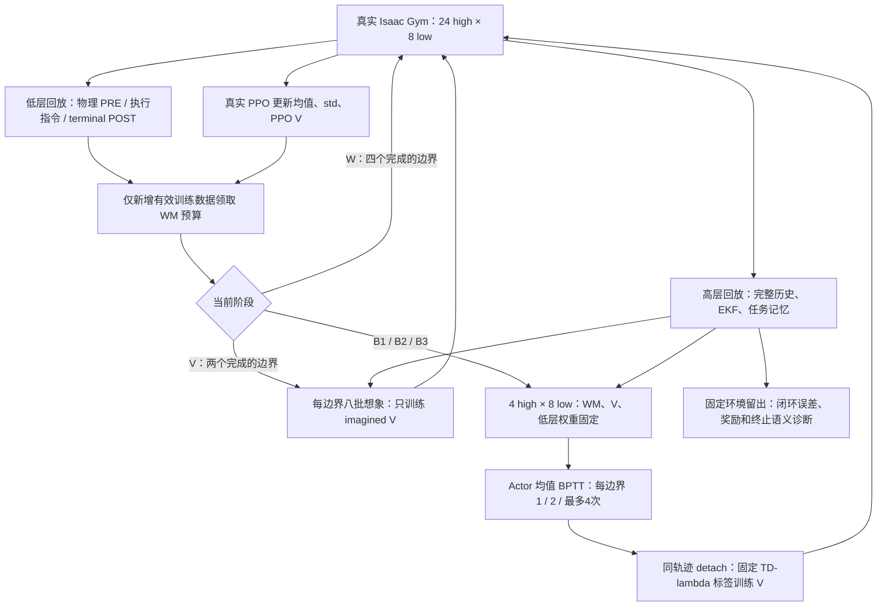

# Manipulation 世界模型教师方案实施记录

实施依据：[已批准方案](SuperMimic_manipulation_teacher_revision_plan.md)。本文描述新 `manipulation` 配方；旧 `supermimic` / `gated` 配方继续保留。修改基于工作区已有实现，没有覆盖此前未提交的修改。

## 训练入口与主流程

入口仍为 `DQ_high-level/train_teacher_sgs_ekf_world_model.sh`，默认使用 `cuda:0`、4096 环境、`--wm_recipe manipulation`。真实 PPO 随机采样；想象仅使用策略均值，标准差仅由 PPO 更新。一个高层动作展开八个 20 ms 低层闭环，四个高层决策共 32 个低层模型步骤。低层控制器参数冻结，但保留其输入梯度。



W 至少完成四个完整 PPO 边界；V 再完成两个边界，每个八批；B1 四个边界各一次，B2 四个边界各两次，之后 B3 最多四次。准备期、拒绝更新或样本不足期间不积累 Actor 欠账。阶段完成检查实际更新结果，真实 PPO 始终正常学习。`fit` 模式始终只拟合 WM，不执行 V/BPTT。

WM 更新预算为 `floor(fraction + wm_epochs * N_new_valid_train_low / batch_size)`，默认 `wm_epochs=1`、`batch_size=2048`、每边界上限 512。保留不足一次的小数余额；超上限整数额度丢弃并记录。计数来自新增真实低层转移，不使用环形回放大小差，也不再乘窗口长度。旧 `warmup_steps`、`updates_per_low_step`、`batches_per_update` 不决定新版 Actor 日程。

## 动作、奖励与状态

新版执行/奖励契约为 `manipulation_v2`：

- 真实与想象共同取消高层小命令清零门；物理限幅、冻结低层 walking/gait 逻辑保留。启动器原有 `--small_value_set_zero` 不会覆盖新版契约。
- `base_dir` 使用水平向量；机械臂加速度使用最后一个完整 20 ms 低周期的入口/出口速度。入口速度独立保存，覆盖所有环境，并在真实重置/SGS 恢复后重新同步。
- 夹爪保持 `opening=sigmoid(latent_6)` 和 `q_closed + opening*(q_open-q_closed)`。
- 动力学仍输出 62 维残差和四路接触，积分得到 64 维物理状态。完整 922 维展开状态含历史、EKF、任务记忆等，不是全部由网络预测。桌面保留名义条件递推，不学习实际位姿和速度。

真实 PPO 使用 `r_task_v2`；BPTT 和 imagined V 使用同一 `r_task_v2 + 0.1*r_aux`。辅助项在 POST 状态计算，包含 D/O/G/GL/GLS 五项及滑移/不安全成本。物体尺寸来自实际 URDF collision mesh；双指几何使用实际关节角和 URDF 指端参数。滑移惩罚按抓持几何加权，不把正常追赶直接视为抓持滑移。抬升质量有界，接近/对齐项不会在进入抓持时突然消失。

这些仍是几何与运动代理，不是接触力或承重真值，也不是已调优奖励。质量权重、尺度、物体碰撞边界来源和代理版本写入 checkpoint 元数据。真实成功判据及连续十个高层步保持要求不变。原始动作越界成本默认关闭；启用时使用真实 latent 均值，并进入 Actor 和 V 的同一标签定义。

## 回放、模型与可选实验

末尾约 5% 环境固定用于 WM 验证；真实 PPO 仍可使用这些环境。它们不参与模型训练、归一化统计或想象训练起点采样。旧 episode 划分保留给旧配方。

低层训练窗口支持有效短前缀：terminal/timeout 当步保留，之后屏蔽；无效或不连续记录从当步开始屏蔽。先用有限值填充无效片段，再执行网络和积分。损失及微批累加按有效转移数量加权，全空批次跳过。高层完整起点仍独立保存。

以下候选均默认关闭，可单独打开：

| 配置 | 功能 |
|---|---|
| `layer_norm: true` | 动力学隐藏层增加 LayerNorm，默认仍三层 2048。 |
| `running_normalization: true` | 显式输入/残差 RunningNorm；仅新增真实有效训练样本更新统计。 |
| `critic_memory: true` | imagined V 增加上一动作、低层历史、EKF 和上周期速度特征。 |
| `amp: bf16` | 仅神经 MLP autocast，输出立即回 FP32；几何、积分、统计、损失继续 FP32。 |
| `hidden: [2048,2048,2048,2048,2048]` | 单独的五层网络实验。 |
| `task_aux_alpha: 0` | 关闭想象辅助奖励。 |
| `raw_action_bound_weight: ...` | 可选原始动作/夹爪 latent 越界成本，默认 0。 |

输出归一化使用 `residual_targets(pre,post,dt)` 反解半隐式积分器，包括 PRE yaw 坐标、POST 姿态 COM 修正和最短旋转分支。它不是 `post-pre` 统计。输出标准差不用于直接缩放 endpoint loss；该损失保持原固定物理尺度。零末层在开启输出归一化后表示平均残差。统计与计数均作为模型 buffers 保存。

另外修复了 `modules/pose_prediction.py` 中小角度 SE(3) 运算的反传 NaN：Taylor 区间内为未选中常规分支提供安全分母，不改变被选中的前向公式。

## 日志、诊断和检查点

每个 PPO 边界分别记录新增数据数、模型预算/实际更新/丢弃预算、阶段、V 批次、Actor 预算与接受次数、耗时。大量模型拟合每 32 批打印进度；每个 V/BPTT 批次也有进度，避免终端长时间无更新。

默认诊断包括八低步拟合误差、四高步冻结低层闭环误差、接触准确率、真实 POST 上的原生/重建/辅助奖励、done 分歧、实际抬升/保持/完成覆盖、执行动作饱和和夹爪 sigmoid 导数。新增 GPU 累计器按 SGS family 记录真实高层 PRE→POST 的进入/退出和失败终止次数；覆盖 replay 所选环境的有效 train＋holdout 记录，每高步仅计一次。其发生率有明确转移分母，不冒充回合成功率或接触真值。闭环误差重放真实记录的高层命令并重算低层反馈；不能称为独立当前均值策略价值真值。

独立物理探针使用独立进程/仿真及共同前缀，不恢复训练 PhysX 状态冒充同一起点。旧 `probe_teacher_world_model.py` 检查一步原生奖励效果；新增 `diagnose_manipulation_teacher.py` 使用当前均值策略、训练同分布观测噪声和真实 POST 重算的完整想象奖励，比较完整有限任务回报与同快照 imagined V。支持 BPTT 首动作 latent 方向、逐维方向和随机方向；分别记录真实改善、重复误差、方向一致性、模型改善而真实恶化及描述性置信区间。回合在诊断截止点未终止时标记为 censored，不作为 V 真值；阈值未标定时不宣布通过模型质量验收。

```bash
# 使用训练保存的 candidate_latest.pt，工具自动在独立子进程建立仿真
python DQ_high-level/diagnose_manipulation_teacher.py \
  --checkpoint PATH/TO/world_model/candidate_latest.pt \
  --output /tmp/manipulation_value_direction.json --device cuda:0 \
  --num_envs 64 --direction bptt --max_steps 5000

# 分维检查夹爪 latent；其他轴使用 coordinate 0..8
python DQ_high-level/diagnose_manipulation_teacher.py \
  --checkpoint PATH/TO/world_model/candidate_latest.pt \
  --output /tmp/manipulation_gripper_direction.json --device cuda:0 \
  --direction coordinate --coordinate 6
```完整真实任务成功评估继续使用原有 full-task/SGS 评估入口，想象代理成功不回写 SGS。

训练 checkpoint 保存模型、优化器、统计、配置、阶段/预算/采样审计。普通教师 checkpoint 另外保存 `teacher_task_contract`，使 `--world_model off` 的新版 PPO 基线也能验证动作/奖励语义。旧动作语义或模型结构不能静默转成新版；实验从声明的初始化重新开始。入口继续拒绝 `--resume`：保存审计信息不表示实现了精确训练恢复。

## 运行方式

```bash
# 激活现有 dqwbc 环境后，正常开始训练
bash DQ_high-level/train_teacher_sgs_ekf_world_model.sh --no-wandb

# 相同初始化、预处理和真实任务契约的纯 PPO 基线
bash DQ_high-level/train_teacher_sgs_ekf_world_model.sh --world_model off --no-wandb

# 只训练模型
bash DQ_high-level/train_teacher_sgs_ekf_world_model.sh --world_model fit --no-wandb

# 单独关闭辅助目标
bash DQ_high-level/train_teacher_sgs_ekf_world_model.sh --wm_task_aux_alpha 0 --no-wandb

# 单独开启归一化；其他可选项也可通过 --wm_config YAML 明确覆盖
bash DQ_high-level/train_teacher_sgs_ekf_world_model.sh --wm_running_normalization true --no-wandb

# 需要回到此前的更新日程时显式选旧配方
bash DQ_high-level/train_teacher_sgs_ekf_world_model.sh --wm_recipe supermimic --no-wandb
```

## 验证记录

本次检查均已完成，详细哈希与记录见 [验证审计](SuperMimic_manipulation_validation.json)。

| 检查 | 实际结果 |
|---|---|
| 相关单元回归，CUDA 0 可见 | 379 项：378 通过、1 跳过；覆盖 CPU 与 CUDA 变体。后续诊断报告字段调整的六项专项也通过。 |
| [32 环境、全部阶段](SuperMimic_manipulation_small_gpu.json) | 360 high / 2880 low；W×4、V×2、B1×4、B2×4、B3×1；16 次 BPTT 全接受；真实阶段计数 11,520 条，符合 32×360。约 135 s。 |
| [4096 环境、默认配方](SuperMimic_manipulation_production_gpu.json) | 192 high / 1536 low；2918 次 WM 更新、16 批 V 准备、两次 BPTT；八个边界均完成；约 516 s，PyTorch 峰值 20.4 GiB。 |
| [可选组合 CUDA](SuperMimic_manipulation_experimental_gpu.json) | 32 环境、192 high；LN＋RunningNorm＋memory Critic＋MLP BF16 同时启用，跨 W/V/B1 通过。输入/输出统计计数都是 46,080，等于新增有效训练转移数。 |
| [独立均值/方向工具](SuperMimic_manipulation_independent_gpu.json) | 五个独立仿真进程完成，八个起点重复性匹配；本次仅四步，八个回合均未终止，因此 V 误差与方向质量明确未验收。 |
| 静态与入口 | `git diff --check`、Python 编译、启动器 shell 语法与 `--dry-run` 均通过；默认 rl/sim 均为 `cuda:0`。 |

CUDA 检查确认低层权重固定，BPTT 不更新 std、WM 或真实 PPO Critic，真实 PPO 确实改变 std。4096 环境各边界真实奖励与重建任务奖励的最大平均绝对差约 `4.81e-6`。阶段准备与 Actor 批次按实际成功更新推进，W/V 阶段没有 Actor step。

生产规模检查后新增的 checkpoint 审计与真实阶段计数不改变训练数学；最终 360 步小规模检查覆盖了这些新增路径和 B2/B3 阶段。可选组合检查用于发现设备/梯度/接口错误，不是把多个实验混在一起宣称收益。

模型预测质量、动作方向是否实际有益、imagined V 是否能正确排序，以及最终 full-task 成功率，仍需要完整真实回合和正式训练数据验收。这里没有开展 40000 步长训，也没有宣称成功率已提升。性能数字包含额外诊断和测试检查，不是论文速度复现结果。

## 关键文件

- [训练配置与入口](../DQ_high-level/utils/wm_entry.py)、[启动脚本](../DQ_high-level/train_teacher_sgs_ekf_world_model.sh)。
- [主循环](../DQ_high-level/utils/wm_ppo.py)、[阶段调度](../DQ_high-level/utils/world_model/schedule.py)、[独立 V 准备/BPTT](../DQ_high-level/utils/world_model/imagination.py)。
- [任务代理](../DQ_high-level/utils/world_model/task_objective.py)、[真实/想象适配](../DQ_high-level/utils/wm_env.py)、[固定八步适配](../DQ_high-level/utils/wm_fixed8.py)。
- [回放](../DQ_high-level/utils/world_model/replay.py)、[多步拟合](../DQ_high-level/utils/world_model/trainer.py)、[残差反解](../DQ_high-level/utils/world_model/residual_targets.py)、[归一化](../DQ_high-level/utils/world_model/normalization.py)。
- [CUDA 跨阶段检查脚本](../DQ_high-level/tests/smoke_manipulation_teacher_gpu.py)、[第三方来源与许可证](../DQ_high-level/utils/world_model/THIRD_PARTY_LICENSES.md)。
