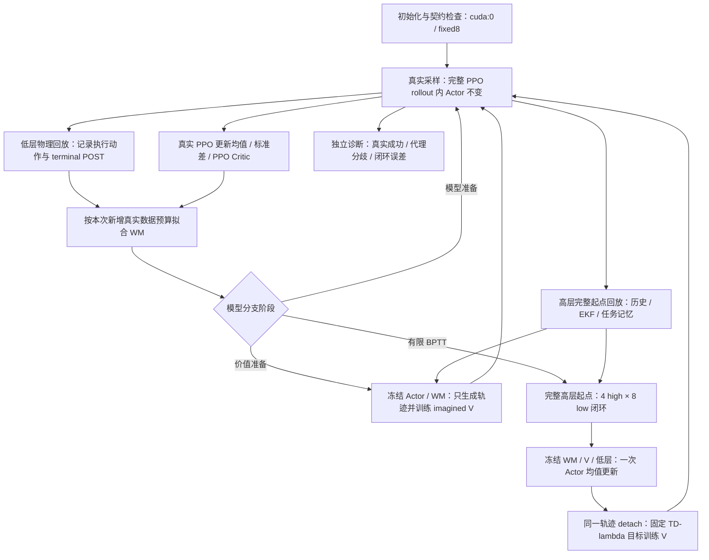

**SGS＋EKF 教师训练修改方案：参考 supermimic_manipulation 的模型学习与想象训练流程**

日期：2026-11-07。状态：待实施方案，不代表下述改动已经写入训练代码或通过训练验证。

目标是让世界模型提供能够改善真实动态抓取的动作梯度，同时保留真实 PPO、固定八次低层闭环和单卡 GPU 运行。优先解决模型准备程度、更新节奏、任务学习信号和价值估计问题，再比较模型结构与执行精度。

本方案参考 [源码仓库](/home/hehui/supermimic_manipulation) 与 [训练数据流图](/home/hehui/supermimic_manipulation/docs/supermimic_manipulation_training_flow.html)。参考仓库 HEAD 和 HTML 内嵌版本均为 `eda7da480c6d92a68cc41c9628b7efdae08cae23`；核对时，HTML 内嵌源码快照与对应磁盘文件的 SHA256 全部一致。图包含八个视图、93 个节点，默认任务为 BoxInBin。

参考 HTML SHA256：`3fe320e7f22196fd7b77d338bb9dee8a4cd3b325042e25c1c82d5ce1766b7d5f`。

DQ 基线是当前工作区，而非仅 Git HEAD；HEAD 为 `9fbebab79b6ca79bd7b1232f5269535452d29461`，工作区已有前期实现改动。入口为 [train_teacher_sgs_ekf_world_model.sh](../DQ_high-level/train_teacher_sgs_ekf_world_model.sh)。后续实施前应记录相关文件和解析后配置的哈希，不能把旧文档中的实现描述当成当前代码事实。

文中使用三个标记：**【借鉴】**表示参考源码已经采用的原则或实现；**【适配】**表示针对 DQ 新提出的设计；**【实验】**表示需要独立比较、暂不设为默认的候选。本文给出的训练预算是首轮实验起点，不是论文参数，也不是已验证最优值。

**1. 保留的约束与本轮范围**

| 项目 | 方案决定 |
|---|---|
| 真实环境 | 保留 Isaac Gym，不迁移 MuJoCo Warp。 |
| 设备 | 默认仿真、网络、回放、优化器均使用 `cuda:0`；不得自动转到 CPU 或另一块 GPU。 |
| 高低层时钟 | 一个高层动作严格执行八个 20 ms 低层周期，即 160 ms。 |
| 想象长度 | 首版保持四次高层决策、32 次低层模型转移，共 0.64 s；不是 32 次高层决策。 |
| 低层控制 | 保留冻结低层策略，每个预测低层状态都重新构造观测并调用它；参数冻结，输入梯度保留。 |
| 教师观测 | 保留对象特征、抓取候选和因果 EKF；不读取真实未来状态、未来观测或未来传感器结果。 |
| 夹爪 | 保留连续 opening 与关节映射，不改回参考的二值夹爪。 |
| PPO 与 BPTT | 真实 PPO 随机采样、更新均值和标准差；BPTT 只使用均值、只更新均值网络。 |
| 成功标准 | 保留真实抬升阈值和连续十个高层步保持要求；不为缩短想象而降低成功要求。 |
| 桌面 | 不预测实际桌面位姿和速度。保留初始几何及名义运动递推作为条件，不能删除物体支撑面信息。 |
| 编译和多 GPU | 延续此前“第 45 项暂不改”的范围，不默认启用 `torch.compile`、DDP 或多 GPU。 |

参考仓库的 50 ms OSC 转移、28 维输出、二值夹爪和纯 BPTT 优化器关系，不能直接替代上述控制契约。该仓库是独立 manipulation 迁移实现，不等同于原论文所有设置。

**2. 要解决的问题与修改次序**

| 顺序 | 当前可确认的现象 | 需要解决的问题 | 计划 |
|---|---|---|---|
| P0 | `base_dir` 无有效引导；想象加速度项为零；高层小命令清零 | 配置中的奖励和动作梯度没有发挥预期作用 | 统一修正真实/想象语义，建立新版基线。 |
| P1 | 首次 BPTT 前仅十次模型优化 | 很早开始利用缺少训练依据的模型与尾部价值 | 增加模型准备期、价值准备期。 |
| P1 | 每次 PPO 边界后连续约 76～77 次 BPTT | 策略改变后没有及时补充相应真实数据 | 模型和 Actor 更新预算分账；Actor 每边界先一次、后最多四次。 |
| P1 | 成功项硬判定；接近/抬升主要奖励刷新纪录 | PPO 可利用的回报不一定提供有效 BPTT 局部梯度 | 增加明确版本化的想象阶段辅助目标。 |
| P1 | 0.64 s 想象短于 1.6 s 保持 | 完整成功信用依赖 Critic，但目前缺少独立证据 | 检查真实保持状态覆盖、尾值作用与实际价值排序。 |
| P1 | 默认验证是八低步、记录动作下的误差 | 不能证明冻结低层反馈后的预测和动作方向正确 | 增加控制器闭环验证和动作后果验证。 |
| P2 | compact Critic 省略部分影响未来回报的记忆 | 相同输入可能对应不同未来行为和回报 | 保留对照，增加受控的记忆特征候选并验证。 |
| P2 | 固定尺度、无 LayerNorm | 可能限制拟合质量，但不是已证实根因 | 分开比较 LayerNorm、运行归一化和网络深度。 |

这些是代码现象及其机制风险，不构成“某一项已被证明导致训练失败”的实验结论。数值保护、梯度有限和更新被接受仍需检查，但不能作为抓取收益验收。

**3. 对照参考数据流图，如何迁移各节点**

| 图中节点 | 参考职责 | DQ 中的落点与修改决定 |
|---|---|---|
| `schedule` | 初始采样、WM-only、采样/更新预算 | 【借鉴＋适配】在 `wm_ppo.py` 建立明确阶段，保留 PPO 边界限制。 |
| `reset_*` | 分阶段、经物理验证的初态库 | 【借鉴＋适配】保留现有 SGS bank，补阶段覆盖与连接诊断。 |
| `collect_pre` / `collect_capture` | PRE 和 reset 前 terminal POST 对齐 | 【借鉴】保留现有终末捕获，增加加速度采样语义检查。 |
| `collect_replay` / `collect_windows` | 真实记录动作、多步窗口、无效段 mask | 【借鉴＋适配】保留双层回放；低层窗口支持终止后的短前缀 mask。 |
| `ar_proc` / `ad_action` | 真实执行映射与想象映射一致 | 【适配】连续夹爪；新版高层映射去除小命令清零；低层步态契约保留。 |
| `wm_innorm` / `wm_outnorm` | 显式统计、归一化输入和物理增量 | 【实验】复制统计框架，输出目标必须反解 DQ 残差积分器。 |
| `wm_mlp` / `wm_integrate` | 学习物理变化、解析更新状态 | 【借鉴＋适配】物理输出维度不扩大；保留半隐式积分与 FK。 |
| `wm_loss` | 自回归误差、终止 mask | 【借鉴＋适配】保留有效步的连续预测图，单独定义损失归约。 |
| `im_*` | 冻结模型/V，重建观测，闭环 BPTT | 【借鉴】四次高层决策内部运行八次低层闭环，参数与梯度归属不变。 |
| `ad_*` | 任务代理、阶段奖励、成功判据 | 【借鉴＋适配】为动态抓取设计辅助目标，首版不复制 success/done ST。 |
| `cr_*` | 固定 TD(λ) 标签、独立训练 V | 【借鉴＋适配】增加只训练 imagined V 的准备阶段，标签与想象奖励版本一致。 |
| `collect_diagnostics` / `output` | 代理/真实对照、原生评估、保存 | 【借鉴＋适配】增加真实 full-task 评估、同定义价值验证和 checkpoint 契约。 |

可直接参考的实现包括 `agent.py::lambda_returns`、`_fixed_parameters`、`networks.py::RunningNorm`、MLP/局部 autocast、窗口有效性 mask 和任务代理诊断。复制时保留参考仓库 [LICENSE](/home/hehui/supermimic_manipulation/LICENSE) 及 [REFERENCE_LICENSE](/home/hehui/supermimic_manipulation/src/clab/algorithms/supermimic/REFERENCE_LICENSE) 对应声明，并更新本仓库第三方来源说明。

**4. 修改后的训练主循环**

每个 PPO 边界只领取一次世界模型预算。一个边界内的有限次 Actor 更新使用同一批已经补充的真实数据，不重复领取模型预算。所有想象数据仅供模型分支使用，不写入 PPO rollout，不作为 SGS 的真实成功事件，也不回写真实环境状态。

一次 Actor 更新内，世界模型、低层控制器、Critic 参数和归一化统计全部固定。冻结参数不等于关闭对输入的求导。Critic 回归只接收 detached 数据，不能向 Actor 或动力学反传。

**5. 分阶段调度与首轮预算**

参考实际默认是先 64 个真实控制步、再 1000 轮仅 WM，随后平均每 2.5 个真实控制步更新一次策略。DQ 保留 PPO，因此采用下面的独立适配，不能称为直接复制参考预算。

| 阶段 | 建议起点 | 真实 PPO | 模型分支 |
|---|---|---|---|
| W：模型准备 | 至少四个完整 PPO 边界；默认为 96 high / 768 low | 正常采样和更新 | 只拟合 WM，BPTT Actor 和 imagined V 不更新。 |
| V：价值准备 | 再两个完整边界；默认为 48 high / 384 low | 正常采样和更新 | 继续拟合 WM；每边界八批想象数据，只训练 imagined V。 |
| B1：小预算 BPTT | 接下来四个边界 | 正常 | 每边界一次 Actor BPTT，之后训练 imagined V。 |
| B2：观察增加预算 | 再四个边界 | 正常 | 每边界两次 Actor BPTT。 |
| B3：后续训练 | 此后 | 正常 | 每边界最多四次 Actor BPTT，不恢复旧的几十次集中更新。 |

W 阶段的“只拟合模型”仅指模型分支；真实 PPO 仍学习，因此不同于参考的 Actor 参数不更新。V 准备期间每批起点仍来自完整高层回放，不能用低层压缩记录补零后冒充完整策略状态。只训练 V 应有独立路径，不通过零学习率 Actor step 模拟。

阶段至少要求对应更新实际完成；无有效窗口、非有限更新或未完成 V 拟合时，不以经过了若干时钟就视为已准备好。首版不默认增加逐轮模型置信度门控、KL 回滚或新 ensemble。准备期的质量诊断不满足后文验收时，应在实验评审中延长准备期或修正模型，而非继续增加 Actor 次数。B1/B2/B3 数值只是候选日程，若真实表现恶化则固定在较低预算；这不是宣称前六个边界已经足以学好模型。

模型预算改为：

\[
u_{\rm WM}=\left\lfloor c+E_{\rm WM}\frac{N_{\rm new,valid,train}^{\rm low}}{B_{\rm WM}}\right\rfloor,
\qquad E_{\rm WM}=1.0,\ B_{\rm WM}=2048.
\]

这里 `N_new` 是本边界新采集、有效、属于模型训练分区的低层转移条数，每条只计一次。与参考一样，`E_WM` 表示抽样窗口数相对于新增转移数的预算，不等于把所有重叠窗口精确遍历一次。一个窗口内部的八步不能再乘入预算。以时间戳累计新增量，不能用环形回放当前大小之差代替。

首轮每边界上限建议 512 次模型 Adam 更新；只保留小于一次更新的小数余额，超过上限的整数额度丢弃并记录。若 4096 环境中留出 205 个、每边界新增 192 个低步且全部有效，约为 `192×3891/2048≈365` 次模型更新。实际次数随有效数据量改变。`E_WM=2/4` 留作拟合不足时的对照，不直接复制参考 4.0。

模型准备、价值准备、样本不足或更新拒绝期间，均不积累 Actor 欠账。删除 `.4 × low_steps → Actor rounds` 的调度关系。模型损失、Actor 次数、V 次数分别统计，不能再用一个 `round` 混合三者。

首版继续使用想象 batch 4096、H=4、γ=0.99/high、λ=0.95、V 的 5 epochs×4 minibatches。先保留当前 Actor `−J/H` 以隔离调度效果；再独立比较参考的 `−J`，不能同时改目标缩放和学习率后宣称只测试了时序。学习率按明确的真实采样时钟记录；暂不重定义真实 PPO 的学习率规则。

**6. 真实执行与奖励的确定性修正**

**6.1 新版高层执行映射。** 保留各物理限幅，去掉高层“前进/转向都未过阈值便全部归零”的额外门：

\[
v_x=\operatorname{clip}(v_{\max}a_7,-v_{\max},v_{\max}),\qquad
\omega_z=\operatorname{clip}(0.6a_8,-0.6,0.6).
\]

这是【适配】，会改变真实执行行为，必须在环境、想象、评估与检查点元数据中一起修改。冻结低层的 walking/gait 判定仍保留，不能同时软化其传感器或步态输入；因此去掉高层清零并不保证低层在零附近有理想跟踪。分别验证零点、旧阈值两侧和限幅附近的真实响应、底盘漂移和稳定性。旧契约继续可选，以便对照；禁止只在想象中删除死区或赋予虚假梯度。

夹爪保持 `opening=sigmoid(latent_6)` 和 `q_closed+opening*(q_open-q_closed)`。标准差继续由 PPO 更新。首版不同时改变全套探索噪声；记录每维执行饱和率与夹爪 sigmoid 导数，必要时再做分维探索的独立实验。

**6.2 底盘朝向奖励。** 使用底盘到物体的水平向量和底盘水平朝向计算余弦，不再清零物体方向的 XY 分量；距离过小时奖励置零。真实和想象采用同一纯函数。

**6.3 机械臂加速度奖励。** 统一取高层动作内最后一个 20 ms 周期前后速度：

\[
a_{\rm arm}=\frac{\dot q_{\rm arm}^{(8)}-\dot q_{\rm arm}^{(7)}}{0.02}.
\]

真实环境另存低周期入口速度，不能被重复的 simulator refresh 覆盖；需要覆盖所有真实环境，而非仅 WM 回放选择的环境。想象 `integrate_low` 保存输入的 `dof_vel` 作为上一低周期速度，不再保存更新后的同一个速度。重置以真实当前速度初始化。不得使用高步起点的速度差再除以 0.02，也不得用最后 5 ms 的速度差冒充 20 ms 加速度。

两项奖励先保留原函数形状与权重，单独观察从零变为有效后的量级；修改后的纯 PPO 也必须重新建立基线。成功判据保持不变，但训练奖励已经改变，不能将新旧结果混为同一奖励设置。

**7. 想象任务目标：给动态抓取提供可检验的方向**

定义两个明确的奖励版本：

\[
r_{\rm real}=r_{\rm task,v2},\qquad
r_{\rm imag}=r_{\rm task,v2}+\alpha r_{\rm aux}.
\]

`task,v2` 包含上一节真实/想象同步修正。真实 PPO 只使用 `r_real`；imagined V 和 BPTT 使用同一版本的 `r_imag`。日志分别记录两个分量，不把代理回报增长解释为真实成功率增长。

| 阶段 | 辅助信号 | 需要覆盖的反例 |
|---|---|---|
| 接近 | 有效抓取候选的距离、姿态与相对运动；距离采用近远两种尺度或不过早饱和的函数 | 追逐物体中心、撞击物体、退后再接近但未刷新历史纪录。 |
| 抓持 | 物体尺寸相容的夹爪/手物几何、相对位姿与滑移 | 闭爪擦过、仅靠近、碰起物体但未抓住。 |
| 抬升 | 物体随末端抬升的有界进度，保留抓持质量 | 单纯抛起物体、抬得越高分越多。 |
| 保持 | 目标高度附近的相对位姿稳定、低滑移、合理速度和底盘稳定 | 松脱前短暂悬空、悬停不完成、过度运动。 |

首轮候选写成可分项审计的有界状态质量，而不是所有条件的硬门乘积。设 `D/O/G/L/S` 分别为接近、对齐、抓持代理、抬升进度和保持质量，均在 `[0,1]`：

\[
L(h)=\operatorname{clip}(h/0.2,0,1),\quad
Q=w_DD+w_OO+w_GG+w_LGL+w_HGLS,\quad \sum_iw_i=1.
\]

其中 `h` 为相对桌面及物体静置高度的抬升量。建议初始质量权重为 `(0.20,0.10,0.20,0.20,0.30)`；它们仅用于首轮分项验证，不是已调优值。`G` 不得只由闭爪或距离构成；使用物体几何和随动/滑移代理，但仍不能声称证明了真实接触或承重。

辅助项候选为 `r_aux=0.16*(Q-c_slip-c_unsafe)`。`Q` 在该高层动作执行八个低层步后的 POST 状态 `s′` 上计算，成本的依赖明确为 `c(s,a,s′)`，BPTT 与 imagined V 共用同一实现；不能误算在 PRE 状态而少一拍动作梯度。有效终止当步也按其真实终点计算，之后吸收段不再获得辅助奖励。

成本非负且明确门控：未接触阶段不能把正常追赶的相对速度当作抓持滑移惩罚。接近和对齐项不因进入抓持就突然消失；高度超过目标后抬升项不继续增大。首轮 `α=0.1`，保留 `α=0` 对照；距离、速度和姿态尺度由物体尺寸、抓取容差和真实阶段数据确定后写入配置，不沿用参考固定机械臂的厘米尺度。

这是新的代理设计，可能出现悬停收益或假抓取，必须做反例评估和分项梯度检查。若改用势差 `γΦ(s')−Φ(s)`，要单独做实验：理想一致价值下其贡献会望远镜相消，不能把它当作必然新增的长期动作方向。任何辅助目标都不能默认声称保持原任务最优策略不变。

首版保留硬成功、硬失败和有限任务 timeout，终止当步奖励保留，之后吸收且不自举；不复制成功/终止 ST。参考的 ST 作为后续对照，届时须同时审查成功奖金与 survival 的梯度，不能只增加一个 sigmoid 就宣称解决了接触学习。

对原始动作的越界成本另设独立开关和日志。先在真实观测上确定饱和范围；候选按超过响应区间的原始八维命令和夹爪 latent 分别惩罚，不把 opening 平滑误认为 latent 防饱和。此成本属于想象目标时，imagined V 标签也必须包含它。

**8. 世界模型：保持物理边界，逐步借鉴网络与训练方法**

连续预测物理状态仍为浮动基座 13、物体 13、关节位置 19、关节速度 19，共 64 维；动力学输出仍为 62 维残差，另有四路足接触头。末端由 FK 计算，步态、时钟、命令、历史、EKF 由解析递推得到。922 维完整展开状态不等于网络预测维度。

拟合仍用真实记录的低层执行指令、连续回馈预测物理状态；想象才由预测状态重新运行冻结低层策略。真实未来足接触只作标签。足接触交给低层仍为二值输入；不为获得梯度而默认给冻结低层喂软概率。

网络实验分为三个独立步骤，均不与调度修正混为一个不可拆分变更：

1. 保留当前三层 2048、固定尺度，建立修正时序后的模型基线。
2. 【借鉴】只给动力学隐藏层增加 LayerNorm，接触头结构暂不变；再单独试输入/输出 RunningNorm。
3. 【实验】比较三层与参考五层 2048，仅当收益覆盖计算成本后采用五层。

输入 RunningNorm 使用当前物理/执行动作/context 特征，统计仅来自新增、有效的真实训练分区数据，每条计一次；不在回放重采样、imagined forward 或验证集上更新。一次八步拟合和一次 BPTT 内统计保持固定。复制参考显式统计接口，不使用 forward 隐式更新。

**输出归一化必须先实现 `residual_targets(pre,post,dt)`。** 当前模型不是直接预测 `post−pre`。设 `H` 为 PRE 底盘 yaw 旋转，刚体状态为 `(p,R,v,ω)`，真实 POST 记为上标 `+`，则与现积分器匹配的无量纲目标为：

\[
r_v=H^T(v^+-v)/0.3,\qquad r_\omega=H^T(\omega^+-\omega)/0.5,
\]
\[
r_R=H^T[\operatorname{Log}(R^+R^T)-\omega^+\Delta t]/0.02,
\qquad r_p=H^T[p^+-p-v_{\rm origin}^+\Delta t]/0.01,
\]
\[
r_{\dot q}=(\dot q^+-\dot q)/2,\qquad
r_q=(q^+-q-\dot q^+\Delta t)/0.02.
\]

物体的位置积分按现有约定使用其线速度；机器人 root 必须调用现有 COM/原点速度换算，使用 POST 姿态和角速度。旋转采用与积分器一致的左乘及最短旋转分支。启用归一化前，先验证真实 PRE/POST 的“反解目标→积分恢复”回环。

网络输出再按 `r_hat=μ_r+σ_r*network(x_normalized)` 反归一化。零末层此时对应平均残差而非零残差，必须记录这一初始化变化。输出统计的顺序、坐标系与当前 endpoint error 不同，**不得将 `out_norm.std` 直接用于除 `physical_error_vector`**。首版继续使用固定物理误差尺度；自适应 endpoint loss 另建同序、同坐标的统计后再实验。

借鉴参考终止 mask，低层拟合允许有效短前缀：有效 terminal/timeout 当步的 PRE→POST 保留，之后屏蔽；无效数据、episode/时间戳/分区不连续则从发生的当步开始屏蔽，之后全部屏蔽。首条必须有效，有效 mask 总数为零时跳过更新。首版仍要求采样位置有八条实际记录，不同时扩展到尚未采集的回放末尾。

状态损失与接触 BCE 按有效转移总数归一化：

\[
L_{\rm WM}=\frac{\sum_{b,t}m_{bt}\|e_{bt}\|^2}{\sum_{b,t}m_{bt}}
+0.1\frac{\sum_{b,t}m_{bt}\operatorname{BCE}_{bt}}{\sum_{b,t}m_{bt}}.
\]

其中 `BCE_bt` 是四路足接触 BCE 的均值，不是四路之和。这在全长窗口下保持当前损失尺度，**不是参考的“维度均值、时间求和、仅除 batch”**。无效尾部在网络、几何和 loss 运算之前替换成有限 padding，不能依赖 `NaN×0`。有效预测出现非有限数仍报告并拒绝更新。

**9. imagined Critic 的训练目标、信息与验证**

首版保留独立 imagined Critic 和 compact 输入作为对照，先新增 V 准备阶段。固定 TD(λ) 目标一次构造并 detach，V 的多轮拟合不反复改写标签。Actor 使用尾值时保留输入梯度，V 参数冻结。V 准备、Actor 目标与 V 标签必须共享奖励版本、γ、timeout、观测噪声及动作语义。

这个 V 预测的是当前均值策略在想象任务中的折扣回报，既不是成功概率，也不是 PPO Critic 的直接替代物。参考 V 同样依赖想象目标，未提供独立真实真值。

【实验】增加 `critic_memory` 对照。除 compact 中的物理、目标、步态、保持进度等信息外，候选输入应覆盖：上一动作造成的实际奖励依赖、低层动作/历史、计算因果 EKF 所需的记忆，以及修正后的上一低周期速度。较长历史可以编码为有限维特征；编码器只随 V 训练，Actor BPTT 时参数冻结但输入可导。不得混入 reset 类别标签或未来成功结果。

不能简单要求“同物理状态 V 就相同”：上一原始动作可能真实影响下一步动作变化成本，历史也影响下一次低层决策。应检查的是，**在物理后果、策略所需记忆和实际奖励差异都被控制后，是否仍能通过无意义的饱和原始动作虚增价值**。若出现该问题，应处理相应特征/成本/动作契约，不以再次删除全部必要记忆代替诊断。

首版不把 PPO replay 的实际未来回报直接混为 V 监督。PPO 数据来自随机动作和历史策略，不是当前确定性均值策略；即便重算相同代理奖励，也不能自动消除策略分布差异。Gaussian 重要性比率不能直接纠正确定性点质量策略。真实轨迹回报先作趋势诊断；定量价值验证使用独立的当前均值策略真实 rollout，并对齐奖励、折扣、终止、剩余时间和观测噪声约定。

若条件不足以恢复一致的接触状态，沿用现有 probe 的独立仿真/相同动作前缀方法；不在训练仿真器上简单设置状态后分叉，以免把未恢复的 PhysX 隐藏状态当成相同起点。

**10. 数据覆盖、验证划分与 GPU 验收**

【借鉴】增加固定环境留出选项，首轮建议末尾 5% 环境只用于 WM 验证。它们不参与模型拟合及运行统计量；其真实数据仍可用于真实 PPO。模型想象起点首版也只取训练分区，避免把模型泛化验证与策略优化混在一起。保留旧 episode 留出作为对照，不能把两种误差直接混画成同一曲线。

SGS 继续使用真实回合结果更新。记录各类别采样率、独立成功率和真实阶段转移数；分类依据实际抓取过程，而非把 `near_goal` 标签直接当成已抓稳或已保持。默认不重建已有 bank。若阶段覆盖不足，再对训练采样加入覆盖约束，完整任务评估始终从 full-task 分布单独报告。

验证分为四层：

| 层次 | 检查内容 | 通过所能说明的范围 |
|---|---|---|
| 计算语义 | 动作映射、奖励、PRE/POST、残差回环、mask、梯度归属、checkpoint | 代码实现与声明的公式一致。 |
| 模型预测 | 八低步记录动作；再做四高步/32低步的冻结低层反馈 | 在指定起点和控制条件下的预测质量。 |
| 有限动作效果 | 对当前 BPTT 建议方向和分维方向作真实扰动，比较物体/手物关系/奖励变化 | 模型是否提供有用的局部动作方向；不是精确接触导数证明。 |
| 任务学习 | 同条件完整真实回合，各 SGS 类别及 full-task；多种子 | 是否提高最终任务表现和样本/时间效率。 |

每项模型误差按底盘、机械臂、夹爪、物体和接触阶段报告，不只给总 NSE。真实动作效果实验应报告可重复性误差、方向一致率、实际改善幅度及区间，重点记录“模型认为改善、真实变差”。代理诊断在相同真实 POST 上记录 reward/done/candidate 分歧，特别关注代理成功而真实失败。

质量阈值应在首轮标定后固定：位置/姿态阈值由实际抓取余量给出，动作改善需超过仿真重复误差。未标定的指标记为“未验收”，不能凭一个随意 NSE 数字宣布模型可信。短测、验证通过或更新 accepted 都不能替代完整真实成功率。

GPU 基础检查使用 `cuda:0`：参数、优化器、回放和模型计算保持 GPU；32 个低步图完整，低层权重和 BPTT 中的 std 不改变。先小规模跨阶段测试，再 4096 环境跨多个更新块；记录峰值显存、模型/V/BPTT/真实采样耗时。资源不足时显式降低微批/分块并记录，不能无声改变物理时钟、H 或逻辑 batch。

【实验】仅 MLP 使用 BF16 autocast，输出立刻回 FP32；几何、四元数、FK、残差反归一化、积分、统计和损失累积保持 FP32。先检验前向、输入梯度与真实闭环表现，再比较吞吐。网络加深和 BF16 分开实验；不默认引入编译、多 GPU 或删除数值保护。

**11. 拟修改文件与交付顺序**

以下是实施清单，文件中的新接口名为计划名称，当前代码未必存在。

| 批次 | 文件/模块 | 具体交付 | 进入下一批次前的检查 |
|---|---|---|---|
| A：语义与基线 | `envs/reward_vec_task.py`、`envs/b1z1_base.py`、`utils/wm_fixed8.py`、`utils/wm_env.py`、`action_contract.py` | 水平朝向、20 ms 加速度、新版死区开关；真实/想象共享公式 | 终末/重置不污染速度；真实与想象同状态同动作的基础奖励一致。 |
| A：契约 | `wm_entry.py`、`action_checkpoint.py`、训练/评估配置解析 | 动作映射、奖励、时钟、模型结构与特征版本统一保存/校验 | CLI 覆写先解析后校验；旧权重不能静默按新执行语义运行。 |
| B：调度 | `wm_ppo.py`、`world_model/recipe.py`、`imagination.py`、`imagined_critic.py` | W/V/B 阶段；模型/Actor 分账；独立 V 准备路径 | 无 Actor 欠账；PPO rollout 内 Actor 不变；V 准备不调用 Actor optimizer.step。 |
| C：任务目标 | `wm_env.py`；可新增 `world_model/task_objective.py` | 基础奖励与想象辅助奖励分离，分项指标与反例 | Actor/V 使用同奖励版本；真实评估不使用代理成功替代原判据。 |
| D：回放/模型 | `replay.py`、`trainer.py`、`hierarchical.py`、`dynamics.py`、`wm_fixed8.py` | mask 短前缀、LN 候选、残差反解、显式 RunningNorm | padding 不产生 NaN；反解回环正确；统计在展开期间不变。 |
| E：价值 | `wm_fixed8.py::critic_features`、`imagined_critic.py` | compact 对照和 memory 候选，独立真实均值价值诊断 | 必要历史有效；饱和动作不能产生无法由真实回报解释的价值收益。 |
| F：诊断/GPU | `probes.py`、训练日志、相关测试、启动脚本 | 开环/闭环/方向/成功四层报告，单卡耗时与显存 | 跨阶段 GPU 运行及机制检查完成，再开始正式多种子对照。 |

复制参考纯函数时应增加针对该函数和输入梯度的对照检查；任务适配则验证自己的物理契约，不能用“与参考28维输出一致”作为验收。只为关键公式、梯度、终止、统计生命周期和 GPU 行为编写测试，不为文档格式写实现镜像测试。

检查点须保存：解析后配置、执行/奖励/观测/V 特征 schema、模型和所有优化器、归一化统计及计数、阶段和预算余额、采样计数、随机状态以及参考来源信息。更改动作语义、LN、归一化或特征结构时拒绝不兼容的自动加载；首轮正式对照从各自声明的初始化重新训练。

当前入口明确禁止 `--resume`，本轮不额外实现完整训练恢复，继续明确拒绝该选项；上述保存字段用于审计、评估和后续恢复支持，不表示可以精确续训。将来若实现不带 replay 的恢复，需保留全局采样/LR 进度与相应优化状态，但丢弃未完成的 PPO rollout，重置新 replay 的时间戳水位、新增转移计数、WM 小数余额和 W/V/B 局部阶段计数，重新经过数据及模型分支准备；Actor 不继承欠账。不能把旧回放水位套到新空回放，也不能无说明地重启全局学习率日程。

**13. 关键源码索引**

- 参考调度、验证与代理诊断：[runner.py](/home/hehui/supermimic_manipulation/src/clab/algorithms/supermimic/runner.py)。
- 参考多步拟合、BPTT 与固定 λ-return：[agent.py](/home/hehui/supermimic_manipulation/src/clab/algorithms/supermimic/agent.py)。
- 参考网络与统计：[networks.py](/home/hehui/supermimic_manipulation/src/clab/algorithms/supermimic/networks.py)。
- 参考窗口 mask：[buffer.py](/home/hehui/supermimic_manipulation/src/clab/algorithms/supermimic/buffer.py)。
- 参考状态、动作、FK、代理和 Critic：[任务公共适配器](/home/hehui/supermimic_manipulation/src/clab/tasks/supermimic.py)。
- 参考阶段奖励：[BoxInBin](/home/hehui/supermimic_manipulation/src/clab/tasks/box_in_bin/supermimic.py)、[Square](/home/hehui/supermimic_manipulation/src/clab/tasks/square/supermimic.py)、[Drawer](/home/hehui/supermimic_manipulation/src/clab/tasks/drawer/supermimic.py)。
- DQ 当前调度：[wm_ppo.py](../DQ_high-level/utils/wm_ppo.py) 与 [recipe.py](../DQ_high-level/utils/world_model/recipe.py)。
- DQ fixed8 物理/观测：[wm_fixed8.py](../DQ_high-level/utils/wm_fixed8.py)、[hierarchical.py](../DQ_high-level/utils/world_model/hierarchical.py)。
- DQ 想象/价值：[imagination.py](../DQ_high-level/utils/world_model/imagination.py)、[imagined_critic.py](../DQ_high-level/utils/world_model/imagined_critic.py)。
- DQ 当前诊断边界：[probes.py](../DQ_high-level/utils/world_model/probes.py)。

后续实施应按批次更新本方案的完成状态和证据链接，并更新训练数据流图。本文不覆盖既有实施记录，也不把拟议接口、预算和实验结果表述成当前已实现的事实。
