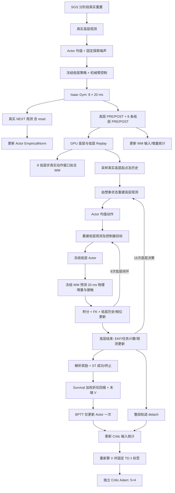

# 与 supermimic_manipulation 对齐的纯 BPTT 教师实现

更新：2026-11-07。对应启动入口：`DQ_high-level/train_teacher_sgs_ekf_world_model.sh`。

本次按照用户确认，将默认配方改为 `reference`：**关闭 PPO，Actor 仅由世界模型中的 BPTT 更新**。参考源码为 `/home/hehui/supermimic_manipulation`，核对的 HEAD 与训练图内记录均为 `eda7da480c6d92a68cc41c9628b7efdae08cae23`。旧 `manipulation / supermimic / gated` 配方保留，须显式选择。

本文描述已经落地的代码。此前的 `SuperMimic_manipulation_teacher_revision_plan.md` 和旧网络图不能代表新的默认算法。

## 1. 此前的问题与证据

检查了实际运行 `sgs_ekf_wm_seed43_20261107_162429` 的 `world_model/status.json`、TensorBoard 和本地日志。在高层步3144附近：

- BPTT 更新为4/4接受，并非模型门槛一直拒绝更新。
- full-task 累计4,639,146条转移，记录到的 lifted/completed 阶段进入次数均为0；near-goal近期成功约84%，不能据此认定学会完整抓取。
- 动作0、4、7的饱和比例约97.7%、95.3%、93.8%；夹爪 sigmoid 导数均值降至约0.00957。
- 旧想象辅助奖励加权均值约0.001559，而原生奖励均值约1.43646；辅助目标没有形成同等量级的主优化任务。
- 想象价值损失约23.67。此前 PPO 与 BPTT 同时更新同一个 Actor，但各自维护独立 Adam；PPO 自适应学习率曾升至约0.00287，BPTT 约0.0002。

这些是观测事实，不能把所有失败唯一归因于某一项。代码层面可以明确的问题是：旧框架并非参考仓库的训练算法；默认4次高层决策只覆盖0.64秒，无法从零保持计数直接完成需要10次高层决策的成功条件；价值输入省略部分历史；复杂代理奖励有多项相乘门控；Actor 准备期仍受 PPO 更新。

另修正两个集成错误：基础任务 YAML 曾显式写 `horizon: 4`，会覆盖新配方的16；完整 Critic 输入曾可能带入不随想象更新的13维 EE 缓存。前者改为由配方决定，后者移除缓存并从 FK 重建末端信息。

## 2. 参考仓库实际上如何训练

参考 `src/clab/algorithms/supermimic/{runner,agent,networks,config}.py` 及用户提供的 HTML：

1. 从分阶段 reset bank 重置真实环境，先采集64个控制向量步。
2. 确定性 Actor 输出均值；真实采样另外加固定 Gaussian 噪声，标准差0.1。Actor 观测统计由真实 `env.step` 返回的 NEXT 观测更新，包含 reset 后观测。
3. 记录真实 PRE、执行动作和 reset 前 terminal POST。WM 统计由真实物理转移更新，不能用 reset 状态代替动力学标签。
4. 每轮按 `updates_per_sim_step=0.4` 交替采集2、3步。WM 默认使用 epochs 调度：`4 × 新增训练转移数 / 2048` 累积取整；`world_model_batches=30` 只在另一种 batches 调度下生效。
5. 前1000轮只训练 WM；Actor 权重不更新，其观测统计仍随采集变化。
6. WM 用8步真实动作窗口自回归拟合。输出为物理增量；输入输出 RunningNorm，MLP 为5×2048、LayerNorm、SiLU。
7. 此后每轮先 WM，再一次 Actor BPTT，再 Critic。当前 manipulation 源码默认 **H=16**，不能把它写成原 SuperMimic 的32步。
8. 想象时冻结 WM、Critic 参数但保留输入导数；每一步重建观测并重新调用 Actor。Actor 优化折扣回报加末端价值，不再除以 H。
9. Actor 更新后，将轨迹分离计算图，更新 Critic 的想象输入统计，再计算固定 TD(λ) 标签，训练5 epochs×最多4个 minibatches。

参考仓库中的 PPO 是另一条基线，不参与上述 Actor 更新。

## 3. 现在的训练数据流



关键代码：

| 功能 | 文件 |
|---|---|
| 独立真实采集/WM/BPTT调度，无 PPO | `DQ_high-level/utils/wm_reference.py` |
| 默认配置 | `DQ_high-level/utils/world_model/reference_recipe.py` |
| 确定性 Actor、固定探索、真实观测统计 | `DQ_high-level/utils/world_model/reference_policy.py` |
| 低层动力学网络与8次闭环 | `DQ_high-level/utils/world_model/hierarchical.py` |
| 物理增量标签、积分、同坐标误差 | `DQ_high-level/utils/world_model/physical_increments.py` |
| 8步拟合与masked microbatch归约 | `DQ_high-level/utils/world_model/trainer.py` |
| 16步想象、survival、BPTT | `DQ_high-level/utils/world_model/imagination.py` |
| 想象 Critic、归一化和TD(λ) | `DQ_high-level/utils/world_model/imagined_critic.py` |
| 任务代理奖励及ST计数 | `DQ_high-level/utils/world_model/reference_task.py` |
| 观测/FK/EKF/低层控制器状态推进 | `DQ_high-level/utils/wm_fixed8.py`、`utils/wm_env.py` |

`ReferenceTeacherAgent`直接继承通用 skrl `Agent`，没有实例化 PPO、真实 Critic、PPO rollout memory、GAE 或 KL 自适应优化器。真实观测经验统计不是 PPO 优化的一部分。

## 4. 状态、网络和损失

### 4.1 哪些状态由动力学预测

仅学习机器人的浮动基座、物体、19个关节的物理运动：

- 基座：位置、姿态、线速度、角速度。
- 物体：位置、姿态、线速度、角速度。
- 19个关节：位置、速度，包含机械臂和夹爪。

物理状态64维，其中两个姿态各用四元数保存；网络输出62维增量，其中姿态各用3维旋转向量。robot/object输出顺序均为 `[Δv, Δω, Δp, Δrot]`，再接19维 `Δq`、19维 `Δq̇`。平移/速度/旋转增量统一在 PRE 基座 heading 坐标下表达，使用真实物理单位。额外4路足部接触预测用于冻结低层策略的闭环观测。

桌面实际位姿和速度不作为学习目标。桌面的名义支撑高度、尺寸与条件仍影响任务和接触动力学，保留为解析条件。FK、目标位置、四路时钟、步态相位、低层历史、EKF、任务保持计数都解析更新，不扩张成神经网络预测标签。

922维 rollout state 是保存这些物理量和因果历史的容器，**不是922维动力学预测输出**。

### 4.2 默认网络

当前 sugar_box + SGS + EKF 配置的实测结构：

| 网络 | 输入与结构 | 输出 |
|---|---|---|
| Actor | 1284维原生高层观测 → EmpiricalNorm → 2048/1024/512/256，ELU | 9维原始动作 |
| WM物理主干 | 164维低层物理/动作/context特征 → RunningNorm → 5×2048，LayerNorm+SiLU | 62维归一化物理增量，再反归一化积分 |
| 足部接触头 | 同一输入 → 128/128 | 4路接触 logits |
| Critic | 2253维 → RunningNorm → 256/128，ELU | 标量 V |

Critic输入为 `state去除13维冗余EE缓存 + 60维context特征 + 1284维重建高层观测`。低层历史、EKF历史、前一动作和成功计数都保留。只有数据维度匹配当前任务时，上表的具体维数才成立。

Actor最后一层小增益0.01；WM最后一层零初始化。MLP使用BF16 autocast，参数/优化器及FK、四元数、物理积分、EKF仍为FP32。冻结模块保留输出关于输入的梯度。

### 4.3 WM监督目标

对真实8低层步窗口，用预测状态继续递推，动作来自记录。物理项采用参考损失：

\[
L_{WM,physical}=\frac1B\sum_{b,t}m_{tb}\operatorname{mean}_{d}
\left(\frac{e_{tbd}}{\max(\sigma_{\Delta,d},f_d)}\right)^2.
\]

即**特征维平均、时间求和、logical batch平均**，不是对有效步总数平均，也不是62维求和。端点误差与增量统计使用相同单位、顺序和PRE heading坐标。`f_d`是有单位的数值下限，不是模型质量验收阈值。

终止转移保留，reset后的片段屏蔽；无效输入在运算前以有效padding代替。不同有效长度、microbatch尾块都按原logical batch权重合并。四路接触的BCE另加，默认权重0.1。

### 4.4 Actor与Critic

\[
w_t=\prod_{j<t}(1-d_j),\qquad
J=\sum_{t=0}^{H-1}\gamma^t w_t r_t+\gamma^H w_HV(s_H,c,o_H),
\quad L_\pi=-\operatorname{mean}(J).
\]

H默认16次高层决策，每次明确运行8次冻结低层闭环：合计128个20ms模型步、2.56秒。每个高层时刻重新计算Actor均值；同一个高层动作在其8个低层步内保持控制目标语义。整个图保留动作→低层控制→物理预测→后续观测→后续动作的梯度。

reference路径不计算Gaussian KL，不进行旧式KL回滚，也不复制Actor/Adam作更新回滚。Actor一次Adam更新，梯度先norm clip=1，再value clip=0.1；非有限值明确报错。

Actor更新之后，Critic先从detach的可达想象输入更新RunningNorm，再计算固定TD(λ)标签（γ=0.99、λ=0.95），进行5×4次回归。终止和有限任务超时没有reset自举；没有target Critic或真实PPO Critic。

## 5. 想象任务与成功梯度

旧“native reward + 0.1×复杂AABB辅助项”改为独立的想象抓取任务：接近、抬升、相对EE滑移下的持握、成功终奖、动作幅度/变化及机械臂关节速度成本。dense项乘高层dt=0.16，原生成功奖50不乘dt。持握不惩罚物体与机器人共同平移。

高度、EE距离、opening组成成功候选。真实可达转移的硬前向判断与原生规则一致，反向使用明确的sigmoid代理；保持计数可微，成功反向缩放0.02。这些是**代理梯度**，不是真实接触梯度。

特别修正了ST终止后的语义：

- 想象仍继续预测假设后续状态、观测、奖励和计数。
- 成功后的假设尾部不再使用真实任务的completed latch停止计数；候选持续则计数继续，候选消失则清零，与参考源码一致。
- 真实可达回报由survival屏蔽，不会重复领取成功奖；Critic也只训练可达行。
- 不再额外把尾部reward清零或冻结state，否则会改变survival的代理梯度。

真实仿真任务的奖励、终止标签和SGS统计仍使用原生实现。想象训练目标与真实评估指标分别报告。

## 6. 调度、GPU与仍保留的任务差异

默认先采集64高层步，之后更新边界为66、69、71、74……。前1000轮只训练WM，正常条件下首次Actor更新位于第1001轮、约高层步2566。观测normalizer在此期间更新，因此“Actor权重冻结”不等于输出完全不变。

WM预算按**新增有效训练低层转移**计数：`4×新增valid LOW rows/2048`累积取整。warmup不积累优化欠账。默认`wm_max_batches=0`不封顶；显式正数上限会丢弃并记录超额整数预算，不延后补做。每轮默认一次Actor，再一组Critic更新。

这些适配需要保留或单独验证，不能说与参考仓库完全相同：

| 项目 | 当前处理与原因 |
|---|---|
| 仿真器/机器人 | 保留Isaac Gym、四足+机械臂、冻结低层策略；没有迁移到MuJoCo Warp或OSC机械臂任务 |
| 时间尺度 | 参考一次模型步对应一次控制决策；这里一次高层决策包含8个模型步。H16代表的物理时长不同 |
| 接触与桌面 | 增加4路足部接触头供已有低层策略使用；桌面保持名义条件，不预测其实际动态 |
| 初态分布 | 保留用户的SGS自适应分布，没有改成参考默认的类别均匀reset |
| 动作与观测 | 保留9维动作、连续sigmoid夹爪、对象特征、抓取候选、EKF和低层历史；没有强行换成参考机械臂的7维/二值夹爪 |
| 奖励任务 | 抓取并持握，而非放置/释放。原生成功奖50、连续夹爪及移动基座要求不能直接复制别的任务权重含义 |
| 数据隔离 | WM统计和想象起点仅来自有效训练分区；保持DQ更严格的固定环境holdout隔离 |
| Replay | 高层容量256、低层容量1000；高层256×0.16=40.96秒。保留紧凑低层存储以控制GPU内存 |
| 计算预算 | 每个高层样本产生8条低层监督，因此相同epochs下的WM拟合量显著增加；不能用相同outer iteration直接比较源仓库速度 |
| 执行方式 | 保留单GPU，不启用torch.compile/DDP；chunk仅用于梯度累积，不增加Actor更新次数 |

连续夹爪的探索尤其需要实测：初始logit均值约0，σ=0.1对应opening集中在0.5附近；参考二值夹爪的相同噪声能切换开闭。当前遵循固定噪声逻辑并保留用户的连续动作契约，**没有证据证明这个探索幅度已足够覆盖完整抓取**。后续应结合真实夹爪分布、接触/抬升覆盖和full-task成功率评估，而不是仅看BPTT accepted。

新调度使用`collection_warmup_high_steps`、`collection_updates_per_high_step`、`world_model_only_iterations`和`lr_decay_iterations`。导出配置中兼容保留的旧`warmup_steps`、W/V/B字段、`updates_per_low_step`、`lr_decay_low_steps`不控制reference主线。TensorBoard通用`iteration`轴按真实高层步记录；优化轮数看`World model / reference/iteration`。

## 7. 使用与检查点

```bash
cd /home/hehui/DQ_WBC
PYTHON_BIN=/home/hehui/miniconda3/envs/dqwbc/bin/python \
  bash DQ_high-level/train_teacher_sgs_ekf_world_model.sh --no-wandb
```

默认sim和learner均为`cuda:0`、4096环境。`--no-wandb`仅关闭外部W&B，本地训练日志保留。先检查解析后的命令可用`--dry-run`。

显式运行旧混合配方：

```bash
bash DQ_high-level/train_teacher_sgs_ekf_world_model.sh --wm_recipe manipulation --no-wandb
```

新Actor为不同网络结构，不能续接旧attention/Gaussian策略权重；旧物理residual也不能直接当作新物理增量网络加载。检查点记录算法、Actor结构/观测归一化、物理坐标与任务语义，加载不匹配会报错。独立probe恢复policy内部normalizer和想象Critic；仅评估时不分配WM/replay。没有实现完整模拟器/replay恢复，因此不宣称支持精确训练resume。

## 8. 验证边界

最终CPU回归发现848项，实际执行656项全部通过，192项依平台/设备条件跳过。汇总、命令和关键代码哈希见 [SuperMimic_reference_validation.json](SuperMimic_reference_validation.json)。

真实CUDA验证均使用`cuda:0`、16环境、74个真实高层步（592低层步），完成2轮WM-only及2轮Actor→Critic。每次Actor更新完整展开16高层/128低层步，每次有20个Critic更新：

- [小网络报告](SuperMimic_reference_gpu_validation.json)。
- [生产网络宽度报告](SuperMimic_reference_full_network_gpu_validation.json)：保留5×2048 WM和2048/1024/512/256 Actor，PyTorch峰值分配约4.85 GiB。这个数不包含PhysX等非PyTorch分配，也不是默认4096环境所需显存。
- [独立诊断加载报告](SuperMimic_reference_probe_loading_validation.json)：5个独立GPU worker均完成，验证候选恢复、Actor归一化、Critic恢复及BPTT方向计算。故意只运行3步后截断，完整回合样本为0，不能用于价值精度或动作改进效果结论。

GPU测试的环境数、batch及WM准备轮数均有显式覆盖，不代表生产批量吞吐或完整训练效果。

检查包括：无PPO优化器/memory/真实Critic；WM-only阶段Actor权重和Adam状态不变；真实NEXT更新Actor统计；BPTT不修改WM、冻结低层策略或探索标准差；128低层步梯度贯通；一次Actor更新后20次Critic更新；GPU参数/缓冲有限；候选保存、策略及normalizer恢复。CPU测试另外覆盖与参考cumprod目标的逐项梯度对照、终止尾部计数、物理增量往返及masked microbatch等价性。

**尚未进行多个种子的长程训练、4096环境生产批量吞吐测量或完整任务成功率对照。** 本次完成的是训练算法和数据闭环修正；仍需用full-task实测验证学习效果。代码没有把短程集成测试包装成收敛结论。

源码复用与适配的MIT/BSD声明见 `DQ_high-level/utils/world_model/THIRD_PARTY_LICENSES.md`。
