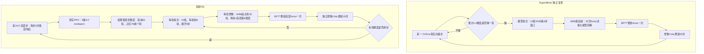

# SuperMimic 与当前 DQ 教师的完整训练流程、计时与性能问题

审阅日期：2026-11-06。

本文保留速度优化前的实现和计时，作为诊断基线。后续已授权的代码优化与 cuda:0 验证见 [SuperMimic_speed_optimization.md](SuperMimic_speed_optimization.md)。

审阅入口：`DQ_high-level/train_teacher_sgs_ekf_world_model.sh`。按当前默认 `supermimic + hybrid + fixed8` 路径分析，不把旧的 `gated` 路径混进来。论文、独立复现和本仓库实现分别标明。

## 1. 结论与本轮工作范围

**当前实现确实有很大的、可以避免的执行开销。不能再只用“任务更复杂”“世界模型更新次数多”解释训练慢。**

在本机 RTX 4090 / `cuda:1` 上，使用真实 Isaac Gym 采样所得的小回放池、当前完整尺寸网络，做了阶段计时：

| 阶段 | 当前分块 | 仅在诊断进程中增大分块 | 实测阶段耗时 |
|---|---|---|---|
| 动力学拟合：10 批 × 2048 个窗口 × 8 步 | microbatch=256 | microbatch=2048 | 18.94 s → 2.39 s，约 7.9 倍 |
| Actor BPTT＋想象 Critic：4096 个起点 × 32 个低层步 | chunk=128 | chunk=512 | 27.72 s → 7.22 s，约 3.8 倍 |
| 同上 | chunk=128 | chunk=4096 | 27.72 s → 0.91 s，约 30 倍 |

这些对比**没有开启编译，没有改变逻辑训练批量，没有缩短想象长度，也没有删掉冻结低层控制器**。计时说明：当前串行分块组织方式是一个已被实验支持的重要瓶颈。它尚不能证明生产规模的完整训练也能获得相同加速，更不能证明抓取成功率已经改善。

我之前将“GPU 短测能通过”作为训练可用性的主要依据，并低估了分块的时间成本，这个判断不充分。把复现采用的 UTD 口径说成论文已经明确规定，也不严谨。

本轮只做源码核对、临时诊断和本文档整理，**没有修改生产算法或训练配置**。尤其没有实施此前你明确暂不改的第 45 项编译／多 GPU 改造。

原始计时、调用次数、GPU 驻留检查及实验限制见：[SuperMimic_training_flow_profile.json](SuperMimic_training_flow_profile.json)。

## 2. 先区分论文中的三种“快”

依据：[SuperMimic 论文](papers/supermimic.pdf)，正文 §4.1–4.3、图 3–5，附录 Algorithm A.1 和 Table A.4/A.5。

| 论文结论 | 实际比较什么 | 不能直接推出什么 |
|---|---|---|
| 单张 H100 约 3 小时达到超过已发布 SONIC checkpoint 的表现 | 完整学习过程达到特定性能所需的时间；SONIC 训练报告为 128 张 L40 × 7 天 | 任意任务、任意实现的世界模型拟合都会很快；也不能按显卡数量简单换算本任务训练时长 |
| 世界模型比 MuJoCo Warp 快 10 倍以上，64k 并行时约 62 倍 | 图 5(a) 的模型 rollout／step 吞吐；一控制步为 20 ms，仿真器需 4 个 5 ms 物理子步；测试为 H100、TF32 | 本仓库“拟合＋Actor 反传＋Critic＋PPO”的总耗时应比原 PPO 快 10 倍 |
| 相比 PPO-WM，用约 64 倍更少的想象步达到目标回报 | 图 5(b) 在指定运动子集上的想象样本效率 | 单次 BPTT 更新快 64 倍，或任意接触任务都具有相同倍率 |

图 5(a) 没有充分公开计时函数的边界，不能武断说它“只测了裸 MLP 前向”，也不能认为它已经覆盖完整的模型拟合和优化器更新。稳妥的表述是：**这是 rollout／step 吞吐证据，不是完整训练更新耗时的直接证据。**

论文也做了较可比的 PPO-Sim 实验：相同 LAFAN1 任务设置下，SuperMimic 约 1.2 小时达到指定评测回报，PPO-Sim 在 18 小时预算内未达到。它支持这种学习方法的效率，但不能代替对当前 DQ 实现的实际计时。

## 3. 四种“步”不能混用

| 时间单位 | SuperMimic 复现 | 当前 DQ |
|---|---|---|
| 物理子步 | 5 ms | 5 ms |
| 一次模型转移 | 20 ms | 20 ms |
| 待训练 Actor 的一次决策 | 20 ms | 高层 160 ms |
| 冻结低层控制器 | 没有本任务这种额外层级 | 每 20 ms 重新计算一次 |
| 拟合窗口 k=8 | 8 × 20 ms = 0.16 s | 8 × 20 ms = 0.16 s |
| 一条默认想象轨迹 | 32 次 Actor 决策，32 次模型转移 | 4 次高层 Actor 决策，32 次低层闭环／模型转移 |
| 想象的物理时长 | 0.64 s | 0.64 s |
| 真实数据的一次集中采集块 | 主循环每次先采一个 20 ms 向量步 | PPO 每次先采 24 个高层步，即 192 个低层步 |

这里的“向量步”指所有并行环境一起前进一步。4096 环境的一次向量步产生 4096 条转移，不是把 UTD 再乘一次 4096。

当前设定满足你要求的“一个高层动作固定展开 8 次低层响应”。但**相同的 32 个模型步和 0.64 秒，不等于相同的 32 次策略优化决策**。奖励、折扣和 Critic 的时间尺度也随之不同。

## 4. 论文的完整训练逻辑

### 4.1 准备：运动目标与物理状态分开

机器人跟踪给定运动库中的参考运动。未来参考帧是任务给定的目标，不是世界模型需要预测的未来真实状态。

系统包含：动力学模型、策略、价值网络，以及由状态计算观测／奖励等量的解析模块。动力学学习机器人在动作和物理参数条件下怎样运动；策略学习朝参考目标怎样行动。机器人与地面的接触效应包含在学得的转移中，不能将它理解为纯粹的无接触运动学。

### 4.2 采真实仿真数据

1. 从运动库选择重置起点，困难程度影响采样概率。
2. 根据本体观测历史、未来参考目标产生确定性动作。
3. 在真实采集时加入动作探索噪声，执行到物理仿真器。
4. 保存真实物理状态、实际执行动作、物理参数和终止信息等。
5. 观测中的已知传感器噪声与干净的动力学监督标签区分开。

论文附录 D.1 的重置混合为：50% 均匀、40% 当前困难程度、10% 历史困难程度。**这是仿真重置起点的分布，不等于回放训练窗口也按这三个权重抽样。**

### 4.3 拟合世界模型：8 步自回归监督

从回放中取一段真实序列，只用第一个真实状态初始化模型：

\[
\hat s_0=s_0,\qquad
\hat s_{j+1}=F_\omega(\hat s_j,a_j^{\mathrm{exec}},\xi),\quad j=0,\ldots,7.
\]

后续输入使用模型自己的预测，动作使用记录的实际执行动作。真实后续状态只作监督标签，不能每步替换预测状态，否则就不是这种多步自回归拟合。

论文的一般损失包含状态与需要学习的输出项；若奖励／观测等可以解析构造，对应项不必再训练网络。复现具体选择状态误差＋终止 BCE，见下一节。

**这个阶段更新动力学模型，不更新 Actor。**

### 4.4 利用世界模型改进策略：32 步闭环 BPTT

1. 从回放中抽取起点，恢复策略所需历史。
2. 冻结世界模型与 Critic 的参数。
3. 在每个想象步由当前预测状态构造观测；加入已知观测噪声。
4. Actor 产生新动作，世界模型预测下一状态。
5. 计算跟踪奖励、终止概率，并更新观测历史与参考帧。
6. 连续做 32 步，最后用 Critic 估计没有展开的后续价值。
7. 将回报梯度沿整条轨迹反传给 Actor。

代表性的目标为：

\[
J=\mathbb E\left[\sum_{t=0}^{H-1}\gamma^t c_t\hat r_t
 +\gamma^H c_H V_\psi(\hat s_H,g_H,\xi)\right],
\qquad c_{t+1}=c_t(1-\hat d_{t+1}).
\]

这里冻结的是参数，并未切断模型输出对状态／动作的梯度。**如果在模型转移外层使用 `no_grad`，Actor 就拿不到所需的动作后果梯度。**

### 4.5 用刚才的想象轨迹训练 Critic

从想象奖励、终止概率和旧的价值估计构造固定 GAE／TD(λ) 回报；将这些数据 detach 后，用 MSE 更新 Critic。默认 5 个 epoch，每个 epoch 4 个 minibatch。

Critic 的长期价值来自这种自举学习，不是预先提供的“是否最终成功”的真值标签，也不需要另一个 PPO 给它供数。下一轮 Actor 的短期 BPTT 再使用改进后的 Critic 补足远期回报。

### 4.6 重复交替

```text
当前策略 → 真实仿真采集 → 回放
                         ↓
                  多步拟合世界模型
                         ↓
             冻结模型，32 步想象，BPTT 更新 Actor
                         ↓
                  想象回报拟合 Critic
                         ↓
                 新策略继续真实采集
```

它不是“先离线训练好一个固定世界模型，再一直在里面训练策略”。真实数据、动力学和策略持续交替更新。

## 5. 独立复现源码具体怎样实现

该目录明确是独立复现。论文未交代的细节由复现作者作出选择，不能把每个代码常数都视为论文官方设定。

### 5.1 主循环与更新预算

入口逻辑见 [training/loop.py](/home/hehui/SuperMimic-Reproduced/src/supermimic/training/loop.py:161)。

```python
for env_step in range(total_env_steps):
    action = policy(observation, future_motion_goal)
    observation = simulator.step(action)  # 20 ms，记录实际带噪动作

    if collected_steps_since_start >= 40:
        credit += 0.4
        while credit >= 1:
            credit -= 1
            world_model_update()          # 10 个独立 Adam 梯度步
            actor_bptt_update()           # 4096 × 32，一次 Actor Adam
            imagined_critic_update()      # 5 × 4 次 Critic Adam
```

- 主循环一次迭代是一个 20 ms 向量步，默认 4096 环境／GPU。
- 每 2～3 个向量步触发一整轮学习，随后立刻回去采集。
- warmup=40 是复现的实现选择，不是论文表格明确给出的数值。
- 复现从第 40 步开始计 credit，首次更新在第 42 步，随后第 44、47、49 步等。
- 按复现边界口径，到第 192 个低层步累计 61 轮；当前 DQ 到这个边界是 60 轮。这个一轮差异很小，不能解释当前数量级的性能问题。

**UTD 需要保留不确定性。** 论文给出了 UTD=0.4、每次更新 10 批、训练 320000 iterations，但没有唯一确定这些量的完整计数关系。复现将其解释为“每个环境向量步累计 0.4 个更新块，一个块含 10 次模型 Adam＋1 次 Actor＋Critic 拟合”。

复现自己的 [PAPER_SPEC.md](/home/hehui/SuperMimic-Reproduced/docs/PAPER_SPEC.md:176) 和 [REPRODUCTION_PLAN.md](/home/hehui/SuperMimic-Reproduced/docs/REPRODUCTION_PLAN.md:222) 都记录了这个问题。因此当前 DQ 对齐的是**该复现的调度解释**，不是已经核实的官方训练计数口径。

### 5.2 复现的动力学网络与拟合

见 [state_spec.py](/home/hehui/SuperMimic-Reproduced/src/supermimic/world_model/state_spec.py:1)、[world_model.py](/home/hehui/SuperMimic-Reproduced/src/supermimic/world_model/world_model.py:76)、[wm_trainer.py](/home/hehui/SuperMimic-Reproduced/src/supermimic/world_model/wm_trainer.py:52)。

- 物理状态 71 维：根位置 3、根姿态 4、29 个关节位置、根线速度 3、根角速度 3、29 个关节速度。
- 动力学 MLP 输入：71 维规范化状态特征＋29 维动作＋33 维物理参数。
- 隐层 `2048 → 2048 → 2048`；输出 70 维速度／位置修正，经显式积分得到下一物理状态。
- 终止是独立的小网络；奖励、观测、身体几何量由解析函数构造。
- 每轮依次抽 10 批，每批 2048 个连续 8 步窗口；每批一次模型 Adam。
- **没有将 2048 再拆成 8 个 microbatch。**
- 监督拟合计算状态误差与终止 BCE，终止特征只需要根位姿；这一训练路径不需要逐步做全身 FK。

### 5.3 复现的想象与 Critic

见 [rollout.py](/home/hehui/SuperMimic-Reproduced/src/supermimic/imagination/rollout.py:75)、[policy_trainer.py](/home/hehui/SuperMimic-Reproduced/src/supermimic/imagination/policy_trainer.py:60)。

- 一次直接处理 4096 条轨迹，没有当前 DQ 的 128 条串行分块。
- 未来参考帧已知，可以把整条 rollout 所需参考数据及参考 FK 提前批量取出／计算。
- 每个模型步都执行 Actor；预测状态组成后续观测历史，不能每步重新接回真实机器人状态。
- 想象时不加采集用的动作探索噪声；仍可添加已知观测噪声。
- 模型终止概率形成软存活权重；不会因为概率很低而把整批计算循环提前结束。
- Actor 更新一次后，Critic 使用固定想象目标做 20 次更新。4096 × 32 最多形成 131072 条 Critic 样本。

### 5.4 它的加速并不只是“大 MLP 在 GPU 上”

复现将两个单步函数编译：

1. 拟合单步：状态规范化、动力学、积分、状态误差、终止 BCE。
2. 想象单步：动力学、**一次 FK**、奖励、终止、下一观测，几何计算结果在本步内复用。

见 [compiled.py](/home/hehui/SuperMimic-Reproduced/src/supermimic/imagination/compiled.py:29)。外层 8／32 步循环、Actor、Critic、回放和优化器并没有因此全部变成一个编译大图。

复现的 [EXPERIMENTS.md](/home/hehui/SuperMimic-Reproduced/docs/EXPERIMENTS.md:32) 曾记录 Python 逐刚体 FK 的开销，并报告相应优化收益。这是复现作者的实验记录，本轮没有在相同硬件上重新验证。

特别要避免混比 README 所说的约 0.33 秒：[bench_imagination.py](/home/hehui/SuperMimic-Reproduced/scripts/bench_imagination.py:50) 测的是 2048 × 32 的想象前向＋反向，传入 `policy_objective` 的尾值是 `None`，不包括模型拟合、Actor optimizer step、Critic 拟合或真实采集，且排除了首次编译时间。它不是完整一轮训练的耗时。

## 6. 当前 DQ 融合后的实际训练流程

### 6.1 启动和待训练模块

```text
train_teacher_sgs_ekf_world_model.sh
    → train_teacher_sgs_ekf.sh
    → train_multistate_DQ_teacher.py
    → WorldModelPPO
```

当前主要模块：

| 模块 | 作用 | 何时更新 |
|---|---|---|
| 高层 Actor | 根据对象、机器人、候选抓取与 EKF 等输入产生 9 维动作 | 真实 PPO；随后想象 BPTT 再更新均值相关参数 |
| Gaussian `log_std` | 真实采集的探索分布 | 只由 PPO 更新 |
| 真实 PPO Critic | 估计真实抓取任务回报 | 只用真实 PPO 数据更新 |
| 20 ms 动力学＋接触头 | 机器人／物体物理转移与四足接触信号 | 低层真实回放监督拟合 |
| 冻结低层策略 | 由本体历史和高层命令产生低层响应 | 始终冻结；想象时保留对输入的导数 |
| 想象 Critic | 为 4 个高层决策后的未来提供尾值 | 只用想象轨迹训练 |
| SGS | 调整真实初始状态的采样 | 由真实任务结果更新，不由想象成功替代 |

当前不是纯 SuperMimic，而是**一个共享高层 Actor 接受真实 PPO 和模型 BPTT 两种更新，配两个用途分开的 Critic**。

### 6.2 真实采集：一个高层动作执行 8 次低层响应

1. 构造默认 1284 维高层观测。对象特征经编码，30 组候选抓取经选择模块，结合机器人／对象相对信息、因果 EKF 等输入高层 Actor。
2. 从 Gaussian 随机采样动作；夹爪坐标经过当前连续 opening 映射。BPTT 不参与这一步的采样。
3. 高层更新末端目标、夹爪 opening 与底盘命令，在接下来 8 个低层周期内保持本次目标。
4. 每 20 ms 重建低层观测，再执行冻结低层策略。
5. 每个低层周期内，真实 Isaac Gym 再执行 4 个 5 ms 物理子步。

机械臂控制需要特别准确地描述：当前低层网络虽然输出腿部与机械臂分支，但真实执行路径中腿部的 12 维动作驱动腿部控制；机械臂由末端目标配合实际 IK／PD 控制，夹爪由关节目标控制。不能说“低层策略的全部 18 个输出直接控制全部关节”。实际控制见 [b1z1_base.py](/home/hehui/DQ_WBC/DQ_high-level/envs/b1z1_base.py:2018)。

### 6.3 同时收集三份用途不同的数据

| 数据 | 频率／容量 | 用途 |
|---|---|---|
| PPO rollout | 每高层步记录；24 步后更新 | 高层 Actor 的随机 PPO＋真实 Critic |
| 低层回放 | 每 20 ms；默认 1000 个向量步 | 拟合 20 ms 动力学 |
| 高层回放 | 每 160 ms；默认 256 个向量步 | 恢复完整历史，作为想象起点 |

低层回放将用于拟合的状态压缩为 82 维存储；高层起点保留 922 维展开状态，含物理量、控制器历史、EKF 历史和任务计数等。**922 维不是动力学网络的输出。**

回放保存重置前的终止下一状态，按 episode 分开训练与验证窗口。当前配方的验证误差只作诊断，不再作为必须通过的 BPTT 启动门槛；默认也不等待单独 probe。

### 6.4 先进行真实 PPO

默认收集 24 个高层向量步：

\[
24\times 8=192\text{ 个低层向量步},\qquad
4096\times24=98304\text{ 条高层转移}.
\]

然后做 5 个 epoch × 6 个 minibatch 的 PPO 更新。Actor、标准差、真实 Critic 在这里更新。

随后才进入世界模型学习块，见 [wm_ppo.py](/home/hehui/DQ_WBC/DQ_high-level/utils/wm_ppo.py:684)。真实 rollout 采集期间不插入 BPTT Actor 更新，这与目前的 PPO 数据组织相容。

### 6.5 算出本次要集中执行多少轮世界模型学习

当前 [调度代码](/home/hehui/DQ_WBC/DQ_high-level/utils/wm_ppo.py:584) 按已收集低层向量步累计：

\[
\text{eligible}=\max(0,N_{\mathrm{low}}-40),\qquad
\text{credit}\mathrel{+}=0.4\,\Delta\text{eligible}.
\]

- 首个 PPO 边界：`floor((192−40)×0.4)=60` 轮，余 credit=0.8。
- 此后每收集 192 个低层向量步增加 76.8 轮，通常一次集中执行 76 或 77 轮。
- **一轮不是一次简单模型 forward，也不是只做一次模型 optimizer step。**

一轮的内容是：**10 次模型 Adam → 1 次想象 Actor Adam → 20 次想象 Critic Adam**。

因此第一块在没有跳过更新时，包含 600 次模型 Adam、60 次 Actor BPTT Adam、1200 次想象 Critic Adam，此外还有先前的 30 个 PPO minibatch 更新。

复现也是采用这个“更新块”的解释，但它在采集途中每 2～3 个低层步就更新并返回采集；当前 DQ 把额度积攒到 PPO 边界集中执行。**总预算解释接近，数据新鲜程度和反馈节奏不同。**

你之前在第 23／24 个进度位置附近看到长时间不刷新，正好与第一个大更新块相符。W&B 上传警告本身不能证明训练被网络上传卡住；需要看各阶段日志，而不是仅凭两个现象的时间接近来判断。

### 6.6 每轮先拟合 20 ms 动力学

见 [trainer.py](/home/hehui/DQ_WBC/DQ_high-level/utils/world_model/trainer.py:46) 和 [hierarchical.py](/home/hehui/DQ_WBC/DQ_high-level/utils/world_model/hierarchical.py:53)。

每次抽 2048 个连续 8 步窗口，使用记录的**低层执行命令**做自回归预测，重复 10 批。

- 这一步不运行冻结低层策略：真实低层动作已经在回放里。
- 原始低层命令 20 维：腿部 12＋保持的末端世界位姿 7＋夹爪关节目标 1；姿态转为 6D 后得到 22 维动作特征。
- 物理特征 81 维＋动作特征 22 维＋条件特征 60 维＋时长 1 维，共 164 维输入。这里 60 是编码后的条件特征；回放里原始 context 为 26 维。
- 动力学 MLP `2048 → 2048 → 2048` 输出 62 维修正，经积分更新 64 维物理状态。
- 独立接触头预测 4 个足部接触 logit，供监督与后续低层观测使用。

64 维物理状态是：

| 物理量 | 维数 |
|---|---:|
| 机器人根位姿与速度 | 13 |
| 物体位姿与速度 | 13 |
| 19 个关节位置 | 19 |
| 19 个关节速度 | 19 |
| 合计 | 64 |

62 而非 64 个修正，是因为姿态修正用 3 维旋转向量而状态存 4 维四元数。

桌面实际位姿／速度不由网络预测。当前保存名义支撑条件并解析推进已知运动规则；模型不能读取真实未来桌面状态。

损失包括平衡后的物理状态误差、足部接触 BCE、以及末端与物体相对位姿／速度、物体高度的辅助误差。辅助误差每个预测步需要分别从预测状态和真实目标状态计算 FK。

当前每批 2048 又拆成 8 个 256 microbatch，分别反传累积梯度后才执行一次 Adam：

```text
10 个模型 minibatch
    × 8 个 microbatch
        × 8 个自回归低层步
```

### 6.7 再做想象：4 个高层决策，每个显式运行 8 次低层闭环

从高层回放取 4096 个完整起点，冻结动力学、低层策略和两个 Critic 的参数，只训练高层 Actor 的均值相关参数。

```text
高层起点：物理状态＋低层历史＋EKF历史＋任务记忆
    ↓
从当前预测状态构造高层观测
    ↓
高层 Actor 均值动作 → 更新并保持末端目标／底盘命令／夹爪目标
    ↓
重复 8 次：
    从当前预测状态构造低层 781 维观测
    → 冻结低层策略（保留输入梯度）
    → 腿部动作＋保持的末端／夹爪目标
    → 20 ms 动力学网络＋接触头
    → 更新物理状态、步态／时钟／低层历史等
    ↓
更新高层任务记忆和 EKF 历史
    ↓
计算抓取奖励、完成／失败／超时
    ↓
下一个高层决策；总共 4 次
    ↓
想象 Critic 尾值 → 回报目标 → BPTT 更新高层 Actor
```

低层观测是当前 71 维＋过去 10 帧 710 维。FK、坐标变换、历史滑动和因果 EKF 都从想象链条中的预测状态构造，不能从真实未来偷取输入。

模型以“腿部命令＋末端目标＋夹爪目标”为条件，学习包含实际 IK／PD 效应的 20 ms 转移；**想象内部没有再运行真实 Isaac Gym 的机械臂 IK／PD 物理子步**。

当前使用任务规则判断完成／失败／超时及硬吸收状态，没有复现的可微软终止头；足部接触阈值同样不是光滑梯度通道。连续的物理预测与观测链仍提供动作梯度，但不能称整个任务逻辑处处可微。

高层奖励与折扣每 160 ms 计算一次。当前 `gamma=0.99` 是每高层步，不是每个 20 ms 步；4 步尾值权重为 `0.99^4`，复现 32 步为 `0.99^32`。物理时长对齐并没有自动使价值目标完全一致。

默认把 4096 条轨迹拆成 32 个 128 条的串行块，各块分别建图和反传，最后只执行一次 Actor Adam。`log_std` 不通过 BPTT 更新。

### 6.8 想象 Critic，随后进入下一轮或恢复采集

将刚才的想象轨迹 detach，用固定 GAE／TD(λ) 回报拟合独立的想象 Critic，5×4 次 Adam。

由于奖励和价值只在高层决策点记录，这里最多是 4096×4=16384 条样本，并不是复现的 4096×32；吸收状态等还会减少有效样本。

一轮结束后如果还有更新额度，继续拟合模型与想象；直至完成这 60～77 轮，主循环才恢复采集，外部环境进度条才继续推进。

## 7. 两套完整循环的并排对照



## 8. GPU 计时的条件和边界

实验用现有 `smoke_supermimic_aligned_gpu.py` 创建 12 个真实 Isaac Gym 环境，采集 48 个高层步；准备阶段用小批量、低 UTD 跑过 3 次模型更新。之后临时以生产的逻辑 batch 和网络尺寸测拟合／想象阶段。

- 硬件：`cuda:1`，RTX 4090，24564 MiB。
- 模型隐层完整保留 `2048×3`；Actor、低层策略、Critic 使用当前实际实现。
- 拟合测量：2048 窗口，k=8，10 个模型 minibatch。
- 想象测量：4096 起点，4 个高层决策，每个 8 个低层步。
- 低层 replay 容量只有 128 个向量步，高层只有 16；**并非生产的 4096 环境大回放池**。
- 每项前后 CUDA synchronize，用 wall-clock 计时；同时统计 Python 方法调用次数。
- 对比前恢复深拷贝的网络、优化器状态及 CPU／所用 CUDA RNG，防止 Adam 状态别名污染。
- 改 chunk 会改变噪声分配顺序和想象 Critic 数据展开／minibatch 分组；因此只说逻辑批量、长度和初始参数一致，不声称最终结果逐位相等。
- 最终受控 sweep 每条件一次、按从小块到大块顺序；此前探索测量得到相近趋势。约 8／30 倍是本次诊断的数量级，精确数值仍受 warmup、缓存、运行负载影响。
- 本次拟合没有可用验证窗口；生产中的验证、完整回放扫描、真实采集和 PPO 不在这些阶段计时里。

峰值 Torch 已分配显存如下：

| 诊断条件 | 阶段时间 | 峰值 Torch 显存 |
|---|---:|---:|
| 拟合 microbatch=256 | 18.94 s | 0.58 GiB |
| 拟合 microbatch=2048 | 2.39 s | 1.32 GiB |
| 想象 chunk=128 | 27.72 s | 0.60 GiB |
| 想象 chunk=512 | 7.22 s | 1.19 GiB |
| 想象 chunk=4096 | 0.91 s | 6.48 GiB |

这些显存数包括诊断保存的参数／优化器快照，各条件快照基线也略不同；不包括 Isaac Gym、驱动等非 Torch 分配。**6.48 GiB 不是完整 4096 环境训练的总显存需求。**

短测通过了 GPU 驻留和参数更新归属检查：动力学拟合可更新模型；BPTT 可更新 Actor 和想象 Critic；真实 Critic、低层策略、模型及标准差没有被 BPTT 错误更新。它只验证功能与梯度归属，不代表抓取训练已收敛。

## 9. 已确认的性能问题与尚待定量的部分

### 9.1 串行微批使相同样本工作量重复走大量 Python／小张量路径

| 工作量 | 当前默认 | 整批诊断 |
|---|---:|---:|
| 拟合的 `low_step` 批量调用次数 | 10×8×8=640 次，每次 256 条 | 10×8=80 次，每次 2048 条 |
| 拟合的 sample-low-steps | 163840 | 163840 |
| 想象的 `low_step`／冻结低层策略调用次数 | 32×4×8=1024 次，每次 128 条 | 4×8=32 次，每次 4096 条 |
| 想象的 sample-low-steps | 131072 | 131072 |
| 每条想象轨迹长度 | 32 个低层步 | 32 个低层步 |

**1024 次批量函数调用不代表每条轨迹走了 1024 步。** 轨迹长度相同，只是同一批样本被分成许多小块串行执行。

本次对比能证实这种执行组织的合并开销很大；尚未用算子 profiler 分离 FK、kernel launch、同步和小 batch 矩阵运算各占多少比例，不能为它们编造百分比。

### 9.2 FK 重复计算，而且算了当前训练不用的足端输出

[wm_fixed8.py](/home/hehui/DQ_WBC/DQ_high-level/utils/wm_fixed8.py:91) 中每次 `get(state, "ee")` 都重新运行 FK。

高层观测、`finish_high`、奖励里的 `task_outcome`、奖励几何计算、想象主循环自己的 `task_outcome` 等会多次取同一阶段的末端状态。本次完整 Actor＋想象 Critic 更新计数：

- chunk=128：FK 641 次。
- chunk=512：FK 161 次。
- chunk=4096：FK 21 次。

计数不仅说明分块增加调用，也说明同一高层终点内部仍存在可复用的几何／任务结果。复现单步则把 FK 输出传给后续函数复用。

此外，[kinematics.py](/home/hehui/DQ_WBC/DQ_high-level/utils/world_model/kinematics.py:220) 会遍历末端和四足相关链，输出足端位置与速度。当前生产训练调用者只取末端量；足端位置／速度目前只在测试中使用。可以保留完整 FK 接口供测试／其他用途，但训练里的末端计算不必每次重算四条腿。

拟合阶段另有每步“预测 FK＋目标 FK”。当前 256 微批配置一轮计数为 1280 次 FK；整批为 160 次。真实目标的几何是固定监督量，有提前批量计算的空间；预测 FK 必须保持可微，不能靠 detach 省掉所需梯度。

### 9.3 922 维是控制器展开状态；反复拼接它也有成本

动力学本身只需紧凑物理量与条件。但现在 `replace/_pack` 在每个低层步多次重新拼接 922 维展开状态，其中包含 710 维低层历史。

本次想象更新的 `replace` 次数：chunk=128 为 4224，整批为 132。许多字段在某一步并没有改变，却随着整条大张量再次拼接。

因此“不是网络预测目标”并不等于“不占显存／不花计算时间”。历史对闭环是必要的，但其存储和传递方式仍可以改善。

### 9.4 CUDA 驻留不代表不存在 CPU 同步等待

例如 [hierarchical.py](/home/hehui/DQ_WBC/DQ_high-level/utils/world_model/hierarchical.py:17) 的时长校验对 GPU Tensor 执行 `bool(valid.all())`。在默认拟合中，这个固定 20 ms 的检查会进入每一个低层模型调用。

每微批的 finite 检查、部分参数检查和标量日志也会同步。因果 EKF 还有多次小矩阵计算／求解。这些并不说明训练“落到 CPU”，而是 CPU 调度和同步仍可能限制 GPU 的吞吐。当前尚未单独测出各项的时间比例。

### 9.5 大回放与小分块形成显存上的制约

默认高层回放保留完整状态和下一状态，低层也保存前后紧凑状态。按当前原始 context=26、float32 和元数据布局估算：

- 高层 4096×256：约 7.38 GiB。
- 低层 4096×1000：约 3.35 GiB。
- 两者合计约 10.72 GiB，还没计仿真、PPO rollout、模型与优化器、BPTT 激活。

因此生产规模不能直接照搬小回放测试的 chunk=4096。需要一起审阅回放布局、历史冗余和峰值激活；不是只将 128 改为 4096 就可保证 24 GB 卡稳定运行。

回放采样本身还会重复构造全容量窗口有效性掩码并做索引。生产低层回放最多约 410 万条转移，本次只有 1536 个槽位，相关代价在本次小测试中被明显低估。见 [replay.py](/home/hehui/DQ_WBC/DQ_high-level/utils/world_model/replay.py:229)。

### 9.6 集中执行 60～77 轮，放大了每轮低效和终端停顿

当前采集块结束后的长等待，是“单轮执行低效＋大量更新集中执行”的共同结果。只加进度提示不能解决计算成本；只减小 UTD 则是在减少学习预算，不能证明实现效率问题被修复。

同时也不能简单把 BPTT Actor 更新插入 PPO 的 24 步采集中间，因为那会改变当前 PPO rollout 的策略一致性与训练语义。调度重构需要单独审阅。

本次测得想象 Critic 的 20 次拟合总计约 0.014 秒，说明在这组数据上，27 秒主要不在这个小 Critic 的优化器循环。这个结论仅限该测试条件。

## 10. 后续修改的合理优先级

| 优先级 | 内容 | 是否需要改变既定任务／算法 |
|---|---|---|
| 1 | 在真实 4096 环境常驻显存下测可承受的模型 microbatch 和想象 chunk；减少无必要串行分块 | 可保持逻辑批量、窗口、想象时长及更新次数 |
| 2 | 末端 FK 按同一状态复用；奖励／终止共享几何和任务结果；固定监督目标 FK 批量预计算 | 可保留当前奖励、预测对象与损失定义 |
| 3 | 训练使用只算末端的 FK 路径；减少大状态的重复拼接；优化回放与历史存储 | 可保持闭环语义，但需验证末端速度、历史对齐和采样边界 |
| 4 | 将固定时长检查等移出热点循环，检查回放窗口掩码构造及 EKF 小算子开销 | 可保持数值定义；保留必要的非有限值保护 |
| 5 | 重新审阅 UTD 预算、PPO／BPTT 交替节奏、每 160 ms 的折扣和奖励尺度 | 属于学习方案改变，不能伪装成纯性能优化 |

这次不建议因为慢就改用 MuJoCo Warp：已测出的拟合和想象瓶颈发生在 Torch 路径中，想象阶段根本不调用 Isaac Gym 物理推进。更换采集仿真器不会自动消除这些开销。

也不建议因为慢就删掉你要求的 8 次冻结低层闭环，或把 32 个低层步改短。当前实验已经表明，在保留这些逻辑的情况下仍有很大的性能空间。

编译是复现使用的一个手段，但你已经要求第 45 项暂不改，本轮不把它作为必须条件。未编译整批诊断已经给出了明显加速证据。

速度之外，尚需通过真实任务评测判断模型误差、接触预测、长轨迹漂移、PPO 与 BPTT 更新配合是否有效。**目前确认的是执行效率问题；还不能仅凭这些计时断言物理预测已正确，或 BPTT 已提高最终成功率。**

## 11. 主要代码证据索引

- 论文：`doc/papers/supermimic.pdf`，§3、§4、Algorithm A.1、Table A.4/A.5。
- 复现主循环：`/home/hehui/SuperMimic-Reproduced/src/supermimic/training/loop.py`。
- 复现调度假设：`/home/hehui/SuperMimic-Reproduced/docs/PAPER_SPEC.md`、`docs/REPRODUCTION_PLAN.md`。
- 复现模型：`world_model/state_spec.py`、`world_model/world_model.py`、`world_model/wm_trainer.py`。
- 复现想象：`imagination/rollout.py`、`imagination/compiled.py`、`imagination/policy_trainer.py`。
- 当前配方：`DQ_high-level/utils/world_model/recipe.py`。
- 当前真实 PPO 和学习块调度：`DQ_high-level/train_multistate_DQ_teacher.py`、`utils/wm_ppo.py`。
- 当前模型拟合：`utils/world_model/trainer.py`、`hierarchical.py`。
- 当前低层闭环／历史：`utils/wm_fixed8.py`。
- 当前高层观测／EKF／奖励／辅助损失：`utils/wm_env.py`。
- 当前 FK：`utils/world_model/kinematics.py`。
- 当前 Actor 想象与独立 Critic：`utils/world_model/imagination.py`、`imagined_critic.py`。
- 本轮计时证据：`doc/SuperMimic_training_flow_profile.json`。
