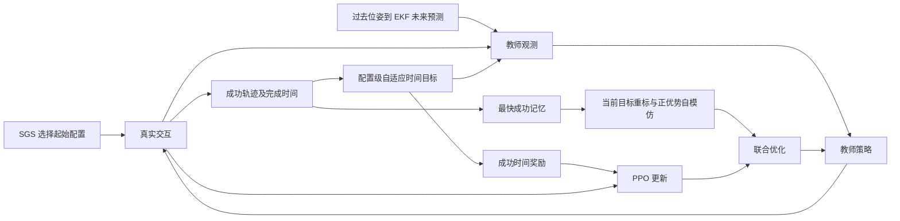

**TSIL 与现有 SGS+EKF 教师策略的完整适配方案**

本方案将 TSIL 的自适应时间条件、时间成功奖励、最快成功记忆、高回报补缺、正优势采样及联合自模仿全部接入现有 SGS+EKF 教师训练，从同一次训练开始运行。各配置由自身成功历史自动调整时间目标和回放内容，不安排分阶段实现，也不要求逐个开启模块再开展多轮测试。

依据为本地 [TSIL.pdf](papers/TSIL.pdf)，包括正文 §3–§5、附录 A、B.3–B.4、D；同时核对 `/home/hehui/TSIL` 的 `137e3ab` 版本。论文与公开代码不一致时，以论文的算法定义为主，并明确说明 DQ 任务必须保留的差异。本文给出完整方法设计；现已按此接入训练代码，运行方式与验证结果见 [实现说明](TSIL_SGS_EKF_implementation.md)。代码检查不构成学习效果的证明。

**TSIL 最重要的思想，是将同一次快速成功转化为两种互相配合的监督。**

论文第 3–5 页的逻辑不是“成功了就多模仿几次”。一条成功轨迹提供两类信息：它的完成时间说明这个配置已经被证明能够以多快的速度完成；它的状态—动作序列说明策略曾经怎样做到这一点。TSIL 同时利用这两类信息：

| 从成功中提取什么 | 如何进入训练 | 影响什么 |
|---|---|---|
| 完成时间 | 收紧该配置的目标时间；目标进入观测及成功奖励 | 后续新交互的 PPO 优势信号，使学习更偏向高效完成 |
| 实际行为序列 | 保存最快成功，按当前目标重标，通过效率加权的正优势自模仿重复利用 | 后续策略更新的方向，减少已经发现的成功行为被冲淡 |

只加时间奖励，仍可能在后续优化中忘掉实现这一时间的动作；只加普通高回报回放，又可能反复强化很慢、甚至没有完成任务的行为。TSIL 的设计是让“已经发现的完成效率”决定未来目标，同时保留实现这种效率的行为依据。

论文 §4.3 的分析支持这一解释。第 8–9 页图 6 显示，自适应时间目标使 PPO 的正优势质量更多集中在快速成功，而不是长时间失败或高稠密回报行为。图 7 则在局部参数平面中展示，联合更新更倾向于提高历史快速成功动作的似然。它们是学习信号和更新方向的经验证据，不是绝不遗忘或必然收敛的保证。第 9 页表 1 还说明，仅保存快速成功并不足以替代效率权重：移除效率权重后，该论文 Meta-World 汇总结果的成功率由 95.1% 降到 89.31%。这些数值属于原论文任务，不能直接外推到 DQ。

论文第 9 页也明确承认 TSIL 不直接解决初始探索：在尚未发现成功时，它没有可靠的成功时间可用于收紧目标。这正是 SGS 能补充的地方。

**SGS、EKF、TSIL 在你的任务中分别提供成功机会、运动信息和成功后的持续监督。**

SGS 利用配置的近期成功率，决定下一回合从哪个初态开始。`near_goal` 和 `pregrasp` 使共享策略有机会较早见到抓取、抬升和保持成功，`full_task` 则要求把这些能力与接近行为连接起来。SGS 调整的是在线交互分布，并不负责记住某次成功的动作序列。

EKF 根据过去的物体位姿提供未来运动估计，使策略能够学习动态目标的接近和抓取时机。它提供信息，但不会自动教会策略如何使用这些信息完成任务，也不会保留已经学会的成功行为。

TSIL 接收 SGS+EKF 策略自己产生的成功，把完成时间变成该配置的后续目标，把包含 EKF 条件的动作序列变成持续的辅助监督。这样，三者组合的研究假设是：SGS 帮助发现成功，EKF 帮助在运动目标上作出有效决策，TSIL 帮助将这些成功转化为更高效、较少遗忘的行为。



这也限定了合理预期：TSIL 不会使 EKF 预测更准确；SGS 不能保证所有配置可解；更快也不自动等于更平滑、更稳定。原有抓持成功要求、负惩罚和运动约束仍然决定什么行为值得接受。

**统一的学习对象是 SGS 中的具体配置，而不是并行环境槽或初态类别。**

当前入口为 [train_teacher_sgs_ekf.sh](../DQ_high-level/train_teacher_sgs_ekf.sh)。实际默认是 8192 个并行环境、v10 bank 中 6144 个配置，`full_task/pregrasp/near_goal` 各 2048；任务为平地 Level02 的 `sugar_box` 抓取。每个配置固定机器人／物体初态和台面运动参数，SGS 在每次 reset 重新抽取配置。

记配置为 \(c\)，第 \(i\) 次 PPO 更新前的 SGS 抽样分布为 \(q_i^{SGS}(c)\)。每个配置共同维护：

\[
\bigl(p_i(c),\ D_i(c),\ F_i(c),\ H_i(c)\bigr).
\]

其中 \(p_i(c)\) 是原 SGS 的近期成功率；\(D_i(c)\) 是 TSIL 的目标时间；\(F_i(c)\) 保存最快成功；\(H_i(c)\) 保存高回报候选，用于成功不足时补缺。它们共享配置身份，但更新依据不同。

TSIL 原论文在每个并行环境中固定一个配置，所以源码可以直接按 `env_id` 保存目标和轨迹。你的 SGS 会换配置，因此必须把这些持久信息绑定 `config_id`；`env_id` 只追踪正在执行的回合。同一个配置被多个环境同时执行时，所有真实回合结果都属于该配置。

SGS 继续使用原来的 100 回合窗口、目标成功率 0.5 等参数。成功标签仍是实际满足抓取并连续保持 10 步，不加入“是否赶在 D 前完成”的条件。回放不增加 SGS 访问次数、成功次数或新的时间纪录。配置 ID 不输入策略网络。

**教师同时观察 EKF 的未来位姿和 TSIL 的完成时间条件，但两者不是同一个时间量。**

设原有物理／抓取特征为 \(o_t\)，现有因果 EKF 输出为

\[
\xi_t^{EKF}=\left(\hat x_{t+0.60},\hat x_{t+0.90},v_t^{EKF}\right),
\]

其中每个预测姿态按当前代码编码成 6 维，valid 占 1 维，总计 13 维。Actor 和 Critic 接收：

\[
\tilde o_t=\left(o_t,\xi_t^{EKF},T_t^{used}/T_{ref},D_{episode}/T_{ref}\right).
\]

EKF 的 0.60/0.90 秒是从当前时刻向前预测的时域；TSIL 的 D 是从回合开始到完成任务的目标总用时。不能用 D 或 D−T 替换 EKF horizon。保留当前 history=5、Q scale=1、R scale=0.01 和 `no_velocity_obs`。

当前 [RollingSE3Predictor](../DQ_high-level/modules/pose_prediction.py) 使用真实时间戳，对最近 5 个世界位姿拟合并外推；其输入是仿真位姿，没有读取真实速度或未来状态。reset 后先清历史并放入新初态样本，valid=0；约再经过 4 个高层动作才有足够历史。无效时两个未来姿态重复当前姿态。TSIL 保留这些真实输入，不提前暖机、不把 near_goal 的 valid 人工置真。

回放保存动作采样当时策略实际收到的 EKF 预测、valid 和参考坐标表达。重标目标时间时，不重新运行 EKF，不用成功轨迹的后续真实位姿修正过去预测，也不用当前环境机器人姿态重新投影历史数据。这保证模仿的行为始终建立在当时因果可获得的信息上。valid 只表示历史和数值条件满足，不当作额外的准确度权重。

当前教师输入是 1284 维，加两个时间量后为 1286 维；Actor/Critic 结构及 9 维动作保持原设计。时间通道插在 EKF 后、grasp 候选前，保留末尾 grasp180＋action9 的含义。时间特征只按 T_ref 固定缩放，排除观测运行均值／方差归一化。

**目标时间严格由同配置的最快真实成功产生，保持论文的软目标和单调收紧规则。**

当前高层动作有 7/8 个低层控制周期，实际步长约为 0.14/0.16 秒。用实际仿真时间累计：

\[
T_{t+1}^{used}=T_t^{used}+\Delta t_t^{actual},\qquad T_0^{used}=0.
\]

当前参考上限取 \(T_{ref}=100\times0.16=16\) 秒，所有配置初始 \(D_1(c)=T_{ref}\)。16 秒是当前控制配置导出的参考量，实际回合仍在 100 个高层动作结束；γ 保持原 PPO 的逐决策折扣 0.99。

成功时间从 reset 计到完整 10 步 hold 成功，包括 EKF 冷启动、接近、抓取、抬升和保持。不能使用首次接触或首次抬升时间替代，也不能扣除保持时间。

按论文式 1：

\[
D_{i+1}(c)=\min\left(D_i(c),\min_{\tau\in\mathcal S_i(c)}T_\tau^{succ}\right).
\]

没有新成功时不变；同配置多条新成功取最小值。目标更新在本轮联合优化结束后提交，下一次 reset 领取。正在运行的回合固定使用 reset 时领取的 \(D_{episode}\)，不会因其他环境成功而中途变更。原 PPO rollout 的观测、奖励和 old log-prob 不被事后重写。

在 SGS 异步 reset 下，某个回合可能跨越多轮 PPO 更新并持有较早的目标。因此“本轮目标表固定”和“所有在途回合目标相同”不是一回事：在线数据保留各自 episode_D，回放统一使用本轮冻结的 \(D_i(c)\)。

保留历史最小值，不把原方法改成分位数目标、平均时间目标或手工逐类时间课程。环境的随机执行条件意味着最快时间未必次次可复现；论文的处理是让目标保持软性，而不是让慢成功失去资格。

**时间监督通过观测和成功奖励共同改变 PPO 学到的行为。**

当前 `pick_up` 基础奖励为 50。完整适配用论文式 2 替换该项：

\[
r_t=r_t^{task}+50\,\mathbf1_{\text{本步新发生完整成功}}
\left[1+\min\left(\frac{D_{episode}}{T_{t+1}^{used}},1\right)\right].
\]

\(r_t^{task}\) 不再包含旧 `pick_up` 项，避免重复计奖；接近、抬升、姿态和动作等任务奖励及负惩罚保留。超过 D 不额外终止、不把成功记成失败，也不增加一项手工每步时间惩罚。

例如，同一完整起点的当前目标为 6 秒，一条成功用了 8 秒，则其成功奖为 87.5，回放效率权重为 1.75；6 秒成功的对应量为 100 和 2。近目标配置即使已经发现 2 秒成功，也不能拿这 2 秒约束完整起点。

初始 D=T_ref 时，限时内成功均获得最大倍率；时间目标尚未收紧前，它并不区分快慢成功。这说明早期学习仍依赖 SGS 提供的成功机会、任务奖励和 fallback。随着具体配置出现更快成功，后续奖励才逐渐形成由经验产生的时间偏好。

论文的观点是时间条件与时间奖励改变后续 PPO 的正优势分配，不是简单宣称“增加奖励就会更快”。你的 approaching/lifting 已按新的距离／高度纪录给增量奖励，因此不能未经数据支持便断言现有策略存在严重刷分；此处保留其引导作用，让完成效率成为额外监督。

**每个配置同时保存最快成功和高回报候选，回放始终成功优先、空位补缺。**

按照论文附录 A.1–A.2 和第 18 页表 5，设 k=5：

\[
F_i(c)=\operatorname{TopK}_{T^{succ}\uparrow}
\{\tau:\tau\text{从 }c\text{开始且真实成功}\}.
\]

同时维护同配置按采集时起点折扣回报排名的 Top-5 候选 \(H_i(c)\)。实际用于本轮回放的轨迹集合是：

\[
B_i(c)=F_i(c)\;\cup
\operatorname{TopReturn}_{k-|F_i(c)|}\bigl(H_i(c)\setminus F_i(c)\bigr).
\]

同一条轨迹按唯一回合 ID 去重；不足 5 条就使用实际数量，不跨配置借轨迹补满。双榜联合存储最多约 2k 条，但每配置每轮被选中的轨迹最多 k 条。

这一规则意味着：某配置还没有成功时可利用高回报探索轨迹；已有两条成功时最多再补三条高回报轨迹；已有五条成功后，该配置回放全部来自最快成功。它是每个配置内部自动发生的选择，不需要人工分期训练。

高回报不等于成功，fallback 也不会获得成功标签或更新 D。它保留的是早期可能有用的部分行为，后续仍受正优势门控。随着成功充足，它自然让位给快速成功，这正是 TSIL 与永久依赖最高回报的 SIL 的区别。

论文未进一步规定 fallback 排名是否动态重算；本方案采用本地源码明确的排序量：采集时未归一化的起点折扣回报

\[
S(\tau)=\sum_{t=0}^{L-1}\gamma^t r_t^{collected}.
\]

它用于入库排名，不是平均奖励、普通无折扣总和或 Critic 估值。学习时的回报另按当前目标重建。成功不足 k 时，所有已有成功都在 F 中，所以去重后实际补入的通常是失败回合；不能因此把 H 的定义误写成只能存失败。

**历史轨迹必须按当前学习目标重标，保留完整的回报定义和终止语义。**

对入选轨迹 \(\tau\)，保留采样时的物理观测、EKF 输出、动作及已用时间，仅替换时间目标：

\[
\hat o_t^\tau=
\left(o_t^\tau,\xi_t^{EKF,\tau},T_t^{used,\tau}/T_{ref},D_i(c_\tau)/T_{ref}\right).
\]

成功轨迹末步的时间奖励按当前 D 重算；失败 fallback 不产生时间成功奖。这样，同一条历史行为是在“现在的时间要求”下重新评价，而不是继续携带发现它时更宽松的目标。

论文附录 A.1 式 10 的完整回报是：

\[
\hat G_t^\tau=
\sum_{j=t}^{L-1}\gamma^{j-t}\hat r_j^\tau
+\gamma^{L-t}(1-d_\tau)\operatorname{stopgrad}V(\hat o_L^\tau).
\]

原文中，真正成功或失败取 d=1；任务仍可继续、仅采集被截断时取 d=0，使用 reset 前最终观测的价值。不能使用下一回合初态，也不能让 bootstrap 目标参与梯度。

**DQ 这里保留原来的 100 步有限任务预算。** 成功、物理失败、100 步内未完成，都结束本次任务，PPO 与 replay 统一取零终态尾值。因此 archive 中完整成功和高回报失败都使用完整回合 Monte Carlo 回报。24 步 PPO rollout 边界只是采集分块：未结束回合的 GAE 正常 bootstrap，轨迹录制继续，不能把每个 24 步块当作完整 fallback。行政中断不伪装成失败轨迹入库。

这是现有 DQ 有限任务与论文无限时域／外部采集截断之间的明确适配。不能只给 replay 开启超时 bootstrap，让它追求 PPO Critic 没有学习的“第 100 步以后的继续价值”。本地 TSIL 的 ATTL 主配置事实上也设置 `value_bootstrap:false`，但此处的主要依据是保持 DQ 任务目标与两种价值监督一致。

还有一项 DQ 特有差异：论文假定 task reward 不变，而当前 `command_reward` 在训练一半后才启用。为让旧行为按当前奖励阶段评价，本方案保存其门控前分量，使用：

\[
\hat r_t=r_{fixed,t}+g_i r_{command,raw,t}
+50\,\mathbf1_{t=L-1}\mathbf1_{success}
\left[1+\min(D_i(c)/T_\tau,1)\right].
\]

\(r_{fixed}\) 排除成功项和 command 项，\(g_i\) 是当前训练奖励开关。approaching/lifting 等历史增量直接使用采集记录，不能重新调用会修改环境历史的奖励函数。该 command 重标是适应 DQ 奖励课程的额外设计，不冒充 TSIL 原论文的任务奖励不变假设。fallback 入库分数仍按采集时固定，学习回报则按当前版本重建。

**回放按照论文遍历全部配置，保留正优势筛选和一次更新固定集合。**

在每次 PPO update 开始优化前，对全部有记忆的配置及其 \(B_i(c)\) 做重标和价值评估。设当时的 Critic 快照为 \(\psi_i\)，正优势为：

\[
A_{t,screen}^+(\tau)=\left[\mathcal N_V(\hat G_t^{(s),\tau})-V_{norm,\psi_i}(\mathcal N_o(\hat o_t^\tau))\right]_+.
\]

其中 \(\hat G^{(s)}\) 使用下文规定的本轮奖励尺度，\(\mathcal N_o,\mathcal N_V\) 是本轮只读的观测／价值变换。筛选和实际训练使用相同的 gap 定义，不能筛选时比较原始回报、训练时却比较经过缩放与裁剪的价值。

对每条轨迹，仅在正优势 transition 中按

\[
P(t\mid\tau)=\frac{A_{t,screen}^+}{\sum_{j:A_{j,screen}^+>0}A_{j,screen}^+}
\]

不放回抽最多 n=32 条。全部非正就不选。抽样概率使用 gap，不把效率权重 w 再乘进抽样概率。

所有配置的入选 transition 合成 \(\mathcal R_i\)，本轮只构建一次，在现有 E=5 个 PPO epoch 中复用；可以 shuffle 分批，但不重新抽取候选轨迹或构造另一套集合。样本身份固定，实际优化时使用当前 Critic 重新计算正优势，已经不再优于当前价值的样本贡献零，不需要补样。

当前配置数为 6144，因此：

\[
|\mathcal R_i|\le6144\times5\times32=983040.
\]

这里是配置数，不是 8192 个并行环境数。不设置 384 条候选预算，不设置每 family 128 条配额，也不只回放成功。每配置相同的 k 和每轨迹相同的 n 已限制容易配置占据全部记忆；最终样本数仍会因成功数量、长度和正优势数量而不同。

SGS 决定在线交互分布，TSIL 使用独立的配置记忆分布。回放不再按 SGS 概率二次筛选，也不额外乘 \(1/q_i^{SGS}(c)\) 做重要性修正。正优势优先采样与正优势损失加权都按原文保留，不擅自抵消其中一次。

983040 是上限，约为当前单次新 rollout 的五倍，完整方案确实可能增加计算量。显存不足时可以流式评估和微批累加，但应保持相同逻辑样本集合、逻辑 batch 均值和 optimizer 更新次数，不能以改变采样算法来冒充等价实现。

**辅助损失同时保留正优势门控、效率权重和论文规定的归一化。**

对当前参数下的回放正优势 \(A_t^+\)，轨迹效率权重为：

\[
w_i(\tau)=1+\mathbf1_{success(\tau)}\min(D_i(c_\tau)/T_\tau,1).
\]

失败 fallback 的 w=1；成功的 w 在 1 到 2 之间。它与最快成功排序、时间奖励的作用不同：排序决定保留谁，奖励改变轨迹价值，w 直接影响模仿动作的梯度强度。

Actor 原始权重及实际使用的权重为：

\[
u_t=w_i(\tau)\operatorname{stopgrad}(A_t^+),\qquad
\bar u_t=\min\left(\frac{u_t}{\operatorname{Std}\{u_j:u_j>0\}+\epsilon},1\right).
\]

只对当前逻辑 replay minibatch 的正权重计算总体标准差，不减均值，最后截到 1。没有正项时损失为零；只有一个正项时用 epsilon 处理，不能产生 NaN。固定的是 replay 样本身份，不是冻结的权重。

联合目标为：

\[
L=L_{PPO}+\lambda_{SI}\left(
-\mathbb E_{\mathcal R_i}[\bar u_t\log\pi_\theta(a_t|\hat o_t)]
+\frac{\lambda_{V,SI}}2\mathbb E_{\mathcal R_i}[(A_t^+)^2]
\right),
\]

\[
\lambda_{SI}=0.05,\qquad\lambda_{V,SI}=0.05.
\]

效率权重、正权重标准差及 cap 只用于 Actor；Critic 不乘 w，也不把自身正 gap 截到 1。Actor 权重 detach，Critic 保留 \([\hat G-V]_+^2/2\) 对 V 的梯度。这是向较好历史回报的辅助回归，不是历史轨迹上的一步 Bellman 更新。

PPO loss 仍只使用新鲜在线 rollout、原 old log-prob、GAE 和 clipped ratio。历史数据不混入 PPO memory 或 ratio。两种损失在同一 optimizer step 联合更新，保留现有梯度裁剪和 PPO 主超参数。在线价值损失使用下文明确的输出坐标补偿和作者 PPO 值裁剪形式；不能保留会因 RMS 更新产生零梯度的旧硬裁剪 MSE 写法。它不是先 PPO 训练完再单独行为克隆。

逻辑上，每个 epoch 都遍历本轮完整 \(\mathcal R_i\)，与现有 6 个 PPO minibatch 对齐。若 replay 逻辑 batch 被拆成多个微批，按实际样本数加权累加 loss；上述权重标准差也以整个逻辑 batch 为范围，不能因拆批而改变有效 λ 或权重。

**数值尺度必须使 PPO、回放回报和 Critic 在同一价值空间中比较。**

论文附录 A.2 第 14–15 页规定四件不同的事：物理观测运行标准化；时间固定尺度；奖励除以折扣 trace 的运行标准差且不减均值；必要时 value 再作统一归一化。不能把这些合并成一句“已有 scaler，所以不需要处理”。本完整方案补上奖励 trace，并保留时间与物理特征的不同处理。

对每个环境 e 单独维护原奖励 trace：

\[
z_{e,t}=\gamma z_{e,t-1}+r_{e,t}^{raw}.
\]

包含终端奖励的 trace 先进入 running statistics，再将已结束环境的 trace 清零。当前糖盒抓取是一个任务，三类 SGS 初态不是三个任务；8192 个环境各有独立 trace，汇总得到同一个任务奖励尺度。

为使一次联合更新的单位明确，本方案在每轮 rollout 开始冻结 \(s_i=\max(\operatorname{Std}(z),\epsilon)\)，初始未有统计时取 1。该轮在线奖励和重标 replay 奖励都除以同一 s_i，不中心化；在线原始 trace 继续更新，新的奖励尺度下一轮生效。Replay 不更新 trace 或任何运行统计。这是论文未限定统计更新频率处的数值时序适配。

GAE 使用 \(r_t^{raw}/s_i\) 和同尺度的价值。回放也先计算缩放后的 \(\hat G_t^{(s)}\)，再映射到当前 value RMS 空间：

\[
A_t^+=\left[\mathcal N_V(\hat G_t^{(s)})-V_{norm}(\mathcal N_o(\hat o_t))\right]_+.
\]

本轮先用在线 rollout 得到 GAE returns，只用这些 returns 更新一次 value RMS；cached old values 仅转换，不参与统计更新。cached old values、PPO returns 和 replay returns 必须用同一个最终 value RMS 快照转换，联合优化中该快照固定。

但仅转换缓存与目标还不够：当前 Critic 输出也必须随 RMS 换坐标，否则尚未更新任何网络参数就可能触发 PPO 的值裁剪。实现使用 `ValueScaler` 保存非训练仿射缓冲 a、b，令网络原始输出为 \(f_\psi\)，归一化预测和实际奖励尺度内的预测为：

\[
v=a f_\psi(\mathcal N_o(o))+b,\qquad V=\sigma v+\mu,
\qquad a_0=1,\ b_0=0.
\]

本轮 returns 将 RMS 从 \((\mu,\sigma)\) 更新到 \((\mu',\sigma')\) 时，原子地补偿：

\[
a'=a\frac{\sigma}{\sigma'},\qquad
b'=\frac{\sigma b+\mu-\mu'}{\sigma'}.
\]

因此 \(\sigma'(a'f_\psi+b')+\mu'=\sigma(af_\psi+b)+\mu\)：统计更新本身保持 V 不变，首次 optimizer step 前的当前 v 与转换后的 cached old value 一致。a、b 不参与优化，网络参数、Adam 一阶／二阶矩保持原样；两缓冲随 checkpoint 保存。这是为当前 DQ 数值时序增加的仿射坐标适配，不是 TSIL 论文必须额外提出的机制。

价值正／逆变换使用相同的 \(\sigma=\max(\sqrt{\operatorname{variance}},\epsilon_V)\)，不做 ±5 裁剪，以保持可逆性；观测标准化仍保留原来的裁剪。令在线归一化 return 为 y，\(v_{old}\) 为缓存值在当前 RMS 下的坐标，保持真实配置的 \(\delta=0.2\) 值裁剪：

\[
v_{clip}=v_{old}+\operatorname{clip}(v-v_{old},-\delta,\delta),\qquad
L_{V,PPO}=c_V\mathbb E\max\{(v-y)^2,(v_{clip}-y)^2\}.
\]

这里采用作者 `algo/utils.py::compute_value_loss` 的 max 规则，外层 \(c_V\) 沿用 DQ 的 `value_loss_scale=1`，不额外引入作者默认 1/2 系数。它既限制超过裁剪范围的改进，也保留偏离目标时未裁剪误差的惩罚。修复不通过关闭 `clip_predicted_values` 绕过问题；SI Critic 仍使用自身的单侧平方损失，不套 PPO 值裁剪。

物理观测 RMS 在本轮采集及对应的全部 PPO epoch 使用同一快照，新的在线统计累积供下一轮生效；回放使用相同快照且不更新统计。这样不会在一次更新内部仅因切换预处理便改变策略概率。所有旧 log-prob 仍保留采集值，不能用新预处理重新生成“旧策略概率”。这些冻结规则是把论文的统一尺度落实到当前训练链路的时序选择。PPO advantage 在当前单任务在线 batch 内标准化，replay 正权重采用前述不减均值的另一套规则。

跨轮奖励尺度由 s_i 变为 s_{i+1} 时，以 \(q=s_i/s_{i+1}\) 将 value RMS 的 mean 乘 q、variance 乘 q²、标准差下限 \(\epsilon_V\) 乘 q，count 不变，输出适配 a、b 不变。这是奖励单位换算，不是新增 returns 的统计更新：归一化 v 保持原值，反归一化 V 乘 q；随单位变换下限可保证极小方差时仍有 \(\sigma_{new}=q\sigma_{old}\)。不额外增加价值网络。缓存仍保存原始奖励分量，不能复用旧的 normalized return。

当前 skrl 的 scaler 默认在 `no_grad` 中执行，因此 Actor／Critic 损失使用单独可微的 `normalize_prediction(f_psi)`，与只读 scaler 转换的目标比较；不能先把网络 V 经默认 inverse scaler 再计算损失而切断梯度。采集缓存、下一状态 bootstrap、正 gap 预筛、逻辑权重标准差和两种 Critic 损失都通过同一个 `_predict_values` 入口使用 a、b，避免部分路径漏掉补偿。时间通道保持固定缩放，EKF 原有观测通道仍按物理观测规则处理。

奖励 trace、归一化快照和上述 PPO 价值数值修复都是当前完整适配的明确组成部分。与原 SGS+EKF 结果比较时，不能把全部变化都归因于 TSIL 的记忆和时间目标；研究其单独贡献时应使用一致的数值处理对照，或报告这些差异。

**整个训练过程是一个同时包含所有机制的算法。**

```text
初始化教师 Actor/Critic、原 SGS、原 EKF；所有配置 D=T_ref。
初始化每配置最快成功池 F 与高回报池 H，逐环境完整回合记录与 reward trace。

每次 PPO iteration i：
    固定本轮目标表 D_i、奖励尺度 s_i 和物理观测标准化快照。
    采集原来的 24 个高层交互步：
        reset 时按 SGS 抽 config，领取 episode_D，清时间并重置该环境 EKF。
        策略使用原特征 + 当时 EKF + elapsed/episode_D。
        按真实 dt 累计时间，用真实 hold 判据产生结果与时间成功奖励。
        在线回合结束：按旧 config 更新结果，完整轨迹进入 F/H 候选；收集成功时间。
        未结束回合跨 rollout 继续记录。
    用在线数据计算 PPO 的 GAE/returns，只用 returns 更新一次 value RMS，
        同时补偿 Critic 输出 a、b；转换缓存旧预测和 targets，随后冻结这些变换。
    每配置选最快成功优先、同配置高回报补缺的最多 5 条轨迹。
    用 D_i、当前奖励版本及 s_i 重标，按每轨迹正 gap 抽最多 32 条。
    固定本轮 replay set，在 5 个 epoch 中与 PPO 联合优化。
    优化完成后，按本轮成功的最小时间提交 D_{i+1}。
    更新下一轮数值尺度；在途回合的 episode_D 不改变。
```

当前 DQ 的真实顺序是 `env.step → record_transition → PPO update（若到边界）→ env.reset`，所以必须在 reset 前把结果和完整轨迹归给旧配置。SGS 已在自然 reset 处理真实结果，TSIL 不另重复提交。实现中模型、目标表、归一化统计与 EKF 参数需要随同一 checkpoint 保存；否则测试时的策略条件与模型不配套。

**未见初态通过训练配置推断目标，评估时不再学习时间目标。**

论文附录 A.2 对新配置取同任务最多 5 个成功训练配置的目标均值。你的严格评估从原始 2 m 起点开始，不使用 SGS bank reset，因此只在训练 `full_task` 成功配置中找邻居：

\[
D_{eval}(c')=\frac1{|\mathcal N_5(c')|}\sum_{c\in\mathcal N_5(c')}D_{train}(c).
\]

若没有成功参考，使用 T_ref。近邻描述符采用 schema `dq_full_task_planar_v2`，仅包含当前 `full_task` bank 实际变化且 reset 时稳定可观测的 5 维任务几何：

\[
g(c)=\bigl(\Delta x_{base\ yaw},\ \Delta y_{base\ yaw},\ h_x,\ h_y,\ H_{table}\bigr).
\]

其中相对位置以机器人 base 的 yaw 为参考；\((h_x,h_y)\) 是物体局部 x 轴在同一水平坐标平面的单位投影，不直接用可能发生 ±π 跳变的 Euler yaw。bank 和严格 reset 用同一函数构造。机器人落地高度、身体倾斜和腿／臂关节初始瞬态不是本 bank 的任务随机化参数，不再加入距离和支持域条件；否则已经稳定的 bank 与刚 reset 的评估初态会系统性失配。这里不改变严格 reset 的起点、不增加稳定等待，也不按评估样本放宽阈值。

描述符距离按全部训练 `full_task` 配置的各维范围缩放，而邻居候选只取其中已有成功的配置。范围大于 `1e-4` 的维度按训练范围加 5% 边缘检查支持域；近恒定维不参与距离，保留 `1e-4` 原单位容差检查。无成功参考、超支持域或无效几何分别回退 T_ref；若物体局部 x 轴水平投影长度不超过 `1e-6`，朝向无定义，判为无效查询。该 schema 适用于当前 sugar_box 的水平局部 x 轴，不宣称已覆盖任意物体姿态。训练描述符和 checkpoint 描述符必须有限，查询的回退不掩盖损坏的训练参考。

评估分别统计 `nearest`、`no_success`、`out_of_support`、`invalid` 的实际次数，不以固定的 `successful_full_task_5nn` 算法名称证明命中。归一化尺度、支持域和容差来自训练配置及明确规则；查询只读，不更新目标表。

原 Meta-World 论文可直接使用配置随机向量。DQ 保留 `no_velocity_obs`，且 reset 时 EKF 尚未有效，因此这里不额外读取隐藏的真实运动速度，也不依赖 reset 时的无效未来预测。这是新任务上的描述符适配，可能使几何相似但运动条件不同的配置难以区分，不能声称已经精确推断了最短可行时间。

目标在测试回合开始确定后保持不变；EKF 正常随真实交互更新，D 表、SGS 历史、archive 和归一化统计均不更新。普通 reset 恢复初态后即可查询，不需要给测试初态分配训练 config ID，也不依赖再次加载训练 bank 对象。测试完成时间仍包含全部 10 步保持。

新 checkpoint 的 metadata 和 temporal state 使用 version 2，声明 `affine_output_v2` 价值变换、`dq_full_task_planar_v2` 描述符 schema，保存 a、b、\(\epsilon_V\) 及完整目标／成功标记／几何尺度。新状态缺失或 schema 不一致时明确拒绝加载。

旧 SGS+EKF checkpoint 仍可走原评估路径。旧 TSIL v1 checkpoint 只允许显式的 Actor 评估兼容：保留 Actor 与观测变换，从原始无列名 32 维描述符确定性提取相对平面位置、物体水平朝向和桌高，先验证旧尺度完整性，再按新 schema 重算训练范围；不凭测试数据拟合。旧 Critic 带有不可由新仿射缓冲恢复的裁剪语义，故兼容加载发出说明、禁止 Critic 使用和训练加载；迁移来源随再次保存保留，二次加载也不解除此限制。这不修复旧模型此前的学习偏差。新旧 checkpoint 都不代表已经实现 archive／SGS／仿真状态完整断点续训。

最终结果首先看独立完整任务成功率，再看成功用时以及论文的失败惩罚时间指标：

\[
C=\frac1N\sum_e\left[s_e\frac{T_e}{T_{ref}}+(1-s_e)\right].
\]

这样不会因为只完成少数容易样本就被误判为“更快”。沿用当前 DQ 严格评估的确定性动作；原论文 Meta-World 评估是从 Gaussian policy 采样，两者协议不同，不直接横向比较论文表中数值。完整适配可以在一次训练后直接评估最终配套 checkpoint，无须以分阶段消融作为使用前提。

**论文的学习信号分析可以成为同一次训练的解释指标。**

除成功率和用时外，按附录 D.1 记录每条完成轨迹实际用于 PPO 的正优势质量 \(m_\tau=\sum_t[\hat A_t^{PPO}]_+\)。例如：

\[
F_{success}=\frac{\sum_\tau m_\tau s_\tau}{\sum_\tau m_\tau},\qquad
F_{fast}=\frac{\sum_\tau m_\tau s_\tau(1-T_\tau/T_{ref})}{\sum_\tau m_\tau}.
\]

它们回答的是“PPO 正在强化哪些行为”，不能与 replay 的正 gap 混为一谈。结合固定历史成功行为的动作似然，可以观察后续更新是否持续保留其行为支持。这些量在三类 SGS 起点中分别统计，避免把起点更容易误当作策略效率提高；它们不改变回放采样分布，也不要求另外训练一组模型。

**完整方法的参数和适配边界如下。**

| 内容 | 最终选择 | 依据 |
|---|---|---|
| 在线起点 | 原 SGS 规则与 v10 bank | 保留现有成功探索机制 |
| 预测信息 | 原 EKF 0.60/0.90 s、history=5、Q=1、R=0.01 | 保留现有因果运动观测 |
| 时间目标 | 每 config 历史最小成功秒数，初始 T_ref=16 s | 论文式 1；变步长按 DQ 实际时间累计 |
| 成功奖励 | 50×success×[1+min(D/T,1)]，替换原 pick_up | 论文式 2；基础系数保持 DQ 的 50 |
| 成功标准 | 原真实几何／抓持条件＋10 步 hold | 不为追求速度降低任务要求 |
| 记忆 | 每 config 最快成功 Top-5＋高回报候选补缺 | 论文附录 A；不是 success-only 或固定 50/50 |
| 样本选择 | 所有配置，每轨迹按正 gap 无放回最多 32；一轮固定集合 | 论文 §3.4、附录 A.2、表 5 |
| 辅助系数 | λSI=0.05，λV,SI=0.05 | 论文表 5 |
| 奖励／价值尺度 | 逐 env trace、单任务尺度、同轮统一价值空间；RMS 更新同步补偿 Critic 输出 | 论文归一化；按 DQ 明确快照与可逆坐标变换 |
| 回合尾值 | 完整 100 步有限任务终止为零；24 步采集边界可 bootstrap | 保持现有 DQ 任务含义，明确区别原文外部截断 |
| 任务奖励课程 | 保留现有课程，历史 command 分量按当前开关重建 | DQ 的非平稳奖励适配，不属于原文默认假设 |
| 网络与 PPO | 原网络、动作及 PPO 主超参数；增加时间条件与非训练价值适配，值损失使用 max 裁剪规则 | 保持数值坐标一致，采用作者值裁剪形式 |
| 新配置目标 | full_task 成功配置 5-NN；5 维稳定几何；无参考／超覆盖／无效时回退 T_ref | 论文评估思路，匹配 DQ bank 与严格 reset 的任务坐标 |

必要的代码接入集中在已有观测／奖励构造、配置级记忆和 PPO 联合目标，不需要另建一套训练框架：[教师入口](../DQ_high-level/train_multistate_DQ_teacher.py) 负责完整模式及配套状态，[环境](../DQ_high-level/envs/b1z1_pickmulti.py) 负责回合条件和真实结果，[TSILPPO](../DQ_high-level/utils/tsil_ppo.py) 在原 skrl PPO 基础上接入重标、归一化与辅助损失，[严格评估](../DQ_high-level/eval_sgs_teacher.py) 读取冻结目标。新增时间特征时应保持现有 grasp/action 切片含义；以后加载该教师作学生蒸馏，也必须继承时间条件和相应预处理，不能将它当作原 1284 维教师直接加载。

**论文与本地源码的差异只作为实现取舍依据，不替代论文算法。**

| 核对点 | 本地代码行为 | 本方案采用的定义 |
|---|---|---|
| 轨迹主键 | `memory.py` 按 env 存储 | SGS config 主键 |
| fallback | helper 支持成功优先补缺；主 YAML 却设置成功池占比 0.5 | 论文的同配置成功优先补缺 |
| 采样 | 主路径抽整轨迹、每 minibatch 重抽；无论文式正 gap 预筛 | 全配置、每轨迹≤32、每 update 固定集合 |
| 时间提交 | 优化后提交，下次 reset 生效；replay context 使用各 env 活跃目标 | 显式目标表快照＋固定回合目标 |
| reward trace | 本地 normalizer 按 task 存 trace，不等于论文逐 env trace | 逐 env 维护、按任务汇总尺度 |
| 总奖励处理 | replay 中有非负裁剪 | 保留 DQ 的负奖励 |
| timeout | ATTL 主 YAML 关闭 bootstrap | 按 DQ 有限任务统一 PPO/replay 尾值，不混用 |
| 新配置评估 | 标准 evaluator 未接通完整训练目标表 5-NN | 配套保存并实现论文式只读目标推断 |

可核对源码：[memory.py](/home/hehui/TSIL/core/training/algo/tsil/memory.py)、[sampling.py](/home/hehui/TSIL/core/training/algo/tsil/sampling.py)、[loss.py](/home/hehui/TSIL/core/training/algo/tsil/loss.py)、[updater.py](/home/hehui/TSIL/core/training/algo/updater.py)、[trainer.py](/home/hehui/TSIL/core/training/trainer.py)、[normalizer](/home/hehui/TSIL/core/agents/utils.py)、[TSIL 配置](/home/hehui/TSIL/exec/TSIL/train/conf/method/sil/tsil.yaml)、[ATTL 配置](/home/hehui/TSIL/exec/TSIL/train/conf/method/temporal/attl.yaml)。

这份方案中，时间条件、完整成功／fallback 记忆、全配置正优势采样、效率加权、统一归一化和未见配置目标推断都是同一个完整方法的组成部分，不留作以后再决定是否接入的模块。其效果需要由实际完整任务表现判断，不能由机制上的互补性直接推定。
